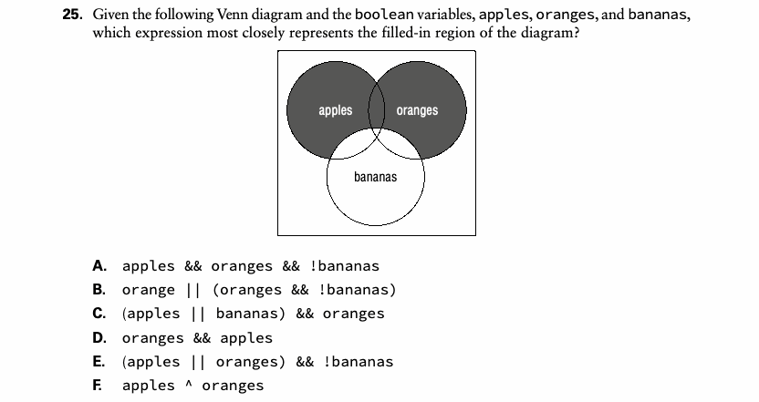
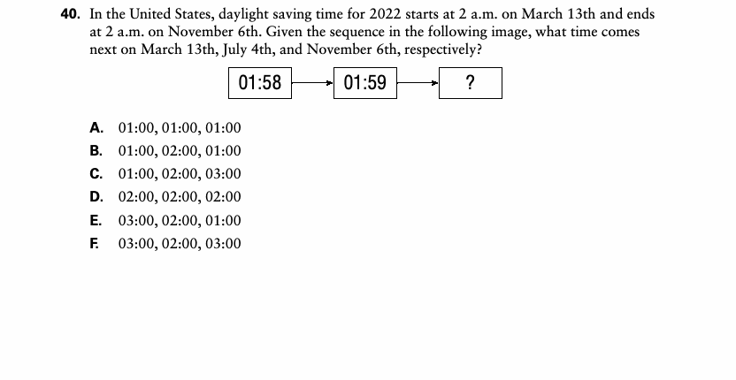

# Chapter 1: Handling Date, Time, Text, Numeric and Boolean Values

> Source: *OCP Oracle Certified Professional Java SE 17 Developer Practice Tests (Exam 1Z0-829)*. Extracted from your PDF for personal study. Questions with figures/tables include a scan of the original page.

## 829-01-001

How many of the `Duration`, `LocalDateTime`, and `LocalTime` classes have the concept of a time zone?

- **A.** None
- **B.** One
- **C.** Two
- **D.** Three

**Answer:** A

**Explanation:** The `Duration` class is used to reflect an amount of time using small units like minutes. Since it just uses units of time it does not involve time zones. The `LocalTime` class contains units of hours, minutes, seconds, and fractional seconds. The `LocalDateTime` class contains all the data in a `LocalTime` and adds on a year, month, and date. Since none of the three classes listed includes a time zone, option A is correct.

## 829-01-002

How many lines does this print?

```java
System.out.print("""
   "ape"
   "baboon"
   "gorilla"
   """);
```

- **A.** Three
- **B.** Four
- **C.** Five
- **D.** The code does not compile.

**Answer:** B

**Explanation:** This is a valid text block. Since the closing triple quotes (`"""`) are on a new line, the code prints the three lines of text followed by a blank line and option B is the answer.

## 829-01-003

Which of the following are not valid variable names? (Choose two.)

- **A.** \_
- **B.** `_blue`
- **C.** `2blue`
- **D.** `blue$`
- **E.** `Blue`

**Answer:** A, C

**Explanation:** An identifier name must begin with a letter, currency symbol (such as `$`), or underscore (`_`). Numbers are permitted only for subsequent characters. Therefore, option C is not a valid variable name. Additionally, an identifier may not be a single underscore, making option A an invalid variable name.

## 829-01-004

Which class has a `getSeconds()` method?

- **A.** Only the `Duration` class
- **B.** Only the `Period` class
- **C.** Both the `Duration` and `Period` classes
- **D.** Neither class

**Answer:** A

**Explanation:** A `Period` is measured in days, weeks, months, or years. A `Duration` is measured in smaller units like minutes or seconds. Only `Duration` has a `getSeconds()` method, making option A correct.

## 829-01-005

Most of the United States observes daylight saving time on March 13, 2022, by moving the clocks forward an hour at 2 a.m. What does the following code output?

```java
var localDate = LocalDate.of(2022, 3, 13);
var localTime = LocalTime.of(1, 0);
var zone = ZoneId.of("America/New_York");
var z = ZonedDateTime.of(localDate, localTime, zone);
var offset = z.getOffset();
var duration = Duration.ofHours(3);
 var later = z.plus(duration);
 System.out.println(later.getHour() + " "
    + offset.equals(later.getOffset()));
```

- **A.** `4 false`
- **B.** `4 true`
- **C.** `5 false`
- **D.** `5 true`
- **E.** `6 false`
- **F.** `6 true`
- **G.** None of the above

**Answer:** C

**Explanation:** On a normal night, adding three hours to 1 a.m. makes it 4 a.m. However, this date begins daylight saving time. This means we add an extra hour to skip the 2 a.m. hour. This makes `later` contain 05:00 instead of 04:00 and the offset changes. Therefore, the code prints `5 false`, and option C is correct.

## 829-01-006

What is the value of `tip` after executing the following code snippet?

```java
int meal = 5;
int tip = 2;
var total = meal + (meal>6 ? tip++ : tip--);
```

- **A.** `1`
- **B.** `2`
- **C.** `3`
- **D.** `7`
- **E.** None of the above

**Answer:** A

**Explanation:** In a ternary expression, only one of the two right-most expressions is evaluated. Since `meal>6` is `false`, `tip--` is evaluated, and `tip++` is skipped. The result is that `tip` is changed from `2` to `1`, making option A the correct answer. The value of `total` is `7`, since the post-decrement operator was used on `tip`, although you did not need to know this to solve the question.

## 829-01-007

What does the following output?

```java
int year = 1874;
int month = Month.MARCH;
int day = 24;
LocalDate date = LocalDate.of(year, month, day);
System.out.println(date.isBefore(LocalDate.now()));
```

- **A.** `false`
- **B.** `true`
- **C.** The code does not compile.
- **D.** The code compiles but throws an exception at runtime.

**Answer:** C

**Explanation:** `LocalDate` allows passing the month as an `int` or `Month enum` parameter. However, `Month.MARCH` is an `enum`. It cannot be assigned to an `int` variable, so the declaration of `month` does not compile, and option C is correct.

## 829-01-008

What is the output of the following?

```java
12: var b = "12";
13: b += "3";
14: b.reverse();
15: System.out.println(b.toString());
```

- **A.** `12`
- **B.** `21`
- **C.** `123`
- **D.** `321`
- **E.** The code does not compile.

**Answer:** E

**Explanation:** Trick question. There is no reverse method on the `String` class. There is one on the `StringBuilder` class. Therefore, the code does not compile, and option E is correct.

## 829-01-009

What is the output of the following?

```java
5: var line = new StringBuilder("-");
6: var anotherLine = line.append("-");
7: System.out.print(line == anotherLine);
8: System.out.print(" ");
9: System.out.print(line.length());
```

- **A.** `false 1`
- **B.** `false 2`
- **C.** `true 1`
- **D.** `true 2`
- **E.** It does not compile.

**Answer:** D

**Explanation:** A `StringBuilder` is mutable, so the length is 2 after line 6 completes. The `StringBuilder` methods return a reference to the same object, so you can chain method calls. Therefore, `line` and `anotherLine` refer to the same object. This means that line 7 prints `true`. Then on line 9, both references point to the same object of length 2, and option D is correct.

## 829-01-010

Given that daylight saving time starts on March 13, 2022, at 2 a.m. and clocks jump from 1:59 a.m. to 03:00 a.m., which of the following can fill in the blank so the code doesn’t throw an exception?

```java
var localDate = LocalDate.of(2022, 3, 13);
var localTime = LocalTime.of( __________ );
var zone = ZoneId.of("America/New_York");
var z = ZonedDateTime.of(localDate, localTime, zone);
```

- **A.** `2, 0`
- **B.** `3, 0`
- **C.** Either of the above will run without throwing an exception.
- **D.** Both of these will cause an exception to be thrown.

**Answer:** C

**Explanation:** While there is no 2 a.m. on the clock that night, Java adjusts the time to 3 a.m. automatically and changes the time zone. It does not throw an exception, so option D is incorrect. Option B is a valid time, since any value after the time adjustment is just a normal time on the clock. Since both options A and B are valid times, option C is the correct answer.

## 829-01-011

Which statement is true of this text block?

```java
var block = """
   green
    yellow
""";
```

- **A.** There is only essential whitespace.
- **B.** There is only incidental whitespace.
- **C.** There is both essential and incidental whitespace.
- **D.** The code does not compile.

**Answer:** A

**Explanation:** Since the closing triple quotes (`"""`) are at the beginning of the line, there is no incidental whitespace. By contrast, there is essential whitespace before both `green` and `yellow`, making option A correct.

## 829-01-012

What are the return types of `cat`, `moose`, and `penguin`, respectively?

```java
var cat = Math.ceil(65);
var moose = Math.max(7,8);
var penguin = Math.pow(2, 3);
```

- **A.** `double`, `double`, `double`
- **B.** `double`, `int`, `double`
- **C.** `double`, `int`, `int`
- **D.** `int`, `double`, `double`
- **E.** `int`, `int`, `double`
- **F.** `int`, `int`, `int`

**Answer:** B

**Explanation:** This code is tricky because only `int` values are passed in. However, the parameters passed to `ceil()` and `pow()` are implicitly cast to `double` since those two methods take `double` parameters and return a `double` result. The `max()` method returns an `int`, giving us option B.

## 829-01-013

What is the result of the following?

```java
11: var waffleDay = LocalDate.of(2022, Month.MARCH, 25);
12: var period = Period.of(1, 6, 3);
13: var later = waffleDay.plus(period);
14: later.plusDays(1);
15: var thisOne = LocalDate.of(2023, Month.SEPTEMBER, 28);
16: var thatOne = LocalDate.of(2023, Month.SEPTEMBER, 29);
17: System.out.println(later.isBefore(thisOne) + " "
18:    + later.isBefore(thatOne));
```

- **A.** `false false`
- **B.** `false true`
- **C.** `true true`
- **D.** `true false`
- **E.** The code does not compile.

**Answer:** B

**Explanation:** Line 12 creates a `Period` representing a year, six months, and three days. Adding this to `waffleDay` gives us the year 2023, the month of September, and a day of 28. This new date is stored in `later` on line 13 and represents September 28, 2023. Line 14 has no effect, as the return value is ignored. Line 17 checks that you know that `isBefore()` returns `false` if the value is an exact match. Since `thisOne` is an exact match but `thatOne` is a whole day before, the output is `false true`, making option B correct.

## 829-01-014

Which operators work with one or more `boolean` types? (Choose three.)

- **A.** `^`
- **B.** `~`
- **C.** `&`
- **D.** `+`
- **E.** `||`
- **F.** `@`

**Answer:** A, C, E

**Explanation:** Options A, C, and E are correct because they all operate on `boolean` values. Options B and D operate on numbers. Option F is not an operator, although it is used to indicate an annotation.

## 829-01-015

What is a possible result of the following?

```java
 var montyPythonDay = LocalDate.of(2023, Month.MAY, 10);
 var aprilFools = LocalDate.of(2023, ___ Month.APRIL, 1);
 var duration = Duration.ofDays(1);
var result = montyPythonDay.minus(duration);
System.out.println(result + " " + aprilFools.isBefore(result));
```

- **A.** `2023-05-09 false`
- **B.** `2023-05-09 true`
- **C.** The code does not compile.
- **D.** None of the above.

**Answer:** D

**Explanation:** `Duration` is supposed to be used with objects that contain times. While it has an `ofDays()` method, this is a convenience method to represent a large number of seconds. This means that calling `Duration.ofDays(1)` is fine. However, this code throws an `UnsupportedTemporalTypeException` when you try to pass it to the `minus()` method on `LocalDate`, making option D correct. Note that the question asks about a possible result rather than the definitive result because the format of dates varies by region.

## 829-01-016

What is the output of the following?

```java
5: var line = new String("-");
6: var anotherLine = line.concat("-");
7: System.out.print(line == anotherLine);
8: System.out.print(" ");
9: System.out.print(line.length());
```

- **A.** `false 1`
- **B.** `false 2`
- **C.** `true 1`
- **D.** `true 2`
- **E.** Does not compile

**Answer:** A

**Explanation:** A `String` is immutable, so a different object is returned on line 6. The object `anotherLine` points to is of length 2 after line 6 completes. However, the original `line` reference still points to an object of length 1. Therefore, option A is correct.

## 829-01-017

How many of these lines contain a compiler error?

```java
public void pi() {
   byte b = 3.14;
   double d = 3.14;
   float f = 3.14;
   short s = 3.14;
}
```

- **A.** None
- **B.** One
- **C.** Two
- **D.** Three
- **E.** Four

**Answer:** D

**Explanation:** Both `byte` and `short` do not compile since they do not store values with decimal points. Next, note that `3.14` is automatically a `double`. It requires casting to `float` or writing `3.14f` to be assigned to a `float`. Since only `double` compiles, option D is the answer.

## 829-01-018

In the United States, daylight saving time ends on November 6, 2022 at 02:00 a.m. and we repeat the previous hour. What is the output of the following?

```java
var localDate = LocalDate.of(2022, Month.NOVEMBER, 6);
var localTime = LocalTime.of(1, 0);
var zone = ZoneId.of("America/New_York");
var z = ZonedDateTime.of(localDate, localTime, zone);
var offset = z.getOffset();
 for (int i = 0; i < 6; i++)
    z.plusHours(1);
 System.out.print(z.getHour() + " "
    + offset.equals(z.getOffset()));
```

- **A.** `5 false`
- **B.** `5 true`
- **C.** `6 false`
- **D.** `6 true`
- **E.** `7 false`
- **F.** `7 true`
- **G.** None of the above

**Answer:** G

**Explanation:** This question is tricky. It appears to be about daylight saving time. However, the result of `z.plusHours(1)` is never stored in a variable or used. Since `ZonedDateTime` is immutable, the time remains at 01:00. The code prints out `1 true`, making none of these correct and option G the answer.

## 829-01-019

What does the following code output?

```java
var baa = 8;
var bleat = ~baa;
var sheep = ~bleat;
System.out.printf(bleat + " " + sheep);
```

- **A.** `-8 8`
- **B.** `-8 9`
- **C.** `-9 8`
- **D.** `-9 9`
- **E.** None of the above

**Answer:** C

**Explanation:** The bitwise complement operator (`~`) inverts all bits in the number. You can calculate this by negating the number and subtracting one, which is `-9` in this case. Applying the bitwise complement operator twice gives you the original number, which is `8`. Therefore, option C is the answer.

## 829-01-020

The author of this method forgot to include the data type. Which of the following reference types can best fill in the blank to complete this method?

```java
public static void secret( ___________ mystery) {
   char ch = mystery.charAt(3);
   mystery = mystery.insert(1, "more");
   int num = mystery.length();
}
```

- **A.** `String`
- **B.** `StringBuilder`
- **C.** Both
- **D.** Neither

**Answer:** B

**Explanation:** The `charAt()` and `length()` methods are declared on both `String` and `StringBuilder`. However, the `insert()` method is declared only on a `StringBuilder` and not a `String`. Therefore, option B is correct.

## 829-01-021

`LocalTime.of()` has a number of overloads. Which of the following is not one of them?

- **A.** `LocalTime.of(int hour, int minute)`
- **B.** `LocalTime.of(int hour, int minute, int second)`
- **C.** `LocalTime.of(int hour, int minute, int second, int`

  ```java
  nanoOfSecond)
  ```
- **D.** `LocalTime.of(int hour, int minute, int second, int`

  ```java
  nanoOfSecond, int picoSeconds)
  ```

**Answer:** D

**Explanation:** There are three overloads for `LocalTime.of()`. Options A, B, and C are all valid overloads. Option D is not because Java only allows passing one fractional second parameter. Java does support nanoseconds, but not the further granularity of picoseconds.

## 829-01-022

Which statements are true about the output of this code? (Choose three.)

```java
var text = """
   ant antelope \s \n
   cat "kitten" \
   seal sea lion
   """;
System.out.print(text);
```

- **A.** It contains two quotes.
- **B.** It contains eight quotes.
- **C.** It is three lines.
- **D.** One line is blank.
- **E.** Two lines are blank.
- **F.** The first line contains trailing whitespace.
- **G.** The first line does not contain trailing whitespace.

**Answer:** A, E, F

**Explanation:** The triple quotes (`"""`) are the text block syntax. Option A is correct, as only the two quotes around `"kitten"` are output. The `\n` gives a blank line since it is at the end of the line. The last line is also blank, making option E correct. Finally, option F is correct, as `\s` preserves trailing whitespace.

## 829-01-023

Fill in the blanks: The operators `!=`, , , , and `++` are listed in the same or increasing levels of operator precedence. (Choose two.)

- **A.** `==`, `*`, `!`
- **B.** `/`, `%`, `*`
- **C.** `*`, `--`, `/`
- **D.** `!`, `*`, `%`
- **E.** `+=`, `&&`, `*`
- **F.** `*`, `<`, `/`

**Answer:** A, B

**Explanation:** Option A is correct and lists the operators in the same or increasing level of operator precedence. In option B, the three operators actually have the same operator precedence, so it is correct. Option C is incorrect, as division (`/`) has a lower precedence than the decrement operator (`--`). Option D is incorrect because the logical complement operator (`!`) has a higher order of precedence than the other two operators. Option E lists the operators in the correct order, but they don’t fit within not equals (`!=`) and the increment operator (`++`) as listed in the question. In particular, the compound addition operator (`+=`) and the shortcircuit logical operator (`&&`) have a lower precedence than the not equals operator (`!=`). Finally, option F is incorrect because the relational operator (`<`) does not fit between the multiplication operator (`*`) and the division operator (`/`) in order of precedence.

## 829-01-024

How many of the `LocalDate`, `Period`, and `ZonedDate` classes have a method to get the year?

- **A.** None
- **B.** One
- **C.** Two
- **D.** Three

**Answer:** C

**Explanation:** The `LocalDate` class represents a date using year, month, and day fields. There is a `getYear()` method to get the year. The `Period` class holds units of years, months, and days. It has a `getYears()` method. There is not a date/time class called `ZonedDate`. There is a class called `ZonedDateTime`, which does have a `getYear()` method. Since only `LocalDate` and `Period` have a method to get the year, option C is correct.

## 829-01-025

Given the following Venn diagram and the `boolean` variables, `apples`,`oranges`, and `bananas`, which expression most closely represents the filled-in region of the diagram? apples oranges bananas



- **A.** `apples && oranges && !bananas`
- **B.** `orange || (oranges && !bananas)`
- **C.** (`apples || bananas) && oranges`
- **D.** `oranges && apples`
- **E.** (`apples || oranges) && !bananas`
- **F.** `apples ^ oranges`

**Answer:** E

**Explanation:** The diagram represents all cases where `apples` or `oranges` is `true`, but `bananas` is `false`, making option E correct. Option A is close but is correct only if the top overlapping portion of `apples` and `oranges` was filled in. For fun, you should try to draw the diagrams that would represent the other answers.

## 829-01-026

What is a possible output of this code?

```java
var time = LocalTime.of(1,2,3,4);
System.out.println(time);
```

- **A.** `01:02:03.4`
- **B.** `01:02:03.000000004`
- **C.** `01/01/1970 01:02:03.4`
- **D.** `01/01/1970 01:02:03.000000004`

**Answer:** B

**Explanation:** The first thing to notice is that this is a `LocalTime` object. Since there is no date component, options C and D are incorrect. Four parameters are passed to this `LocalTime` method. The first three are the hour, minute, and second. The fourth is nanoseconds, which are fractions of a second. While you aren’t expected to do calculations with nanoseconds, you should know that a fraction of a second is at the end of the output. Option A is incorrect because `.4` is 40 percent of a second. That’s far larger than 4 nanoseconds. Therefore, option B is correct.

## 829-01-027

What is the output of the following?

```java
var teams = new StringBuilder("333");
teams.append(" 806");
teams.append(" 1601");
System.out.print(teams);
```

- **A.** `333`
- **B.** `333 806 1601`
- **C.** The code compiles but outputs something else.
- **D.** The code does not compile.

**Answer:** B

**Explanation:** Since `StringBuilder` is mutable, each call to `append` adds to the value. When calling `print`, `toString()` is automatically called, and `333 806 1601` is output. Therefore, option B is correct.

## 829-01-028

Which of the following local variable declarations does not compile?

- **A.** `double num1, int num2 = 0;`
- **B.** `int num1, num2;`
- **C.** `int num1, num2 = 0;`
- **D.** `int num1 = 0, num2 = 0;`
- **E.** All of the above
- **F.** None of the above

**Answer:** A

**Explanation:** Option A does not compile because Java does not allow declaring different types as part of the same declaration. The other three options show various legal combinations of combining multiple variables in the same declarations with optional default values.

## 829-01-029

Which contains a constant named `HOURS`?

- **A.** `ChronoUnit`
- **B.** `Duration`
- **C.** `Instant`
- **D.** `Period`
- **E.** None of the above

**Answer:** A

**Explanation:** The `ChronoUnit enum` contains values for various measures of time, including `HOURS`, so option A is correct.

## 829-01-030

Which methods, when combined, match the functionality of the `strip()` method? (Choose two.)

- **A.** `stripAfter()`
- **B.** `stripBefore()`
- **C.** `stripEnding()`
- **D.** `stripIndent()`
- **E.** `stripLeaders()`
- **F.** `stripTrailing()`

**Answer:** D, F

**Explanation:** Options D and F are correct since only the `stripIndent()` and `stripTrailing()` methods exist.

## 829-01-031

The United States observes daylight saving time on March 13, 2022, by moving the clocks forward an hour at 2 a.m. What does the following code output?

```java
var localDate = LocalDate.of(2022, 3, 13);
var localTime = LocalTime.of(13, 0);
var zone = ZoneId.of("America/New_York");
var z = ZonedDateTime.of(localDate, localTime, zone);
var offset = z.getOffset();
var duration = Duration.ofHours(3);
var later = z.plus(duration);
System.out.println(later.getHour() + " "
   + offset.equals(later.getOffset()));
```

- **A.** `13 false`
- **B.** `13 true`
- **C.** `16 false`
- **D.** `16 true`
- **E.** `17 false`
- **F.** `17 true`
- **G.** None of the above

**Answer:** D

**Explanation:** Adding three hours to 13:00 makes it 16:00. While this date happens to be the start of daylight saving time, the change occurs at 2 a.m. This code uses 13:00, which is 1 p.m. Since the calculation does not cross 2 a.m., the fact that it is the date that starts daylight saving time is irrelevant. Option D is correct because the hour is `16` and there is no offset.

## 829-01-032

Which of the following can fill in the blank so the code prints `true`?

```java
var happy = " :) - (: ";
var really = happy.trim();
var question = happy.substring( ________________ );
System.out.println(really.equals(question));
```

- **A.** `0, happy.length() - 1`
- **B.** `0, happy.length()`
- **C.** `1, happy.length() - 1`
- **D.** `1, happy.length()`
- **E.** None of the above

**Answer:** C

**Explanation:** The `trim()` method returns a `String` with all leading and trailing white space removed. In this question, that’s the seven-character `String`: `":) - (:"`. Options A and B are incorrect because they do not remove the first blank space in `happy`. Option D is incorrect because it does not remove the last character in `happy`. Therefore, option C is correct.

## 829-01-033

How many of the following lines contain a compiler error?

```java
double num1 = 2.718;
double num2 = 2._718;
double num3 = 2.7_1_8;
double num4 = _2.718;
```

- **A.** 0
- **B.** 1
- **C.** 2
- **D.** 3
- **E.** 4

**Answer:** C

**Explanation:** Underscores are allowed between any two digits in a numeric literal, causing `num4` to fail to compile. Additionally, underscores are not allowed adjacent to a decimal point, causing a compiler error in `num2`. Since two lines have errors, option C is the correct answer.

## 829-01-034

What is a possible result of the following?

```java
var montyPythonDay = LocalDate.of(2022, Month.MAY, 10);
var time = LocalTime.of(5, 40);
var dateTime = LocalDateTime.of(montyPythonDay, time);
var duration = Duration.ofDays(1);
var result = dateTime.minus(duration);
System.out.println(result);
```

- **A.** `2022-05-09`
- **B.** `2022-05-09T05:40`
- **C.** `2022-05-10T05:40`
- **D.** The code does not compile.
- **E.** None of the above.

**Answer:** B

**Explanation:** This code correctly subtracts a day from `montyPythonDay`. It then outputs a `LocalDateTime` value. Option A is incorrect because it omits the time. Option B is correct because it represents one day earlier than the original date and includes a time in the output.

## 829-01-035

What is true of the following code? (Choose two.)

```java
var numPigeons = Long. __________ ("100");
System.out.println(numPigeons.toString());
```

- **A.** When `parseLong` fills in the blank, the code does not compile.
- **B.** When `parseLong` fills in the blank, the code throws an exception.
- **C.** When `parseLong` fills in the blank, the output is `100`.
- **D.** When `valueOf` fills in the blank, the code does not compile.
- **E.** When `valueOf` fills in the blank, the code throws an exception.
- **F.** When `valueOf` fills in the blank, the output is `100`.

**Answer:** A, F

**Explanation:** The `parseLong()` method returns a `long`. Since this is a primitive, we cannot call a method on it. Therefore, it does not compile, and option A is one answer. By contrast, `valueOf()` returns a `Long` wrapper class and gives the desired output, which is option F.

## 829-01-036

What is the output of the following application?

```java
public class Airplane {
   static int start = 2;
   final int end;
   public Airplane(int x) {
     x = 4;
     end = x;
   }
   public void fly(int distance) {
     System.out.print(end-start+" ");
     System.out.print(distance);
   }
   public static void main(String... start) {
     new Airplane(10).fly(5);
   } }
```

- **A.** `2 5`
- **B.** `8 5`
- **C.** `6 5`
- **D.** The code does not compile.
- **E.** None of the above.

**Answer:** A

**Explanation:** The code compiles, so option D is incorrect. The input to the constructor is ignored, making the assignment of `end` to be `4`. Since `start` is `2`, the subtraction of `2` from `4` results in the application printing `2`, followed by `5`, making option A the correct answer.

## 829-01-037

What is the output of the following?

```java
var date1 = LocalDate.of(2022, Month.MARCH, 3);
var date2 = LocalDate.of(2022, Month.FEBRUARY, 31);
System.out.println(date1.equals(date2));
```

- **A.** `false`
- **B.** `true`
- **C.** The code does not compile.
- **D.** The code compiles but throws an exception at runtime.

**Answer:** D

**Explanation:** February has 28 or 29 days, depending on the year. There is never a February 31. Java throws a `DateTimeException` when you try to create an invalid date, making option D correct.

## 829-01-038

How many lines does this print?

```java
System.out.print("""
   "ape"
   "baboon"
   "gorilla" """);
```

- **A.** Three
- **B.** Four
- **C.** Five
- **D.** The code does not compile.

**Answer:** A

**Explanation:** This is a valid text block. Since the closing triple quotes (`"""`) are on the same line as the text, the code prints the three lines of text without adding a blank line and option A is the answer.

## 829-01-039

What is the output of the following class?

```java
1: package rocket;
2: public class Countdown {
3:    public static void main(String[] blastOff) {
4:      var builder = "54321";
5:      builder = builder.substring(4);
6:      System.out.println(builder.charAt(2));
7:    } }
```

- **A.** `2`
- **B.** `3`
- **C.** `4`
- **D.** The code does not compile.
- **E.** None of the above

**Answer:** E

**Explanation:** Line 4 creates a `String` of length 5. Since `String` is immutable, line 5 creates a new `String` with the value `1` and assigns it to `builder`. Remember that indexes in Java begin with `0`, so the `substring()` method is taking the values from the fifth element through the end. Since the first element is the last element, there’s only one character in there. Then line 6 tries to retrieve the second indexed element. Since there is only one element, this gives a `StringIndexOutOfBoundsException`, and option E is correct.

## 829-01-040

In the United States, daylight saving time for 2022 starts at 2 a.m. on March 13th and ends at 2 a.m. on November 6th. Given the sequence in the following image, what time comes next on March 13th, July 4th, and November 6th, respectively? 01:58 01:59 ?




- **A.** 01:00, 01:00, 01:00
- **B.** 01:00, 02:00, 01:00
- **C.** 01:00, 02:00, 03:00
- **D.** 02:00, 02:00, 02:00
- **E.** 03:00, 02:00, 01:00
- **F.** 03:00, 02:00, 03:00

**Answer:** E

**Explanation:** In the first time change of the year, clocks “spring ahead” and skip the 02:00–03:00 hour entirely. This means 1:59 is followed by 03:00 on March 13, 2022. By contrast, July 4 is a normal day and 01:59 is followed by 02:00. In the second time change of the year, clocks “fall back” and repeat an hour, so 01:59 is followed by 01:00. Granted, you can’t tell whether this is the first or second 01:59 from the image. If this information is relevant to a question’s context, the question will specify this fact. In this case, 03:00, 02:00, 02:00 is not a choice. Option E is the answer.

## 829-01-041

What does the following code output?

```java
var baa = false;
var bleat = ~baa;
var sheep = ~bleat;
System.out.printf(bleat + " " + sheep);
```

- **A.** `false false`
- **B.** `false true`
- **C.** `true false`
- **D.** `true true`
- **E.** None of the above

**Answer:** E

**Explanation:** The bitwise complement operator (`~`) works on numeric types, not a `boolean`. Since the code does not compile, option E is correct.

## 829-01-042

What is a possible output of the following?

```java
var trainDay = LocalDate.of(2022, 5, 13);
var time = LocalTime.of(10, 0);
var zone = ZoneId.of("America/Los_Angeles");
var zdt = ZonedDateTime.of(trainDay, time, zone);
var instant = zdt.toInstant();
instant = instant.plus(1, ChronoUnit.DAYS);
System.out.println(instant);
```

- **A.** `2022-05-13T10:00-07:00[America/Los_Angeles]`
- **B.** `2022-05-13T00:00:00Z`
- **C.** `2022-05-13T17:00:00Z`
- **D.** `2022-05-14T10:00-07:00[America/Los_Angeles]`
- **E.** `2022-05-14T00:00:00Z`
- **F.** `2022-05-14T17:00:00Z`

**Answer:** F

**Explanation:** An `Instant` represents a specific moment in time using GMT. Since there are no time zones included, options A and C are incorrect. This code correctly adds one day to the `instant`. It includes the date, making option F correct.

## 829-01-043

What is the output of the following application?

```java
package transporter;
public class Rematerialize {
   public static void main(String[] input) {
     int init = 11;
     int split = 3;
     int partA = init / split;
     int partB = init % split;
     int result = split * (partB + partA);
     System.out.print(result);
   } }
```

- **A.** `9`
- **B.** `11`
- **C.** `12`
- **D.** `15`
- **E.** The code does not compile.
- **F.** None of the above.

**Answer:** D

**Explanation:** The code compiles and runs without issue, making option E incorrect. In this example, `partA` is the integer division of the two numbers. Since `3` does not divide `11` evenly, the result is rounded down to `3`. The variable `partB` is the remainder from the first expression, which is `2`. The results are added together, resulting in the expression `3 * 5`, or `15`, and making option D correct.

## 829-01-044

What is the output of the following code?

```java
var math = new Math();
var sum = 0;
sum += math.min(3, 5);
sum += math.floor(1.8);
sum += math.round(5.6);
System.out.println(sum);
```

- **A.** `9`
- **B.** `9.0`
- **C.** `10`
- **D.** `10.0`
- **E.** `11`
- **F.** `11.0`
- **G.** None of the above

**Answer:** G

**Explanation:** The methods on `Math` are `static`. Since the class cannot be instantiated, the code does not compile and the answer is option G.

## 829-01-045

What is the output of the following?

```java
var date = LocalDate.of(2022, Month.JULY, 17);
var time = LocalTime.of(10, 0);
var zone = ZoneId.of("America/New_York");
var iceCreamDay = ZonedDateTime.of(date, time, zone);
time = time.plusMonths(1);
System.out.println(iceCreamDay.getMonthValue());
```

- **A.** `6`
- **B.** `7`
- **C.** `8`
- **D.** `9`
- **E.** The code does not compile.

**Answer:** E

**Explanation:** Make sure to pay attention to date types. This code attempts to add a month to a `LocalTime` value. There is no `plusMonths()` method on `LocalTime,` so option E is correct.

## 829-01-046

Which of these can replace `isEmpty()` and `trim()` to produce the same output? (Choose two.)

```java
String curious = "george likes bananas ";
System.out.println(curious.isEmpty());
System.out.println(curious.trim());
```

- **A.** `empty()`
- **B.** `isBlank()`
- **C.** `isMissing()`
- **D.** `removeBlanks()`
- **E.** `shorten()`
- **F.** `strip()`

**Answer:** B, F

**Explanation:** The original sample prints `false`, followed by `george likes bananas` with a trailing space. Options B and F are correct because `isBlank()` and `strip()` work the same way as the originals. The key difference is that the replacements can handle an extended range of whitespace characters.

## 829-01-047

What is the result of the following code?

```java
var sb = new StringBuilder("radical")
   .insert(sb.length(), "robots");
System.out.println(sb);
```

- **A.** `radicarobots`
- **B.** `radicalrobots`
- **C.** `radical robots`
- **D.** The code does not compile.
- **E.** The code compiles but throws an exception at runtime.

**Answer:** D

**Explanation:** Calling the constructor and then `insert()` is an example of method chaining. However, the `sb.length()` call is a problem. The `sb` reference doesn’t exist until after the chained calls complete. Just because it happens to be on a separate line doesn’t change when the reference is created. Since the code does not compile, option D is correct.

## 829-01-048

Given the following code snippet, what is the value of `dinner` after it is executed?

```java
int time = 9;
int day = 3;
var dinner = ++time >= 10 ? day-- <= 2
   ? "Takeout" : "Salad" : "Leftovers";
```

- **A.** `Takeout`
- **B.** `Leftovers`
- **C.** `Salad`
- **D.** The code does not compile but would compile if parentheses were added.
- **E.** None of the above.

**Answer:** C

**Explanation:** While parentheses are recommended for ternary operations, especially embedded ones, they are not required, so option D is incorrect. The first expression evaluates to `10 >= 10`, so the first branch of the ternary operation is selected, and `"Leftovers"` can be eliminated. The expression in the second ternary operation evaluates to `3 <= 2`, which is `false`, so `"Salad"` is selected, and option C is correct.

## 829-01-049

What is the result of the following?

```java
11: var waffleDay = LocalDate.of(2022, Month.MARCH, 25);
12: var period = Period.ofYears(1).ofMonths(6).ofDays(3);
13: var later = waffleDay.plus(period);
14: later.plusDays(1);
15: var thisOne = LocalDate.of(2022, Month.SEPTEMBER, 28);
 16: var thatOne = LocalDate.of(2022, Month.SEPTEMBER, 29);
 17: System.out.println(later.isBefore(thisOne) + " "
 18:    + later.isBefore(thatOne));
```

- **A.** `false false`
- **B.** `false true`
- **C.** `true true`
- **D.** `true false`
- **E.** The code does not compile.

**Answer:** C

**Explanation:** Line 12 creates a `Period` representing three days. `Period` objects do not chain, so only the last method call, which is `ofDays(3)`, is used in determining the value. Adding three days sets `later` to March 28, 2022. Line 14 has no effect, as the return value is not assigned. March 28, 2022 is before both `thisOne` and `thatOne`, so option C is correct.

## 829-01-050

How many pairs of parentheses can be removed and have the code print `6`?

```java
System.out.println((((1+1))*((1+2))));
```

- **A.** None
- **B.** One pair
- **C.** Two pairs
- **D.** Three pairs
- **E.** Four pairs
- **F.** Five pairs
- **G.** None of the above

**Answer:** D

**Explanation:** The simplest way of writing the numbers to be evaluated is `(1+1)*(1+2)`. These two pairs of parentheses must remain so that the addition gets done before the multiplication and the answer remains `6`. The two pairs around the numbers and the additional pair around the whole expression are redundant, giving us option D. Remember, the `println()` method call still requires a set of parentheses.

## 829-01-051

What is the output of the following?

```java
var teams = new String("694");
teams.concat(" 1155");
teams.concat(" 2265");
teams.concat(" 2869");
System.out.println(teams);
```

- **A.** `694`
- **B.** `694 1155 2265 2869`
- **C.** The code compiles but outputs something else.
- **D.** The code does not compile.

**Answer:** A

**Explanation:** Since `String` is immutable, each call to `concat()` returns a new object with the new value. However, that return value is ignored, and the `teams` variable never changes in value. Therefore, it stays as `694`, and option A is correct.

## 829-01-052

Which of the following is not a valid wrapper class?

- **A.** `Boolean`
- **B.** `Char`
- **C.** `Double`
- **D.** `Integer`
- **E.** `Long`
- **F.** All of these are valid wrapper classes.

**Answer:** B

**Explanation:** While `char` has a wrapper class, it is `Character` rather than `Char`. Therefore, option B is the answer.

## 829-01-053

What is the output of the following?

```java
var date = LocalDate.of(2022, Month.JULY, 17);
var time = LocalTime.of(10, 0);
var zone = ZoneId.of("America/New_York");
var iceCreamDay = ZonedDateTime.of(date, time, zone);
date = date.plusMonths(1);
System.out.println(iceCreamDay.getMonthValue());
```

- **A.** `6`
- **B.** `7`
- **C.** `8`
- **D.** The code does not compile.
- **E.** An exception is thrown at runtime.

**Answer:** B

**Explanation:** This code begins by correctly creating four objects. It then adds a month to `date`. Since these classes are immutable, this does not affect the value of `iceCreamDay`. Therefore, `iceCreamDay` remains in July. Since months count from one, option B is correct.

## 829-01-054

How many of these lines print the same number?

```java
6: var phrase = "prickly \nporcupine";
7: System.out.println(phrase.length());
8: System.out.println(phrase.indent(1).length());
9: System.out.println(phrase.indent(0).length());
10: System.out.println(phrase.indent(-1).length());
```

- **A.** Zero
- **B.** One
- **C.** Two
- **D.** Three
- **E.** Four
- **F.** The code does not compile.

**Answer:** C

**Explanation:** Line 7 prints `18` due to the 16 letters, one blank space, and one newline character. Line 8 prints `21` since it indents each of the two lines by a single character and normalizes the output by adding a line break to the end. Line 9 prints `19` because it does not change the indentation, but still adds the normalizing line break. Line 10 requests decreasing the indentation by 1. Since there isn’t any indentation in the original value, this behaves the same way as line 9, printing `19`. Option C is correct because lines 9 and 10 print the same number.

## 829-01-055

How many of the following lines compile?

```java
bool b = null;
Bool bl = null;
int i = null;
Integer in = null;
String s = null;
```

- **A.** None
- **B.** One
- **C.** Two
- **D.** Three
- **E.** Four
- **F.** Five

**Answer:** C

**Explanation:** First, `bool` and `Bool` are not valid Java types. They should be `boolean` and `Boolean`, respectively. Next, objects are allowed to have a `null` reference while primitives cannot. Since `Integer` and `String` are objects, those lines compile. Finally, the line with `int` is a primitive, so assigning `null` to it does not compile. Therefore, option C is correct.

## 829-01-056

How many lines does this print?

```java
System.out.print(""" "ape"
   "baboon"
   "gorilla"
""");
```

- **A.** Three
- **B.** Four
- **C.** Five
- **D.** The code does not compile.

**Answer:** D

**Explanation:** This is not a valid text block, as the text starts on the same line as the opening triple quotes (`"""`). Therefore, option D is correct.

## 829-01-057

Which of the following can fill in the blank to make this code compile?

```java
public boolean isItMyBirthday(LocalDateTime dateTime) {
                                       ;
   return now.getMonth() == dateTime.getMonth()
     && now.getDayOfMonth() == dateTime.getDayOfMonth();
}
```

- **A.** `LocalDate now = LocalDate.now()`
- **B.** `LocalDate now = new LocalDate()`
- **C.** `ZonedDate now = ZonedDate.now()`
- **D.** `ZonedDate now = new ZonedDate()`

**Answer:** A

**Explanation:** These classes are immutable. They use a `static` factory method to get the object reference rather than a constructor. This makes options B and D incorrect. Further, there is not a `ZonedDate` class. There is a `ZonedDateTime` class. As a result, option C is incorrect, and option A is the answer.

## 829-01-058

How many of these print two lines?

```java
18: System.out.println("cheetah\ncub");
19: System.out.println("cheetah\\ncub");
20: System.out.println("cheetah\ncub".translateEscapes());
21: System.out.println("cheetah\\ncub".translateEscapes());
```

- **A.** Zero
- **B.** One
- **C.** Two
- **D.** Three
- **E.** Four
- **F.** The code does not compile.

**Answer:** D

**Explanation:** Lines 18 and 20 treat the `\n` as a newline and print two lines. By contrast, line 19 sees `\\n` as literal text and prints a single line. Line 21 also prints two lines since `translateEscapes()` turns `\\n` into the newline escape character. Since three of these print two lines, option D is the answer.

## 829-01-059

What is the output of the following code snippet?

```java
int height = 2, length = 3;
boolean w = height > 1 | --length < 4;
var x = height!=2 ? length++ : height;
boolean z = height % length == 0;
System.out.println(w + "-" + x + "-" + z);
```

- **A.** `true-2-true`
- **B.** `false-2-false`
- **C.** `true-2-false`
- **D.** `true-3-false`
- **E.** `true-3-true`
- **F.** `false-3-false`

**Answer:** A

**Explanation:** In the first expression, `height > 1` is `true`. Since it uses the logical operator (`|`), which evaluates both sides, the right side is still executed, resulting in `length` being assigned a value of `2` and `w` assigned a value of `true`. In the second expression, only the right-hand side of the expression is evaluated, so `x` is assigned a value of `2`, and `length` is unchanged. The last expression evaluates to `2 % 2`, which is `0`, so `z` is assigned a value of `true` and option A is correct.

## 829-01-060

How many backslashes can be removed without changing the value of the text block?

```java
12: var quotes = """
13:    \"The Quotes that Could\"
14:    \"\"\"
15:    """;
```

- **A.** Zero
- **B.** One
- **C.** Two
- **D.** Three
- **E.** Four
- **F.** The code does not compile.

**Answer:** E

**Explanation:** Both backslashes on line 13 can be removed since this is a text block. Additionally, the second and third backslashes on line 14 can be removed. The first one must be retained since there are three quotes in a row. Since four backslashes can be removed, option E is correct.

## 829-01-061

What is the output of the following?

```java
var date1 = LocalDate.of(2022, Month.MARCH, 3);
var date2 = date1.plusDays(2).minusDays(1).minusDays(1);
System.out.println(date1.equals(date2));
```

- **A.** `false`
- **B.** `true`
- **C.** The code does not compile.
- **D.** The code compiles but throws an exception at runtime.

**Answer:** B

**Explanation:** The first line of code correctly creates a `LocalDate` object representing March 3, 2022. The second line adds two days to it, making it March 5. It then subtracts a day, making it March 4. Finally, it subtracts yet another day, ending at March 3. The outcome of all this is that we have two dates that have the same value, and option B is correct.

## 829-01-062

What is the output of the following?

```java
1: public class Legos {
2:    public static void main(String[] duplo) {
3:      var sb = new StringBuilder();
4:      sb.append("red");
5:      sb.deleteCharAt(0);
6:      sb.delete(1, 2);
7:      System.out.println(sb);
8:    } }
```

- **A.** `e`
- **B.** `d`
- **C.** `ed`
- **D.** The code does not compile.
- **E.** None of the above.

**Answer:** A

**Explanation:** Line 3 creates an empty `StringBuilder`. Line 4 adds three characters to it. Line 5 removes the first character, resulting in `ed`. Line 6 deletes the characters starting at position 1 and ending right before position 2, which removes the character at index 1, which is `d`. The only character left is `e`, so option A is correct.

## 829-01-063

How many of these lines compile?

```java
35: Boolean.valueOf("8").booleanValue();
36: Character.valueOf('x').byteValue();
37: Double.valueOf("9_.3").byteValue();
38: Long.valueOf(88).byteValue();
```

- **A.** None
- **B.** One
- **C.** Two
- **D.** Three
- **E.** Four

**Answer:** D

**Explanation:** Line 36 does not compile because `Character` is not a numeric type and therefore doesn’t supply a `byteValue()` method. All the other lines compile, making option D the answer. Note that line 37 throws an exception since this is not a valid `double` value, but it does compile. Additionally, line 35 runs successfully and evaluates to `false`, since `Boolean` is accommodating.

## 829-01-064

Which is a true statement?

- **A.** If `s.contains("abc")` is `true`, then `s.equals("abc")` is also `true`.
- **B.** If `s.contains("abc")` is `true`, then `s.startsWith("abc")` is also `true`.
- **C.** If `s.startsWith("abc")` is `true`, then `s.equals("abc")` is also `true`.
- **D.** If `s.startsWith("abc")` is `true`, then `s.contains("abc")` is also `true`.

**Answer:** D

**Explanation:** Options A and B are not `true` if the `String` is `"deabc"`. Option C is not `true` if the `String` is `"abcde"`. Option D is `true` in all cases.

## 829-01-065

What is a possible output of the following?

```java
var date = LocalDate.of(2022, 5, 13);
var time = LocalTime.of(10, 0);
var trainDay = LocalDateTime.of(date, time);
var instant = trainDay.toInstant();
instant = instant.plus(1, ChronoUnit.DAYS);
System.out.println(instant);
```

- **A.** `2022-05-14T10:00-07:00[America/Los_Angeles]`
- **B.** `2022-05-14T17:00:00Z`
- **C.** The code does not compile.
- **D.** The code compiles but throws an exception at runtime.

**Answer:** C

**Explanation:** An `Instant` represents a specific moment in time using GMT. Since `LocalDateTime` does not have a time zone, it cannot be converted to a specific moment in time. Therefore, the `toInstant()` call does not compile, and option C is correct.

## 829-01-066

Which statement is true of this text block?

```java
var block = """
   green
    yellow
   """;
```

- **A.** There is only essential whitespace.
- **B.** There is only incidental whitespace.
- **C.** There is both essential and incidental whitespace.
- **D.** The code does not compile.

**Answer:** C

**Explanation:** The whitespace to the left of the closing triple quotes (`"""`) is incidental whitespace. Additionally, there is essential whitespace before `yellow`, making option C correct.

## 829-01-067

What is the output of the following code snippet?

```java
boolean carrot = true;
Boolean potato = false;
var broccoli = true;
carrot = carrot & potato;
broccoli = broccoli ? !carrot : potato;
potato = !broccoli ^ carrot;
System.out.println(carrot + "," + potato + "," + broccoli);
```

- **A.** `true,false,true`
- **B.** `true,true,true`
- **C.** `false,false,false`
- **D.** `false,true,true`
- **E.** `false,false,true`
- **F.** The code does not compile.

**Answer:** E

**Explanation:** The code compiles, so option F is incorrect. The first expression evaluates to `true & false`, which sets `carrot` to `false`. The next expression resolves to `true ? true : false`, which results in `broccoli` being set to `true`. The last expression reduces to `false ^ false`, which sets `potato` to `false`. Therefore, option E is the correct output.

## 829-01-068

Daylight saving time ends on November 6, 2022 at 2 a.m., when we repeat the hour. Suppose we have a `ZonedDateTime` that outputs `2012-11-06T01:00-04:00[America/New_York]` when calling `toString()`. What is a possible value of the `ZonedDateTime` obtained by adding an hour to this value?

- **A.** `2022-11-06T01:00-04:00[America/New_York]`
- **B.** `2022-11-06T02:00-04:00[America/New_York]`
- **C.** `2022-11-06T01:00-05:00[America/New_York]`
- **D.** `2022-11-06T02:00-05:00[America/New_York]`

**Answer:** C

**Explanation:** Normally, adding an hour would result in 02:00 in the same time zone offset of -05:00. Since the hour is repeated, it is 01:00 again. However, the time zone offset changes instead. Therefore, option C is correct.

## 829-01-069

What is the output of the following class?

```java
1: package rocket;
2: public class Countdown {
3:    public static void main(String[] fuel) {
4:      var builder = new StringBuilder("54321");
5:      builder.substring(2);
6:      System.out.println(builder.charAt(1));
7:    } }
```

- **A.** `1`
- **B.** `2`
- **C.** `3`
- **D.** `4`
- **E.** `5`
- **F.** Does not compile

**Answer:** D

**Explanation:** Line 4 creates a `StringBuilder` of length 5. Pay attention to the `substring()` method in `StringBuilder`. It returns a `String` with the value `321`. It does not change the `StringBuilder` itself. Then line 6 retrieves the element at index 1 from that unchanged value, which is `4`. Therefore, option D is correct.

## 829-01-070

What is the output of the following code?

```java
var sum = 0.0;
sum = sum + Math.min(3, 5);
sum = sum + Math.floor(1.8);
sum = sum + Math.round(5.6);
System.out.println(sum);
```

- **A.** `9`
- **B.** `9.0`
- **C.** `10`
- **D.** `10.0`
- **E.** `11`
- **F.** `11.0`
- **G.** None of the above Chapter Controlling 2 Program Flow THE OCP EXAM TOPICS COVERED IN THIS PRACTICE TEST INCLUDE THE FOLLOWING: ✓ Controlling Program Flow ■ Create program flow control constructs including if/else, switch statements and expressions, loops, and break and continue statements

**Answer:** D

**Explanation:** Since `sum` is a `double`, we can rule out options A, C, and E. Now tracking the code, `min()` returns `3`. The `floor()` method finds the next lowest non-fractional number, which is `1.0`, and turns `sum` into `4.0`. Finally, the `round()` method rounds up, which is `6`, and turns `sum` into `10.0`. Therefore, option D is correct.
