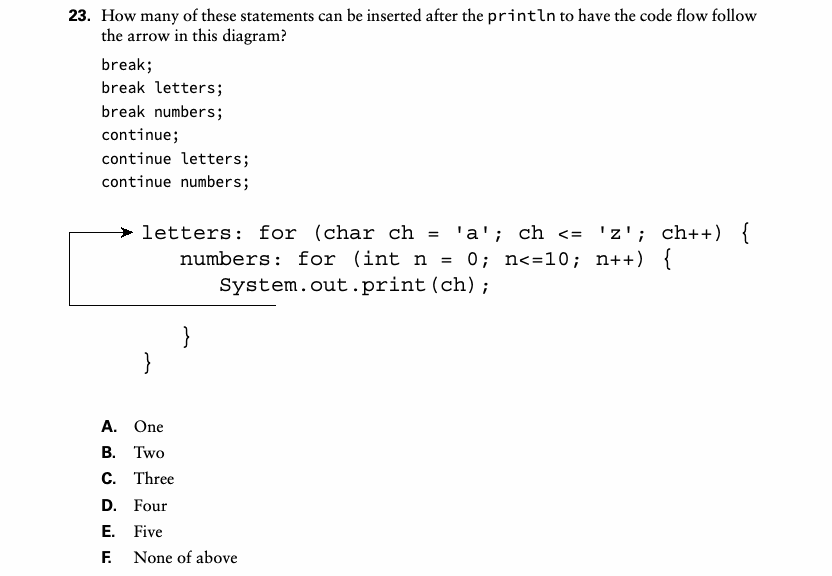

# Chapter 2: Controlling Program Flow

> Source: *OCP Oracle Certified Professional Java SE 17 Developer Practice Tests (Exam 1Z0-829)*. Extracted from your PDF for personal study. Questions with figures/tables include a scan of the original page.

## 829-02-001

Which statements are true of the following code? (Choose two.)

```java
public class Penguins {
    public static void main(String[] args) {
      var pen = new Penguins();
      pen.length("penguins");
      pen.length(5);
      pen.length(new Object());
   }
   public void length(Object obj) {
    if (obj instanceof String x)
       System.out.println(x.length());
   } }
```

- **A.** The code compiles as is.
- **B.** One line causes compiler errors.
- **C.** Two lines cause compiler errors.
- **D.** If any lines that do not compile are removed, this code does not print anything.
- **E.** If any lines that do not compile are removed, this code prints one line.
- **F.** If any lines that do not compile are removed, this code prints two lines.

**Answer:** A, E

**Explanation:** The code compiles fine, making option A correct. Note that the `length()` method takes advantage of pattern matching to avoid a cast. Only the call with `"penguins"` has a matching type because it is a `String`. It enters the `if` statement, giving us option E.

## 829-02-002

Variables declared as which of the following are never permitted in a `switch` statement? (Choose two.)

- **A.** `var`
- **B.** `double`
- **C.** `int`
- **D.** `String`
- **E.** `char`
- **F.** `Object`

**Answer:** B, F

**Explanation:** A `switch` statement supports the primitive types `byte`, `short`, `char`, and `int` and the wrapper classes `Character`, `Byte`, `Short`, and `Integer`. It also supports `String` and enumerated types. Finally, it permits `var` if it can be resolved to one of the previous types. Floating-point types like `float` and `double` are not supported; therefore, option B is correct. `Object` is also not supported since it could include any class, making option F correct as well.

## 829-02-003

When can you omit the `default` condition in a `switch` expression? (Choose two.)

- **A.** When all the values of an `enum` are covered
- **B.** When no value is returned
- **C.** When the type is a `Boolean`
- **D.** When the type is a `Byte`
- **E.** When the type is a `Boolean` or `Byte`

**Answer:** A, B

**Explanation:** Option A is correct because the compiler knows all possible values have been addressed. Option B is also correct because `switch` expressions only need to be complete if returning a value. We can rule out options C and E because a `Boolean` is not allowed in a `switch`. We can further rule out option D because `Byte` does not allow this shortcut.

## 829-02-004

What happens when running the following code snippet?

```java
3: var gas = true;
4: do (
5:    System.out.println("helium");
 6:    gas = gas ^ gas;
 7:    gas = !gas;
 8: ) while (!gas);
```

- **A.** It completes successfully without output.
- **B.** It outputs `helium` once.
- **C.** It outputs `helium` repeatedly.
- **D.** Line 6 does not compile.
- **E.** None of the above.

**Answer:** E

**Explanation:** The code does not compile because parentheses, `()`, are used instead of braces, `{}`, making option E the correct answer.

## 829-02-005

What is output by the following?

```java
10: int m = 0, n = 0;
11: while (m < 5) {
12:    n++;
13:    if (m == 3)
14:      continue;
15:
16:    switch (m) {
17:      case 0:
18:      case 1:
19:         n++;
20:      default:
21:         n++;
22:    }
23:    m++;
24: }
25: System.out.println(m + " " + n);
```

- **A.** `3 10`
- **B.** `3 12`
- **C.** `5 10`
- **D.** `5 12`
- **E.** The code does not compile.
- **F.** None of the above.

**Answer:** F

**Explanation:** When getting this type of question, the best approach is to write down the values of the variables. Both start out as `0` on line 10. On the first iteration of the loop, `n` becomes `1`, while `m` remains `0`, so the clause in the `if` statement doesn’t run. In the `switch` statement, the value of `m` remains `0`, so it matches the first `case`. Since there is no `break`, the `default` block is also executed, and `n` is incremented twice and is now `3`. Finally, `m` is incremented to `1`. On the second iteration of the loop, `m` goes from `1` to `2`, and `n` goes from `3` to `6`. On the third iteration, `m` goes from `2` to `3`, and `n` goes from `6` to `8`. On the fourth iteration `m` is `3` and the `continue` is executed with only `n` increasing in value by `1`. This pattern continues with the loop never terminating, while `n` continues to increase by `1`. Since the execution does not complete, option F is the correct answer.

## 829-02-006

What is true of the following program?

```java
enum Admission { ADULT, SENIOR, CHILD}
public class Movie {
   public static void main(String[] args) {
     var price = switch (Admission.CHILD) {
        case ADULT -> 12.50;
       case SENIOR, CHILD -> 10;
    };
    System.out.println(price);
  } }
```

- **A.** The code does not compile because the return types of the `case` branches are different.
- **B.** The code does not compile because one of the `case` branches has two values.
- **C.** The code does not compile because the value being evaluated in the `switch` is hard coded.
- **D.** The code does not compile because there are too many semicolons.
- **E.** The code compiles and prints `10`.
- **F.** The code compiles and prints `10.0`.

**Answer:** F

**Explanation:** We can eliminate options B and C, as both of these are legal. Also, semicolon usage is fine within the `switch` expression, so option D is incorrect. The `switch` expression returns values of two different types, `double` and `int`, but since they both can be implicitly cast to the same type, `double`, option A is incorrect. This makes option F the answer.

## 829-02-007

Given the following, which can fill in the blank and allow the code to compile? (Choose three.)

```java
var quest = ___________ ;
for(var zelda : quest) {
   System.out.print(zelda);
}
```

- **A.** `3`
- **B.** `new int[] {3}`
- **C.** `new StringBuilder("3")`
- **D.** `List.of(3)`
- **E.** `new String[3]`
- **F.** `"Link"`

**Answer:** B, D, E

**Explanation:** A for-each loop accepts arrays and classes that implement `java.lang.Iterable`, such as `List`. For these reasons, options B, D, and E are correct. Option A is incorrect because it is a primitive value. Options C and F are incorrect because `StringBuilder` and `String` do not implement `Iterable`.

## 829-02-008

Which of the following rules about adding a `default` branch to this `switch` statement are correct? (Choose two.)

```java
switch (numPenguins) {
   case 0 : System.out.println("no penguins");
   case 1 : System.out.println("one penguin");
}
```

- **A.** This `switch` statement is required to declare a `default` statement.
- **B.** A `default` statement must be placed after all `case` statements.
- **C.** A `default` statement can be placed between any `case` statements.
- **D.** Unlike a `case` statement, a `default` statement does not take a parameter value.
- **E.** This `switch` statement can contain more than one `default` statement.
- **F.** A `default` statement can be used only when at least one `case` statement is present.

**Answer:** C, D

**Explanation:** A `default` statement inside a `switch` statement is optional and can be placed in any order within the `switch`’s `case` statements, making options A and B incorrect and option C correct. Option D is also correct because a `default` statement does not take a parameter value. Options E and F are incorrect rules about `switch` statements.

## 829-02-009

What does the following method output?

```java
void dance() {
   var singer = 0;
   while (singer)
     System.out.print(singer++);
}
```

- **A.** The method does not compile.
- **B.** The method completes with no output.
- **C.** The method prints `0` and then terminates.
- **D.** The method enters an infinite loop.
- **E.** None of the above.

**Answer:** A

**Explanation:** A `while` loop requires a `boolean` condition. While `singer` is a variable, it is not a `boolean`. Therefore, the code does not compile, and option A is correct.

## 829-02-010

How many lines contain compiler errors?

```java
22: int magicNumber = 7;
23:    var ok = switch (magicNumber) {
24:      case 7 -> true; ___ break;
25:      case 9 -> { yield true }
26:      case 11 -> yield true;
27:      case 13 : {yield true;}
28:      default -> false;
29: }
```

- **A.** Zero
- **B.** One
- **C.** Two
- **D.** Three
- **E.** Four
- **F.** Five

**Answer:** F

**Explanation:** Line 24 is incorrect because `break` is not permitted here. Line 25 is incorrect because there should be a semicolon (`;`) after `true`. Line 26 does not compile as `yield` needs to be in a block. Line 27 is not allowed because you can’t mix `switch` expression and `switch` statement syntax. Line 28 is the only branch that is correct. Finally, line 29 is missing the closing semicolon. This gives us five compiler errors and option F.

## 829-02-011

Which are true statements comparing for-each and traditional `for` loops? (Choose two.)

- **A.** Both can iterate through an array starting with the first element.
- **B.** Only the for-each loop can iterate through an array starting with the first element.
- **C.** Only the traditional `for` loop can iterate through an array starting with the first element.
- **D.** Both can iterate through an array starting from the end.
- **E.** Only the for-each loop can iterate through an array starting from the end.
- **F.** Only the traditional `for` loop can iterate through an array starting from the end.

**Answer:** A, F

**Explanation:** A traditional `for` loop gives you full control over the order of iteration. This means you can iterate through the array backward or forward. By contrast, with a for-each loop, the iteration order is determined for you. With an array, this means starting with index `0`. Options A and F match this scenario.

## 829-02-012

What statements are true about filling in the blank and calling with `zero(0)`? (Choose two.)

```java
public void zero(Object number) {
   if (number instanceof ___________ Math.abs(n) == 0)
     System.out.println("zero");
   else
     System.out.println("non-zero");
}
```

- **A.** When filling in the blank with `Integer n ||`, the code does not compile.
- **B.** When filling in the blank with `Integer n ||`, the output is `zero`.
- **C.** When filling in the blank with `Integer n ||`, the output is `non-zero`.
- **D.** When filling in the blank with `int n &&`, the code does not compile.
- **E.** When filling in the blank with `int n &&`, the output is `zero`.
- **F.** When filling in the blank with `int n &&`, the output is `non-zero`.

**Answer:** A, D

**Explanation:** Since pattern matching uses flow scoping and `n` cannot be guaranteed to exist, the statement with `||` does not compile, making option A one answer. The other answer is option D, since primitives cannot be used with `instanceof`. If the blank contained `Integer n &&`, the output would be `zero`.

## 829-02-013

What is the output of the following application?

```java
package planning;
public class ThePlan {
   public static void main(String[] input) {
     var plan = 1;
     plan = plan++ + --plan;
     if(plan==1) {
        System.out.print("Plan A");
     } else { if(plan==2) System.out.print("Plan B"); }
     } else System.out.print("Plan C");
     }
   }
}
```

- **A.** `Plan A`
- **B.** `Plan B`
- **C.** `Plan C`
- **D.** The class does not compile.
- **E.** None of the above.

**Answer:** D

**Explanation:** This code does not compile because it has two `else` statements as part of a single `if` statement. Notice that the second `if` statement is not connected to the last `else` statement. For this reason, option D is the correct answer.

## 829-02-014

What is true about the following code? (Choose two.)

```java
23: var race = "";
24: loop:
25: do {
26:    race += "x";
 27:    break loop;
 28: } while (true);
 29: System.out.println(race);
```

- **A.** It outputs `x`.
- **B.** It does not compile.
- **C.** It is an infinite loop.
- **D.** With lines 25 and 28 removed, it outputs `x`.
- **E.** With lines 25 and 28 removed, it does not compile.
- **F.** With lines 25 and 28 removed, it is an infinite loop.

**Answer:** A, E

**Explanation:** The code compiles as is. Due to the `break` statement on line 27, the loop executes only once. It prints a single `x`, which means option A is the first correct answer. While the label on line 24 is present with lines 25 and 28 removed, it no longer points to a loop. This causes the code to not compile, and option E is the other correct answer.

## 829-02-015

What does the following code output?

```java
int count = 0;
char letter = 'A';
switch (letter) {
   case 'A' -> count++;
   case 'B' -> count++;
}
System.out.println(count);
```

- **A.** `0`
- **B.** `1`
- **C.** `2`
- **D.** The code does not compile.

**Answer:** B

**Explanation:** This code is correct. The `default` case is optional since there is no return value assigned. Since this is a `switch` expression, rather than a `switch` statement, the cases do not fall through and option B is the answer.

## 829-02-016

Which of the following can replace the body of the `perform()` method to produce the same output on any nonempty input? (Choose two.)

```java
public void perform(String[] circus) {
   for (int i=circus.length-1; i>=0; i--)
     System.out.print(circus[i]);
}
```

- **A.** 

  ```java
  for (int i=circus.length; i>0; i--)
     System.out.print(circus[i-1]);
  ```
- **B.** 

  ```java
  for-reversed (String c = circus)
     System.out.print(c);
  ```
- **C.** 

  ```java
  for (var c : circus)
     System.out.print(c);
  ```
- **D.** 

  ```java
  for (var i=0; i<circus.length; i++)
     System.out.print(circus[circus.length-i-1]);
  ```
- **E.** 

  ```java
  for (int i=circus.length; i>0; i--)
     System.out.print(circus[i+1]);
  ```
- **F.** 

  ```java
  for-each (String c circus)
     System.out.print(c);
  ```

**Answer:** A, D

**Explanation:** The method prints the elements of the array in the reverse order in which they are defined. Option A correctly accomplishes this using a different starting value for the loop. Options B and F do not compile, as they do not use the correct syntax in a for-each loop. Option C compiles and runs without issue, but prints the items in their natural ordering, as opposed to the reverse ordering. Option D is correct, as it increments in positive order but reverses the output within the body of the `for` loop. Finally, option E is incorrect. The first element read is `circus[circus.length+1]`, which results in an

```java
ArrayIndexOutOfBoundsException.
```

## 829-02-017

What does the following code snippet output?

```java
var bottles = List.of("glass", "plastic", "can");
for (int type = 1; type < bottles.size();) {
   System.out.print(bottles.get(type) + "-");
   if(type < bottles.size()) break;
}
System.out.print("end");
```

- **A.** `glass-end`
- **B.** `glass-plastic-can-end`
- **C.** `plastic-end`
- **D.** `plastic-can-end`
- **E.** The code does not compile.
- **F.** None of the above.

**Answer:** C

**Explanation:** The first time through the loop, `type` is `1`, and `plastic-` is output. The `break` statement then terminates the loop, with `end` bring printed. If the `break` keyword were removed, then this would be an infinite loop because `type` is not incremented between loop executions.

## 829-02-018

What is the result of executing the following code snippet?

```java
final var GOOD = 100;
var score = 10;
switch (score) {
   default:
   1 : System.out.print("1-");
   -1 : System.out.print("2-"); break;
   4,5 : System.out.print("3-");
   6 : System.out.print("4-");
   9 : System.out.print("5-");
}
```

- **A.** `1-`
- **B.** `1-2-`
- **C.** `2-`
- **D.** `3-`
- **E.** `4-`
- **F.** None of the above

**Answer:** F

**Explanation:** The code does not compile because the `switch` statement is missing the `case` keyword for each value.

## 829-02-019

What is the output of the following application?

```java
package dinosaur;
public class Park {
   public final static void main(String... arguments) {
     int pterodactyl = 8;
     long triceratops = 3;
     if(pterodactyl % 3 > 1 + 1)
        triceratops++;
        triceratops--;
     System.out.print(triceratops);
   } }
```

- **A.** `2`
- **B.** `3`
- **C.** `4`
- **D.** The code does not compile.
- **E.** The code compiles but throws an exception at runtime.

**Answer:** A

**Explanation:** First, determine whether the `if` statement’s expression is executed. The expression `8 % 3` evaluates to `2`. The right-hand side of the expression is evaluated next, since `+` has a higher precedence than `>`. Since `2 > 2` is `false`, the expression `triceratops++` is not called. Notice there are no braces, `{}`, in the `if` statement. Despite the `triceratops––` line being indented, it is not part of the `if` statement. Therefore, `triceratops––` is always executed, resulting in a value of `2` for `triceratops` and making option A the correct answer.

## 829-02-020

What variable type of `red` allows the following application to compile?

```java
package tornado;
public class Kansas {
   public static void main(String[] args) {
     int colorOfRainbow = 10;
                  red = 5;
     switch(colorOfRainbow) {
        default:
           System.out.print("Home");
           break;
        case red:
           System.out.print("Away");
     } } }
```

- **A.** `long`
- **B.** `double`
- **C.** `int`
- **D.** `var`
- **E.** `String`
- **F.** None of the above

**Answer:** F

**Explanation:** The value of a `case` statement must be a constant, a literal value, or a `final` variable. Since `red` is missing the `final` attribute, no variable type allows the code to compile, making option F the correct answer. If the `final` modifier were added to the declaration of `red`, then `int` or `var` would be correct. The other options use types that are incompatible with `switch` statements or with `colorOfRainbow`.

## 829-02-021

What is true about the following method when calling with an empty `ArrayList`? (Choose two.)

```java
public void meow(Collection<String> kitties) {
   if (kitties instanceof List c) {
     System.out.println("L " + c.size());
   } else if (kitties instanceof Map c) {
     c = new TreeMap<>();                // x1
     System.out.println("M " + c.size());
   } else {
     System.out.println("E " + c.size());
   }
}
```

- **A.** The code compiles.
- **B.** The code does not compile due to line `x1`.
- **C.** The code does not compile for another reason.
- **D.** If any lines that do not compile are removed, the output is `L0`.
- **E.** If any lines that do not compile are removed, the output is `E0`.
- **F.** If any lines that do not compile are removed, the output is another value.

**Answer:** C, D

**Explanation:** The code does not compile because of the `else` block. Since no variable named `c` is in scope, option C is one of the answers. The other answer is option D since the first `if` block is executed.

## 829-02-022

How many lines of the `magic()` method contain compilation errors?

```java
10: public void magic() {
11:    do {
12:      int trick = 0;
13:      LOOP: do {
14:         trick++;
15:      } while (trick < 2--);
16:      continue LOOP;
17:    } while (1 > 2);
18:    System.out.println(trick);
19: }
```

- **A.** Zero
- **B.** One
- **C.** Two
- **D.** Three
- **E.** Four

**Answer:** D

**Explanation:** Line 15 does not compile because the post-decrement operator can be applied only to variables, not values. Line 16 also does not compile because the label `LOOP` is out of scope after line 15. Finally, line 18 does not compile because `trick` is declared within the `do`/`while` loop and is out of scope after line 17. For these reasons, option D is the correct answer.

## 829-02-023

How many of these statements can be inserted after the `println` to have the code flow follow the arrow in this diagram?

```java
break;
break letters;
break numbers;
continue;
continue letters;
continue numbers;
    letters: for (char ch = 'a'; ch <= 'z'; ch++) {
        numbers: for (int n = 0; n<=10; n++) {
            System.out.print(ch);
        }
    }
```



- **A.** One
- **B.** Two
- **C.** Three
- **D.** Four
- **E.** Five
- **F.** None of above

**Answer:** C

**Explanation:** If the code follows the arrow, then it prints each letter once, breaking out of the inner loop on every iteration. Since a `break` without a label applies to the innermost structure, `break` and `break numbers` are equivalent, and both of these two are correct answers. Likewise, `continue` and `continue numbers` are equivalent although wrong in this case since they resume operation of the inner loop. That leaves `break letters` and `continue` `letters`. In this case, `break letters` stops the outer loop after printing just one letter, so it is incorrect. On the other hand, `continue letters` exits the inner loop and returns control to the outer loop, which is the desired behavior. Since three statements are correct, option C is correct.

## 829-02-024

What is the output of the following application?

```java
package dessert;
public class IceCream {
   public final static void main(String... args) {
     var flavors = 30;
     int eaten = 0;
     switch(flavors) {
        case 30: eaten++;
        case 40: eaten+=2;
       default: eaten--;
    }
    System.out.print(eaten);
  } }
```

- **A.** `1`
- **B.** `2`
- **C.** `3`
- **D.** The code does not compile because `var` cannot be used in a `switch` statement.
- **E.** The code does not compile for another reason.
- **F.** None of the above.

**Answer:** B

**Explanation:** The code compiles without issue, so options D and E are incorrect. A `var` can be used in a `switch` statement, provided the underlying type resolves to a supported `switch` type. Next, notice there are no `break` statements. Once the matching `case` statement, `30`, is reached, all remaining `case` statements will be executed. The `eaten` variable is increased by `1`, then `2`, then reduced by `1`, resulting in a final value of `2`, making option B the correct answer.

## 829-02-025

Which of the following statements compile and create infinite loops at runtime? (Choose three.)

- **A.** `while (!false) {}`
- **B.** `do {}`
- **C.** `for( : ) {}`
- **D.** `do {} while (true);`
- **E.** `while {}`
- **F.** `for( ; ; ) {}`

**Answer:** A, D, F

**Explanation:** A `while` loop and `do`/`while` loop both require a `boolean` expression, making options A and D correct and options B and E incorrect. Option C is incorrect because a foreach statement requires an assignment type and an object to iterate on. Option F is correct and shows a traditional `for` loop with no arguments.

## 829-02-026

How many of these methods compile?

```java
public void m(Object obj) {
   if (obj instanceof LocalDate date)
     System.out.println(date);
   else
     System.out.println(date);
}
public void n(Object obj) {
   if (obj instanceof LocalDate date)
     return;
   else
    System.out.println(date);
}
public void o(Object obj) {
   if (!obj instanceof LocalDate date)
     return;
   else
     System.out.println(date);
}
public void p(Object obj) {
    if (!(obj instanceof LocalDate date))
       return;
    else
       System.out.println(date);
 }
 public void q(Object obj) {
    if (!obj instanceof LocalDate date)
       return;
    System.out.println(date);
 }
 public void r(Object obj) {
    if (!(obj instanceof LocalDate date))
       return;
    System.out.println(date);
 }
```

- **A.** Zero
- **B.** One
- **C.** Two
- **D.** Three
- **E.** Four
- **F.** Five
- **G.** Six

**Answer:** C

**Explanation:** Methods `m()` and `n()` do not compile because `date` is not in scope in the `else` block. Methods `o()` and `q()` do not compile due to the missing parentheses when negating `instanceof`. Methods `p()` and `r()` do compile, which makes option C the answer.

## 829-02-027

Which of the following iterates a different number of times than the others?

- **A.** `for (int k=0; k < 5; k++) {}`
- **B.** `for (int k=1; k <= 5; k++) {}`
- **C.** `int k=0; do { } while(k++ < 5);`
- **D.** `int k=0; while (k++ < 5) {}`
- **E.** All of these iterate the same number of times.

**Answer:** C

**Explanation:** Option A goes through five indexes on the iterations: `0`, `1`, `2`, `3`, and `4`. Option B also goes through five indexes: `1`, `2`, `3`, `4`, and `5`. Option D goes through five iterations as well, from `0` to `4`. However, option C goes through six iterations since the loop condition is at the end of the loop. Therefore, it is not like the others, and option C is the correct answer.

## 829-02-028

What is the output of the following code snippet?

```java
int count = 0;
var stops = new String[] { "Washington", "Monroe",
   "Jackson", "LaSalle" };
while (count < stops.length)
   if (stops[++count].length() < 8)
     break;
   else continue;
System.out.println(count);
```

- **A.** `0`
- **B.** `1`
- **C.** `2`
- **D.** `3`
- **E.** The code does not compile.
- **F.** None of the above.

**Answer:** B

**Explanation:** On the first iteration of the loop, `stops[++count]` evaluates to `stops[1]`, while also setting `count` to `1`. Since `stops[1]` is `Monroe` and it has six characters, the `break` is reached, and the loop stops. For this reason, `1` is printed, making option B correct.

## 829-02-029

What is the output of the following code snippet?

```java
int hops = 0;
int jumps = 0;
jumps = hops++;
if(jumps)
   System.out.print("Jump!");
else
   System.out.print("Hop!");
```

- **A.** `Jump!`
- **B.** `Hop!`
- **C.** The code does not compile.
- **D.** The code compiles but throws an exception at runtime.
- **E.** None of the above.

**Answer:** C

**Explanation:** The statement `if(jumps)` evaluates to `if(0)`, and since `0` is not a `boolean` value, the code does not compile. Java requires `boolean` expressions in `if` statements, making option C the correct answer.

## 829-02-030

Which of the following best describes the flow of execution in this `for` loop if `beta` always returns `false`?

```java
for (alpha; beta; gamma) {
  delta;
}
```

- **A.** `alpha`
- **B.** `alpha, beta`
- **C.** `alpha, beta, gamma`
- **D.** `alpha, gamma`
- **E.** `alpha, gamma, beta`
- **F.** None of the above

**Answer:** B

**Explanation:** The initializer, which is `alpha`, runs first. Then Java checks the condition, which is `beta`, to see whether loop execution should start. Since `beta` returns `false`, the loop is never entered, and option B is correct.

## 829-02-031

What is the output of the following code snippet?

```java
boolean balloonInflated = false;
do {
   if (!balloonInflated) {
     balloonInflated = true;
       System.out.print("inflate-");
    }
 } while (!balloonInflated);
 System.out.println("done");
```

- **A.** `done`
- **B.** `inflate-done`
- **C.** The code does not compile.
- **D.** This is an infinite loop.
- **E.** None of the above.

**Answer:** B

**Explanation:** On the first iteration of the loop, the `if` statement executes and prints `inflate-`. Then the loop condition is checked. The `balloonInflated` variable is `true`, so the loop condition is `false`, and the loop completes and `done` is printed.

## 829-02-032

Which are true about `switch` expressions and `switch` statements? (Choose three.)

- **A.** Both allow assigning the result to a variable.
- **B.** Both allow multiple values in the same `case`.
- **C.** Only a `switch` expression supports `break`.
- **D.** Only a `switch` statement supports `break`.
- **E.** A `switch` expression is more compact.
- **F.** A `switch` statement is more compact.

**Answer:** B, D, E

**Explanation:** A `switch` expression is more compact and does not allow fall through. This makes options D and E correct. The final answer is option B, because either can use multiple values.

## 829-02-033

Which of these code snippets behaves differently from the others?

- **A.** 

  ```java
  if (numChipmunks == 1)
     System.out.println("One chipmunk");
  if (numChipmunks == 2)
     System.out.println("Two chipmunks");
  if (numChipmunks == 3)
     System.out.println("Three chipmunks");
  ```
- **B.** 

  ```java
  switch (numChipmunks) {
     case 1: System.out.println("One chipmunk");
     case 2: System.out.println("Two chipmunks");
     case 3: System.out.println("Three chipmunks");
  }
  ```
- **C.** 

  ```java
   if (numChipmunks == 1)
      System.out.println("One chipmunk");
   else if (numChipmunks == 2)
      System.out.println("Two chipmunks");
  else if (numChipmunks == 3)
     System.out.println("Three chipmunks");
  ```
- **D.** All three code snippets do the same thing.

**Answer:** B

**Explanation:** Options A and C print one line if `numChipmunks` is `1`, `2`, or `3`. Option B does not behave the same way if `numChipmunks` is `1` or `2`. There is no `break` statement, so the `case` statements fall through, and more than one statement will be printed.

## 829-02-034

Which statements about loops are correct? (Choose three.)

- **A.** A `do`/`while` loop requires a body.
- **B.** A `while` loop cannot be exited early with a `return` statement.
- **C.** A `while` loop requires a conditional expression.
- **D.** A `do`/`while` loop executes the body (if present) at least once.
- **E.** A `do`/`while` loop cannot be exited early with a `return` statement.
- **F.** A `while` loop executes the body (if present) at least once.

**Answer:** A, C, D

**Explanation:** A `do`/`while` loop requires a body, making option A correct. Options B and E are incorrect, as both types of `while` loops can be exited early with a `return` statement. Both also require a conditional expression, making option C correct. What distinguishes a `do`/`while` loop from a `while` loop is that it executes its body at least once, making option D correct and option F incorrect.

## 829-02-035

Given the following enum and class, which option fills in the blank and allows the code to compile?

```java
enum Season { SPRING, SUMMER, WINTER }
public class Weather {
   public int getAverageTemperate(Season s) {
     switch (s) {
        default:
                     return 30;
     } } }
```

- **A.** `case Season.WINTER:`
- **B.** `case WINTER, SPRING:`
- **C.** `case SUMMER | WINTER:`
- **D.** `case SUMMER ->`
- **E.** `case FALL:`
- **F.** None of the above

**Answer:** B

**Explanation:** Option B is correct since a comma is allowed to separate values in Java 17. Option A is incorrect because the enum type `Season` is not used within a `case` statement. If it were just `case WINTER:`, then it would compile. Option C does not compile because a pipe (`|`) is not valid syntax in a `case` statement. Option D is incorrect because `->` is used instead of `:`. Option E is incorrect because `FALL` is not defined in the list of values for the enum `Season`.

## 829-02-036

Fill in the blank with the line of code that causes the application to compile and print exactly one line at runtime.

```java
package nyc;
public class TourBus {
   public static void main(String... args) {
     var nycTour = new String[] { "Downtown", "Uptown",
        "Brooklyn" };
     var times = new String[] { "Day", "Night" };
     for ( ___________ i<nycTour.length && j<times.length;
           i++, j++)
        System.out.println(nycTour[i] + "-" + times[j]);
   } }
```

- **A.** `int i=1; j=1;`
- **B.** `int i=0, j=1;`
- **C.** `int i=1; int j=0;`
- **D.** `int i=1, int j=0;`
- **E.** `int i=1, j=0;`
- **F.** None of the above

**Answer:** B

**Explanation:** In a traditional `for` loop, only one initialization type is allowed to be specified. If more than one variable is supplied, then they are separated by a comma. Therefore, options A, C, and D do not compile. Options B and E both compile, although only option B prints a single line at runtime. Option E instead prints two lines since `nycTour` is of size `3` and `times` is of size `2`.

## 829-02-037

What statements are true of the following code? (Choose two.)

```java
public class Penguins {
    public static void main(String[] args) {
      var pen = new Penguins();
      pen.length("penguins");
      pen.length(5);
      pen.length(new Object());
   }
   public void length(Object obj) {
     if (obj instanceof String) {
        System.out.println(obj.length());
    } } }
```

- **A.** The code compiles as is.
- **B.** One line causes compiler errors.
- **C.** Two lines cause compiler errors.
- **D.** If any lines that do not compile are removed, this code does not print anything.
- **E.** If any lines that do not compile are removed, this code prints one line.
- **F.** If any lines that do not compile are removed, this code prints two lines.

**Answer:** B, D

**Explanation:** The code does not compile because `obj` is never cast to a `String`. Since this is the only error, option B is one answer. Removing that line due to the compiler error also removes the `println()` statement, so option D is the other answer.

## 829-02-038

The following code contains six pairs of curly braces. How many pairs can be removed without changing the behavior?

```java
 12: public static void main(String[] args) {
 13:    int secret = 0;
 14:    for (int i = 0; i < 10; i++) {
 15:      while (i < 10) {
 16:         if (i == 5) {
 17:            System.out.println("if");
 18:         } else {
 19:            System.out.println("in");
 20:            System.out.println("else");
 21:         }
 22:      }
 23:    }
24:    switch (secret) {
25:      case 0: System.out.println("zero");
26:    }
27: }
```

- **A.** One
- **B.** Two
- **C.** Three
- **D.** Four
- **E.** Five
- **F.** Six

**Answer:** C

**Explanation:** The braces on lines 12 and 27 are required because they comprise the method body. The braces on lines 24 and 26 are required because a `switch` statement needs braces regardless of how many `case` statements are inside. Finally, the braces on lines 18 and 21 are required because the `else` has two statements inside. The braces on lines 14 and 23, 15 and 22, and 16 and 18 are all optional because there is only one statement inside. Since there are three pairs, option C is correct.

## 829-02-039

Which of the following can replace the body of the `travel()` method to produce the same output on any nonempty input?

```java
public void travel(List<Integer> roads) {
   for (int w = 1; w <= roads.size(); w++)
     System.out.print(roads.get(w-1));
}
```

- **A.** 

  ```java
  for (int r = 0; r < roads.size(); r += 1)
     System.out.print(roads.get(0));
  ```
- **B.** 

  ```java
  for(var z : roads)
     System.out.print(z);
  ```
- **C.** 

  ```java
  for (int t = roads.size(); t > 0; t--)
     System.out.print(roads.get(t));
  ```
- **D.** 

  ```java
  for (var var : roads)
     System.out.print(roads);
  ```
- **E.** 

  ```java
  for (int q = roads.size(); q >= 0; q++)
     System.out.print(roads.get(q));
  ```
- **F.** None of the above

**Answer:** B

**Explanation:** The method prints the elements of the list in the order in which they are defined. Option A is incorrect and prints the first element repeatedly. Option B is correct and prints the elements using a for-each loop. Options C and E are incorrect because the first element that’s read results in an `ArrayIndexOutOfBoundsException`. Finally, option D is incorrect because the entire list is printed each time.

## 829-02-040

Which statement about the following code snippet is correct?

```java
3: final var javaVersions = List.of(17,11,8);
4: var names = List.of("JDK", "Java");
5: V: for (var e1 : javaVersions) {
6:    E: for (String e2 : names)
7:      System.out.println(e1 + "_" + e2);
8:      break;
9: }
```

- **A.** One line does not compile.
- **B.** Two lines do not compile.
- **C.** Three lines do not compile.
- **D.** It compiles and prints two lines at runtime.
- **E.** It compiles and prints three lines at runtime.
- **F.** None of the above.

**Answer:** D

**Explanation:** The code snippet compiles, making options A, B, and C incorrect. Notice that the inner for-each loop does not use braces, `{}`, so the `break` statement applies to the outer loop only. On the first iteration of the outer loop, the inner loop prints `17_JDK` and `17_Java`. Then, the `break` statement is encountered, and the outer loop is terminated, making option D correct. Object-Oriented Approach
