# Chapter 3: Utilizing Java Object-Oriented Approach

> Source: *OCP Oracle Certified Professional Java SE 17 Developer Practice Tests (Exam 1Z0-829)*. Extracted from your PDF for personal study. Questions with figures/tables include a scan of the original page.

## 829-03-001

How many lines would have to be changed for the following code to compile?

```java
1: enum Color {
2:    public static Color DEFAULT = BROWN;
3:    BROWN, YELLOW, BLACK;
4: }
5: public record Pony {
6:    String name;
7:    static int age;
8:    { age = 10;}
9: }
```

- **A.** Zero
- **B.** One
- **C.** Two
- **D.** Three
- **E.** Four or more

**Answer:** E

**Explanation:** An enum must declare its values before any members. For this reason, lines 2 and 3 are reversed. Line 5 is missing parentheses required for a record declaration. Line 6 is not allowed, as records do not allow instance variables. Line 8 is incorrect because only `static` initializers, not instance initializers, are allowed in records. Since there are at least four lines that contain errors, option E is correct.

## 829-03-002

Which modifiers can be applied to a sealed subclass? (Choose three.)

- **A.** `nonsealed`
- **B.** `default`
- **C.** `sealed`
- **D.** `unsealed`
- **E.** `non-sealed`
- **F.** `closed`
- **G.** `final`

**Answer:** C, E, G

**Explanation:** A sealed subclass must be declared `final`, `sealed`, or `non-sealed`, making options C, E, and G correct.

## 829-03-003

What is the output of the following application?

```java
package dnd;
final class Story {
   void recite(int chapter) throws Exception {}
}
public class Adventure extends Story {
   final void recite(final int chapter) {     // g1
     switch(chapter) {                  // g2
        case 2: System.out.print(9);
        default: System.out.print(3);
     }
   }
   public static void main(String... u) {
     var bedtime = new Adventure();
     bedtime.recite(2);
   } }
```

- **A.** `3`
- **B.** `9`
- **C.** `93`
- **D.** The code does not compile because of line `g1`.
- **E.** The code does not compile because of line `g2`.
- **F.** None of the above.

**Answer:** F

**Explanation:** The program does not compile because `Story` is marked `final`, which means it cannot be extended by `Adventure`, making option F correct. If the `final` modifier were removed, the rest of the code would compile and print `93` at runtime.

## 829-03-004

Which of the following lines of code are not permitted as the first line of a Java class file? (Choose two.)

- **A.** `import widget.*;`
- **B.** `// Widget Manager`
- **C.** `int facilityNumber;`
- **D.** `package sprockets;`
- **E.** `/** Author: Cid **/`
- **F.** `void produce() {}`

**Answer:** C, F

**Explanation:** A class can start with a comment, an optional `package` statement, or an `import` statement if there is no `package` statement. It cannot start with a variable definition or method declaration, since those cannot be declared outside a type. Therefore, options C and F are correct.

## 829-03-005

Which of the following modifiers can be applied to an abstract method? (Choose two.)

- **A.** `final`
- **B.** `private`
- **C.** `public`
- **D.** `default`
- **E.** `protected`
- **F.** `concrete`

**Answer:** C, E

**Explanation:** An abstract method cannot include the `final` or `private` modifier. If a method contained either of these modifiers, then no concrete subclass would ever be able to override it with an implementation. For these reasons, options A and B are incorrect. Option D is also incorrect because the `default` keyword applies to concrete interface methods, not abstract methods. Option F is incorrect because there is no concrete modifier. That leaves options C and E as the correct answers. The `protected`, package, and `public` access modifiers can each be applied to abstract methods.

## 829-03-006

What is the result of compiling and executing the following class?

```java
1: public class ParkRanger {
2:    final static int birds = 10;
3:    public static void main(String[] data) {
4:      var r = new ParkRanger();
5:      var trees = 5f;
6:      System.out.print(trees + r.birds);
7:    } }
```

- **A.** It compiles and outputs `5`.
- **B.** It compiles and outputs `5.0`.
- **C.** It compiles and outputs `15`.
- **D.** It compiles and outputs `15.0`.
- **E.** It does not compile.
- **F.** It compiles but throws an exception at runtime.

**Answer:** D

**Explanation:** On line 5, the variable `trees` is assigned a value of `5f`. On line 6 it is added to an `int` value, which is promoted to `float`. The program then prints `15.0`, making option D correct. Although accessing a `static` variable with an instance reference is not recommended, it is allowed on line 6.

## 829-03-007

Fill in the blanks: The \_\_\_\_\_\_\_\_\_\_\_\_\_\_\_\_\_\_\_ access modifier allows access to everything the \_\_\_\_\_\_\_\_\_\_\_\_\_\_\_\_\_\_\_ access modifier does and more.

- **A.** package, `protected`
- **B.** `private`, package
- **C.** `private`, `protected`
- **D.** `private`, `public`
- **E.** `public`, `private`
- **F.** None of the above

**Answer:** E

**Explanation:** The `public` access modifier allows access to members in the same class, package, subclass, or even classes in other packages, whereas the `private` modifier allows access only to members in the same class. Therefore, the `public` access modifier allows access to everything the `private` access modifier does, and more, making option E the correct answer. Options A, B, C, and D are incorrect because the first term is a more restrictive access modifier than the second term.

## 829-03-008

Which set of modifiers, when added to a `default` method within an interface, prevents it from being overridden by a class implementing the interface?

- **A.** `const`
- **B.** `final`
- **C.** `static`
- **D.** `private`
- **E.** `private static`
- **F.** None of the above

**Answer:** F

**Explanation:** There is no modifier that can prevent a `default` method from being overridden in a class implementing an interface, making option F correct.

## 829-03-009

Given the following application, fill in the missing values in the table starting from the top and going down.

```java
package competition;
public class Robot {
   static String weight = "A lot";
   double ageMonths = 5, ageDays = 2;
   private static boolean success = true;
   public void compete() {
     final String retries = "1";
     // P1
   } }
```

Variable Type Number of Variables Accessible at `P1` Class \_\_\_\_\_ Instance \_\_\_\_\_ Local \_\_\_\_\_

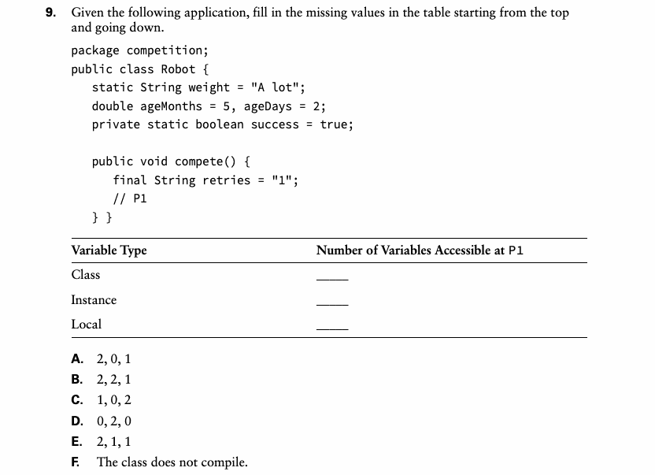


- **A.** 2, 0, 1
- **B.** 2, 2, 1
- **C.** 1, 0, 2
- **D.** 0, 2, 0
- **E.** 2, 1, 1
- **F.** The class does not compile.

**Answer:** B

**Explanation:** Notice in this question that `main()` is not a `static` method; therefore, it can access both class and instance variables. It can also access the local variable `args`. Since there are two class variables, two instance variables, and one local variable available, option B is the correct answer.

## 829-03-010

Given the following code, what values inserted, in order, into the blank lines allow the code to compile? (Choose two.)

```java
       agent;
public ______ Banker {
   private static ______ getMaxWithdrawal() {
     return 10;
   } }
```

- **A.** `package`, `new`, `int`
- **B.** `package`, `class`, `long`
- **C.** `import`, `class`, `null`
- **D.** `//`, `class`, `int`
- **E.** `import`, `interface`, `void`
- **F.** `package`, `class`, `void`

**Answer:** B, D

**Explanation:** Option A is incorrect because `new` cannot be used to declare a type. Option C is incorrect because `null` is a literal and cannot be used as the return type. Options E and F are incorrect because a `void` method cannot return a value. That leaves options B and D as the correct answers. Note that `10` can be returned as an `int` or implicitly promoted to a `long`, without issue.

## 829-03-011

Which of the following are correct? (Choose two.)

```java
public class Phone {
   private int size;
   // LINE X
   public static void sendHome(Phone p, int newSize) {
     p = new Phone(newSize);
     p.size = 4;
   }
   public static final void main(String... params) {
     final var phone = new Phone(3);
     sendHome(phone,7);
     System.out.print(phone.size);
   } }
```

- **A.** Insert this constructor at `LINE X`:

  ```java
  public static Phone create(int size) {
     return new Phone(size);
  }
  ```
- **B.** Insert this constructor at `LINE X`:

  ```java
  public static Phone newInstance(int size) {
     return new Phone();
  }
  ```
- **C.** Insert this constructor at `LINE X`:

  ```java
  public Phone(int size) {
     size = this.size;
  }
  ```
- **D.** Insert this constructor at `LINE X`:

  ```java
  public void Phone(int size) {
     size = this.size;
  }
  ```
- **E.** With the correct constructor, the output is `0`.
- **F.** With the correct constructor, the output is `3`.
- **G.** With the correct constructor, the output is `7`.

**Answer:** C, E

**Explanation:** Trick question! Options A, B, and D are not even constructors. Options A and B are `static` methods, whereas option D is a method that happens to have the same name as the class. Option C is the only valid constructor. As for the output, the key is that Java uses “pass by value” to send object references to methods. Since the `Phone` reference `p` was reassigned in the first line of the `sendHome()` method, any changes to the `p` reference were made to a new object. In other words, no changes in the `sendHome()` method affected the object that was passed in. Therefore, the value of `size` was the same before and after the method call. In this program, `this.size` is initialized with a default value of `0` and never changed, making option E the other correct answer.

## 829-03-012

Given the following class structures, which lines can be inserted into the blank independently that would allow the class to compile? (Choose two.)

```java
public class Dinosaur {
   class Pterodactyl extends Dinosaur {}
   public void roar() {
     var dino = new Dinosaur();
                              ;
   } }
```

- **A.** `dino.Pterodactyl()`
- **B.** `Dinosaur.new Pterodactyl()`
- **C.** `dino.new Pterodactyl()`
- **D.** `new Dino().new Pterodactyl()`
- **E.** `new Dinosaur().Pterodactyl()`
- **F.** `new Dinosaur.Pterodactyl()`

**Answer:** C, F

**Explanation:** Options A and E are incorrect because the `new` keyword before `Pterodactyl` is required to create an instance of the member inner class `Pterodactyl` using a member of the outer class `Dinosaur`. Option B is incorrect, as this is not a valid way to instantiate a member inner class. Option C is correct and relies on the `dino` instance variable for the outer class instance. Option D would be correct if `Dino` were changed to the correct class name, `Dinosaur`. Finally, option F is correct and relies on the fact that `roar()` is an instance method, which means there’s an implicit instance of the outer class `Dinosaur` available. The `Dinosaur.` prefix is optional, though.

## 829-03-013

What is the output of the `Computer` program?

```java
class Laptop extends Computer {
    public void startup() {
       System.out.print("laptop-");
    } }
public class Computer {
   public void startup() {
     System.out.print("computer-");
   }
   public static void main(String[] args) {
     Computer computer = new Laptop();
       Laptop laptop = new Laptop();
       computer.startup();
       laptop.startup();
    } }
```

- **A.** `computer-laptop-`
- **B.** `laptop-computer-`
- **C.** `laptop-laptop-`
- **D.** The code does not compile.
- **E.** None of the above.

**Answer:** C

**Explanation:** Both objects are instances of the class `Laptop`. This means the overridden `startup()` method in the `Laptop` class gets called both times thanks to polymorphism, making option C correct.

## 829-03-014

How many lines does the following code output?

```java
public class Cars {
   private static void drive() {
      {
         System.out.println("zoom");
      }
      System.out.println("fast");
   }
   static { System.out.println("faster"); }
   public static void main(String[] args) {
     drive();
     drive();
   } }
```

- **A.** One
- **B.** Two
- **C.** Three
- **D.** Four
- **E.** Five
- **F.** Six or more
- **G.** None of the above. The code does not compile.

**Answer:** E

**Explanation:** The `static` initializer is only run once, so `faster` is printed exactly once. The `drive()` method is called twice, printing two lines each. Therefore, the program prints five lines, and option E is correct.

## 829-03-015

Which statements about `static` interface methods are correct? (Choose three.)

- **A.** A `static` interface method can be `final`.
- **B.** A `static` interface method can be declared `private`.
- **C.** A `static` interface method can be declared with package access.
- **D.** A `static` interface method can be declared `public`.
- **E.** A `static` interface method can be declared `protected`.
- **F.** A `static` interface method can be declared without an access modifier.

**Answer:** B, D, F

**Explanation:** Option A is incorrect as methods cannot be marked `final` within an interface. Interfaces support `static` methods that are marked `public` or `private`, making options B and D correct and option E incorrect. Option F is correct and the lack of an access modifier makes the method implicitly `public`, not package, making option C incorrect.

## 829-03-016

Not counting the `Planet` declaration, how many declarations compile? Assume they are all declared within the same `.java` file.

```java
public abstract sealed class Planet permits Mercury, Venus, Earth {}
non-sealed class Venus {}
non-sealed class Mars extends Planet {}
non-sealed class Mercury {}
abstract non-sealed class Earth {}
```

- **A.** Zero
- **B.** One
- **C.** Two
- **D.** Three
- **E.** Four

**Answer:** A

**Explanation:** While the `permits` clause is optional for sealed classes with subclasses in the same file, the `extends` clause in each subclass is not. For this reason, `Mercury`, `Venus`, and `Earth` do not compile. `Mars` also does not compile. When the `permits` clause is specified, all subclasses must be listed. For this reason, option A is correct.

## 829-03-017

What is the result of executing the following program?

```java
public class Canine {
   public String woof(int bark) {
     return "1"+bark.toString();
   }
   public String woof(Integer bark) {
     return "2"+bark.toString();
   }
   public String woof(Object bark) {
     return "3"+bark.toString();
   }
   public static void main(String[] a) {
     System.out.println(woof((short)5));
   } }
```

- **A.** `15`
- **B.** `25`
- **C.** `35`
- **D.** One line does not compile.
- **E.** Two lines do not compile.
- **F.** The program compiles but throws an exception at runtime.

**Answer:** E

**Explanation:** The first `woof()` method does not compile because `bark` is a primitive, not an object, and does not have a `toString()` method. The `main()` method also does not compile because it is `static` and all of the `woof()` methods require an instance of `Canine`. Since these two lines do not compile, option E is the correct answer.

## 829-03-018

What statement best describes the notion of effectively final in Java?

- **A.** A local variable that is marked `final`.
- **B.** A `static` variable that is marked `final`.
- **C.** A local variable whose primitive value or object reference does not change after it is initialized.
- **D.** A local variable whose primitive value or object reference does not change after a certain point in the method.
- **E.** None of the above.

**Answer:** C

**Explanation:** A local variable is effectively final when its primitive value or object reference does not change after it is initialized, making option C the correct answer. Note that option D is incorrect because any change to the variable after it is initialized disqualifies it for being considered effectively final.

## 829-03-019

What is the output of the `Turnip` class?

```java
interface GameItem {
   int sell();
}
abstract class Vegetable implements GameItem {
   public final int sell() { return 5; }
}
public class Turnip extends Vegetable {
   public final int sell() { return 3; }
   public static void main(String[] expensive) {
     System.out.print(new Turnip().sell());
   } }
```

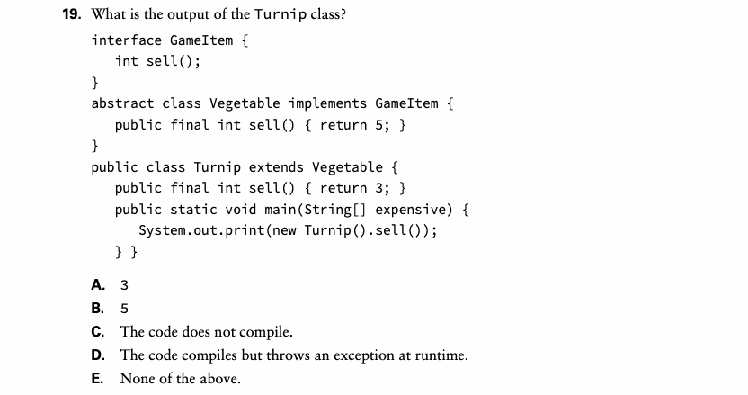

- **A.** `3`
- **B.** `5`
- **C.** The code does not compile.
- **D.** The code compiles but throws an exception at runtime.
- **E.** None of the above.

**Answer:** C

**Explanation:** The `sell()` method is declared `final` in the `Vegetable` class. The `Turnip` class then attempts to override this method, resulting in a compilation error and making option C the correct answer.

## 829-03-020

What is the output of the following application?

```java
package holiday;
enum DaysOff {
   Thanksgiving, PresidentsDay, ValentinesDay
}
public class Vacation {
   public static void main(String[] unused) {
     final DaysOff input = DaysOff.Thanksgiving;
     switch(input) {
        default:
       case DaysOff.ValentinesDay:
          System.out.print("1");
       case DaysOff.PresidentsDay:
          System.out.print("2");
    } } }
```

- **A.** `1`
- **B.** `2`
- **C.** `12`
- **D.** The code does not compile.
- **E.** The code compiles but throws an exception at runtime.
- **F.** None of the above.

**Answer:** D

**Explanation:** The `case` statements incorrectly use the enum name as well as the value, such as `DaysOff.ValentinesDay`. Since the type of the enum is determined by the value of the variable in the `switch` statement, the enum name is not allowed and causes a compilation error when used. For this reason, option D is correct.

## 829-03-021

What is the output of the following program?

```java
record Animal(boolean isMammal) {}
public record Panda(String name) extends Animal {
   public Panda() {
     this("TaiShan");
   }
   public Panda {
     this.name = name.toLowerCase();
   }
   public static void main(String[] args) {
     System.out.print(new Panda().name());
   } }
```

- **A.** `TaiShan`
- **B.** `taishan`
- **C.** Exactly one line needs to be corrected for the program to compile.
- **D.** Exactly two lines need to be corrected for the program to compile.
- **E.** Three or more lines need to be corrected for the program to compile.
- **F.** The code compiles but prints an exception at runtime.

**Answer:** D

**Explanation:** Records are implicitly `final` and cannot be extended. For this reason, the `Panda` declaration does not compile. Setting a value on `this.name` is not permitted in a compact constructor, although the constructor parameter `name` may be reassigned. The rest of the code compiles without issue. Since two lines don’t compile, option D is correct.

## 829-03-022

Which statements about instance keywords are correct? (Choose two.)

- **A.** The `that` keyword can be used to read `public` members in the direct parent class.
- **B.** The `this` keyword can be used to read all members declared within the class.
- **C.** The `super` keyword can be used to read all members declared in a parent class.
- **D.** The `that` keyword can be used to read members of another class.
- **E.** The `this` keyword can be used to read `public` members in the direct parent class.
- **F.** The `super` keyword can be used in `static` methods.

**Answer:** B, E

**Explanation:** There is no `that` keyword, so options A and D are incorrect. Option B is correct, as `this` can access all members declared within the class. Option C is incorrect, as only inherited members can be accessed. For example, `private` members declared in a parent class cannot be accessed using `super`. Option E is correct, as `this` allows access to members declared in the class and those inherited from a parent. Finally, option F is incorrect, as `static` methods do not have access to `this` or `super` references.

## 829-03-023

Fill in the blanks: A class \_\_\_\_\_\_\_\_\_\_\_\_ an interface and \_\_\_\_\_\_\_\_\_\_\_\_\_\_ an `abstract` class. An interface \_\_\_\_\_\_\_\_\_\_\_\_\_\_ another interface.

- **A.** `extends`, `extends`, `implements`
- **B.** `extends`, `implements`, `extends`
- **C.** `extends`, `implements`, `implements`
- **D.** `implements`, `extends`, `extends`
- **E.** `implements`, `extends`, `implements`
- **F.** `implements`, `implements`, `extends`

**Answer:** D

**Explanation:** A class can implement an interface, not extend it, ruling out options A, B, and C. Classes do extend an `abstract` class, ruling out option F. Finally, an interface can only extend another interface, making option D the correct answer.

## 829-03-024

Suppose you have the following code. Which of the images best represents the state of the references `c1`, `c2`, and `c3`, right before the end of the `main()` method, assuming garbage collection hasn’t run? In the diagrams, each box represents a `Chicken` object with a number of `eggs`.

```java
1: public class Chicken {
2:     private Integer eggs = 2;
3:     { this.eggs = 3; }
4:     public Chicken(int eggs) {
5:       this.eggs = eggs;
6:     }
7:     public static void main(String[] r) {
8:       var c1 = new Chicken(1);
9:       var c2 = new Chicken(2);
10:      var c3 = new Chicken(3);
11:      c1.eggs = c2.eggs;
12:      c2 = c1;
13:      c3.eggs = null;
14:    } }
```

Option A Option B c1 c1 2 2 2 c2 1 c2 c3 null c3 null Option C Option D c1 c1 2 1 1 1 c2 c2 null c3 3 c3

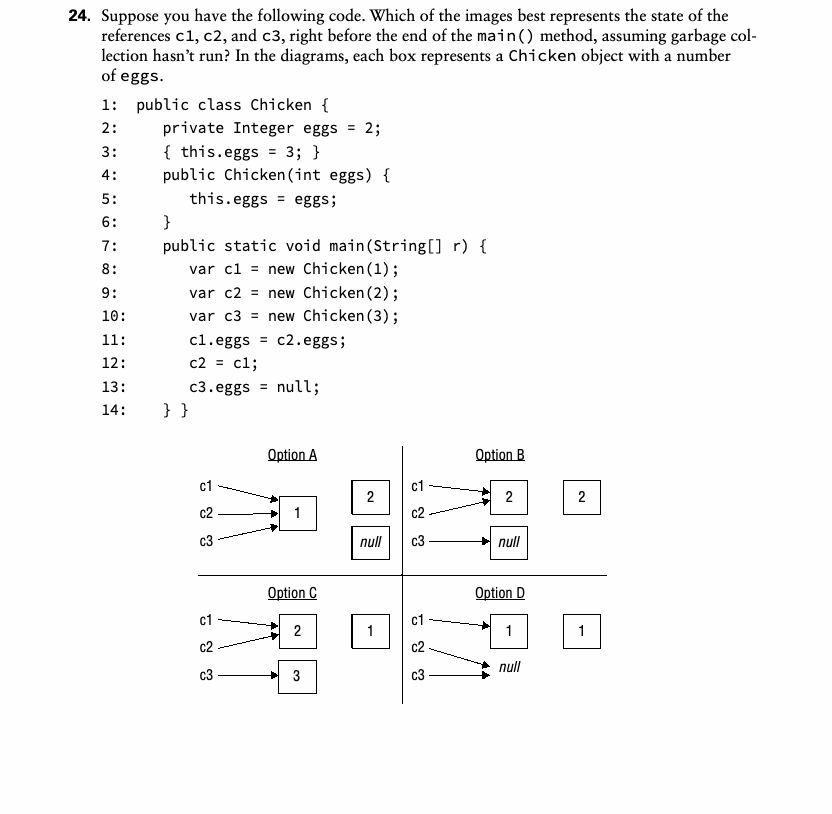

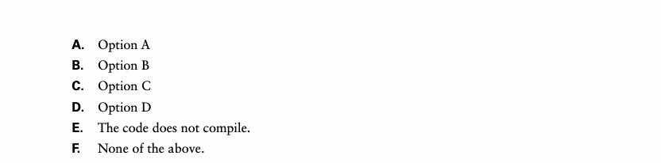

- **A.** Option A
- **B.** Option B
- **C.** Option C
- **D.** Option D
- **E.** The code does not compile.
- **F.** None of the above.

**Answer:** B

**Explanation:** Three instances of `Chicken` are created on lines 8–10. On line 11, the value of `eggs` in the first two instances is set to `2`, while the third instance has a value of `3`. On line 12, the original instance that was pointed to by `c2` (with an `eggs` value of `2`) is dereferenced and eligible for garbage collection. The `c1` and `c2` variables now both point to the same instance with an `egg` value of `2`. Finally, on line 13, the `eggs` value for `c3` is changed from `3` to `null`. For this reason, option B is correct.

## 829-03-025

What is the output of the following application?

```java
package musical;
interface Speak { default int talk() { return 7; } }
interface Sing { default int talk() { return 5; } }
public class Performance implements Speak, Sing {
   public int talk(String... x) {
     return x.length;
   }
   public static void main(String[] notes) {
     System.out.print(new Performance().talk());
   } }
```

- **A.** `7`
- **B.** `5`
- **C.** The code does not compile.
- **D.** The code compiles without issue, but the output cannot be determined until runtime.
- **E.** None of the above.

**Answer:** C

**Explanation:** Java does not allow multiple inheritance, so having one class implement two interfaces that both define the same `default` method signature leads to a compiler error, unless the class overrides the method. In this case, the `talk(String...)` method defined in the `Performance` class is an overloaded method, not an overridden one, because the signatures do not match. Therefore, the `Performance` class does not compile, making option C correct.

## 829-03-026

What is the output of the following application?

```java
package ai;
interface Pump { public abstract String toString(); }
interface Bend extends Pump { void bend(double tensileStrength); }
public class Robot {
   public static final void apply(
     Bend instruction, double input) {
     instruction.bend(input);
   }
   public static void main(String... future) {
     final Robot r = new Robot();
     r.apply(x -> System.out.print(x+" bent!"), 5);
   } }
```

- **A.** `5 bent!`
- **B.** `5.0 bent!`
- **C.** The code does not compile because `Bend` is not a functional interface.
- **D.** The code does not compile because of the `apply()` method declaration.
- **E.** None of the above.

**Answer:** B

**Explanation:** First off, `Pump` is not a functional interface. The `toString()` method will be overridden by any class inheriting the interface (via `lang.lang.Object`), so it does not count as an abstract method. On the other hand, `Bend` is a functional interface and contains one abstract method. The code compiles and prints `5.0 bent!` at runtime, making option B correct. Using an instance variable to call a `static` method, `r.apply()` in the `main()` method, is permitted but discouraged.

## 829-03-027

Which statement is true about encapsulation while providing the broadest access allowed?

- **A.** Variables are `private` and methods are `private`.
- **B.** Variables are `private` and methods are `public`.
- **C.** Variables are `public` and methods are `private`.
- **D.** Variables are `public` and methods are `public`.
- **E.** Variables are `private` and methods are `protected`.
- **F.** None of the above.

**Answer:** B

**Explanation:** If the variables are `public`, the class is not encapsulated because callers have direct access to them. This rules out options C and D. Having `private` methods doesn’t allow the callers to use the data, making option A an undesirable answer. Option B is correct and the classic definition of encapsulation where the data is not exposed directly. Option E is close, but the question asks for the broadest access allowed.

## 829-03-028

Fill in the blanks: \_\_\_\_\_\_\_\_\_\_\_\_ means the state of an object cannot be changed, while \_\_\_\_\_\_\_\_\_\_\_\_\_ means that it can.

- **A.** Encapsulation, factory method
- **B.** Immutability, mutability
- **C.** Rigidity, flexibility
- **D.** Static, instance
- **E.** Tightly coupled, loosely coupled
- **F.** None of the above

**Answer:** B

**Explanation:** Option B is correct because mutability means the state can change, and immutability means it cannot. The other options are invalid. In option C, rigidity is not a common programming term.

## 829-03-029

Which statement about the following interface is correct?

```java
public interface Swimming {
   String DEFAULT = "Diving!";     // k1
   abstract int breath();
   private static void stroke() {
     if(breath()==1) {            // k2
        System.out.print("Go!");
     } else {
        System.out.print(dive());     // k3
     } }
   static String dive() {
     return DEFAULT;              // k4
   } }
```

- **A.** The code compiles without issue.
- **B.** The code does not compile because of line `k1`.
- **C.** The code does not compile because of line `k2`.
- **D.** The code does not compile because of line `k3`.
- **E.** The code does not compile because of line `k4`.
- **F.** None of the above.

**Answer:** C

**Explanation:** The `stroke()` method is `static`, which means it cannot access the instance method `breath()` on line `k2`, making option C correct.

## 829-03-030

Which is the first line to fail to compile?

```java
class Tool {
   private void repair() {}           // r1
   void use() {}                     // r2
}
class Hammer extends Tool {
   private int repair() { return 0; } // r3
   private void use() {}             // r4
   public void bang() {}             // r5
}
```

- **A.** `r1`
- **B.** `r2`
- **C.** `r3`
- **D.** `r4`
- **E.** `r5`
- **F.** None of the above

**Answer:** D

**Explanation:** The `Hammer` class is a subclass of the `Tool` class. The `repair()` method can be declared in the `Hammer` subclass with a different return type because the parent method is not inherited. For these reasons, options A and C are incorrect. On the other hand, the `use()` method has package-level access in `Tool`, with the overridden version in `Hammer` reducing the visibility to `private`. This is an invalid override, making option D correct. The rest of the lines compile without issue.

## 829-03-031

Which modifier can be applied to an `abstract` interface method?

- **A.** `final`
- **B.** `interface`
- **C.** `protected`
- **D.** `volatile`
- **E.** `sealed`
- **F.** None of the above

**Answer:** F

**Explanation:** Methods cannot be both `abstract` and `final`, making option A incorrect. Abstract interface methods are always `public`, making option C incorrect. Finally, options B, D, and E list modifiers that can’t be applied to methods. Therefore, option F is the answer.

## 829-03-032

What is the output of the `Plant` program?

```java
class Bush extends Plant {
   String type = "bush";
}
public class Plant {
   String type = "plant";
   public static void main(String[] args) {
     Plant w1 = new Bush();
     Bush w2 = new Bush();
     Plant w3 = w2;
     System.out.print(w1.type+","+w2.type+","+w3.type);
   } }
```

- **A.** `plant,bush,plant`
- **B.** `plant,bush,bush`
- **C.** `bush,plant,bush`
- **D.** `bush,bush,bush`
- **E.** The code does not compile.
- **F.** None of the above.

**Answer:** A

**Explanation:** While both objects are instances of `Bush`, we are not calling methods in this example. Virtual method invocation works only for methods, not instance variables. For instance variables, Java looks at the type of the reference and calls the appropriate variable based on the reference. Based on the reference types of the three variables (`Plant`, `Bush`, `Plant`), option A is correct.

## 829-03-033

The following `Organ` class is included, unmodified, in a larger program at runtime. At most, how many classes can inherit from `Organ` (excluding `Organ` itself)?

```java
package body;
public sealed class Organ {
   sealed class Heart extends Organ {}
   final class Lung extends Organ {}
   static non-sealed class Stomach extends Organ {}
   final class Valentine extends Heart {}
}
```

- **A.** None
- **B.** Three
- **C.** Four
- **D.** Five
- **E.** One of the nested classes does not compile.
- **F.** Two or more of the nested classes do not compile.
- **G.** The number cannot be determined with the information given.

**Answer:** G

**Explanation:** The code compiles, so options E and F are incorrect. Remember that the `permits` clause is optional if the sealed subclasses are in the same file. Given the class declaration, exactly four subclasses inherit from `Organ`. The `Stomach` class is `non-sealed`, though, which means the larger program could define additional classes in the same package that extend `Stomach` and inherit `Organ`. For this reason, option G is correct.

## 829-03-034

What is the correct order of statements for a Java class file?

- **A.** `import` statements, `package` statement, `class` declaration
- **B.** `package` statement, `class` declaration, `import` statements
- **C.** `class` declaration, `import` statements, `package` statement
- **D.** `package` statement, `import` statements, `class` declaration
- **E.** `import` statements, `class` declaration, `package` statement
- **F.** `class` declaration, `package` statement, `import` statements

**Answer:** D

**Explanation:** Java classes are defined in this order: `package` statement, `import` statements, `class` declaration. That makes option D the only correct answer. Note that not all of these statements are required. For example, a class may not have a `package` statement, but if it does, it must come first in the file.

## 829-03-035

Which are true of the following code? (Choose three.)

```java
 1: class Penguin {
 2:     private enum Baby { EGG }
 3:     static class Chick {
 4:       enum Baby { EGG }
 5:     }
6:     public static void main(String[] args) {
7:       boolean match = false;
8:       Baby egg = Baby.EGG;
9:       switch (egg) {
10:         case EGG:
11:            match = true;
12:      } } }
```

- **A.** It compiles as is.
- **B.** It does not compile as is.
- **C.** Removing `private` on line 2 would create an additional compiler error.
- **D.** Removing `private` on line 2 would not create an additional compiler error.
- **E.** Removing the `static` modifier on line 3 would create an additional compiler error.
- **F.** Removing the `static` modifier on line 3 would not create an additional compiler error.

**Answer:** A, D, F

**Explanation:** The code does compile as is, making option A correct. Removing `private` on line 2 would not cause a compiler error in the `main()` method, making option D correct. Option F is the final correct answer because a `static` type such as an enum can be defined in both inner and `static` nested classes.

## 829-03-036

Which are true of the following? (Choose two.)

```java
package beach;
public class Sand {
   private static int numShovels;
   private int numRakes;
   public static int getNumShovels() {
     return numShovels;
   }
   public static int getNumRakes() {
     return numRakes;
   }
   public Sand() {
     System.out.print("a");
   }
   public void Sand() {
     System.out.print("b");
   }
   public void run() {
     new Sand();
     Sand();
   }
   public static void main(String... args) {
     new Sand().run();
   } }
```

- **A.** The code compiles.
- **B.** Exactly one line doesn’t compile.
- **C.** Exactly two lines don’t compile.
- **D.** If the code compiles or if any constructors/methods that do not compile are removed, the remaining code prints `a`.
- **E.** If the code compiles or if any constructors/methods that do not compile are removed, the remaining code prints `ab`.
- **F.** If the code compiles or if any constructors/methods that do not compile are removed, the remaining code prints `aab`.

**Answer:** B, F

**Explanation:** A `static` method can access `static` variables, but not instance variables. The `getNumRakes()` method does not compile, so option B is correct. The `main()` method calls the constructor, which outputs `a`. Then the main method calls the `run()` method. The `run()` method calls the constructor again, which outputs `a` again. Next, the `run()` method calls the `Sand()` method, which happens to have the same name as the constructor. This outputs `b`. Therefore, option F is correct.

## 829-03-037

Which of the following class types cannot be marked `abstract`?

- **A.** `static` nested class
- **B.** Local class
- **C.** Anonymous class
- **D.** Member inner class
- **E.** Sealed class
- **F.** All of the above can be marked `abstract`.

**Answer:** C

**Explanation:** While an anonymous class can extend another class or implement an interface, it cannot be declared `abstract` since it has no class name. For this reason, option C is correct. The other classes may be declared `abstract` since they have a class name.

## 829-03-038

Fill in the blanks: The \_\_\_\_\_\_\_\_\_\_\_\_\_\_\_\_\_\_\_ access modifier allows access to everything the \_\_\_\_\_\_\_\_\_\_\_\_\_\_\_\_\_\_\_ access modifier does and more. (Choose three.)

- **A.** package, `protected`
- **B.** package, `public`
- **C.** `protected`, package
- **D.** `protected`, `public`
- **E.** `public`, package
- **F.** `public`, `protected`

**Answer:** C, E, F

**Explanation:** The `public` access modifier is the broadest, making options E and F correct. Package access limits references to those in the same package. The `protected` access modifier adds on subclass access, making option C correct.

## 829-03-039

Which is the first line containing a compiler error?

```java
var var = "var";              // line x1
var title = "Weather";        // line x2
var hot = 100, var cold = 20;     // line x3
var f = 32, int c = 0;        // line x4
```

- **A.** `x1`
- **B.** `x2`
- **C.** `x3`
- **D.** `x4`
- **E.** None of the above

**Answer:** C

**Explanation:** Java does not allow multiple variables to be declared in the same statement using a local variable type inference. Lines `x3` and `x4` both have compiler errors. Since the question asks about the first line with a compiler error, option C is the answer.

## 829-03-040

How many of the following members of the `Telephone` interface are `public`?

```java
public interface Telephone {
   static int call() { return 1; }
   default void dial() {}
   long answer();
   String home = "555-555-5555";
}
```

- **A.** Zero
- **B.** One
- **C.** Two
- **D.** Three
- **E.** Four
- **F.** The code does not compile.

**Answer:** E

**Explanation:** All four members of the `Telephone` interface are implicitly `public`, making option E correct. Only `private` and `private static` interface methods are not `public`, and they must be explicitly marked `private`.

## 829-03-041

Which best describes what the `new` keyword does?

- **A.** Creates a copy of an existing object and treats it as a new one.
- **B.** Creates a new primitive.
- **C.** Instantiates a new object.
- **D.** Switches an object reference to a new one.
- **E.** The behavior depends on the class implementation.

**Answer:** C

**Explanation:** The `new` keyword is used to call the constructor for a class and instantiate an instance of the class, making option C correct. A primitive cannot be created using the `new` keyword, so option B is incorrect. Dealing with references happens after the object created by `new` is returned. The other options are invalid.

## 829-03-042

How many lines will not compile?

```java
11: public class PrintShop {
12:    public void printVarargs(String... names) {
13:      System.out.println(Arrays.toString(names));
14:    }
15:    public void printArray(String[] names) {
16:      System.out.println(Arrays.toString(names));
17:    }
18:    public void stormy() {
19:      printVarargs("Arlene");
20:      printVarargs(new String[]{"Bret"});
21:      printVarargs(null);
22:      printArray ("Cindy");
23:      printArray (new String[]{"Don"});
24:      printArray (null);
25:    } }
```

- **A.** Zero
- **B.** One
- **C.** Two
- **D.** Three
- **E.** Four
- **F.** Five

**Answer:** B

**Explanation:** From within a method, an array or varargs parameter is treated the same. However, there is a difference from the caller’s point of view. A varargs parameter can receive either an array or individual values, making lines 19 and 20 compile. However, an array parameter can take only an array, which permits line 23 but prevents line 22 from compiling. Both lines 21 and 24 compile because `null` can be passed to a method taking an array or a vararg parameter. Since there is only one line that doesn’t compile, option B is the answer.

## 829-03-043

How do you change the value of an instance variable in an immutable class?

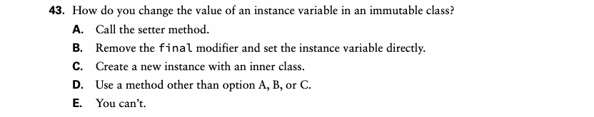

- **A.** Call the setter method.
- **B.** Remove the `final` modifier and set the instance variable directly.
- **C.** Create a new instance with an inner class.
- **D.** Use a method other than option A, B, or C.
- **E.** You can’t.

**Answer:** E

**Explanation:** By definition, you cannot change the value of an instance variable in an immutable class. There are no setter methods, making option A incorrect. While option B would allow you to set the value, the class would no longer be immutable. Option C is incorrect because that would not modify the original instance. Option E is correct. If you are an advanced developer, you might know that you can use reflection to change the value. Don’t read into questions like this on the exam. Reflection isn’t on the exam, so you can pretend it doesn’t exist.

## 829-03-044

What is the minimum number of lines that need to be removed to make this code compile?

```java
@FunctionalInterface
public interface Play {
   public static void baseball() {}
   private static void soccer() {}
   default void play() {}
   void fun();
}
```

- **A.** One
- **B.** Two
- **C.** Three
- **D.** Four
- **E.** The code compiles as is.

**Answer:** E

**Explanation:** This code is already a functional interface and compiles without any changes, making option E correct. The `Play` interface has a single `abstract` method: `fun()`. The other methods have a method body, which shows they are not `abstract`.

## 829-03-045

Fill in the blanks: A class that defines an instance variable with the same name as a variable in the parent class is referred to as \_\_\_\_\_\_\_\_\_\_\_\_\_\_\_\_\_\_\_ a variable, while a class that defines a `static` method with the same signature as a `static` method in a parent class is referred to as \_\_\_\_\_\_\_\_\_\_\_\_\_\_\_\_\_\_\_ a method.

- **A.** hiding, overriding
- **B.** overriding, hiding
- **C.** masking, masking
- **D.** hiding, masking
- **E.** replacing, overriding
- **F.** hiding, hiding

**Answer:** F

**Explanation:** Both of these descriptions refer to variable and `static` method hiding, respectively, making option F correct. Only instance methods can be overridden, making options A and B incorrect. Options C, D, and E are also incorrect because replacing and masking are not real terms in this context.

## 829-03-046

Which statements about records are correct? (Choose two.)

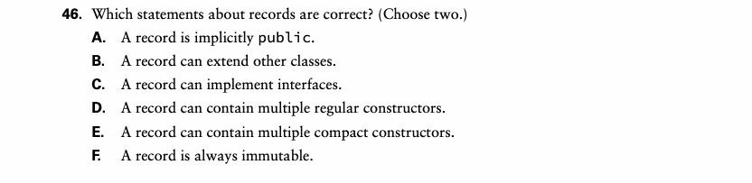


- **A.** A record is implicitly `public`.
- **B.** A record can extend other classes.
- **C.** A record can implement interfaces.
- **D.** A record can contain multiple regular constructors.
- **E.** A record can contain multiple compact constructors.
- **F.** A record is always immutable.

**Answer:** C, D

**Explanation:** Records can be declared with any access modifier and included as nested classes, making option A incorrect. A record cannot extend other classes, but it can implement interfaces, making option B incorrect and option C correct. A record can contain multiple constructors, but at most one compact constructor since a compact constructor does not take any arguments. For this reason, option D is correct and option E is incorrect. Finally, option F is incorrect. A developer could define a record with a mutable field such as an `ArrayList` and accidentally expose it for direct modification.

## 829-03-047

What change is needed to make `Secret` well encapsulated?

```java
import java.util.*;
public class Secret {
   private int number = new Random().nextInt(10);
   public boolean guess(int candidate) {
     return number == candidate;
   } }
```

- **A.** Change `number` to use a `protected` access modifier.
- **B.** Change `number` to use a `public` access modifier.
- **C.** Declare a `private` constructor.
- **D.** Declare a `public` constructor.
- **E.** Remove the `guess` method.
- **F.** None. It is already well encapsulated.

**Answer:** F

**Explanation:** This class is a good example of encapsulation. It has a `private` instance variable and is accessed by a `public` method. No changes are needed to encapsulate it, and option F is correct.

## 829-03-048

What is the output of the following application?

```java
interface Toy { String play(); }
public class Gift {
   public static void main(String[] matrix) {
     abstract class Robot {}
     class Transformer extends Robot implements Toy {
        public String name = "GiantRobot";
        public String play() {return "DinosaurRobot";}     // y1
     }
     Transformer prime = new Transformer () {
        public String play() {return name;}            // y2
     };
     System.out.print(prime.play() + " " + name);
   } }
```

- **A.** `GiantRobot`
- **B.** `GiantRobot DinosaurRobot`
- **C.** `DinosaurRobot`
- **D.** The code does not compile because of line `y1`.
- **E.** The code does not compile because of line `y2`.
- **F.** None of the above.

**Answer:** F

**Explanation:** The declarations of the local classes `Robot` and `Transformer` compile without issue. The only compilation problem in this program is the last line of the `main()` method. The variable `name` is defined inside the local class and not accessible outside class declaration without a reference to the local class. Due to scope, this last line of the `main()` method does not compile, making option F the correct answer. Note that the first part of the `print()` statement in the `main()` method, if the code compiled, prints `GiantRobot`.

## 829-03-049

What is the output of the following application?

```java
package space;
public class Bottle {
   public static class Ship {
       private enum Sail {         // w1
         TALL {protected int getHeight() {return 100;}},
         SHORT {protected int getHeight() {return 2;}};
         protected abstract int getHeight();
       }
       public Sail getSail() {
         return Sail.TALL;
       } }
    public static void main(String[] stars) {
       var bottle = new Bottle();
       Ship q = bottle.new Ship();     // w2
       System.out.print(q.getSail());
    } }
```

- **A.** `TALL`
- **B.** The code does not compile because of line `w1`.
- **C.** The code does not compile because of line `w2`.
- **D.** The code does not compile for another reason.
- **E.** The code compiles but throws an exception at runtime.

**Answer:** C

**Explanation:** The `Bottle` class includes a `static` nested class `Ship` that must be instantiated in a `static` manner. Line `w2` uses an instance of `Bottle` to instantiate the `Ship`. Therefore, line `w2` does not compile, and option C is the correct answer.

## 829-03-050

Which of the following is not a valid order for elements within a class?

- **A.** Constructor, instance variables, method declarations
- **B.** Instance variables, `static` initializer constructor, method declarations
- **C.** Method declarations, instance variables, constructor
- **D.** Instance initializer, constructor, instance variables, constructor
- **E.** None of the above

**Answer:** E

**Explanation:** The instance variables, constructor, instance and `static` initializers, and method declarations can appear in any order within a class declaration, making option E correct.

## 829-03-051

Which line of code, inserted at line `p1`, causes the application to print `5`?

```java
package games;
public class Jump {
   private int rope = 1;
   protected boolean outside;
   public Jump() {
     // line p1
     outside = true;
   }
   public Jump(int rope) {
     this.rope = outside ? rope : rope+1;
   }
   public static void main(String[] bounce) {
     System.out.print(new Jump().rope);
   } }
```

- **A.** `this(4);`
- **B.** `new Jump(4);`
- **C.** `this(5);`
- **D.** `rope = 4;`
- **E.** `super(4);`
- **F.** `super(5);`

**Answer:** A

**Explanation:** Remember that the default initialization of a `boolean` instance variable is `false`, so `outside` is `false` at line `p1`. Therefore, `this(4)` will cause `rope` to be set to `5`, while `this(5)` will cause `rope` to be set to `6`. Since `5` is the number we are looking for, option A is correct, and option C is incorrect. Option B is also incorrect. While the statement does create a new instance of `Jump`, with `rope` having a value of `5`, that instance is nested, and the value of `rope` does not affect the surrounding `instance` of `Jump` that the constructor was called in. Option D is also incorrect. The value assigned to `rope` is `4`, not the target `5`. Options E and F do not compile because the superclass is `Object`, which does not have a constructor taking an `int`.

## 829-03-052

Which of the following are not reasons to use encapsulation when designing a class? (Choose two.)

- **A.** Improve security.
- **B.** Increase concurrency and improve performance.
- **C.** Maintain class data integrity of data elements.
- **D.** Prevent users from modifying the internal attributes of a class.
- **E.** Prevent variable state from changing.
- **F.** Promote usability by other developers.

**Answer:** B, E

**Explanation:** Option A is true because encapsulation improves security because instance variables cannot be accessed directly. Implementing encapsulation prevents internal attributes of a class from being modified directly, so option D is a true statement. By preventing access to internal attributes, we can also maintain class data integrity between elements, making option C a true statement. Option F is also a true statement about encapsulation, since well-encapsulated classes are often easier to use. Encapsulation makes no guarantees about performance and concurrency, making option B one of the answers. Option E is the other answer because it describes immutability, not encapsulation.

## 829-03-053

Which is not a true statement given this diagram? Assume all classes are `public`.

```java
com.light ________________ com.dark
Flashlight ________________ Blanket
• private replaceBulb() ____ • wash()
• public turnOn()
Phone ____________________ Tent
• protected display() ______ • private pitch()
• public charge() _________ • public goCamping()
```

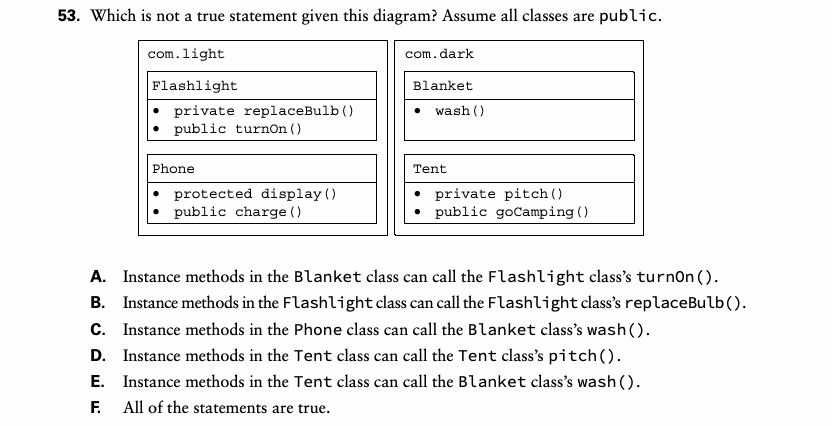

- **A.** Instance methods in the `Blanket` class can call the `Flashlight` class’s `turnOn()`.
- **B.** Instance methods in the `Flashlight` class can call the `Flashlight` class’s `replaceBulb()`.
- **C.** Instance methods in the `Phone` class can call the `Blanket` class’s `wash()`.
- **D.** Instance methods in the `Tent` class can call the `Tent` class’s `pitch()`.
- **E.** Instance methods in the `Tent` class can call the `Blanket` class’s `wash()`.
- **F.** All of the statements are true.

**Answer:** C

**Explanation:** Option A is allowed because the `turnOn()` method is `public` and can be called from anywhere. Options B and D are allowed since the method is in the same class, which is always allowed! Option E is allowed because `Tent` and `Blanket` are in the same package. The `Phone` class cannot access the `wash()` method in the `Blanket` class because it is in a different package, making option C correct.

## 829-03-054

Given the diagram in the previous question, how many of the classes shown in the diagram can call the `display()` method?

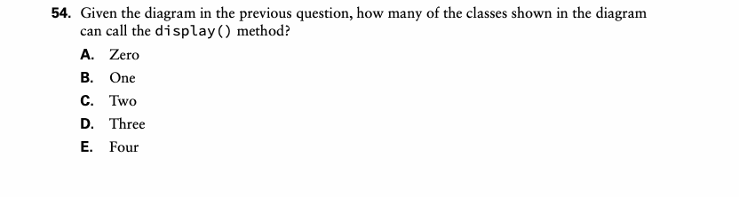


- **A.** Zero
- **B.** One
- **C.** Two
- **D.** Three
- **E.** Four

**Answer:** C

**Explanation:** The `display()` method has `protected` access. This means it can be accessed by instance methods in the same package and any subclasses. There are no subclasses in this example, so we only need to count the classes in the same package. Option C is correct because `Flashlight` and `Phone` are in the package.

## 829-03-055

Which of the following statements are correct? (Choose two.)

- **A.** Java allows multiple inheritance using two abstract classes.
- **B.** Java allows multiple inheritance using two interfaces.
- **C.** Java does not allow multiple inheritance.
- **D.** An interface can extend another interface.
- **E.** An interface can extend a record.
- **F.** An interface can implement another interface.

**Answer:** B, D

**Explanation:** While Java does not allow a class to extend more than one class, it does allow a class to implement any number of interfaces. Multiple inheritance is, therefore, only allowed via interfaces, making option B correct. Interfaces can extend other interfaces, making option D the other correct answer. The other statements are incorrect.

## 829-03-056

Which changes, taken together, would make the `Tree` class immutable? (Choose three.)

```java
1: public class Tree {
2:     String species;
3:     public Tree(String species) {
4:       this.species = species;
5:     }
6:     public String getSpecies() {
7:       return species;
8:     }
9:     private final void setSpecies(String newSpecies) {
10:      species = newSpecies;
11:    } }
```

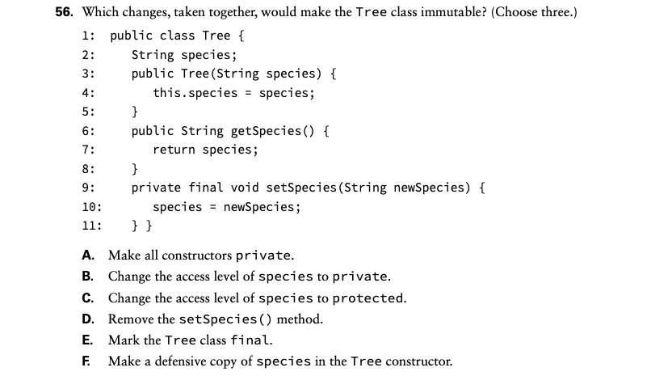

- **A.** Make all constructors `private`.
- **B.** Change the access level of `species` to `private`.
- **C.** Change the access level of `species` to `protected`.
- **D.** Remove the `setSpecies()` method.
- **E.** Mark the `Tree` class `final`.
- **F.** Make a defensive copy of `species` in the `Tree` constructor.

**Answer:** B, D, E

**Explanation:** Immutable objects are ones that are not modified after they are created. Immutable objects can have `public` constructors. There is no need to change the access modifier to `private`, making option A incorrect. All instance variables should be `private` in an immutable class to prevent subclasses and classes within the package from modifying them outside the class, making option B correct and option C incorrect. They should not have any setter methods, making option D correct. The class should also either be marked `final` or contain `final` methods to prevent subclasses from altering the behavior of the class, making option E correct. Finally, option F is incorrect as `String` is immutable, so a defensive copy is not required. Note that if `species` were a mutable type, like `List`, a defensive copy would be required.

## 829-03-057

What is the output of the following application?

```java
package ocean;
abstract interface CanSwim {
   public void swim(final int distance);
}
public class Turtle {
   final int distance = 2;
   public static void main(String[] seaweed) {
     final int distance = 3;
     CanSwim seaTurtle = {
        final int distance = 5;
        @Override
       public void swim(final int distance) {
          System.out.print(distance);
       }
    };
    seaTurtle.swim(7);
  } }
```

- **A.** `2`
- **B.** `3`
- **C.** `5`
- **D.** `7`
- **E.** The code does not compile.
- **F.** None of the above.

**Answer:** E

**Explanation:** The `main()` method attempts to define an anonymous class instance but fails to provide the class or interface name, or use the `new` keyword. The right-hand side of the assignment to the `seaTurtle` variable should start with `new CanSwim()`. For this reason, option E is the correct answer. If the code were corrected with the proper declaration, then the program would output `7` at runtime.

## 829-03-058

What is the output of the following application?

```java
package pet;
public class Puppy {
   public static int wag = 5;     // q1
   public void Puppy(int wag) { // q2
     this.wag = wag;
   }
   public static void main(String[] tail) {
     System.out.print(new Puppy(2).wag); // q3
   } }
```

- **A.** `2`
- **B.** `5`
- **C.** The first line with a compiler error is line `q1`.
- **D.** The first line with a compiler error is line `q2`.
- **E.** The first line with a compiler error is line `q3`.

**Answer:** E

**Explanation:** The `Puppy` class does not declare a constructor, so the default no-argument constructor is automatically inserted by the compiler. What looks like a constructor in the class is actually a method that has a return type of `void`. Therefore, the line in the `main()` method to create the `new Puppy(2)` object does not compile, since there is no constructor capable of taking an `int` value, making option E the correct answer.

## 829-03-059

Given the following method signature used in a class, which classes can call it?

```java
void run(String government)
```

- **A.** Classes in other packages
- **B.** Classes in the same package
- **C.** Subclasses in a different package
- **D.** All classes
- **E.** None of the above

**Answer:** B

**Explanation:** The method signature has package, or default, access; therefore, it is accessible to classes in the same package, making option B the correct answer.

## 829-03-060

Which is the first declaration to not compile?

```java
package desert;
interface CanBurrow {
   public abstract void burrow();
}
@FunctionalInterface interface HasHardShell
   extends CanBurrow {}
abstract class Tortoise implements HasHardShell {
   public abstract int toughness();
}
public class DesertTortoise extends Tortoise {
   public int toughness() { return 11; }
}
```

- **A.** `CanBurrow`
- **B.** `HasHardShell`
- **C.** `Tortoise`
- **D.** `DesertTortoise`
- **E.** All of the declarations compile.

**Answer:** D

**Explanation:** First, both `CanBurrow` and `HasHardShell` compile as functional interfaces since they contain exactly one `abstract` method, although only the latter uses the optional `@FunctionalInterface` annotation. The declarations of these two interfaces, along with the `abstract` class `Tortoise`, compile without issue, making options A, B, and C incorrect. The class `DesertTortoise` inherits two `abstract` methods, one from the interface `CanBurrow` and the other from the `abstract` parent class `Tortoise`. Since the class implements only one of them and the class is concrete, the class declaration of `DesertTortoise` fails to compile, making option D the correct answer.

## 829-03-061

Which is the first line to not compile?

```java
interface Building {
   default Double getHeight() { return 1.0; }        // m1
}
interface Office {
   public default String getHeight() { return null; } // m2
}
abstract class Tower implements Building, Office {}     // m3
public class Restaurant extends Tower {}             // m4
```

- **A.** Line `m1`
- **B.** Line `m2`
- **C.** Line `m3`
- **D.** Line `m4`
- **E.** None of the above

**Answer:** C

**Explanation:** The interface declarations compile without issue. When inheriting two `default` methods with the same signature, the `Tower` class is required to override both methods even if the class is marked `abstract`. For this reason, line `m3` is the first line that does not compile, and option C is correct. Note that there is no possible overridden method that can fulfill both inherited `default` methods since the return types are not covariant.

## 829-03-062

What is the output of the following code snippet?

```java
public class Nature {
  public static void main(String[] seeds) {
    record Tree() {}
    var tree = "pine";
    int count = 0;
    if (tree.equals("pine")) {
       int height = 55;
       count = count + 1;
    }
    System.out.print(height + count);
   } }
```

- **A.** `1`
- **B.** `55`
- **C.** `56`
- **D.** It does not compile because a record cannot be nested in a method.
- **E.** It does not compile because a record must have at least one value passed in.
- **F.** It does not compile for another reason.

**Answer:** F

**Explanation:** The `height` variable is declared within the `if` statement block. Therefore, it cannot be referenced outside the `if` statement, and the code does not compile, making option F correct. The rest of the code is correct.

## 829-03-063

Which of the following are valid comments in Java? (Choose three.)

- **A.** `/****** TODO */`
- **B.** `# Fix this bug later`
- **C.** `‘ Error closing pod bay doors`
- **D.** `/ Invalid record /`
- **E.** `/* Page not found */`
- **F.** `// IGNORE ME`

**Answer:** A, E, F

**Explanation:** Java supports three types of comments: single-line (`//`), multiline (`/* */`), and Javadoc (`/** **/`), making options A, E, and F correct. The other options may be comments in other languages, but not in Java.

## 829-03-064

Which of the following pairs of modifiers can both be applied to a method? (Choose three.)

- **A.** `private` and `final`
- **B.** `abstract` and `final`
- **C.** `static` and `private`
- **D.** `private` and `abstract`
- **E.** `abstract` and `static`
- **F.** `static` and `protected`

**Answer:** A, C, F

**Explanation:** An `abstract` method is one that will be implemented by a subclass. For this reason, it cannot be combined with `final` or `private`, as both prevent a method from being overridden, making options B and D incorrect. An `abstract` method can also not be marked `static`, since `static` members belong to the class level, not an instance, making option E incorrect. Options A, C, and F are the correct answers. Note that marking a `private` method `final` has no practical implication, although it is allowed.

## 829-03-065

Given the following class, what should be inserted into the two blanks to ensure the class data is properly encapsulated?

```java
package storage;
public class Box {
    public String stuff;
                String ____________ () {
       return stuff;
    }
    public void setStuff(String stuff) {
       this.stuff = stuff;
    } }
```

- **A.** `private` and `getStuff`
- **B.** `private` and `isStuff`
- **C.** `public` and `getStuff`
- **D.** `public` and `isStuff`
- **E.** `default` and `getStuff`
- **F.** None of the above

**Answer:** F

**Explanation:** The class data, `stuff`, is declared `public`, allowing any class to modify the `stuff` variable and making the implementation inherently unsafe for encapsulation. Therefore, there are no values that can be placed in the two blanks to ensure the class properly encapsulates its data, making option F correct. Note that if `stuff` were declared `private`, options A, B, C, and D would all be correct. Encapsulation does not require any specific method names, just that the internal attributes are protected from outside access, which all of these sets of values do achieve. Option E is incorrect because classes cannot define `default` methods.

## 829-03-066

How many rows of the following table contain an error? Interface member Membership type Requires method body? `static` method Class Yes `private` non-`static` Class Yes method `abstract` method Instance No `default` method Instance No `private static` method Class Yes

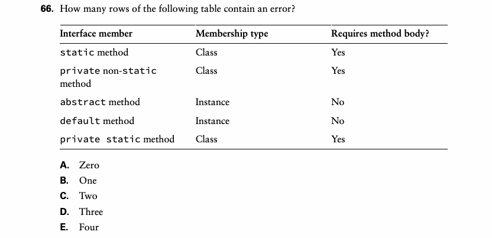

- **A.** Zero
- **B.** One
- **C.** Two
- **D.** Three
- **E.** Four

**Answer:** C

**Explanation:** The second row is incorrect, as `private` methods belong to an instance, not the class. The fourth row is also incorrect, as `default` methods require a method body. The rest of the rows are correct, making option C correct.

## 829-03-067

Fill in the blanks: \_\_\_\_\_\_\_\_\_\_\_\_\_\_\_\_\_\_\_ is used to call a constructor in the parent class, while \_\_\_\_\_\_\_\_\_\_\_\_\_\_\_\_\_\_\_ is used to reference a member of the parent class.

- **A.** `super`, `this()`
- **B.** `super`, `super()`
- **C.** `super()`, `this`
- **D.** `super()`, `super`
- **E.** None of the above

**Answer:** D

**Explanation:** The `super()` statement is used to call a constructor in the parent class, while `super` is used to reference a member of the parent class. The `this()` statement is used to call a constructor in the current class, while `this` is used to reference a member of the current class. For these reasons, option D is the correct answer.

## 829-03-068

Which of the following declarations can be inserted into the blank and have the class compile?

```java
public sealed class Toy {
                              extends Toy {}
}
```

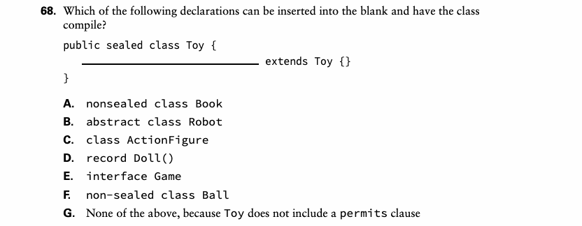

- **A.** `nonsealed class Book`
- **B.** `abstract class Robot`
- **C.** `class ActionFigure`
- **D.** `record Doll()`
- **E.** `interface Game`
- **F.** `non-sealed class Ball`
- **G.** None of the above, because `Toy` does not include a `permits` clause

**Answer:** F

**Explanation:** A sealed class can only be extended by a class with a `final`, `non-sealed`, or `sealed` modifier, making option F correct. The `permits` clause is optional if the subclasses are within the same file. Option A is incorrect because `nonsealed` is not a keyword. Options B and C are incorrect because they are missing one of the required modifiers. Options D and E are incorrect because records and interfaces cannot extend a class.

## 829-03-069

What is the output of the `Watch` program?

```java
1: class SmartWatch extends Watch {
2:     private String getType() { return "smart watch"; }
3:     public String getName(String suffix) {
4:       return getType() + suffix;
5:     } }
6: public class Watch {
7:     private String getType() { return "watch"; }
8:     public String getName(String suffix) {
9:       return getType() + suffix;
10:    }
11:    public static void main(String[] args) {
12:      var watch = new Watch();
13:      var smartWatch = new SmartWatch();
14:      System.out.print(watch.getName(","));
15:      System.out.print(smartWatch.getName(""));
16:    } }
```

- **A.** `smart watch,watch`
- **B.** `watch,smart watch`
- **C.** `watch,watch`
- **D.** The code does not compile
- **E.** An exception is printed at runtime
- **F.** None of the above

**Answer:** B

**Explanation:** Line 14 calls the method on line 8 since it is a `Watch` object. That returns `watch`, making option A incorrect. Line 15 calls the method on line 3 since it is a `SmartWatch` object and the method is properly overridden. That returns `smart watch`, so option B is the answer, and option C is incorrect.

## 829-03-070

What is the output of the `Movie` program?

```java
package theater;
class Cinema {
   private String name = "Sequel";
   public Cinema(String name) {
     this.name = name;
   } }
public class Movie extends Cinema {
   private String name = "adaptation";
   public Movie(String movie) {
     this.name = "Remake";
   }
   public static void main(String[] showing) {
     System.out.print(new Movie("Trilogy").name);
   } }
```

- **A.** `Sequel`
- **B.** `Trilogy`
- **C.** `Remake`
- **D.** `Adaptation`
- **E.** `null`
- **F.** None of the above

**Answer:** F

**Explanation:** The `Cinema` class defines a constructor that takes a `String` value, which means the compiler does not insert the default no-argument constructor. Therefore, it is not available in the `Movie` constructor, and an explicit constructor must be called with `super()`. Since this is not done, the `Movie` constructor does not compile, making option F the correct answer.

## 829-03-071

Which statement best describes this class?

```java
import java.util.*;
public final class Ocean {
   private final List<String> algae;
   private final double wave;
   private int sun;
   public Ocean(double wave) {
     this.wave = wave;
     this.algae = new ArrayList<>();
   }
   public int getSun() {
     return sun;
   }
   public void setSun(int sun) {
     sun = sun;
   }
  public double getWave() {
    return wave;
  }
  public List<String> getAlgae() {
    return new ArrayList<String>(algae);
  } }
```

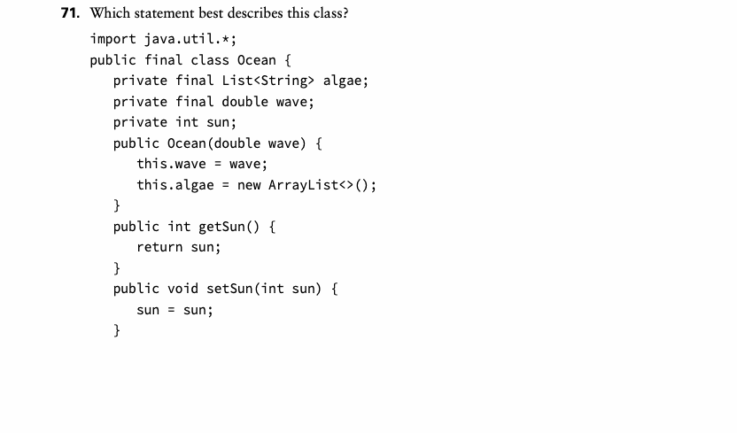

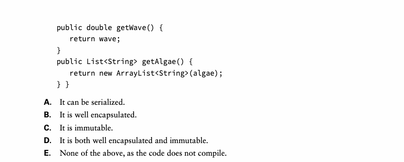

- **A.** It can be serialized.
- **B.** It is well encapsulated.
- **C.** It is immutable.
- **D.** It is both well encapsulated and immutable.
- **E.** None of the above, as the code does not compile.

**Answer:** D

**Explanation:** This class does not implement `Serializable`, so option A is incorrect. This code is well encapsulated because the instance variables are `private`. The `algae` and `wave` variables are immutable because they are marked `final` and there are no methods that can change them. The `getAlgae()` method creates a defensive copy, preventing direct access to the `algae` object. Finally, the `sun` variable is initialized to `0` and cannot be changed after its creation. The `setSun()` method is missing a `this` reference, so the assignment `sun = sun` assigns the method parameter `sun` to itself. For these reasons, the class is immutable, and option D is correct.

## 829-03-072

Given the file `Magnet.java` shown, which of the marked lines can you independently insert the line `var color;` into and still have the code compile?

```java
// line a1
public class Magnet {
   // line a2
   public void attach() {
     // line a3
   }
   // line a4
}
```

- **A.** `a2`
- **B.** `a3`
- **C.** `a2` and `a3`
- **D.** `a1`, `a2`, `a3`, and `a4`
- **E.** None of the above

**Answer:** E

**Explanation:** Local variable type inference requires a value so that the type can be inferred. The `var` `color;` statement without a value is not allowed, making option E the answer.

## 829-03-073

Which of the following results is not a possible output of this program?

```java
package sea;
enum Direction { north, south, east, west; };
public class Ship {
   public static void main(String[] compass) {
     System.out.print(Direction.valueOf(compass[0]));
   } }
```

- **A.** `WEST` is printed.
- **B.** `south` is printed.
- **C.** An `ArrayIndexOutOfBoundsException` is thrown at runtime.
- **D.** An `IllegalArgumentException` is thrown at runtime.
- **E.** All of the above are possible.

**Answer:** A

**Explanation:** If the program is called with a single input `south`, then `south` would be printed at runtime. If the program is called with no input, then the `compass` array would be of size zero and an `ArrayIndexOutOfBoundsException` would be thrown at runtime. Finally, if the program is called with a string that does not match one of the values in `Direction`, then an `IllegalArgumentException` would be thrown at runtime. The only result not possible is `WEST`, since the enum value is in lowercase, making option A the correct answer.

## 829-03-074

What is the output of the following application?

```java
package radio;
public class Song {
   public void playMusic() {
     System.out.print("Play!");
   }
   private static void playMusic() {
     System.out.print("Music!");
   }
   private static void playMusic(String song) {
     System.out.print(song);
   }
   public static void main(String[] tracks) {
     new Song().playMusic();
   } }
```

- **A.** `Play!`
- **B.** `Music!`
- **C.** The code does not compile.
- **D.** The code compiles, but the answer cannot be determined until runtime.

**Answer:** C

**Explanation:** A class cannot contain two methods with the same method signature, even if one is `static` and the other is not. Therefore, the code does not compile because the two declarations of `playMusic()` conflict with one another, making option C the correct answer.

## 829-03-075

Which of the following statements about overriding a method are correct? (Choose three.)

- **A.** The return types must be covariant.
- **B.** The access modifier of the method in the child class must be the same as or narrower than the method in the superclass.
- **C.** The return types must be the same.
- **D.** A checked exception declared by the method in the parent class must be declared by the method in the child class.
- **E.** A checked exception declared by a method in the child class must be the same as or narrower than the exception declared by the method in the parent class.
- **F.** The access modifier of the method in the child class must be the same as or broader than the method in the superclass.

**Answer:** A, E, F

**Explanation:** First, the return types of an overridden method must be covariant, making option A correct. They can be the same, but it is not required, making option C incorrect. Next, the access modifier must be the same as or broader than the child method, making option B incorrect, and option F correct. Option D is incorrect as an overridden method is not required to throw a checked exception declared in the parent version of the method. If it does declare a checked exception, it cannot be new or broader than the ones declared in the superclass, making option E correct.

## 829-03-076

How many lines of the following code do not compile?

```java
 10: interface Flavor {
 11:    public default void happy() {
 12:      printFlavor("Rocky road");
 13:    }
 14:    private static void excited() {
 15:      printFlavor("Peanut butter");
 16:    }
17:    private void printFlavor(String f) {
18:      System.out.println("Favorite Flavor is: "+f);
19:    }
20:    public static void sad() {
21:      printFlavor("Butter pecan");
22:    }
23: }
24: public class IceCream implements Flavor {
25:    @Override public void happy() {
26:      printFlavor("Cherry chocolate chip");
27:    } }
```

- **A.** None, they all compile.
- **B.** One
- **C.** Two
- **D.** Three
- **E.** Four
- **F.** Five or more

**Answer:** D

**Explanation:** A `private` non-`static` interface method may only be accessed from other `private` or `default` methods declared within the interface. Lines 15 and 21 do not compile because the `private` method is called within `static` methods. Line 26 does not compile because a `private` interface method cannot be called in a method outside the interface declaration. Since these three lines do not compile, option D is correct.

## 829-03-077

What is the output of the following program?

```java
1: public record Disco(int beats) {
2:     public Disco(String beats) {
3:       this(20);
4:     }
5:     public Disco {
6:       beats = 10;
7:     }
8:     public int getBeats() {
9:       return beats;
10:    }
11:    public static void main(String[] args) {
12:      System.out.print(new Disco(30).beats());
13:    } }
```

- **A.** `10`
- **B.** `20`
- **C.** `30`
- **D.** Exactly one line needs to be corrected for the program to compile.
- **E.** Exactly two lines need to be corrected for the program to compile.
- **F.** Three or more lines need to be corrected for the program to compile.
- **G.** The code compiles but prints an exception at runtime.

**Answer:** A

**Explanation:** The code compiles without issue. Line 2 declares an overloaded constructor, while line 5 declares a compact constructor. Line 8 creates a new method. The `beats` value can then be accessed from `getBeats()` or `beats()`, the latter of which is provided by the compiler. When the code runs, the compact constructor is called and the input parameter is replaced with `10`, making option A correct.

## 829-03-078

Which of the following words are modifiers that are implicitly applied to all interface variables? (Choose three.)

- **A.** `const`
- **B.** `final`
- **C.** `abstract`
- **D.** `static`
- **E.** `public`
- **F.** `constant`

**Answer:** B, D, E

**Explanation:** Interface variables are implicitly `public`, `static`, and `final`, making options B, D, and E correct. The words `const` and `constant` aren’t modifiers, so options A and F are incorrect. Option C is also incorrect. Variables cannot be declared as `abstract` in interfaces, nor in classes.

## 829-03-079

Given the following method, what is the first line that does not compile?

```java
public static void main(String[] args) {
   int Integer = 0;       // k1
   Integer int = 0;       // k2
   Integer ++;            // k3
   int++;                // k4
   int var = null;        // k5
}
```

- **A.** `k1`
- **B.** `k2`
- **C.** `k3`
- **D.** `k4`
- **E.** `k5`

**Answer:** B

**Explanation:** `Integer` is the name of a class in Java. While it is bad practice to use the name of a class as your local variable name, it is legal. Therefore, `k1` does compile. It is not legal to use a reserved word as a variable name. All of the primitives including `int` are reserved words. Therefore, `k2` does not compile, and option B is the answer. Lines `k4` and `k5` don’t compile either, but the question asks about the first line to not compile.

## 829-03-080

What is the result of compiling and executing the following class?

```java
public class Tolls {
   private static int yesterday = 1;
   int tomorrow = 10;
   public static void main(String[] args) {
     var tolls = new Tolls();
     int today = 20, tomorrow = 40;     // line x
     System.out.print(
        today + tolls.tomorrow + tolls.yesterday); // line y
   } }
```

- **A.** The code does not compile due to line `x`.
- **B.** The code does not compile due to line `y`.
- **C.** `31`
- **D.** `61`
- **E.** None of the above.

**Answer:** C

**Explanation:** The code compiles and runs without issue, so options A and B are incorrect. The question relies on your ability to understand variable scope. The `today` variable has local scope to the method in which it is executed. The `tomorrow` variable is re-declared in the method, but the reference used on line `y` is to the instance variable with a value of `10`. Finally, the `yesterday` variable is `static`. While using an instance reference to access a `static` variable is not recommended, it does not prevent the variable from being read. The result is line `y` evaluates and prints `31` (`20` + `10` + `1`), making option C the correct answer.

## 829-03-081

What is the output of the following application?

```java
package weather;
public class Forecast {
   public enum Snow {
     BLIZZARD, SQUALL, FLURRY
     @Override public String toString() { return "Sunny"; }
   }
   public static void main(String[] modelData) {
     System.out.print(Snow.BLIZZARD.ordinal() + " ");
     System.out.print(Snow.valueOf("flurry".toUpperCase()));
   } }
```

- **A.** `0 FLURRY`
- **B.** `1 FLURRY`
- **C.** `0 Sunny`
- **D.** `1 Sunny`
- **E.** The code does not compile.
- **F.** None of the above.

**Answer:** E

**Explanation:** If an enum contains anything other than a list of values, then a semicolon (`;`) must follow the list of values. The `Snow` enum includes a method, so there must be a semicolon after the last value, `FLURRY`. For this reason, the code does not compile, and option E is correct. If the semicolon was added, then the code would compile and print `0 Sunny` at runtime, with the overridden `toString()` replacing the default value of `FLURRY`.

## 829-03-082

Which of the following is an invalid statement?

- **A.** The first line of every constructor is a call to the parent constructor via the `super()` command.
- **B.** A class is not required to have a constructor explicitly defined.
- **C.** A constructor may pass arguments to the parent constructor.
- **D.** A `final` instance variable whose value is not set when it is declared or in an initialization block should be set by the constructor.
- **E.** All of the above are valid statements.

**Answer:** A

**Explanation:** Option A is the correct answer because the first line of a constructor could be `this()` or `super()`, making it an invalid statement. Option B is a true statement because the compiler will insert the default no-argument constructor if one is not defined. Option C is also a true statement, since zero or more arguments may be passed to the parent constructor, if the parent class defines such constructors. Option D is also true. The value of a `final` instance variable must be set when it is declared in an initialization block or in a constructor.

## 829-03-083

What can fill in the blank so that the `play()` method can be called from all classes in the `com.mammal` and `com.mammal.eland` package, but not in the `com.mammal.gopher` package?

```java
package com.mammal;
public class Enrichment {
          void play() {}
}
```

- **A.** Leave it blank
- **B.** `private`
- **C.** `protected`
- **D.** `public`
- **E.** None of the above

**Answer:** E

**Explanation:** If only the `com.mammal` class needed access, option A would be correct. Access modifiers cannot be used to grant access to a list of packages. The Java Platform Module Framework can do this, but it is not an option in this question. Therefore, option E is correct.

## 829-03-084

What is the output of the `Rocket` program?

```java
package transport;
class Ship {
   protected int weight = 3;
   protected int height = 5;
   public int getWeight() { return weight; }
   public int getHeight() { return height; }
}
public class Rocket extends Ship {
   public int weight = 2;
   public int height = 4;
   public void printDetails() {
     System.out.print(super.getWeight() + "," + this.height);
   }
   public static final void main(String[] fuel) {
     new Rocket().printDetails();
   } }
```

- **A.** `2,5`
- **B.** `3,4`
- **C.** `5,2`
- **D.** `3,5`
- **E.** The code does not compile.
- **F.** None of the above.

**Answer:** B

**Explanation:** The `super.getWeight()` method returns `3` from the variable in the parent class, as polymorphism and overriding do not apply to instance variables. The `this.height` call returns the value of the variable in the current class, which is `4`. For these reasons, option B is correct.

## 829-03-085

Imagine you are working with another team to build an application. You are developing code that uses a class that the other team has not yet finished writing. You want to allow easy integration once the other team’s code is complete. Which statements would meet this requirement? (Choose two.)

- **A.** An abstract class is best.
- **B.** An interface is best.
- **C.** Either an abstract class or interface would meet the requirement.
- **D.** The methods should be `protected`.
- **E.** The methods should be `public`.
- **F.** The methods should be `static`.

**Answer:** B, E

**Explanation:** The key here is understanding which of these features of Java allow one developer to build their application around another developer’s code, even if that code is not ready yet. For this problem, an interface is the best choice. If the two teams agree on a common interface, one developer can write code that uses the interface, while another developer writes code that implements the interface. Assuming neither team changes the interface, the code can be easily integrated once both teams are done. For these reasons, option B is correct. Interfaces expose methods using the `public` keyword, making option E the other answer.

## 829-03-086

Fill in the blank with the line of code that allows the program to compile and print `10` at runtime.

```java
 interface Speak {
    public default int getVolume() { return 20; }
 }
interface Whisper {
   public default int getVolume() { return 10; }
}
public class Debate implements Speak, Whisper {
   public int getVolume() { return 30; }
   public static void main(String[] a) {
     var d = new Debate();
     System.out.println( ______________ );
   } }
```

- **A.** `Whisper.d.getVolume()`
- **B.** `d.Whisper.getVolume()`
- **C.** `Whisper.super.getVolume()`
- **D.** `d.Whisper.super.getVolume()`
- **E.** The code does not compile regardless of what is inserted into the blank.
- **F.** None of the above.

**Answer:** F

**Explanation:** The code compiles, even if the blank is replaced with a constant value, making option E incorrect. Note that the class correctly overrides both inherited `default` methods. While it is possible to call a specific inherited `default` method, even when it has been overridden, it requires calling `super`, which is not accessible from the `static` method `main()`. For these reasons, options A, B, C, and D do not work either, making option F correct.

## 829-03-087

Which of the following properties of an enum can be marked `abstract`?

- **A.** The enum type definition
- **B.** An enum method
- **C.** An enum value
- **D.** An enum constructor
- **E.** None of the above

**Answer:** B

**Explanation:** An enum declaration itself cannot be marked `abstract`, nor can any of its values, but its methods can be marked `abstract`, making option B the correct answer. Note that if an enum contains an abstract method, then every enum value must include an override of this `abstract` method.

## 829-03-088

How many lines does the following code output?

```java
public class Cars {
   static {
     System.out.println("static");
   }
   private static void drive() {
     System.out.println("fast");
   }
   { System.out.println("faster"); }
   public static void main(String[] args) {
     drive();
     drive();
   } }
```

- **A.** One
- **B.** Two
- **C.** Three
- **D.** Four
- **E.** Five
- **F.** None of the above. The code does not compile.

**Answer:** C

**Explanation:** The `static` initializer is run only once. The `static` method is run twice since it is called twice. Therefore, three lines are printed, and option C is correct. The instance initializer block is never run because the `Cars` class is never constructed.

## 829-03-089

What does the following program output?

```java
public record Passenger(String firstName, String lastName) {
   static String middleName;
   @Override public String toString() {
     return null;
   }
   @Override public String getFirstName() {
     return null;
   }
   public static void main(String[] args) {
     var p = new Passenger("John", "Colbert");
     System.out.println(p.getFirstName());
   } }
```

- **A.** `john`
- **B.** `colbert`
- **C.** `null`
- **D.** The code does not compile.
- **E.** The code compiles but prints an exception at runtime.
- **F.** None of the above.

**Answer:** D

**Explanation:** An accessor (or getter) in a record is defined without a `get` prefix. For this reason, the declaration of `getFirstName()` is invalid because it includes an `@Override` annotation and there is no such method inherited. Since the code does not compile, option D is correct. For the exam, you don’t need to know how to create annotations but you need to know when the common ones are incorrectly used. If the annotation were removed, then the code would print `null` at runtime.

## 829-03-090

Suppose `foo` is a reference to an instance of a class `Foo`. Which of the following is not possible about the variable reference `foo.bar`?

- **A.** `bar` is an instance variable.
- **B.** `bar` is a `static` variable.
- **C.** `bar` is a local variable.
- **D.** It can be used to read from `bar`.
- **E.** It can be used to write to `bar`.
- **F.** All of the above are possible.

**Answer:** C

**Explanation:** Dot notation is used for both reading and writing instance variables, assuming they are in scope. It cannot be used for referencing local variables, making option C the correct answer. It is possible that `bar` is a `static` variable, although accessing it in this manner is not recommended.

## 829-03-091

The following diagram shows two reference variables pointing to the same `Bunny` object in memory. The reference variable `myBunny` is of type `Bunny`, while `unknownBunny` is a valid but unknown data type. Which statements about the reference variables are true? Assume the instance methods and variables shown in the diagram are marked `public`. (Choose three.) `Bunny` Object in Memory

```java
myBunny
unknownBunny
```

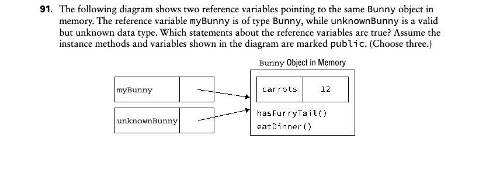

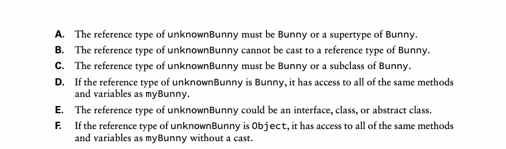

- **A.** The reference type of `unknownBunny` must be `Bunny` or a supertype of `Bunny`.
- **B.** The reference type of `unknownBunny` cannot be cast to a reference type of `Bunny`.
- **C.** The reference type of `unknownBunny` must be `Bunny` or a subclass of `Bunny`.
- **D.** If the reference type of `unknownBunny` is `Bunny`, it has access to all of the same methods and variables as `myBunny`.
- **E.** The reference type of `unknownBunny` could be an interface, class, or abstract class.
- **F.** If the reference type of `unknownBunny` is `Object`, it has access to all of the same methods and variables as `myBunny` without a cast.

**Answer:** A, D, E

**Explanation:** The reference type of `unknownBunny` must be `Bunny` or a supertype of `Bunny`, including any abstract classes, concrete classes, or interfaces that `Bunny` inherits. For this reason, options A and E are correct, and option C is incorrect. Option B is incorrect. Since it already points to an instance of `Bunny`, casting it to a `Bunny` reference is allowed. Option D is trivially true. If the reference types of both are the same, then they can call the same instance members. Option F is incorrect, as casting is required to access members declared in `Bunny` that are not defined in `Object`.

## 829-03-092

Which of the following interface methods are inherited by classes that implement the interface? (Choose two.)

- **A.** `private` methods
- **B.** `private static` methods
- **C.** `default` methods
- **D.** `static` methods
- **E.** `abstract` methods
- **F.** `final` methods

**Answer:** C, E

**Explanation:** Methods marked `private` or `static` are never inherited, so options A, B, and D are incorrect. Interface methods cannot be `final`, so option F is incorrect. That leaves `default` and `abstract` methods, which are both inherited by classes implementing the interface, making options C and E correct.

## 829-03-093

Which of these are functional interfaces?

```java
interface Lion {
   public void roar();
   default void drink() {}
   String toString();
}
interface Tiger {
   public void roar();
   default void drink() {}
   int hashCode();
}
```

- **A.** `Lion`
- **B.** `Tiger`
- **C.** Both `Lion` and `Tiger`
- **D.** Neither is a functional interface.
- **E.** The code does not compile.

**Answer:** C

**Explanation:** The code does compile, so option E is incorrect. A functional interface is required to have exactly one `abstract` method. In both interfaces, that is `roar()`. The `toString()` and `hashCode()` method signatures match those from `Object`. Since they are provided to all subclasses, they are not considered `abstract`. Since `roar()` is the only `abstract` method, both are functional interfaces, making option C the answer.

## 829-03-094

Given the following code, which lines when placed independently in the blank allow the code to compile and print `bounce`? (Choose two.)

```java
public class TennisBall {
   public TennisBall() {
     System.out.println("bounce");
    }
    public static void main(String[] slam) {
                                        ;
    } }
```

- **A.** `var new = TennisBall`
- **B.** `TennisBall()`
- **C.** `var var = new TennisBall()`
- **D.** `new TennisBall`
- **E.** `new TennisBall()`

**Answer:** C, E

**Explanation:** To call a constructor, you must use the `new` keyword, making option E correct. It cannot be called as if it was a normal method. This rules out options A and B. Further, option D is incorrect because the parentheses are required. Option C is correct, as `var` may be used as a variable name.

## 829-03-095

How many of the `public` methods in the class compile?

```java
public class Singing {
   private void sing(String key) {}
   public void sing_do(String key, String... harmonies) {
    this.sing(key);
   }
   public void sing_re(int note, String... sound, String key) {
     this.sing(key);
   }
   public void sing_me(String... keys, String... pitches) {
     this.sing(key);
   }
   public void sing_fa(String key, String... harmonies) {
     this.Singing.sing(key);
   }
   public void sing_so(int note, String... sound,
     String key) {
    this.Singing.sing(key);
   }
   public void sing_la(String... keys, String... pitches) {
     this.Singing.sing(key);
   } }
```

- **A.** Zero
- **B.** One
- **C.** Two
- **D.** Three
- **E.** Four
- **F.** Five
- **G.** Six

**Answer:** B

**Explanation:** To a call an instance method, you can use the `this` prefix. The class name is not included, ruling out the last three methods. A method may contain at most one varargs parameter, and it must appear as the last argument in the list. For this reason, the `sing_do()` method is the only method using varargs that compiles. The `sing()` method also compiles but the question asked for the `public` methods. Therefore, option B is the answer.

## 829-03-096

What is the output of the following application?

```java
package world;
public class Matrix {
   private int level = 1;
   class Deep {
     private int level = 2;
     class Deeper {
        private int level = 5;
        public void printReality(int level) {
           System.out.print(this.level+" ");
           System.out.print(Matrix.Deep.this.level+" ");
           System.out.print(Deep.this.level);
        } } }
   public static void main(String[] bots) {
     Matrix.Deep.Deeper simulation = new Matrix()
        .new Deep().new Deeper();
     simulation.printReality(6);
   } }
```

- **A.** `1 1 2`
- **B.** `5 2 2`
- **C.** `5 2 1`
- **D.** `6 2 2`
- **E.** `6 2 1`
- **F.** The code does not compile.

**Answer:** B

**Explanation:** The code compiles without issue. The first `print()` statement refers to `level` declared in the `Deeper` class, so `5` is printed. The second and third `print()` statements actually refer to the same value in the `Deep` class, so `2` is printed twice. The prefix `Matrix.` is unnecessary in the first of the two `print()` statements and does not change the result. For these reasons, option B is the correct answer.

## 829-03-097

Not counting the `Time` declaration, how many declarations compile? Assume they are all declared within the same `.java` file.

```java
public sealed interface Time permits Hour, Minute, Second {}
record Hour() implements Time {}
interface Minute extends Time {}
non-sealed class Second implements Time {}
class Micro extends Second {}
```

- **A.** Zero
- **B.** One
- **C.** Two
- **D.** Three
- **E.** Four

**Answer:** D

**Explanation:** A sealed subclass must have a `final`, `sealed`, or `non-sealed` modifier. For this reason, `Second` compiles. A record is implicitly `final`, so `Hour` also compiles. `Micro` compiles since it extends a `non-sealed` class. `Minute` is the only one that does not compile since an `interface` is implicitly `abstract` and is missing `sealed` or `non-sealed`, making option D correct.

## 829-03-098

Given that `Integer` and `Long` are direct subclasses of `Number`, what type can be used to fill in the blank in the following class to allow it to compile?

```java
package orchestra;
interface MusicCreator { public Number play(); }
abstract class StringInstrument {
   public Long play() {return 3L;}
}
public class Violin extends StringInstrument
     implements MusicCreator {
   public _____________ play() {
     return null;
   } }
```

- **A.** `Long`
- **B.** `Integer`
- **C.** `Long` or `Integer`
- **D.** `Long` or `Number`
- **E.** `Long`, `Integer`, or `Number`
- **F.** None of the above

**Answer:** A

**Explanation:** The `play()` method is overridden in `Violin` for both `MusicCreator` and `StringInstrument`, so the return type must be covariant with both. `Long` is a subclass of `Number`, and therefore, it is covariant with the version in `MusicCreator`. Since it matches the type in `StringInstrument`, it can be inserted into the blank, and the code would compile. `Integer` is not a subclass of `Long` used in `StringInstrument` and would cause the code to not compile. `Number` is compatible with the version of the method in `MusicCreator` but not with the version in `StringInstrument`. For these reasons, `Long` is the only class that allows the code to compile, making option A the correct answer.

## 829-03-099

What is the output of the `RightTriangle` program?

```java
package shapes;
abstract class Triangle {
   abstract String getDescription();
}
abstract class IsoRightTriangle extends RightTriangle { // g1
   public String getDescription() { return "irt"; }
}
public class RightTriangle extends Triangle {
   protected String getDescription() { return "rt"; }     // g2
   public static void main(String[] edges) {
     final var shape = new IsoRightTriangle();       // g3
     System.out.print(shape.getDescription());
   } }
```

- **A.** `rt`
- **B.** `irt`
- **C.** The code does not compile due to line `g1`.
- **D.** The code does not compile due to line `g2`.
- **E.** The code does not compile due to line `g3`.
- **F.** None of the above.

**Answer:** E

**Explanation:** The `IsoRightTriangle` class is `abstract`; therefore, it cannot be instantiated on line `g3`, making option E correct. If the `abstract` modifier were removed from the `IsoRightTraingle` declaration, then the rest of the code would compile and print `irt` at runtime.

## 829-03-100

What is the output of the following program?

```java
interface Dog {
   private void buryBone() { chaseTail(); }
   private static void wagTail() { chaseTail(); }
   public default String chaseTail() { return "So cute!"; }
}
public class Puppy implements Dog {
   public String chaseTail() throws IllegalArgumentException {
     throw new IllegalArgumentException("Too little!");
   }
   public static void main(String[] t) {
     var p = new Puppy();
     System.out.print(p.chaseTail());
   } }
```

- **A.** `So cute!`
- **B.** An exception is thrown with a `Too little!` message.
- **C.** A different exception is thrown.
- **D.** The code does not compile because `buryBone()` is not used.
- **E.** The code does not compile because `chaseTail()` cannot declare any exceptions in the `Puppy` class.
- **F.** None of the above.

**Answer:** F

**Explanation:** The `private static` method `wagTail()` attempts to access an instance-based `default` method `chaseTail()`, which results in a compiler error, making option F correct. While `buryBone()` is not used, it does not result in a compiler error, making option D incorrect. Overridden methods are permitted to declare new unchecked exceptions, and since `IllegalArgumentException` is unchecked, the override is allowed, making option E incorrect.

## 829-03-101

How do you force garbage collection to occur at a certain point?

- **A.** Calling `System.forceGc()`
- **B.** Calling `System.gc()`
- **C.** Calling `System.requireGc()`
- **D.** Calling `GarbageCollection.clean()`
- **E.** None of the above

**Answer:** E

**Explanation:** While you can suggest to the JVM that it might want to run a garbage collection cycle, the JVM is free to ignore your suggestion. Option B is how to make this suggestion. Since garbage collection is not guaranteed to run, option E is correct.

## 829-03-102

Which changes made to the following class would help to properly encapsulate the data in the class?

```java
package shield;
public class Protect {
   private String material;
   protected int strength;
   public int getStrength() {
     return strength;
   }
    public void setStrength(int strength) {
       this.strength = strength;
    } }
```

- **A.** Add a getter method for `material`.
- **B.** Add a setter method for `material`.
- **C.** Change the access modifier of `material` to `protected`.
- **D.** Change the access modifier of `strength` to `private`.
- **E.** None of the above.

**Answer:** D

**Explanation:** The access modifier of `strength` is `protected`, meaning subclasses and classes within the same package can modify it. Changing the value to `private` would improve encapsulation by making the `Protect` class the only one capable of directly modifying it. For these reasons, option D is correct.

## 829-03-103

Which are true statements about referencing variables from a lambda? (Choose two.)

- **A.** Instance and `static` variables can be used regardless of whether they are effectively final.
- **B.** Instance and local variables can be used regardless of whether they are effectively final.
- **C.** Instance variables and method parameters must be effectively final to be used.
- **D.** Local variables and method parameters must be effectively final to be used.
- **E.** Local and `static` variables can be used regardless of whether they are effectively final.
- **F.** Method parameters and `static` variables can be used regardless of whether they are effectively final.

**Answer:** A, D

**Explanation:** A lambda can reference any instance variable, `static` variable, or lambda parameter that is in scope, making option A correct. Lambdas require local variables and method parameters to be effectively final in order to use them, making option D the other correct answer.

## 829-03-104

Which statement about the following classes is correct?

```java
import java.util.*;
final class Faucet {
   private final String water;
   private final List<Double> pipes;
   public Faucet(String water, List<Double> pipes) {
     this.water = water;
     this.pipes = pipes;
   }
   public String getWater() { return water; }
   public List<Double> getPipes() { return pipes; } }
public final class Spout {
   private final String well;
   private final List<Boolean> buckets;
   public Spout(String well, List<Boolean> buckets) {
     this.well = well;
     this.buckets = new ArrayList<>(buckets);
   }
  public String getWell() { return well; }
  public List<Boolean> getBuckets() {
    return new ArrayList<>(buckets);
  } }
```

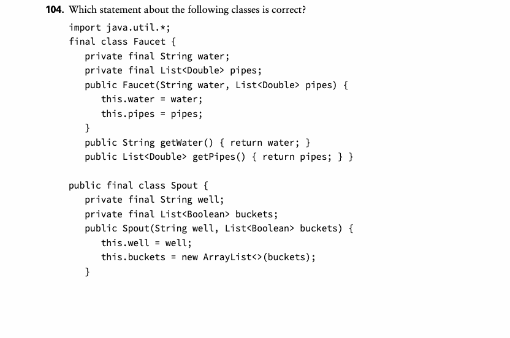

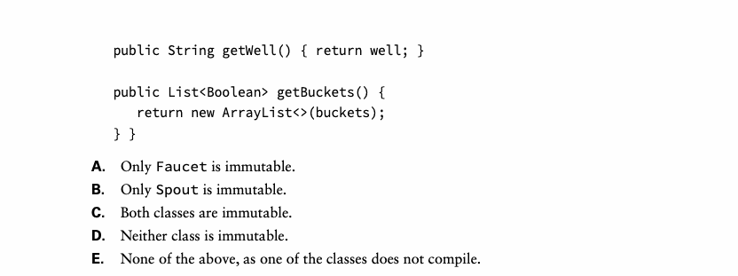

- **A.** Only `Faucet` is immutable.
- **B.** Only `Spout` is immutable.
- **C.** Both classes are immutable.
- **D.** Neither class is immutable.
- **E.** None of the above, as one of the classes does not compile.

**Answer:** B

**Explanation:** An immutable class must not allow the state to change. In the `Faucet` class, the caller has a reference to the `List` being passed in and can change the size or elements in it. Similarly, any class with a reference to the object can get the `List` by calling `getPipes()` and make these changes. The `Faucet` class is not immutable. The `Spout` class shows how to fix these problems and is immutable, making option B correct.

## 829-03-105

Given the following structure, which snippets of code evaluate to `true`? (Choose three.)

```java
interface Friendly {}
abstract class Dolphin implements Friendly {}
class Animal implements Friendly {}
class Whale extends Object {}
class Fish {}
class Coral extends Animal {}
```

- **A.** `new Coral() instanceof Friendly`
- **B.** `null instanceof Object`
- **C.** `new Coral() instanceof Object`
- **D.** `new Fish() instanceof Friendly`
- **E.** `new Whale() instanceof Object`
- **F.** `new Dolphin() instanceof Friendly`

**Answer:** A, C, E

**Explanation:** Option A is correct and returns `true` since `Coral` inherits `Friendly` from its superclass `Animal`. Option B is `false`, as using `null` with the `instanceof` operator always returns `false`. Options C and E are both correct and return `true` because all classes inherit `Object`, even those that don’t explicitly extend it. Option D is `false` because `Fish` does not inherit the `Friendly` interface. Finally, option F does not compile, as `Dolphin` is abstract and cannot be instantiated directly.

## 829-03-106

What is true of the following code?

```java
public class Eggs {
   enum Animal {
     CHICKEN(21), PENGUIN(75);
     private int numDays;
     private Animal(int numDays) {
        this.numDays = numDays;
     }
     public int getNumDays() {
        return numDays;
     }
     public void setNumDays(int numDays) {
        this.numDays = numDays;
       } }
    public static void main(String[] args) {
       Animal chicken = Animal.CHICKEN;
       chicken.setNumDays(20);
       System.out.print(chicken.getNumDays());
       System.out.print(" ");
       System.out.print(Animal.CHICKEN.getNumDays());
       System.out.print(" ");
       System.out.print(Animal.PENGUIN.getNumDays());
    } }
```

- **A.** It prints `20 20 20`.
- **B.** It prints `20 20 75`.
- **C.** It prints `20 21 75`.
- **D.** It prints `21 21 75`.
- **E.** It does not compile due to `setNumDays()`.
- **F.** It does not compile for another reason.

**Answer:** B

**Explanation:** While it is not recommended to change the value of an enum after it is created, it is legal. Each enum value has its own copy of `numDays`. This means the setter changes it for `CHICKEN`, but not for `PENGUIN`. Therefore, option B is correct. Both calls on `CHICKEN` print the updated value of `20`, while `PENGUIN` retains the original `75`.

## 829-03-107

What is the first line to not compile in this interface?

```java
1: public interface Thunderstorm {
2:    float rain = 1;
3:    char getSeason() { return 'W'; }
4:    boolean isWet();
5:    private static void hail() {}
6:    default String location() { return "Home"; }
7:    private static int getTemp() { return 35; }
8: }
```

- **A.** Line 2
- **B.** Line 3
- **C.** Line 4
- **D.** Line 5
- **E.** Line 6
- **F.** Line 7
- **G.** All of the lines compile.

**Answer:** B

**Explanation:** Line 3 does not compile, as a method with a body within an interface must be explicitly marked `static`, `default`, or `private`, making option B correct. The rest of the lines compile without issue.

## 829-03-108

What is the output of the following application?

```java
 package finance;
 enum Currency { DOLLAR, YEN, EURO }
 abstract class Provider {
    protected Currency c = Currency.EURO;
 }
public class Bank extends Provider {
   protected Currency c = Currency.DOLLAR;
   public static void main(String[] pennies) {
     int value = 0;
     switch(new Bank().c) {
        case 0:
           value--; break;
        case 1:
           value++; break;
     }
     System.out.print(value);
   } }
```

- **A.** `-1`
- **B.** `0`
- **C.** `1`
- **D.** The `Provider` class does not compile.
- **E.** The `Bank` class does not compile.
- **F.** None of the above.

**Answer:** E

**Explanation:** The type of the variable in the `switch` statement is the enum `Currency`, but the `case` statements use `int` values. While the enum class hierarchy does support an `ordinal()` method, which returns an `int` value, the enum values cannot be compared directly with `int` values. For this reason, the `Bank` class does not compile, making option E the correct answer.

## 829-03-109

Which of the following cannot be declared within a record? (Choose two.)

- **A.** An implementation of `hashCode()`
- **B.** Instance variables
- **C.** `static` initializers
- **D.** Nested classes
- **E.** `static` methods
- **F.** Constructors
- **G.** Instance initializers

**Answer:** B, G

**Explanation:** A record can contain many of the same members as a class, such as `static` initializers, `static` methods, nested classes, and constructors. Instance variables and initializers cannot be declared inside a record, as this could break immutability, making options B and G correct. Option A is incorrect, as provided methods, such as `hashCode()` or `toString()`, may be overridden in the record declaration.

## 829-03-110

Which is equivalent to `var q = 4.0f;`?

- **A.** `float q = 4.0f;`
- **B.** `Float q = 4.0f;`
- **C.** `double q = 4.0f;`
- **D.** `Double q = 4.0f;`
- **E.** `Object q = 4.0f;`

**Answer:** A

**Explanation:** The `f` in `4.0f` means the type is a `float`, making option A correct. Local variable type inference chooses an exact match rather than using autoboxing to choose `Float`. Note that option D does not compile, as the compiler won’t perform a numeric promotion to `double` and then autobox to `Double` at the same time.

## 829-03-111

Fill in the blanks: A class may be assigned to a(n) \_\_\_\_\_\_\_\_\_\_\_\_\_\_\_\_\_\_\_ reference variable automatically but requires an explicit cast when assigned to a(n) \_\_\_\_\_\_\_\_\_\_\_\_\_\_\_\_\_\_\_ reference variable.

- **A.** subclass, outer class
- **B.** superclass, subclass
- **C.** concrete class, subclass
- **D.** subclass, superclass
- **E.** abstract class, `static` class

**Answer:** B

**Explanation:** A class can trivially be assigned to a superclass reference variable but requires an explicit cast to be assigned to a subclass reference variable. For these reasons, option B is correct.

## 829-03-112

Which statement about functional interfaces is invalid?

- **A.** A functional interface can have any number of `static` methods.
- **B.** A functional interface can have any number of `default` methods.
- **C.** A functional interface can have any number of `private static` methods.
- **D.** A functional interface can have any number of `abstract` methods.
- **E.** A functional interface can have any number of `private` methods.
- **F.** All of the above are correct.

**Answer:** D

**Explanation:** A functional interface may have any number of `static`, `default`, `private static`, or `private` methods. It can have only one qualified `abstract` method, though, making option D correct.

## 829-03-113

What are possible outputs of the following given that the comment on line `X` can be replaced by arbitrary code?

```java
// Mandrill.java
public class Mandrill {
   public int age;
   public Mandrill(int age) {
     this.age = age;
   }
   public String toString() {
     return "" + age;
   }
}
// PrintAge.java
public class PrintAge {
   public static void main (String[] args) {
     var mandrill = new Mandrill(5);
     // line X
     System.out.println(mandrill);
   } }
```

- **A.** `0`
- **B.** `5`
- **C.** Either `0` or `5`
- **D.** Any `int` value
- **E.** Does not compile

**Answer:** D

**Explanation:** This class has poor encapsulation since the `age` variable is `public`. This means that a developer could modify the body of `main()` to change the value of `mandrill.age` to any integer value, making option D correct.

## 829-03-114

How many of the `String` objects are eligible for garbage collection right before the end of the `main()` method?

```java
public static void main(String[] ohMy) {
   String animal1 = new String("lion");
   String animal2 = new String("tiger");
   String animal3 = new String("bear");
   animal3 = animal1;
   animal2 = animal3;
   animal1 = animal2;
}
```

- **A.** None
- **B.** One
- **C.** Two
- **D.** Three
- **E.** None of the above

**Answer:** C

**Explanation:** All three references point to the `String` object `"lion"` by the end of the `main()` method. This makes the other two `String` objects eligible for garbage collection and makes option C correct.

## 829-03-115

Suppose `Panther` and `Cub` are interfaces and neither contains any `default` methods. Which statements are true? (Choose two.) Panther Cub

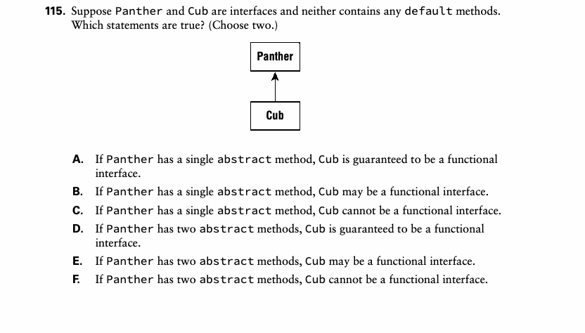


- **A.** If `Panther` has a single `abstract` method, `Cub` is guaranteed to be a functional interface.
- **B.** If `Panther` has a single `abstract` method, `Cub` may be a functional interface.
- **C.** If `Panther` has a single `abstract` method, `Cub` cannot be a functional interface.
- **D.** If `Panther` has two `abstract` methods, `Cub` is guaranteed to be a functional interface.
- **E.** If `Panther` has two `abstract` methods, `Cub` may be a functional interface.
- **F.** If `Panther` has two `abstract` methods, `Cub` cannot be a functional interface.

**Answer:** B, F

**Explanation:** A functional interface has exactly one `abstract` method. This includes inherited methods. If `Panther` has a single `abstract` method, `Cub` is a functional interface if it does not add any more `abstract` methods. This matches option B. However, if `Panther` has two `abstract` methods, there is no code in `Cub` that can make it a functional interface, and option F is the other answer.

## 829-03-116

What does the following output?

```java
1: public class InitOrder {
2:     public String first = "instance";
3:     public InitOrder() {
4:       first = "constructor";
5:     }
6:     { first = "block"; }
7:     public void print() {
8:       System.out.println(first);
9:     }
10:    public static void main(String... args) {
11:      new InitOrder().print();
12:    } }
```

- **A.** `block`
- **B.** `constructor`
- **C.** `instance`
- **D.** The code does not compile.
- **E.** None of the above.

**Answer:** B

**Explanation:** When the `main()` method instantiates the object, line 2 first runs and sets the variable using the declaration. Then the instance initializer on line 6 runs. Finally, the constructor runs. Since the constructor is the last of the three to run, that is the value set when we print the result, so option B is correct.

## 829-03-117

Which statement about the following interface is correct?

```java
public interface Tree {
   public static void produceSap() {
     growLeaves();
   }
   public abstract int getNumberOfRings() {
     return getNumberOfRings();
   }
   private static void growLeaves() {
     produceSap();
   }
   public default int getHeight() {
     return getHeight ();
   } }
```

- **A.** The code compiles.
- **B.** The method `produceSap()` does not compile.
- **C.** The method `getNumberOfRings()` does not compile.
- **D.** The method `growLeaves()` does not compile.
- **E.** The method `getHeight()` does not compile.
- **F.** The code does not compile because it contains a cycle.

**Answer:** C

**Explanation:** An `abstract` method cannot define a body, meaning the declaration of `getNumberOfRings()` is invalid and option C is correct. The rest of the code compiles without issue. While the compiler will prevent cycles within overloaded constructors, it does not do so for methods, meaning option F is incorrect.

## 829-03-118

Which statements about a variable with a type of `var` are true? (Choose two.)

- **A.** The variable can be assigned `null` at initialization without any type information.
- **B.** The variable can be assigned `null` after initialization.
- **C.** The variable can never be assigned `null`.
- **D.** Only primitives can be used with the variable.
- **E.** Only objects can be used with the variable.
- **F.** Either a primitive or an object can be used with the variable.

**Answer:** B, F

**Explanation:** The type is determined based on the value at initialization. It can be `null` at this point, but only if type information is provided such as `(String)null`. It can be assigned `null` later, making option B correct. Both primitives and objects can be used with `var`, making option F correct.

## 829-03-119

Assume there is a class `Bouncer` with a `protected` variable. Methods in which class can access this variable?

- **A.** Any subclass of `Bouncer` or any class in the same package as `Bouncer`
- **B.** Any superclass of `Bouncer`
- **C.** Only subclasses of `Bouncer`
- **D.** Only classes in the same package as `Bouncer`
- **E.** None of the above

**Answer:** A

**Explanation:** The `protected` modifier allows access by any subclass or class that is in the same package; therefore, option A is the correct answer.

## 829-03-120

What is the output of the following application?

```java
package forest;
public class Woods {
   static class Tree {}
   public static void main(String[] leaves) {
     int heat = 2;
     int water = 10-heat;
     final class Oak extends Tree {     // p1
        public int getWater() {
           return water;            // p2
        }
     }
     System.out.print(new Oak().getWater());
     water = 0;
   } }
```

- **A.** `8`
- **B.** Line `p1` contains a compiler error.
- **C.** Line `p2` contains a compiler error.
- **D.** Another line of code contains a compiler error.
- **E.** None of the above.

**Answer:** C

**Explanation:** The `main()` method defines a local class `Oak` that correctly extends `Tree`, a `static` nested class. The method `getWater()` is not permitted to read the local variable `water`, though, since it is not `final` or effectively final, making option C correct. If the last line of the method were removed, then the program would compile and print `8`.

## 829-03-121

Which of the following can fill in the blank to make the code compile? (Choose two.)

```java
interface Australian {}
interface Mammal {}
                 Australian, Mammal {}
```

- **A.** `class Quokka extends`
- **B.** `class Quokka implements`
- **C.** Neither A nor B. Only one interface can be implemented.
- **D.** `interface Quokka extends`
- **E.** `interface Quokka implements`
- **F.** Neither D nor E. Only one interface can be extended.

**Answer:** B, D

**Explanation:** A class can implement multiple interfaces, making option B correct. An interface can also extend multiple interfaces, making option D correct as well.

## 829-03-122

What is true of the following method?

```java
public void setColor(String color) {
   color = color;
}
```

- **A.** It is a correctly implemented accessor method.
- **B.** It is a correctly implemented mutator method.
- **C.** It is an incorrectly implemented accessor method.
- **D.** It is an incorrectly implemented mutator method.
- **E.** None of the above.

**Answer:** D

**Explanation:** The method looks like a setter or mutator method. However, it is incorrectly implemented since the method is missing a `this` reference and doesn’t actually change the value. Therefore, option D is correct.

## 829-03-123

Which of the following statements about calling `this()` in a constructor are true? (Choose three.)

- **A.** If arguments are provided to `this()`, then there must be a constructor in the class that can take those arguments.
- **B.** If arguments are provided to `this()`, then there must be a constructor in the superclass that can take those arguments.
- **C.** If the no-argument `this()` is called within a constructor, then the class must explicitly implement the no-argument constructor.
- **D.** If `super()` and `this()` are both used in the same constructor, `super()` must appear on the line immediately after `this()`.
- **E.** If `super()` and `this()` are both used in the same constructor, `this()` must appear on the line immediately after `super()`.
- **F.** If `this()` is used, it must be the first line of the constructor.

**Answer:** A, C, F

**Explanation:** Option A is correct and option B is incorrect because `this()` calls another constructor in the same class. Option C is correct because `this()` without parameters is the default constructor and is not inserted automatically by the compiler if another constructor is present. Options D and E are both incorrect because only one of `super()` or `this()` can be used from the same constructor. Finally, option F is correct, as `super()` or `this()` must come first in a constructor.

## 829-03-124

What is the result of compiling and executing the following class?

```java
public class RollerSkates {
   static int wheels = 1;
   int tracks = 5;
  public static void main(String[] wheels) {
    RollerSkates s = new RollerSkates();
    int feet = 4, tracks = 15;
    System.out.print(feet + tracks + s.wheels);
  } }
```

- **A.** The code does not compile.
- **B.** `4`
- **C.** `5`
- **D.** `10`
- **E.** `20`

**Answer:** E

**Explanation:** The code compiles and runs without issue, so option A is incorrect. The question involves understanding the value and scope of each variable at the `print()` statement. The variables `feet` and `tracks` are locally scoped and set to `4` and `15`, respectively, ignoring the value of `tracks` of `5` in the instance of the class. Finally, the `static` variable `s.wheels` has a value of `1`. The result is that the combined value is `20`, making option E the correct answer.

## 829-03-125

Which statements about the following program are correct? (Choose two.)

```java
package vessel;
class Problem extends Exception {}
abstract class Danger {
   protected abstract void isDanger() throws Problem; // m1
}
public class SeriousDanger extends Danger { // m2
   protected void isDanger() throws Exception { // m3
     throw new RuntimeException(); // m4
   }
   public static void main(String[] w) throws Throwable { // m5
     var sd = new SeriousDanger().isDanger(); // m6
   } }
```

- **A.** The code does not compile because of line `m1`.
- **B.** The code does not compile because of line `m2`.
- **C.** The code does not compile because of line `m3`.
- **D.** The code does not compile because of line `m4`.
- **E.** The code does not compile because of line `m5`.
- **F.** The code does not compile because of line `m6`.

**Answer:** C, F

**Explanation:** Line `m3` does not compile because `isDanger()` is an invalid method override. An overridden method may not throw a broader checked exception than it inherits. Since `Exception` is a superclass of `Problem`, the code does not compile, and option C is correct. Line `m6` does not compile because the return type of `isDanger()` is `void`, which cannot be assigned to a variable, making option F also correct.

## 829-03-126

Which statements about top-level and member inner classes are correct? (Choose three.)

- **A.** Both can be marked `protected`.
- **B.** Only top-level classes can be declared `final`.
- **C.** Both can declare constructors.
- **D.** Member inner classes cannot be marked `private`.
- **E.** Member inner classes can access `private` variables of the top-level class in which it is defined.
- **F.** Both can be marked `abstract`.

**Answer:** C, E, F

**Explanation:** Top-level classes can be set only with `public` and package access, making option A incorrect. On the other hand, member inner classes can be set with any of the four access levels, making option D incorrect. Both types of classes can be declared with a `final` or `abstract` modifier, making option B incorrect and option F correct. Both can also include constructors, making option C correct. Finally, option E is correct and one of the primary features of inner classes.

## 829-03-127

What is required to define a valid Java class file?

- **A.** A `class` declaration
- **B.** A `package` statement
- **C.** An `import` statement
- **D.** A `class` declaration and `package` statement
- **E.** A `class` declaration and at least one `import` statement
- **F.** The `public` modifier

**Answer:** A

**Explanation:** Option A is the only correct answer, as a `class` declaration is the only required component in a Java class file. Note that we said a Java class file here; Java also allows interfaces, annotations, modules, records, and enums to be defined in a file. A class file may have a single `package` statement or any number of `import` statements. Neither is required.

## 829-03-128

How many objects are eligible for garbage collection right before the end of the `main()` method?

```java
1: public class Person {
2:     public Person youngestChild;
3:
4:     public static void main(String... args) {
5:       Person elena = new Person();
6:       Person janeice = new Person();
7:       elena.youngestChild = janeice;
8:       janeice = null;
9:       Person zoe = new Person();
10:      elena.youngestChild = zoe;
11:      zoe = null;
12:    } }
```

- **A.** None
- **B.** One
- **C.** Two
- **D.** Three
- **E.** The code does not compile.

**Answer:** B

**Explanation:** On line 9, all three objects have references. The `elena` and `zoe` objects have a direct reference. The `janeice` object is referenced through the `elena` object. On line 10, the reference to the `janeice` object is replaced by a reference to the `zoe` object. Therefore, the `janeice` object is eligible to be garbage collected, and option B is correct. Note that `elena` still holds the reference to the original `zoe` object.

## 829-03-129

What is the output of the following application?

```java
 package race;
 interface Drive {
    int SPEED = 5;
    default Integer getSpeed() { return SPEED; }
 }
 interface Hover {
    String MAX_SPEED = "10";
    default String getSpeed() { return MAX_SPEED; }
 }
public class Car implements Drive, Hover {
   @Override public Object getSpeed() { return 15; }
   public static void main(String[] gears) {
     System.out.print(new Car().getSpeed());
   } }
```

- **A.** `5`
- **B.** `10`
- **C.** `15`
- **D.** The code does not compile.
- **E.** The code compiles but produces an exception at runtime.
- **F.** The answer cannot be determined with the information given.

**Answer:** D

**Explanation:** Both the `Drive` and `Hover` interfaces define a `default` method `getSpeed()` with the same signature but different return types. The `Car` class implements both interfaces, which means it inherits both `default` methods. Since the compiler does not know which one to choose, the `Car` class must override the `default` method. Since it does not, the code does not compile and option D is correct. Note that in this case it is not possible to write a method that inherits both `default` methods since the return values cannot be made covariant.

## 829-03-130

What is the output of the following application? (Choose two.)

```java
1: public class ChooseWisely {
2:     public ChooseWisely() { super(); }
3:     public int choose(int choice) { return 5; }
4:     public int choose(short choice) { return 2; }
5:     public int choose(long choice) { return 11; }
6:     public int choose(double choice) { return 6; }
7:     public int choose(Float choice) { return 8; }
8:     public static void main(String[] path) {
9:       ChooseWisely c = new ChooseWisely();
10:      System.out.println(c.choose(2f));
11:      System.out.println(c.choose((byte)2+1));
12:    } }
```

- **A.** `2`
- **B.** `3`
- **C.** `5`
- **D.** `6`
- **E.** `8`
- **F.** `11`

**Answer:** C, D

**Explanation:** On line 10, we are passing a `float`. Since there is no exact match, Java attempts to promote the primitive type to `double` before trying to wrap it as a `Float`, making option D correct. On line 11, the value `2` is first cast to a `byte`. It is then increased by one using the addition `+` operator. The addition `+` operator automatically promotes all `byte` and `short` values to `int`. Therefore, the value passed to `choose()` in the `main()` method is an `int`. The `choose(int)` method is called, returning `5` and making option C the other correct answer.

## 829-03-131

How many lines of the following program do not compile?

```java
1: public enum Color {
2:    RED(1,2) { void toSpectrum() {} },
3:    BLUE(2) { void toSpectrum() {} void printColor() {} },
4:    ORANGE() { void toSpectrum() {} },
5:    GREEN(4);
 6:    public Color(int... color) {}
 7:    abstract void toSpectrum();
 8:    final void printColor() {}
 9: }
```

- **A.** Zero
- **B.** One
- **C.** Two
- **D.** Three
- **E.** More than three

**Answer:** D

**Explanation:** Line 3 does not compile because `printColor()` is marked `final` and cannot be overridden. Line 5 does not compile because the `toSpectrum()` method is marked `abstract` and must be overridden by each enum value. Finally, line 6 does not compile because enum constructors are implicitly `private`. For these three reasons, option D is correct.

## 829-03-132

What is the output of the `Square` program?

```java
package shapes;
abstract class Trapezoid {
   private int getEqualSides() {return 0;}
}
abstract class Rectangle extends Trapezoid {
   public static int getEqualSides() {return 2;}     // x1
}
public class Square extends Rectangle {
   public int getEqualSides() {return 4;}        // x2
   public static void main(String[] corners) {
     final Square myFigure = new Square() {};      // x3
     System.out.print(myFigure.getEqualSides());
   } }
```

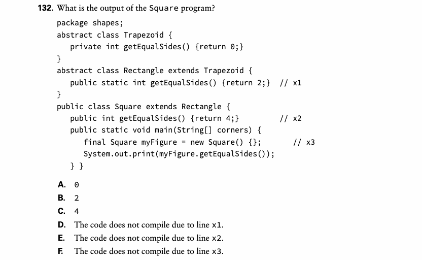

- **A.** `0`
- **B.** `2`
- **C.** `4`
- **D.** The code does not compile due to line `x1`.
- **E.** The code does not compile due to line `x2`.
- **F.** The code does not compile due to line `x3`.

**Answer:** E

**Explanation:** The `getEqualSides()` method is not overridden on line `x1`, since it is `private` in the parent class and not inherited. For this reason, line `x1` compiles. On the other hand, the override of `getEqualSides()` in `Square` is invalid. A `static` method cannot override a non-`static` method and vice versa. For this reason, option E is the correct answer. The rest of the lines compile without issue.

## 829-03-133

What can fill in the blank so that the `play()` method can be called from all classes in the `com.mammal` package but not the `com.mammal.gopher` package?

```java
package com.mammal;
public class Enrichment {
          void play() {}
}
```

- **A.** Leave it blank
- **B.** `private`
- **C.** `protected`
- **D.** `public`
- **E.** None of the above

**Answer:** A

**Explanation:** Since only one package needs access and it is the same package the class is in, option A is correct. Using `protected` would permit access from other classes within the package, but allow subclasses in other packages to access it as well.

## 829-03-134

How many cells in the following table are incorrect? Type Allows `abstract` Allows constants? Allows constructors? methods? Abstract class Yes Yes No Concrete class Yes Yes Yes Interface Yes Yes Yes

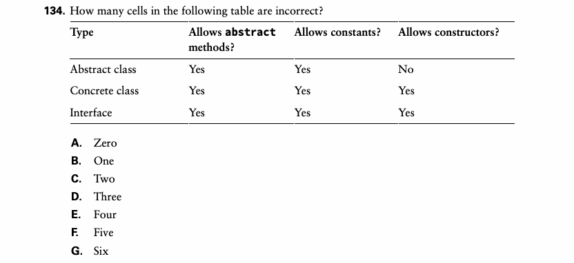

- **A.** Zero
- **B.** One
- **C.** Two
- **D.** Three
- **E.** Four
- **F.** Five
- **G.** Six

**Answer:** D

**Explanation:** A concrete class is not allowed to have `abstract` methods, but the other two types are. This makes the second row in the first column incorrect. All three types are allowed to have `static final` constants, making the whole second column correct. In the last column, there are two errors. An `abstract` class can have a constructor, but an interface cannot. Note that an `abstract` class cannot be instantiated. Instead, it requires a subclass. This gives us a total of three incorrect cells, making option D the answer.

## 829-03-135

Which modifiers are permitted on a direct subclass of a sealed class? (Choose three.)

- **A.** `void`
- **B.** `default`
- **C.** `public`
- **D.** `private`
- **E.** `volatile`
- **F.** `final`
- **G.** `nonsealed`

**Answer:** C, D, F

**Explanation:** A class extending a sealed class must be declared `final`, `sealed`, or `non-sealed`, making option F correct. Option C and D are also correct, as a `sealed` or `non-sealed` subclass may also be marked with any access modifiers. The other modifiers are invalid or cannot be applied to a class declaration.

## 829-03-136

Which statements are true about a functional interface? (Choose three.)

- **A.** It may contain any number of `abstract` methods.
- **B.** It must contain a single `abstract` method.
- **C.** It may contain any number of `private` methods.
- **D.** It must contain a single `private` method.
- **E.** It may contain any number of `static` methods.
- **F.** It must contain a single `static` method.

**Answer:** B, C, E

**Explanation:** A functional interface must have exactly one `abstract` method, which is option B. There are no restrictions on the number of `private` or `static` methods, which make options C and E also correct.

## 829-03-137

What is a possible output of the following application?

```java
package wrap;
public class Gift {
   private final Object contents;
   protected Object getContents() {
     return contents;
   }
   protected void setContents(Object contents) {
     this.contents = contents;
   }
   public void showPresent() {
     System.out.print("Your gift: "+contents);
   }
   public static void main(String[] treats) {
     var gift = new Gift();
     gift.setContents(gift);
     gift.showPresent();
   } }
```

- **A.** `Your gift: wrap.Gift@29ca2745`
- **B.** `Your gift: Your gift:`
- **C.** It does not compile.
- **D.** It compiles but throws an exception at runtime.
- **E.** None of the above.

**Answer:** C

**Explanation:** The `contents` instance variable is marked `final`, which means it must be set as part of object initialization. Since it is not, the `Gift` class cannot be instantiated and the class does not compile. For this reason, option C is correct. The `setContents()` method also does not compile since a `final` instance object cannot be set in an instance method after the class has been initialized.

## 829-03-138

How many lines would need to be corrected for the following code to compile?

```java
1: package animal;
2: interface CanFly {
3:     public void fly() {}
4:     int speed = 5;
5: }
6: final class Bird {
7:     public int fly(int speed) {}
8: }
9: public class Eagle extends Bird implements CanFly {
10:    public void fly() {}
11: }
```

- **A.** None
- **B.** One
- **C.** Two
- **D.** Three
- **E.** Four

**Answer:** D

**Explanation:** Line 3 does not compile because the method is not marked `default`, `static`, or `private`. Line 7 does not compile because the return type is `int`, and the `fly()` method does not return a value. Line 9 does not compile because `Bird` is a `final` class and cannot be extended. For these reasons, option D is correct.

## 829-03-139

What is the output of the following code?

```java
public class Bunny {
   static class Rabbit {
     void hop() {
        System.out.print("hop");
     }
   }
   static class FlemishRabbit extends Rabbit {
     void hop() {
        System.out.print("HOP");
     }
    }
    public static void main(String[] args) {
      Rabbit r1 = new FlemishRabbit();
      FlemishRabbit r2 = new FlemishRabbit();
      r1.hop();
      r2.hop();
    } }
```

- **A.** `hophop`
- **B.** `HOPhop`
- **C.** `hopHOP`
- **D.** `HOPHOP`
- **E.** The code does not compile.
- **F.** None of the above.

**Answer:** D

**Explanation:** This example deals with polymorphism since the methods are being called on the object instance. Since both objects are of type `FlemishRabbit`, `HOP` is printed twice, and option D is the correct answer.

## 829-03-140

Which of the following are valid class declarations? (Choose three.)

- **A.** `class _ {}`
- **B.** `class river {}`
- **C.** `class Str3@m {}`
- **D.** `class Pond2$ {}`
- **E.** `class _var_ {}`
- **F.** `class 5Ocean {}`

**Answer:** B, D, E

**Explanation:** Underscores (`_`) are permitted in identifiers with the exception of a single underscore, making option A incorrect. Currency symbols, such as the dollar sign (`$`), are allowed, but no other symbols are allowed, making option C incorrect. Numbers are allowed, but not as the first character. Therefore, option F is incorrect. The rest of the options are valid class names, making the answer options B, D, and E correct. Note that class names begin with an uppercase letter by convention, but this is not a requirement.

## 829-03-141

What is the output of the `InfiniteMath` program?

```java
class Math {
   public final double secret = 2;
}
 class ComplexMath extends Math {
    public final double secret = 4;
 }
 public class InfiniteMath extends ComplexMath {
    public final double secret = 8;
    public static void main(String[] numbers) {
       Math math = new InfiniteMath();
       System.out.print(math.secret);
    } }
```

- **A.** `2.0`
- **B.** `4.0`
- **C.** `8.0`
- **D.** The code does not compile.
- **E.** The code compiles but prints an exception at runtime.
- **F.** None of the above.

**Answer:** A

**Explanation:** The code compiles without issue. Java allows methods to be overridden, but not variables. Therefore, marking them `final` does not prevent them from being reimplemented in a subclass. Furthermore, polymorphism does not apply in the same way it would to methods as it does to variables. In particular, the reference type determines the version of the `secret` variable that is selected, making the output `2.0` and option A the correct answer.

## 829-03-142

Given the following application, which diagram best represents the state of the `mySkier`, `mySpeed`, and `myName` variables in the `main()` method after the call to the `slalom()` method?

```java
package slopes;
public class Ski {
   private int age = 18;
   private static void slalom(Ski racer,
        int[] speed, String name) {
     racer.age = 18;
     name = "Wendy";
     speed = new int[1];
     speed[0] = 11;
     racer = null;
   }
   public static void main(String[] mountain) {
     final var mySkier = new Ski();
     mySkier.age = 16;
     final int[] mySpeed = new int[1];
     final String myName = "Rosie";
     slalom(mySkier, mySpeed, myName);
   } }
```

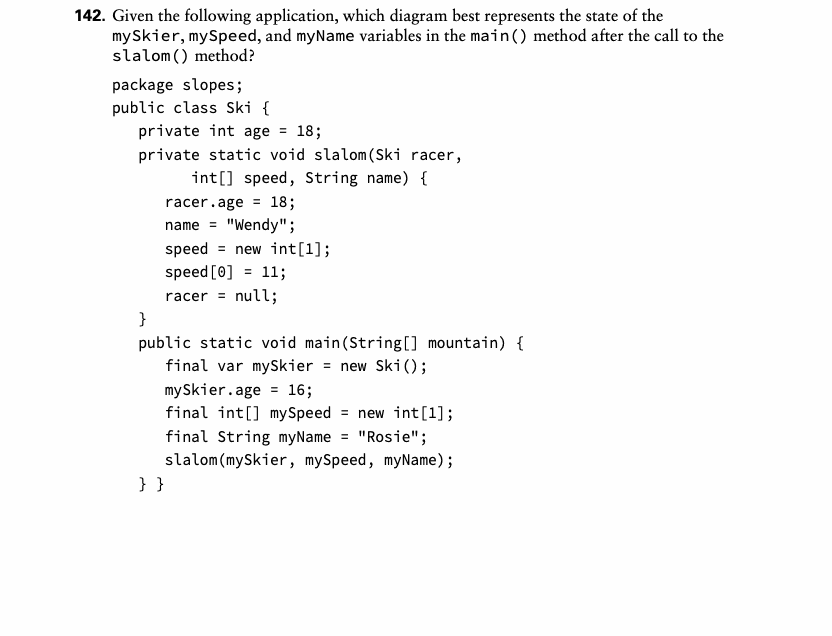

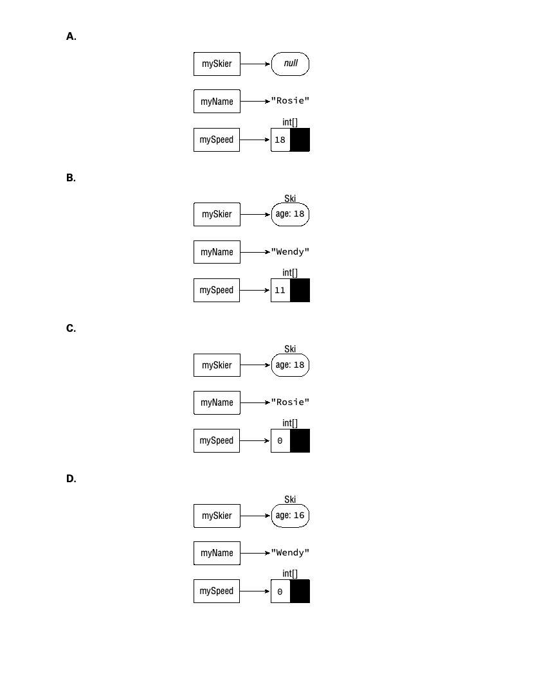


- **A.** mySkier null myName `"Rosie"` int[] mySpeed `18`
- **B.** Ski mySkier age: `18` myName `"Wendy"` int[] mySpeed `11`
- **C.** Ski mySkier age: `18` myName `"Rosie"` int[] mySpeed `0`
- **D.** Ski mySkier age: `16` myName `"Wendy"` int[] mySpeed `0`

**Answer:** C

**Explanation:** Java is a pass-by-value language, which means changes made to the `name` reference in the `slalom()` method are not passed back to `main()`. Therefore, `myName` stays as `Rosie`, allowing us to eliminate options B and D. Setting the `racer` object to `null` in the `slalom()` method doesn’t change the `mySkier` reference in `main()`, allowing us to eliminate option A. Likewise, since `speed` was assigned a new object, changes do not affect `mySpeed` in the `main()` method. Finally, the value of `age` in the `Ski` object does change to `18`, as this was applied before the reference was changed. For these reasons, option C is correct.

## 829-03-143

What is the output of the following application?

```java
package zoo;
public class Penguin {
   private int volume = 1;
   private class Chick {
     private static int volume = 3;
     void chick(int volume) {
        System.out.print("Honk("+Penguin.this.volume+")!");
     } }
   public static void main(String... eggs) {
     Penguin pen = new Penguin();
     final Penguin.Chick littleOne = pen.new Chick();
     littleOne.chick(5);
   } }
```

- **A.** `Honk(1)!`
- **B.** `Honk(3)!`
- **C.** `Honk(5)!`
- **D.** The code does not compile.
- **E.** The code compiles, but the output cannot be determined until runtime.
- **F.** None of the above.

**Answer:** A

**Explanation:** Member inner classes can now include `static` non-`final` members. Despite the unusual references in the `main()` method, the code is valid and does compile. The `Penguin.this.volume` value in the `chick()` method refers to the value defined at the `Penguin` instance level. Therefore, the code prints `Honk(1)!` at runtime, making option A correct.

## 829-03-144

What is a possible output of the following program?

```java
record Name(String v) {}
public record Fruit(Name n) {
   public static void main(String[] vitamins) {
     var x = new Name("Apple");
     System.out.println(new Fruit(x));
   } }
```

- **A.** `Fruit@3f2f5b24`
- **B.** `Fruit[Apple]`
- **C.** `Fruit[Name[Apple]]`
- **D.** `Fruit[n=Apple]`
- **E.** `Fruit[n=Name[v=Apple]]`
- **F.** `Fruit[v=Apple]`
- **G.** The code does not compile.
- **H.** None of the above.

**Answer:** E

**Explanation:** Records include useful overrides of the `toString()` method that include all attributes with both their name and value. For this reason, option E is correct. Note that if `Fruit` were a class instead of a record, then option A would be a possible output since it uses the version defined in `Object`.

## 829-03-145

Fill in the blank with the line of code that allows the program to compile and print `X` at runtime.

```java
interface Fruit {
   public default char getColor() { return 'Z'; }
}
interface Edible {
   public default char getColor() { return 'X'; }
}
public class Banana implements Fruit, Edible {
   public char getColor() { return _____________ ; }
   public static void main(String[] a) {
     var d = new Banana();
     System.out.println(d.getColor());
   } }
```

- **A.** `Edible.getColor()`
- **B.** `Edible.super.getColor()`
- **C.** `super.Edible.getColor()`
- **D.** `super.getColor()`
- **E.** The code does not compile regardless of what is inserted into the blank.
- **F.** None of the above.

**Answer:** B

**Explanation:** The code compiles, even if the blank is replaced with a constant `char` value, making option E incorrect. Note that the class correctly overrides both inherited `default` methods. It is possible to access a `default` method, even if it is overridden in the class, but requires using the `super` keyword properly. Option B demonstrates the correct syntax, while the other samples do not compile. Note that option D would not be correct even if there were only one inherited `default` method.

## 829-03-146

Given the following two classes, each in a different package, which line inserted into the code allows the second class to compile?

```java
package clothes;
public class Store {
   public static String getClothes() { return "dress"; }
}
package wardrobe;
// INSERT CODE HERE
public class Closet {
   public void borrow() {
     System.out.print("Borrowing clothes: "+getClothes());
   } }
```

- **A.** `static import clothes.Store.getClothes;`
- **B.** `import clothes.Store.*;`
- **C.** `import static clothes.Store.getClothes;`
- **D.** `import static clothes.Store;`
- **E.** None of the above

**Answer:** C

**Explanation:** Option A is incorrect because the keywords `static` and `import` are reversed. The `Closet` class uses the method `getClothes()` without a reference to the class name `Store`; therefore, a `static` import is required. For this reason, option B is incorrect since it is missing the `static` keyword. Option D is also incorrect since `static` imports are used with members of the class, not a class name. Finally, option C is the correct answer since it properly imports the method into the class using a `static` import.

## 829-03-147

What is the output of the `ElectricCar` program?

```java
package vehicles;
class Automobile {
   private final String drive() { return "Driving vehicle"; }
}
class Car extends Automobile {
   protected String drive() { return "Driving car"; }
}
public class ElectricCar extends Car {
   public final String drive() { return "Driving electric car"; }
   public static void main(String[] wheels) {
     final Automobile car = new ElectricCar();
     var v = (Car)car;
     System.out.print(v.drive());
   } }
```

- **A.** `Driving vehicle`
- **B.** `Driving electric car`
- **C.** `Driving car`
- **D.** The code does not compile.
- **E.** The code compiles but produces a `ClassCastException` at runtime.
- **F.** None of the above.

**Answer:** B

**Explanation:** The `drive()` method in the `Car` class does not override the `private` version in the `Automobile` class since the method is not visible to the `Car` class. Therefore, the `final` attribute in the `Automobile` class does not prevent the `Car` class from implementing a method with the same signature. The `drive()` method in the `ElectricCar` class is a valid override of the method in the `Car` class, with the `public` access modifier expanding access in the subclass. In the `main()` method, the object created is an `ElectricCar`, even if it is assigned to a `Car` or `Automobile` reference. Due to polymorphism, the method from the `ElectricCar` will be invoked, making option B the correct answer.

## 829-03-148

Which statements about sealed classes are correct? (Choose three.)

- **A.** A sealed class may be extended by another sealed class.
- **B.** In an unnamed module, a sealed class must include all its subclasses within the same file.
- **C.** A sealed class cannot contain nested classes.
- **D.** A sealed class can be declared `abstract`.
- **E.** A sealed class can be declared `final`.
- **F.** In an unnamed module, a sealed class must include all its subclasses within the same package.

**Answer:** A, D, F

**Explanation:** Option A is correct, as sealed classes may be extended by other sealed classes. In an unnamed module, the sealed class and its subclasses must be within the same package, making option B incorrect and option F correct. Option C is incorrect, as sealed classes can contain nested classes. Option D is also correct, as a sealed class can be declared `abstract`. Finally, option E is incorrect, as a sealed class cannot be declared `final`, or there would be no way to declare a subclass for it.

## 829-03-149

What is the output of the following program?

```java
public class Music {
   { System.out.print("do-"); }
   static { System.out.print("re-"); }
   { System.out.print("mi-"); }
   static { System.out.print("fa-"); }
   public Music() {
    System.out.print("so-");
  }
  public Music(int note) {
    System.out.print("la-");
  }
  public static void main(String[] sound) {
    System.out.print("ti-");
    var play = new Music();
  } }
```

- **A.** `re-fa-ti-do-mi-so-`
- **B.** `do-re-mi-fa-ti-so-`
- **C.** `ti-re-fa-do-mi-so-`
- **D.** `re-fa-la-mi-ti-do-`
- **E.** `do-re-mi-fa-so-ti`
- **F.** The code does not compile.
- **G.** None of the above.

**Answer:** A

**Explanation:** The code compiles, so option F is incorrect. The `Music` class is loaded, and the `static` initializers are executed in order, with `re-fa-` being printed first. Next, the first line of the `main()` method is executed, printing `ti-`. The second line of the `main()` method creates a `Music` object, with the instance initializers being called first, printing `do-mi-`. Finally, the no-argument constructor is executed, and `so-` is printed last, making option A correct.

## 829-03-150

Given the following class declaration, which options correctly declare a local variable containing an instance of the class?

```java
public class Earth {
   private abstract class Sky {
     void fall() {
        var e =
     } } }
```

- **A.** `new Sunset() extends Sky {};`
- **B.** `new Sky();`
- **C.** `new Sky() {}`
- **D.** `new Sky() { final static int blue = 1; };`
- **E.** The code does not compile regardless of what is placed in the blank.
- **F.** None of the above.

**Answer:** D

**Explanation:** All of the options attempt to create an instance using an anonymous class that extends `Sky`. Option A is incorrect because when you create an anonymous class, you do not specify a name. Even if there was a `Sunset` class, the declaration of an anonymous class can only extend or implement one type directly. Since it would already extend `Sunset`, it cannot specify `Sky` at the same time. Option B is incorrect because `Sky` is `abstract` and cannot be instantiated directly. Option C is incorrect because it is missing a semicolon (`;`) at the end. Option D is the correct answer. Remember that all nested classes can have `static` variables.

## 829-03-151

What is the output of the `Encyclopedia` program?

```java
package paper;
abstract class Book {
   protected static String material = "papyrus";
   public Book() {}
   abstract String read() {}
   public Book(String material) {this.material = material;}
 }
 public class Encyclopedia extends Book {
    public static String material = "cellulose";
    public Encyclopedia() {super();}
    public String read() { return "Reading is fun!"; }
    public String getMaterial() {return super.material;}
    public static void main(String[] pages) {
       System.out.print(new Encyclopedia().read());
       System.out.print("-" + new Encyclopedia().getMaterial());
    } }
```

- **A.** `Reading is fun!-papyrus`
- **B.** `Reading is fun!-cellulose`
- **C.** `null-papyrus`
- **D.** `null-cellulose`
- **E.** The code does not compile.
- **F.** None of the above.

**Answer:** E

**Explanation:** The code may look complicated, but it does not compile for a simple reason. The `abstract read()` method defined in `Book` cannot have a method body. Since it does, the code does not compile, and option E is correct.

## 829-03-152

What does the following print?

```java
interface Vehicle {}
class Bus implements Vehicle {}
public class Transport {
   public static void main(String[] args) {
     Vehicle vehicle = new Bus();
     boolean n = null instanceof Bus;
     boolean v = vehicle instanceof Vehicle;
     boolean b = vehicle instanceof Bus;
     System.out.println(n + " " + v + " " + b);
  } }
```

- **A.** `false false false`
- **B.** `false false true`
- **C.** `false true true`
- **D.** `true false true`
- **E.** `true true false`
- **F.** `true true true`

**Answer:** C

**Explanation:** While using `null` with `instanceof` compiles, it always returns `false`. The other two `instanceof` calls show that `instanceof` can be used with both classes and interfaces. They both return `true` since `Bus` implements `Vehicle`, making option C correct.

## 829-03-153

How many rows of the following table contain an error? Interface member Optional modifier(s) Required modifier(s) Private method `private _______________ -` Default method `public ________________ default` Static method `public static _________ -` Abstract method `public ________________ abstract`

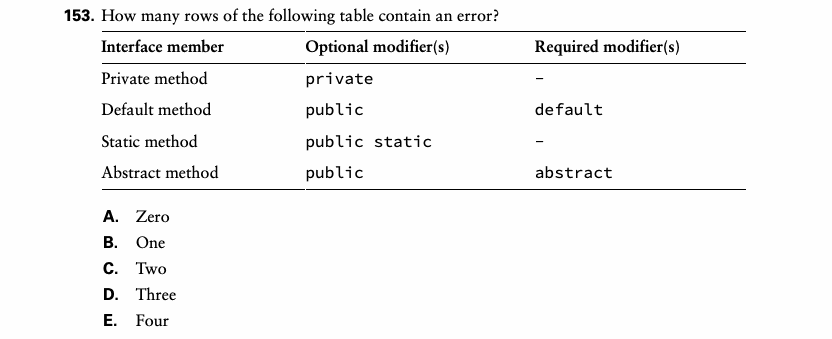

- **A.** Zero
- **B.** One
- **C.** Two
- **D.** Three
- **E.** Four

**Answer:** D

**Explanation:** The first row is incorrect as the `private` modifier is required for `private` interface methods. The second row is correct. The third row is also incorrect because the `static` modifier is required, not optional, for `static` interface methods. The `public` modifier is optional, though, as the `static` method is implicitly `public` without it. The last row is incorrect as the `abstract` modifier can be implied if the method does not declare a body. Since three rows contain an error, option D is correct.

## 829-03-154

What is the output of the following program?

```java
public class Dwarf {
   private final String name;
   public Dwarf() {
     this("Bashful");
   }
   public Dwarf(String name) {
     name = "Sleepy";
   }
   public static void main(String[] sound) {
     var d = new Dwarf("Doc");
     System.out.println(d.name);
   } }
```

- **A.** `Sleepy`
- **B.** `Bashful`
- **C.** `Doc`
- **D.** The code does not compile.
- **E.** An exception is thrown at runtime.

**Answer:** D

**Explanation:** A `final` instance variable must be assigned a value when it is declared, in an instance initializer or by a constructor. The `Dwarf(String)` constructor does not assign a value since it already contains a local variable called `name`. For this reason, this constructor does not compile, and option D is correct. If the assignment in the constructor were changed to `this.name`, then the program would compile and print `Sleepy`.

## 829-03-155

What is the output of the following application?

```java
package pocketmath;
interface AddNumbers {
   int add(int x, int y);
   static int subtract(int x, int y) { return x-y; }
   default int multiply(int x, int y) { return x*y; }
}
 public class Calculator {
    protected void calculate(AddNumbers n, int a, int b) {
       System.out.print(n.add(a, b));
    }
    public static void main(String[] moreNumbers) {
       final var ti = new Calculator() {};
       ti.calculate((k,p) -> p+k+1, 2, 5); // x1
    } }
```

- **A.** `0`
- **B.** `7`
- **C.** `8`
- **D.** The code does not compile because `AddNumbers` is not a functional interface.
- **E.** The code does not compile because of line `x1`.
- **F.** The code does not compile for a different reason.
- **G.** None of the above.

**Answer:** C

**Explanation:** The `AddNumbers` interface is a valid functional interface. While it includes both `static` and `default` methods, it includes only one `abstract` method, the precise requirement for it to be considered a functional interface, making option D incorrect. The class compiles and prints `8` at runtime, making option C correct.

## 829-03-156

Which of the following variables are always in scope for the entire program once defined?

- **A.** Package variables
- **B.** Class variables
- **C.** Instance variables
- **D.** Local variables
- **E.** Pseudo variables

**Answer:** B

**Explanation:** There is no such thing as package or pseudo variables, so options A and E are incorrect. Option C is incorrect as the variable is only in scope within a specific instance of the class. Option D is also incorrect as the variable is only in scope for a single method or block that it is defined in. Option B is the only correct answer as class variables are in scope within the program.

## 829-03-157

What is the command to call one constructor from another constructor in the same class?

- **A.** `construct()`
- **B.** `parent()`
- **C.** `super()`
- **D.** `this()`
- **E.** `that()`
- **F.** `overthere()`

**Answer:** D

**Explanation:** The `super()` statement is used to call a constructor in a parent class, while the `this()` statement is used to call a constructor in the same class, making option D correct and option C incorrect. Options A, B, E, and F are incorrect because they are not built-in functionality in Java.

## 829-03-158

Which of the following statements about no-argument constructors and inheritance are correct? (Choose two.)

- **A.** The compiler cannot insert a no-argument constructor into an abstract class.
- **B.** If a parent class does not include a no-argument constructor, a child class cannot declare one.
- **C.** If a parent class only declares constructors that take at least one parameter, then a child class must declare at least one constructor.
- **D.** The no-argument constructor is sometimes inserted by the compiler.
- **E.** If a parent class declares a no-argument constructor, a child class must declare a noargument constructor.
- **F.** If a parent class declares a no-argument constructor, a child class must declare at least one constructor.

**Answer:** C, D

**Explanation:** The default no-argument constructor is inserted by the compiler whenever a class, abstract or concrete, does not declare any constructors. For this reason, option A is incorrect and option D is correct. Even if a parent class does not declare a no-argument constructor, the child class can still declare one, making option B incorrect. If the parent class does not declare a no-argument constructor (and none is inserted by the compiler), then the child class must declare at least one constructor, making option C correct. Without a constructor call, inserting the default no-argument constructor into the child class would lead to a compiler error on the implicit `super()` call. Finally, options E and F are incorrect, as a child class of a parent with a no-argument constructor is free to declare or not declare any constructors.

## 829-03-159

What is the result of executing the `Grasshopper` program?

```java
// Hopper.java
package com.animals;
public class Hopper {
   protected void hop() {
     System.out.println("hop");
   }
}
// Grasshopper.java
package com.insect;
import com.animals.Hopper;
public class Grasshopper extends Hopper {
   public void move() {
     hop(); // p1
   }
   public static void main(String[] args) {
     var hopper = new Grasshopper();
     hopper.move(); // p2
     hopper.hop();     // p3
   } }
```

- **A.** The code prints `hop` once.
- **B.** The code prints `hop` twice.
- **C.** The first compiler error is on line `p1`.
- **D.** The first compiler error is on line `p2`.
- **E.** The first compiler error is on line `p3`.

**Answer:** B

**Explanation:** The `hop()` method has `protected` access, which allows subclasses to call it. Both the `move()` method and `main()` method are allowed to call `hop()` since `Grasshopper` is a subclass. The code runs without error and prints `hop` twice, making option B the answer.

## 829-03-160

What is the minimum number of lines that need to be removed to make this code compile?

```java
@FunctionalInterface
public interface Play {
   public static void baseball() {}
   private static void soccer() {}
   default void play() {}
   void fun();
   void game();
   void toy();
}
```

- **A.** One
- **B.** Two
- **C.** Three
- **D.** Four
- **E.** The code compiles as is.

**Answer:** A

**Explanation:** This code is not a functional interface because it has three `abstract` methods: `fun()`, `game()`, and `toy()`. Removing two of these three methods would cause the code to compile. However, there is no requirement that the code be a functional interface. Since it only needs to compile, removing the `@FunctionalInterface` annotation would also cause the code to compile. Option A is correct since it is the minimum number of lines that can be removed and have the code compile.

## 829-03-161

Which statement about the following classes is correct?

```java
import java.util.*;
public class Flower {
   private final String name;
   private final List<Integer> counts;
   public Flower(String name, List<Integer> counts) {
     this.name = name;
     this.counts = new ArrayList<>(counts);
   }
   public final String getName() { return name; }
   public final List<Integer> getCounts() {
     return new ArrayList<>(counts);
   } }
class Plant {
   private final String name;
   private final List<Integer> counts;
   public Plant(String name, List<Integer> counts) {
     this.name = name;
     this.counts = new ArrayList<>(counts);
   }
   public String getName() { return name; }
   public List<Integer> getCounts() {
     return new ArrayList<>(counts);
   } }
```

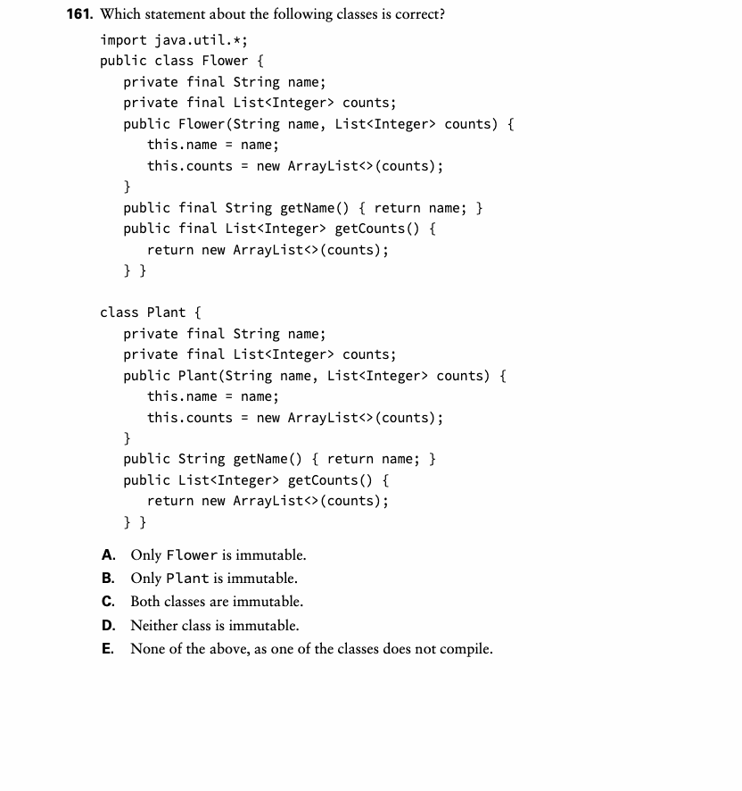


- **A.** Only `Flower` is immutable.
- **B.** Only `Plant` is immutable.
- **C.** Both classes are immutable.
- **D.** Neither class is immutable.
- **E.** None of the above, as one of the classes does not compile.

**Answer:** A

**Explanation:** An immutable class must not allow the state to change. The `Flower` class does this correctly. While the class isn’t `final`, the getters are, so subclasses can’t change the value returned. The `Plant` class lacks this protection, which makes it mutable. Option A is correct.

## 829-03-162

What is the result of executing the `Sounds` program?

```java
// Sheep.java
package com.mammal;
public class Sheep {
   private void baa() {
     System.out.println("baa!");
   }
   private void speak() {
     baa();
   } }
// Sounds.java
package com.animals;
import com.mammal.Sheep;
public class Sounds {
   public static void main(String[] args) {
     var sheep = new Sheep();
     sheep.speak();
   } }
```

- **A.** The code runs and prints `baa!`.
- **B.** The `Sheep` class does not compile.
- **C.** The `Sounds` class does not compile.
- **D.** Neither class compiles.
- **E.** None of the above.

**Answer:** C

**Explanation:** The `speak()` method has `private` access, which does not allow code outside the class to call it. Therefore, option C is the answer.

## 829-03-163

What is the output of the following application?

```java
package stocks;
public class Bond {
   private static int price = 5;
   public boolean sell() {
     if(price<10) {
        price++;
        return true;
     } else if(price>=10) {
        return false;
     } }
   public static void main(String[] cash) {
     new Bond().sell();
     new Bond().sell();
       new Bond().sell();
       System.out.print(price);
    } }
```

- **A.** `5`
- **B.** `6`
- **C.** `7`
- **D.** `8`
- **E.** The code does not compile.
- **F.** The output cannot be determined with the information given.

**Answer:** E

**Explanation:** The `sell()` method does not compile because it does not return a value if both of the `if` statements’ conditional expressions evaluate to `false`. While logically it is true that `price` is either less than `10` or greater than or equal to `10`, the compiler does not know that. It just knows that if both `if` statements evaluate to `false`, then it does not have a return value; therefore, it does not compile. For this reason, option E is correct.

## 829-03-164

Given the following class declaration, what expression can be used to fill in the blank so that `88` is printed at runtime?

```java
final public class Racecar {
   final private int speed = 88;
   final protected class Engine {
     private final int speed = 100;
     public final int getSpeed() {
        return _____________________ ;
     }
   }
   final Engine e = new Engine();
   final public static void main(String[] feed) {
     System.out.print(new Racecar().e.getSpeed());
   } }
```

- **A.** `Racecar.speed`
- **B.** `this.speed`
- **C.** `this.Racecar.speed`
- **D.** `Racecar.Engine.this.speed`
- **E.** `Racecar.this.speed`
- **F.** The code does not compile regardless of what is placed in the blank.

**Answer:** E

**Explanation:** Options A and C do not compile, as they are invalid ways of accessing a member variable. Options B and D both compile but print `100` at runtime, since they reference the `speed` variable defined in the `Engine` class. Option E is the correct answer, accessing the `speed` variable in the `Racecar` class and printing `88` at runtime.

## 829-03-165

Which statements about `static` initializers are correct? (Choose three.)

- **A.** They cannot be used to create instances of the class they are contained in.
- **B.** They can assign a value to a `static final` variable.
- **C.** They are executed at most once per program.
- **D.** They are executed each time an instance of the class is created from a local cache of objects.
- **E.** They are executed each time an instance of the class is created using the `new` keyword.
- **F.** They may never be executed.

**Answer:** B, C, F

**Explanation:** A `static` initializer can create instances of any class it has access to, so option A is incorrect. It can assign values to `static final` variables, specifically ones that have not been assigned a value already, so option B is correct. A `static` initializer is executed when the class is first loaded, not when an object is created or loaded, making option C correct, and options D and E incorrect. If the classes are never loaded, then they will not be executed, making option F correct.

## 829-03-166

What is the output of the `BlueCar` program?

```java
package race;
abstract class Car {
   static { System.out.print("1"); }
   public Car(String name) {
     super();
     System.out.print("2");
   }
   { System.out.print("3"); } }
public class BlueCar extends Car {
   { System.out.print("4"); }
   public BlueCar() {
     super("blue");
     System.out.print("5");
   }
   public static void main(String[] gears) {
     new BlueCar();
   } }
```

- **A.** `23451`
- **B.** `12345`
- **C.** `14523`
- **D.** `13245`
- **E.** `23154`
- **F.** The code does not compile.
- **G.** None of the above.

**Answer:** D

**Explanation:** The class is loaded first, with the `static` initialization block called and `1` is printed. When the `BlueCar` is created in the `main()` method, the superclass initialization happens first. The instance initialization blocks are executed before the constructor, so `32` is outputted next. Finally, the object is created with the instance initialization blocks again being called before the constructor, outputting `45`. The result is that `13245` is printed, making option D the correct answer.

## 829-03-167

The following `Fish` class is included, unmodified, in a larger program at runtime. As most, how many classes can inherit `Fish` (excluding `Fish` itself)?

```java
public sealed class Fish {
   final class Blobfish extends Clownfish {}
   private non-sealed class Dory extends BlueTang {}
   sealed class Clownfish extends Fish {}
   sealed class BlueTang extends Fish {}
   final class Swordfish extends Fish {}
   private non-sealed class Nemo extends Clownfish {}
}
```

- **A.** None
- **B.** Four
- **C.** Five
- **D.** Six
- **E.** One of the nested classes does not compile.
- **F.** Two or more of the nested classes do not compile.
- **G.** The number cannot be determined with the information given.

**Answer:** D

**Explanation:** The code compiles, so options E and F are incorrect. Remember that the `permits` clause is optional if the sealed subclass is in the same file. Given the class declarations, all six nested subclasses inherit `Fish`. While `Fish` does include the `non-sealed` classes `Nemo` and `Dory` as descendants, they are marked `private`, which means they can’t be extended outside the `Fish` class. Since it states the `Fish` class is unmodified, there are at most six subclasses of `Fish`, making option D correct.

## 829-03-168

Given the following class declaration, which value cannot be inserted into the blank line that would allow the code to compile?

```java
package mammal;
interface Pet {
   public Object getDoggy();
}
public class Canine implements Pet {
   public ________ getDoggy() {
     return this;
   } }
```

- **A.** `Canine`
- **B.** `List`
- **C.** `Object`
- **D.** `Pet`
- **E.** All of the above can be inserted.
- **F.** The code does not compile regardless of what is inserted into the blank.

**Answer:** B

**Explanation:** Recall that `this` refers to an instance of the current class. Therefore, any superclass of `Canine` can be used as a return type of the method. Since `Canine` inherits both `Pet` and `Object`, they can also be used as the return type. Note that these are all covariant with the inherited version from the `Pet` interface. Only `List` is incompatible, making option B correct.

## 829-03-169

Which statement about the following interface is correct?

```java
public interface Movie {
   String pass = "TICKET";
   private void buyPopcorn() {
     purchaseTicket();
   }
   public static int getDrink() {
     buyPopcorn();
     return 32;
   }
   private static String purchaseTicket() {
     getDrink();
     return pass;
   } }
```

- **A.** The code compiles.
- **B.** The code contains an invalid constant.
- **C.** The method `buyPopcorn()` does not compile.
- **D.** The method `getDrink()` does not compile.
- **E.** The method `purchaseTicket()` does not compile.
- **F.** The code does not compile for a different reason.

**Answer:** D

**Explanation:** The `static` method `getDrink()` attempts to access an instance-based `private` method `buyPopcorn()` that results in a compiler error, making option D correct. The rest of the code compiles without issue.

## 829-03-170

Which methods compile?

```java
class YardWork {
   private static int numShovels;
   private int numRakes;
   public int getNumShovels() {
     return numShovels;
   }
   public int getNumRakes() {
     return numRakes;
   } }
```

- **A.** Just `getNumRakes()`
- **B.** Just `getNumShovels()`
- **C.** Both methods
- **D.** Neither method

**Answer:** C

**Explanation:** An instance method can access both instance variables and `static` variables. Both methods compile, and option C is correct.

## 829-03-171

How many lines of the following class contain compilation errors?

```java
1: class Fly {
2:    public Fly Fly() { return new Fly(); }
3:    public void Fly(int kite) {}
4:    public int Fly(long kite) { return 1; }
5:    public static void main(String[] a) {
6:      var f = new Fly();
7:      f.Fly();
8:    } }
```

- **A.** None
- **B.** One
- **C.** Two
- **D.** Three
- **E.** Four
- **F.** The answer cannot be determined with the information given.

**Answer:** A

**Explanation:** As ugly as the class looks, it does compile, making option A correct. Lines 2–4 each defines an instance method since they each have a name and return type. There is no rule saying you cannot define a method with the same name as the class, although it is considered bad style. The `main()` method calls the default no-argument constructor on line 6, inserted by the compiler. Finally, line 7 calls the method declared on line 2, which again calls the no-argument constructor inserted by the compiler.

## 829-03-172

How many of the classes in the diagram can write code that references the `sky()` method?

```java
com.color ________________ com.light
Red ______________________ BrightLight extends Red
• protected boolean light
Blue _____________________ Light
• void sky()
```

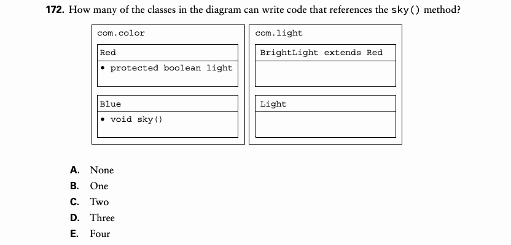

- **A.** None
- **B.** One
- **C.** Two
- **D.** Three
- **E.** Four

**Answer:** C

**Explanation:** This method has package access, which means only classes in the same package can access it. In our case, these are the `Red` and `Blue` classes, making option C correct.

## 829-03-173

For the diagram in Question 172, how many classes can write code that references the `light` variable?

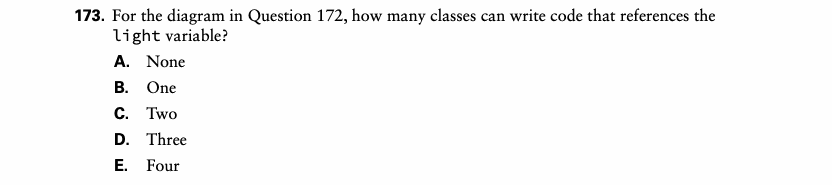

- **A.** None
- **B.** One
- **C.** Two
- **D.** Three
- **E.** Four

**Answer:** D

**Explanation:** This variable has `protected` access, which means code in the same package can access it in addition to subclasses. There are two classes in the `com.color` package and one class that subclasses it, making option D the answer.

## 829-03-174

Which of the following are the best reasons for creating a `public static` interface method? (Choose two.)

- **A.** Allow `static` methods to access instance methods.
- **B.** Allow an interface to define a method at the class level.
- **C.** Provide an implementation that a class implementing the interface can override.
- **D.** Improve code reuse within the interface.
- **E.** Add backward compatibility to existing interfaces.
- **F.** Improve encapsulation of the interface.

**Answer:** B, D

**Explanation:** Option A is incorrect because `static` methods cannot call instance methods directly. Options B and D are correct and are the primary reasons to create a `static` interface method. Options C and E are incorrect and describe attributes of a `default` method. Option F applies only to `private static` interface methods, not `public` ones.

## 829-03-175

What is the output of the `HighSchool` application?

```java
 package edu;
 import java.io.FileNotFoundException;
 abstract class School {
    abstract Float getNumTeachers();
    public int getNumStudents() {
     return 10;
   } }
public class HighSchool extends School {
   final Float getNumTeachers() { return 4f; }
   public int getNumStudents() throws FileNotFoundException {
     return 20;
   }
   public static void main(String[] s) throws Exception {
     var school = new HighSchool();
     System.out.print(school.getNumStudents());
   } }
```

- **A.** `10`
- **B.** `20`
- **C.** `4.0`
- **D.** One line of the program does not compile.
- **E.** Two lines of the program do not compile.
- **F.** None of the above.

**Answer:** D

**Explanation:** When overriding a method, a new or broader checked exception cannot be declared. The `getNumStudents()` method in `HighSchool` is an invalid override since it declares `FileNotFoundException`, which is not declared in the parent method. Since this is the only line that does not compile, option D is correct. Note that an `abstract` method can be overridden with a `final` method, as shown with `getNumTeachers()`.

## 829-03-176

What is the output of the following application?

```java
package track;
interface Run {
   default CharSequence walk() {
     return "Walking and running!";
   } }
interface Jog {
   default String walk() {
     return "Walking and jogging!";
   } }
public class Sprint implements Run, Jog {
   public String walk() {
     return "Sprinting!";
   }
   public static void main(String[] args) {
     var s = new Sprint();
     System.out.println(s.walk());
   } }
```

- **A.** `Walking and running!`
- **B.** `Walking and jogging!`
- **C.** `Sprinting!`
- **D.** The code does not compile.
- **E.** The code compiles but prints an exception at runtime.
- **F.** None of the above.

**Answer:** C

**Explanation:** Having one class implement two interfaces that both define the same `default` method signature leads to a compiler error unless the class overrides the `default` method. In this case, the `Sprint` class overrides both `walk()` methods correctly; therefore, the code compiles without issue, and option C is correct. Note that the return types of the two `default` methods are different, but the overridden method uses a return type that is covariant with both.

## 829-03-177

What is true of these two interfaces?

```java
interface Crawl {
   abstract void wriggle();
}
interface Dance {
   public void wriggle();
}
```

- **A.** A concrete class can implement both interfaces, but must implement `wriggle()`.
- **B.** A concrete class can implement both interfaces, but must not implement `wriggle()`.
- **C.** A concrete class would only be able to implement both interfaces if the `public` modifier were removed but must implement `wriggle()`.
- **D.** If the `public` modifier were removed, a concrete class could implement both interfaces, but must not implement `wriggle()`.
- **E.** None of the above.

**Answer:** A

**Explanation:** Interface methods without bodies are implicitly `abstract` and `public`. Therefore, both of these methods have the same signature. This means a class implementing them must implement a single `wriggle()` method, and option A is correct.

## 829-03-178

Which of these are functional interfaces?

```java
interface Lion {
   public void roar();
   default void drink() {}
   boolean equals(Lion lion);
}
interface Tiger {
   public void roar();
   default void drink() {}
   String toString(String name);
}
interface Bear {
   void ohMy();
   default void drink() {}
}
```

- **A.** `Lion`
- **B.** `Tiger`
- **C.** `Bear`
- **D.** `Lion` and `Tiger`
- **E.** `Tiger` and `Bear`
- **F.** `Bear` and `Lion`
- **G.** None of them
- **H.** All of them

**Answer:** C

**Explanation:** A functional interface is required to have exactly one `abstract` method. In none of the interfaces does the `default` method count as an abstract method. `Lion` and `Tiger` are not functional interfaces since they contain two abstract methods. In both of these interfaces, `roar()` is `abstract`. The `equals(Lion)` method is similar to the `equals(Object)` in `Object` but is not an override of that method. Similarly, the `toString()` method in `Tiger` is also an `abstract` method. While there is a `toString()` method in `Object`, it does not take any parameters. On the other hand, `Bear` is a valid functional interface because it contains exactly one abstract method, making option C correct.

## 829-03-179

How many lines of the following class contain a compiler error?

```java
1: public class Dragon {
2:     boolean scaly;
3:     static final int gold;
4:     Dragon protectTreasure(int value, boolean scaly) {
5:       scaly = true;
6:       return this;
7:     }
8:     static void fly(boolean scaly) {
9:       scaly = true;
10:    }
11:    int saveTheTreasure(boolean scaly) {
12:      return this.gold;
13:    }
14:    static void saveTheDay(boolean scaly) {
15:      this.gold = 0;
16:    }
17:    static { gold = 100; } }
```

- **A.** None
- **B.** One
- **C.** Two
- **D.** Three
- **E.** More than three

**Answer:** B

**Explanation:** The `gold` variable is marked `final`, which means it must be set either when it is declared or in a `static` initializer, as shown on line 17. It cannot be modified by a `static` method, though, so line 15 does not compile. Since this is the only line that does not compile, option B is correct. Line 8 compiles because the `static` method is modifying the local variable `scaly`, not the instance variable of the same name. Line 12 also compiles. While accessing a `static` variable via an instance is not recommended, it is allowed.

## 829-03-180

Which are requirements for a class to be immutable? (Choose three.)

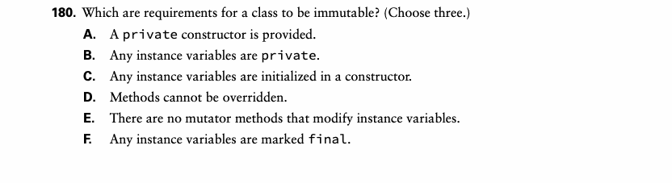


- **A.** A `private` constructor is provided.
- **B.** Any instance variables are `private`.
- **C.** Any instance variables are initialized in a constructor.
- **D.** Methods cannot be overridden.
- **E.** There are no mutator methods that modify instance variables.
- **F.** Any instance variables are marked `final`.

**Answer:** B, D, E

**Explanation:** An immutable class can have `public` constructors, so option A is incorrect. Options B, D, and E are correct and make up the requirements for an immutable class. Option D can be fulfilled by making the class `final` or marking the methods `final`. Option C is incorrect because instance variables can be declared with a value or set by an instance initializer. Option F is also incorrect. While it is common to mark instance variables `final`, as long as there is no way for them to be changed after the constructor is executed, the class can still be considered immutable.

## 829-03-181

Which statement about the following interface is correct?

```java
public interface Planet {
   int circumference;
   public abstract void enterAtmosphere();
   public default int getCircumference() {
     enterAtmosphere();
     return circumference;
   }
   private static void leaveOrbit() {
     var earth = new Planet() {
        public void enterAtmosphere() {}
     };
     earth.getCircumference();
   } }
```

- **A.** The code compiles.
- **B.** The method `enterAtmosphere()` does not compile.
- **C.** The method `getCircumference()` does not compile.
- **D.** The method `leaveOrbit()` does not compile.
- **E.** The code does not compile for a different reason.
- **F.** None of the above.

**Answer:** E

**Explanation:** The code does not compile because the constant variable `circumference` does not declare a value, making option E correct. Remember that all variables within interfaces are implicitly `static` and `final`, so they must be initialized with a value when they are declared. The rest of the lines of code compile without issue. Note that while the `static` method `leaveOrbit()` cannot access the instance-based `default` method `getCircum-` `ference()` directly, it can through the reference variable `earth`.

## 829-03-182

What is the output of the following program?

```java
import java.time.*;
import java.time.temporal.*;
public record User(LocalDate creationDate) {
   static LocalDate today = LocalDate.now();
   public User {
     creationDate = today;
     creationDate = today;
   }
   public static void main(String[] p) {
     LocalDate yesterday = LocalDate.now()
        .minus(1, ChronoUnit.DAYS);
     var u = new User(yesterday);
     System.out.print(u.creationDate());
   } }
```

- **A.** `null`
- **B.** Today’s date
- **C.** Yesterday’s date
- **D.** An exception is thrown at runtime.
- **E.** Exactly one line needs to be corrected for the code to compile.
- **F.** Two or more lines need to be corrected for the code to compile.
- **G.** None of the above.

**Answer:** B

**Explanation:** The code compiles, making options E and F incorrect. The record uses a compact constructor to set the same parameter twice, replacing the value passed into the constructor. The parameter isn’t `final`, so this is allowed. At runtime, the code prints today’s date, making option B correct.

## 829-03-183

Fill in the blanks: \_\_\_\_\_\_\_\_\_\_\_\_\_\_\_\_\_\_\_ methods always have the same name but a different list of parameters, while \_\_\_\_\_\_\_\_\_\_\_\_\_\_\_\_\_\_\_ methods always have the same name and the same return type.

- **A.** Overloaded, overridden
- **B.** Inherited, overridden
- **C.** Overridden, overloaded
- **D.** Hidden, overloaded
- **E.** Overridden, hidden
- **F.** None of the above

**Answer:** F

**Explanation:** Trick question! Overloaded methods is correct in the first part of the sentence, but none of the answers is correct in the second part of the sentence. Remember, overridden methods can have covariant return types. They do not need to be the same. For this reason, option F is the correct answer.

## 829-03-184

What is the output of the following program?

```java
public class Husky {
   { this.food = 10; }
   { this.toy = 2; }
   private final int toy;
   private static int food;
   public Husky(int friend) {
     this.food += friend++;
     this.toy -= friend--;
   }
   public static void main(String... unused) {
     var h = new Husky(2);
     System.out.println(h.food+","+h.toy);
   } }
```

- **A.** `12,-1`
- **B.** `12,2`
- **C.** `13,-1`
- **D.** Exactly one line of this class does not compile.
- **E.** Exactly two lines of this class do not compile.
- **F.** None of the above.

**Answer:** D

**Explanation:** This class creates a `final` instance `toy` variable, but it is assigned a value twice. First, it is assigned a value in an instance initializer and then in a constructor. For this reason, the second line of the constructor does not compile, and option D is correct. The first line of the constructor, in which a `static` variable is referenced from an instance variable, is permitted but discouraged.

## 829-03-185

Suppose you have the following code. Which of the images best represents the state of the references right before the end of the `main()` method, assuming garbage collection hasn’t run?

```java
1: public class Link {
2:     private String name;
3:     private Link next;
4:     public Link(String name, Link next) {
5:       this.name = name;
6:       this.next = next;
7:     }
8:     public void setNext(Link next) {
9:       this.next = next;
10:    }
11:    public Link getNext() {
12:      return next;
13:    }
14:    public static void main(String... args) {
15:      var apple = new Link("x", null);
16:      var orange = new Link("y", apple);
17:      var banana = new Link("z", orange);
18:      orange.setNext(banana);
19:      banana.setNext(orange);
20:      apple = null;
21:      banana = null;
22:    } }
```

Option A Option B apple apple x null x banana banana orange y z orange y z Option C Option D apple apple null x null x banana banana orange y z orange y z

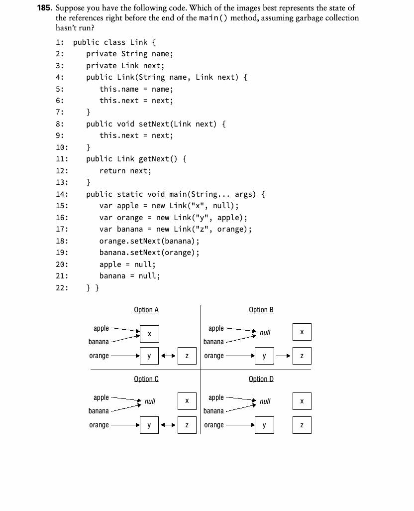

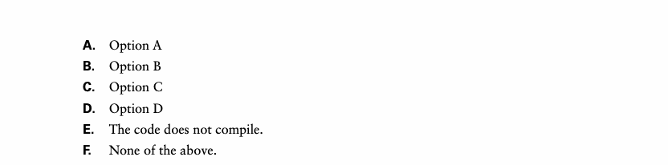

- **A.** Option A
- **B.** Option B
- **C.** Option C
- **D.** Option D
- **E.** The code does not compile.
- **F.** None of the above.

**Answer:** C

**Explanation:** Lines 15–17 create the three objects. Lines 18–19 change the references, so `orange` and `banana` point to each other. Lines 20–21 wipe out two of the original references. This means the object with `name` as `x` is inaccessible. Option C matches this scenario.

## 829-03-186

Which statement about a no-argument constructor is true?

- **A.** The Java compiler will always insert a default no-argument constructor if you do not define a no-argument constructor in your class.
- **B.** For a class to call `super()` in one of its constructors, its parent class must explicitly implement a constructor.
- **C.** If a class extends another class that has only one constructor that takes a value, then the child class must explicitly declare at least one constructor.
- **D.** A class may contain more than one no-argument constructor.
- **E.** None of the above.

**Answer:** C

**Explanation:** Option A is incorrect because Java inserts a no-argument constructor only if there are no other constructors in the class. Option B is incorrect because the parent can have a default no-argument constructor, which is inserted by the compiler and accessible in the child class. Option D is incorrect. A class that contains two no-argument constructors will not compile because they would have the same signature. Finally, option C is correct. If a class extends a parent class that does not include a no-argument constructor, the default noargument constructor cannot be automatically inserted into the child class by the compiler. Instead, the developer must explicitly declare at least one constructor and explicitly define how the call to the parent constructor is made.

## 829-03-187

Which variable declaration is the first line not to compile?

```java
public class Complex {
   class Building {}
   final class House extends Building {}
   public void convert() {
     Building b1 = new Building();
     House h1 = new House();
     Building b2 = new House();
     Building b3 = (House) b1;
     House h2 = (Building) h1;
     Building b4 = (Building) b2;
     House h3 = (House) b2;
   } }
```

- **A.** `b2`
- **B.** `b3`
- **C.** `h2`
- **D.** `b4`
- **E.** `h3`
- **F.** All of the lines compile.

**Answer:** C

**Explanation:** `Building` and `House` are both properly declared inner classes. Any `House` object can be stored in a `Building` reference, making the declarations for `b2`, `b3`, and `b4` compile. The declaration for `h3` is also correct. It so happens that `b2` is a `House` object, so the cast works. The declaration of `h2` is a problem, though. While the cast itself is fine, a `Building` cannot be stored in a `House` reference, which means the assignment fails to compile. Option C is correct and is the only line with a compiler error in this code. Note that if the declaration of `h2` were removed, the declaration of `b3` would produce a `ClassCastException` at runtime.

## 829-03-188

What is the output of the following application?

```java
1: interface Tasty {
2:     default void eat() {
3:       System.out.print("Spoiled!");
4:     } }
5: public class ApplePicking {
6:     public static void main(String[] food) {
7:       var apple = new Tasty() {
8:          @Override
9:          void eat() {
10:            System.out.print("Yummy!");
11:         }
12:      }
13:    }
14: }
```

- **A.** `Spoiled!`
- **B.** `Yummy!`
- **C.** The application completes without printing anything.
- **D.** One line needs to be corrected for the program to compile.
- **E.** Two lines need to be corrected for the program to compile.
- **F.** None of the above.

**Answer:** E

**Explanation:** This `main()` method declares an anonymous class that implements the `Tasty` interface. Interface methods are `public`, whereas the override in the anonymous class uses package access. Since this reduces the visibility of the method, the declaration of `eat()` on line 9 does not compile. Next, the declaration of the `apple` object must end with a semicolon (`;`) on line 12, and it does not. For these two reasons, the code does not compile, and option E is the correct answer. Note that if these two issues were corrected, then the correct answer would be option C because the code does not actually call the `eat()` method; it just declares it.

## 829-03-189

Which of the following statements about functional interfaces is true?

- **A.** It is possible to define a functional interface that returns two data types.
- **B.** It is possible to define a primitive functional interface that uses `float`, `char`, or `short`.
- **C.** All functional interfaces must take arguments or return a value.
- **D.** None of the primitive functional interfaces includes generic arguments.
- **E.** None of these statements is true.

**Answer:** B

**Explanation:** Java supports only a single return data type or `void`. Therefore, it is not possible to define a functional interface that returns two data types, making option A incorrect. While many of the built-in functional interfaces use generics, functional interfaces that use primitives certainly exist, making option B the correct answer. Option C is incorrect because a functional interface that takes no values and returns `void` is possible. In fact, `Runnable` is one such example. Option D is also incorrect, since `IntFunction<R>` takes a primitive argument as input and a generic argument for the return type.

## 829-03-190

What is the result of executing the `Tortoise` program?

```java
 // Hare.java
 package com.mammal;
 public class Hare {
    void init() {
       System.out.print("init-");
    }
    protected void race() {
       System.out.print("hare-");
    } }
// Tortoise.java
package com.reptile;
import com.mammal.Hare;
public class Tortoise {
   protected void race(Hare hare) {
     hare.init();     // x1
     hare.race();     // x2
     System.out.print("tortoise-");
    }
    public static void main(String[] args) {
      var tortoise = new Tortoise();
      var hare = new Hare();
      tortoise.race(hare);
   } }
```

- **A.** `init-hare-tortoise`
- **B.** `init-hare`
- **C.** The first line with a compiler error is `line x1`.
- **D.** The first line with a compiler error is `line x2`.
- **E.** The code does not compile due to a different line.
- **F.** The code throws an exception.

**Answer:** C

**Explanation:** The `init()` method is accessible only from the same package. Since `Tortoise` is in a different package, the method is not available, and option C is correct. Line `x2` does not compile either since `Tortoise` is in a different package and not a subclass. However, the question asks about the first line.

## 829-03-191

How many lines of the following program do not compile?

```java
interface Tool {
   void use(int fun);
}
abstract class Childcare {
   abstract void use(int fun);
}
final public class Stroller extends Childcare implements Tool {
   final public void use(int fun) {
     final int width = 5;
     class ParkVisit {
        final int getValue() { return width + fun; }
     }
     System.out.print(new ParkVisit().getValue());
   } }
```

- **A.** Zero
- **B.** One
- **C.** Two
- **D.** Three
- **E.** More than three

**Answer:** A

**Explanation:** The code does not contain any compilation errors, making option A correct. While an `abstract` class cannot be marked `final`, a concrete class extending it can be. Likewise, a concrete method overriding an `abstract` one can also be marked `final`. In the `ParkVisit` class, the `getValue()` method accesses the effectively final variables `width` and `fun`. Finally, a class can override a method that it inherits from both an interface and an abstract class, provided the method signatures are compatible.

## 829-03-192

What is the result of executing the `Bush` program?

```java
// Evergreen.java
package tree;
public class Evergreen {
   String leaves = "Green ";
   default void season() {
     System.out.println("spring");
   }
   default void bloom() {
     season();
   } }
// Bush.java
package shrub;
import tree.Evergreen;
public class Bush {
   public static void main(String[] args) {
     var var = new Evergreen();
     System.out.print(var.leaves);
     var.bloom();
   } }
```

- **A.** The code runs and prints `Green spring`.
- **B.** The code runs and prints `Green springspring`.
- **C.** The `Evergreen` class does not compile.
- **D.** The `Bush` class does not compile.
- **E.** Neither class compiles.

**Answer:** E

**Explanation:** The `Evergreen` class does not compile because there is no `default` access modifier keyword that can be applied to methods in a class. The `Bush` class does not compile because `leaves` has package access and `Bush` is in a different package. Since both classes do not compile, option E is the correct answer.

## 829-03-193

What is the output of the following program?

```java
public sealed class Seasons {
   final static class Spring extends Seasons {}
   non-sealed class Summer extends Seasons {}
   public static void main(String[] w) {
     var t = new Spring();
     final String m = switch (t) {
        case Spring -> "Flowers";
        case Summer -> "Pool";
        default -> "Snow";
     };
     System.out.print(m);
   } }
```

- **A.** `Flowers`
- **B.** `Pool`
- **C.** `Snow`
- **D.** The `Spring` declaration does not compile.
- **E.** The `Summer` declaration does not compile.
- **F.** The `main()` method does not compile.

**Answer:** F

**Explanation:** While sealed classes are similar to enums, they cannot be used in `switch` statements like enums in Java 17. For this reason, the `main()` method does not compile, making option F correct. The two subclass declarations compile without issue.

## 829-03-194

What is the best reason for marking an existing `static` method `private` within an interface?

- **A.** It allows the method to be overridden in a subclass.
- **B.** It hides the secret implementation details from another developer using the interface.
- **C.** It improves the visibility of the method.
- **D.** It ensures the method is not replaced with an overridden implementation at runtime.
- **E.** It allows the method to be marked `abstract`.
- **F.** Trick question! All `static` methods are implicitly `private` within an interface.

**Answer:** B

**Explanation:** Marking an interface method `private` improves the encapsulation of the class, making option B correct. Options A and D are incorrect as `static` methods cannot be overridden, regardless if they are marked `private`. Option C is incorrect, as adding `private` to a method reduces the visibility of the method. Options E and F are flat-out wrong.

## 829-03-195

What is the output of the following application?

```java
package jungle;
public class RainForest extends Forest {
   public RainForest(long treeCount) {
     this.treeCount = treeCount+1;
   }
   public static void main(String[] birds) {
     System.out.print(new RainForest(5).treeCount);
   } }
class Forest {
   public long treeCount;
   public Forest(long treeCount) {
     this.treeCount = treeCount+2;
   } }
```

- **A.** `5`
- **B.** `6`
- **C.** `7`
- **D.** `8`
- **E.** The code does not compile.

**Answer:** E

**Explanation:** Since a constructor call is not the first line of the `RainForest()` constructor, the compiler inserts the no-argument `super()` call. Since the parent class, `Forest`, does not define a no-argument constructor, the `RainForest()` constructor does not compile, and option E is correct.

## 829-03-196

What is the result of compiling and executing the following class?

```java
package sports;
public class Bicycle {
   String color = "red";
    private void printColor(String color) {
       color = "purple";
       System.out.print(color);
    }
    public static void main(String[] rider) {
       new Bicycle().printColor("blue");
    } }
```

- **A.** `red`
- **B.** `purple`
- **C.** `blue`
- **D.** `null`
- **E.** It does not compile.

**Answer:** B

**Explanation:** First, the `color` variable defined in the instance and set to `red` is ignored in the method `printColor()`. Since local scope overrides instance scope, option A is incorrect. The value of `color` passed to the `printColor()` method is `blue`, but that is lost by the assignment of `purple`, making option B the correct answer and option C incorrect. Options D and E are incorrect as the code compiles and prints a value.

## 829-03-197

Given that `Short` and `Integer` extend `Number` directly, what type can be used to fill in the blank in the following class to allow it to compile?

```java
package band;
interface Horn {
   public Integer play();
}
abstract class Woodwind {
   public Short play() {
     return 3;
   } }
public final class Saxophone extends Woodwind implements Horn {
   public _________ play() {
     return null;
   } }
```

- **A.** `Object`
- **B.** `Integer`
- **C.** `Short`
- **D.** `Number`
- **E.** None of the above

**Answer:** E

**Explanation:** The `play()` method is overridden in `Saxophone` for both `Horn` and `Woodwind`, so the return type must be covariant with both. `Object` and `Number` do not work, because neither is a subclass of `Integer` or `Short`. As stated in the question text, both `Integer` and `Short` extend `Number` directly, so neither can be a subclass of the other. Therefore, nothing can fill in the blank that would allow this code to compile, and option E is correct.

## 829-03-198

Which statements about abstract classes and methods are correct? (Choose three.)

- **A.** An abstract class can be extended by a `final` class.
- **B.** An abstract method can be overridden by a `final` method.
- **C.** An abstract class can be extended by multiple classes directly.
- **D.** An abstract class can extend multiple classes directly.
- **E.** An abstract class cannot implement an interface.
- **F.** An abstract class can extend an interface.

**Answer:** A, B, C

**Explanation:** Options A, B, and C are correct statements about abstract classes. Option D is incorrect as Java allows a class to extend only one class directly, abstract or otherwise. Option E is incorrect, as a class can implement or inherit an interface. Option F is also incorrect as classes can only extend classes, and interfaces can only extend interfaces.

## 829-03-199

Given the following enum declaration, how many lines would need to be corrected for the code to compile?

```java
public enum Proposition {
   TRUE(1) { String getNickName() { return "RIGHT"; }},
   FALSE(2) { public String getNickName() { return "WRONG"; }},
   UNKNOWN(3) { public String getNickName() { return "LOST"; }}
   public int value;
   Proposition(int value) {
     this.value = value;
   }
   public int getValue() {
     return this.value;
   }
   protected abstract String getNickName();
}
```

- **A.** Zero
- **B.** One
- **C.** Two
- **D.** Three
- **E.** More than three

**Answer:** C

**Explanation:** The code does not compile. First, the enum list is not terminated with a semicolon (`;`), which is required when an enum includes anything beyond just the list of values. Second, the access modifier of `TRUE`’s implementation of `getNickName()` is package, but the `abstract` method signature has a `protected` modifier. Since package access is a more restrictive access than `protected`, the override is invalid, and the code does not compile. For these two reasons, option C is the correct answer. Note that the `value` variable is not `final` or properly encapsulated and can therefore be modified by callers outside the enum. This is permitted but considered a poor practice.

## 829-03-200

What is the result of executing the `HopCounter` program?

```java
// Hopper.java
package com.animals;
public class Hopper {
   protected void hop() {
     System.out.println("hop");
   } }
// Grasshopper.java
package com.insect;
import com.animals.Hopper;
public class Grasshopper extends Hopper {
   public void move() {
     hop(); // p1
   } }
// HopCounter.java
package com.insect;
 public class HopCounter {
    public static void main(String[] args) {
       var hopper = new Grasshopper();
       hopper.move(); // p2
       hopper.hop();     // p3
    } }
```

- **A.** The code prints `hop` once.
- **B.** The code prints `hop` twice.
- **C.** The first compiler error is on line `p1`.
- **D.** The first compiler error is on line `p2`.
- **E.** The first compiler error is on line `p3`.
- **F.** None of the above.

**Answer:** E

**Explanation:** The `hop()` method has `protected` access, which allows subclasses to call it, making line `p1` correct. The `HopCounter` class is allowed to call the `move()` method because it is `public`. However, it is not allowed to call the `hop()` method since it is referencing a subclass, but not in one. Therefore, option E is the answer.

## 829-03-201

Which of the following are not attributes common to both abstract classes and interfaces? (Choose two.)

- **A.** They both can contain `abstract` methods.
- **B.** They both can contain `default` methods.
- **C.** They both can contain `protected` methods.
- **D.** They both can contain `public` methods.
- **E.** They both can contain `static` variables.

**Answer:** B, C

**Explanation:** Only interfaces can contain `default` methods, making option B correct. Interfaces cannot contain `protected` methods, making option C the other correct answer.

## 829-03-202

Given the following class, which method signature could be successfully added to the class as an overloaded version of the `findAverage()` method? (Choose two.)

```java
public class Calculations {
   public Integer findAverage(int sum) { return sum; }
}
```

- **A.** `public Long findAverage(int x)`
- **B.** `public Long findAverage(int x, int y)`
- **C.** `public Integer average(int x)`
- **D.** `private void findAverage(int x)`
- **E.** `public Integer findAverage(int... x) throws Exception`
- **F.** `private Integer findAverage(int x)`

**Answer:** B, E

**Explanation:** Options A and D would not allow the class to compile because two methods in the class cannot have the same name and arguments, but a different return value. Option C would allow the class to compile, but it is not a valid overloaded form of our `findAverage()` method since it uses a different method name. Options B and E are correct overloaded versions of the `findAverage()` method, since the name is the same but the arguments are different. While new checked exceptions are not permitted for overridden methods, they are allowed for overloaded methods. Option F is incorrect because the method is overridden, not overloaded, and the visibility of the inherited method cannot be reduced.

## 829-03-203

Which of the following is a valid method name in Java? (Choose two.)

- **A.** `Go_$Outside$2()`
- **B.** `have-Fun()`
- **C.** `new()`
- **D.** `9enjoyTheWeather()`
- **E.** `$sprint()`
- **F.** `walk#()`

**Answer:** A, E

**Explanation:** Options A and E are correct since method names may include the underscore (`_`) character as well as currency (`$`) symbols. Note that there is no rule that requires a method to start with a lowercase character; it is just a practice adopted by the community. Options B and F are incorrect because the hyphen (`-`) and pound (`#`) characters may not be part of a method name. Option C is incorrect since `new` is a reserved word in Java. Finally, option D is incorrect. A method name must start with a letter, a currency (`$`) symbol, or an underscore (`_`) character.

## 829-03-204

Fill in the blanks: A functional interface must contain or inherit \_\_\_\_\_\_\_\_\_\_\_\_\_\_ and may optionally include \_\_\_\_\_\_\_\_\_\_\_\_\_\_.

- **A.** at least one `abstract` method, the `@Override` annotation
- **B.** exactly one method, `static` methods
- **C.** exactly one `abstract` method, the `@FunctionalInterface` annotation
- **D.** at least one `static` method, at most one `default` method
- **E.** None of the above

**Answer:** C

**Explanation:** A functional interface must include exactly one `abstract` method, either by inheritance or declared directly. It may also have any number, including zero, of `default` or `static` methods. For this reason, both parts of option D are incorrect. The first part of option A is incorrect because more than one `abstract` method disqualifies it as a functional interface. The first part of option B is incorrect because the method must be `abstract`. Finally, option C is the correct answer. The first part of the sentence defines what it means to be a functional interface. The second part refers to the optional `@FunctionalInterface` annotation. It is considered a good practice to add this annotation to any functional interfaces you define because the compiler will report a problem if you define an invalid interface that does not have exactly one `abstract` method.

## 829-03-205

Fill in the blank with the line of code that allows the program to compile and print `15` at runtime.

```java
package love;
interface Sport {
   private int play() { return 15; }
}
interface Tennis extends Sport {
   private int play() { return 30; }
}
public class Game implements Tennis {
   public int play() { return _____________ ; }
   public static void main(String... ace) {
     System.out.println(new Game().play());
   } }
```

- **A.** `Sport.play()`
- **B.** `Sport.super.play()`
- **C.** `Sport.Tennis.play()`
- **D.** `Tennis.Sport.super.play()`
- **E.** The code does not compile regardless of what is inserted into the blank.
- **F.** None of the above.

**Answer:** F

**Explanation:** The code compiles, even if the blank is replaced with a constant `int` value, making option E incorrect. The `private` method `play()` declared in the `Sport` interface is not accessible in the `Game` class. For this reason, option F is correct.

## 829-03-206

What is the output of the following program?

```java
public class MoreMusic {
   {
     System.out.print("do-");
     System.out.print("re-");
   }
   public MoreMusic() {
     System.out.print("mi-");
   }
   public MoreMusic(int note) {
       this(null);
       System.out.print("fa-");
    }
    public MoreMusic(String song) {
       this(9);
       System.out.print("so-");
    }
    public static void main(String[] sound) {
       System.out.print("la-");
       var play = new MoreMusic(1);
    } }
```

- **A.** `la-do-re-mi-so-fa-`
- **B.** `la-do-re-mi-fa-`
- **C.** `do-re-mi-fa-so-la-`
- **D.** `fa-re-do-mi-so-`
- **E.** The code does not compile.
- **F.** None of the above.

**Answer:** E

**Explanation:** The code does not compile because two of the constructors contain a cyclic reference to each other. The `MoreMusic(int)` constructor calls `this(null)`, which only matches the `MoreMusic(String)` constructor. Then, the `MoreMusic(String)` constructor calls `this(9)`, which only matches the `MoreMusic(int)` constructor. The compiler notices this circular dependency and does not allow the code to compile, making option E correct.

## 829-03-207

Given the following two classes in the same package, what is the result of executing the `Hug` program?

```java
public class Kitten {
   /** private **/ float cuteness;
   /* public */ String name;
   // default double age;
   void meow() { System.out.println(name + " - "+cuteness); }
}
public class Hug {
   public static void main(String... friends) {
     var k = new Kitten();
     k.cuteness = 5;
     k.name = "kitty";
     k.meow();
   } }
```

- **A.** `kitty - 5.0`
- **B.** The `Kitten` class does not compile.
- **C.** The `Hug` class does not compile.
- **D.** The `Kitten` and `Hug` classes do not compile.
- **E.** None of the above.

**Answer:** A

**Explanation:** Both classes compile without issue, and the `Hug` program prints `kitty - 5.0`, making option A the answer. In the `Kitten` class, all of the variables have package access as the access modifiers are commented out. Also, there is no `age` variable since the entire line is commented out.

## 829-03-208

What is the output of the following application?

```java
package prepare;
interface Ready {
   static int first = 2;
   final short DEFAULT_VALUE = 10;
   GetSet go = new GetSet();           // n1
}
public class GetSet implements Ready {
   int first = 5;
   static int second = DEFAULT_VALUE;     // n2
   public static void main(String[] begin) {
     var r = new Ready() {};
     System.out.print(r.first);       // n3
     System.out.print(" " + second);     // n4
   } }
```

- **A.** `2 10`
- **B.** `5 10`
- **C.** `5 2`
- **D.** The code does not compile because of line `n1`.
- **E.** The code does not compile because of line `n2`.
- **F.** The code does not compile because of line `n3`.
- **G.** The code does not compile because of line `n4`.

**Answer:** A

**Explanation:** The code compiles without issue. The `main()` method creates an instance of an anonymous class of `Ready`. Calling `r.first` retrieves the `static` variable within `Ready`, printing `2` on line `n3`. On line `n4`, there is no reference so the `static` variable of `GetSet` is called, printing `10`. For these reasons, option A is correct.

## 829-03-209

What is the result of executing the `Tortoise` program?

```java
// Hare.java
package com.mammal;
public class Hare {
   public void init() {
     System.out.print("init-");
   }
   protected void race() {
     System.out.print("hare-");
   } }
// Tortoise.java
package com.reptile;
import com.mammal.Hare;
 public class Tortoise extends Hare {
    protected void race(Hare hare) {
       hare.init();     // x1
       hare.race();     // x2
       System.out.print("tortoise-");
     }
     public static void main(String[] args) {
       var tortoise = new Tortoise();
       var hare = new Hare();
       tortoise.race(hare);
    } }
```

- **A.** `init-hare-tortoise`
- **B.** `init-hare`
- **C.** The first line with a compiler error is line `x1`.
- **D.** The first line with a compiler error is line `x2`.
- **E.** The code does not compile due to a different line.
- **F.** The code throws an exception.

**Answer:** D

**Explanation:** The `init()` method is accessible from any class. The `race()` method is available to a subclass in a different package, but only if it is inherited. In particular, `this.race()` would compile on line `x2`. Since the method is being executed on an arbitrary instance of `Hare`, though, it is not accessible. For this reason, line `x2` does not compile and option D is correct.

## 829-03-210

What is the output of the following program?

```java
interface Autobot {}
public record Transformer(Boolean matrix) implements Autobot {
   public boolean isMatrix() {
     return matrix;
   }
   abstract void transform() {}
   public Transformer {
     if(matrix == null)
        throw new IllegalArgumentException();
   }
   public static void main(String[] u) {
     var prime = new Transformer(null) {
        public void transform() {}
     };
     System.out.print(prime.matrix());
   } }
```

- **A.** `true`
- **B.** `false`
- **C.** An exception is thrown at runtime.
- **D.** Exactly one line needs to be corrected for the code to compile.
- **E.** Two or more lines need to be corrected for the code to compile.
- **F.** None of the above.

**Answer:** E

**Explanation:** A record cannot include an `abstract` method, so the `transform()` declaration does not compile. A record is implicitly final and it cannot be used in an anonymous class declaration, so the `main()` method does not compile. You also cannot pass a value, `null`, to an anonymous class declaration. For these reasons, option E is correct.

## 829-03-211

What is the result of executing the `Movie` program?

```java
// Story.java
package literature;
public abstract class Story {
   private void tell() {
     System.out.println("Once upon a time");
   }
   public static void play() {
     tell();
   } }
// Movie.java
package media;
import literature.Story;
public class Movie {
   public static void main(String[] args) {
     var story = new Story();
     story.play();
   } }
```

- **A.** The code runs and prints `Once upon a time`.
- **B.** The code runs but does not print anything.
- **C.** The `Story` class does not compile.
- **D.** The `Movie` class does not compile.
- **E.** Neither class compiles.

**Answer:** E

**Explanation:** The `Story` class does not compile since a `static` method cannot call an instance method. The `Movie` class does not compile because it tries to instantiate a `Story` object, which is `abstract`. Since neither class compiles, option E is correct.

## 829-03-212

What is the output of the `Helicopter` program?

```java
package flying;
class Rotorcraft {
   protected final int height = 5;
   abstract int fly();
}
interface CanFly {}
 public class Helicopter extends Rotorcraft implements CanFly {
    private int height = 10;
    protected int fly() {
       return super.height;
    }
    public static void main(String[] unused) {
       Helicopter h = (Helicopter)new Rotorcraft();
       System.out.print(h.fly());
    } }
```

- **A.** `5`
- **B.** `10`
- **C.** The code does not compile.
- **D.** The code compiles but produces a `ClassCastException` at runtime.
- **E.** None of the above

**Answer:** C

**Explanation:** The `Rotorcraft` class includes an `abstract` method, but the class itself is not marked `abstract`. Only interfaces and abstract classes can include abstract methods. Since the code does not compile, option C is the correct answer. If the `abstract` method were removed, then the code would compile and produce a `ClassCastException` on the first line of the `main()` method at runtime.

## 829-03-213

Given the following program, what is the first line to fail to compile?

```java
1: public class Electricity {
2:    interface Power {}
3:    public static void main(String[] light) {
4:      class Source implements Power {};
5:      final class Super extends Source {};
6:      var start = new Super() {};
7:      var end = new Source() { static boolean t = true; };
8:    } }
```

- **A.** Line 2
- **B.** Line 4
- **C.** Line 5
- **D.** Line 6
- **E.** Line 7
- **F.** All of the lines compile.

**Answer:** D

**Explanation:** The `Super` class is marked `final`, which means it cannot be used as the supertype of an anonymous class. For this reason, line 6 does not compile, and option D is correct. The rest of the lines compile without issue.

## 829-03-214

What is the output of the following application?

```java
package prepare;
public class Ready {
   protected static int first = 2;
   private static final short DEFAULT_VALUE = 10;
   private static class GetSet {
     int first = 5;
    static int second = DEFAULT_VALUE;
  }
  private GetSet go = new GetSet();
  public static void main(String[] begin) {
    Ready r = new Ready();
    System.out.print(r.go.first);
    System.out.print(", "+r.go.second);
  } }
```

- **A.** `2, 5`
- **B.** `5, 10`
- **C.** `5, 5`
- **D.** `2, 10`
- **E.** The code does not compile because of the `GetSet` class declaration.
- **F.** The code does not compile for another reason.

**Answer:** B

**Explanation:** The code compiles without issue. The reference `r.go.first` refers to the value in the `GetSet` instance, which is `5`. The `r.go.second` actually refers to a `static` variable accessed via an instance reference. In this case, `DEFAULT_VALUE` is accessible within `GetSet` and resolves to `10`. For this reason, option B is correct.

## 829-03-215

Which of the following are true about the following code? (Choose two.)

```java
public class Values {
   static ________ defaultValue = 8;
   static _______ DEFAULT_VALUE;
   public static void main(String[] args) {
     System.out.println("" + defaultValue + DEFAULT_VALUE);
   } }
```

- **A.** When you fill in both blanks with `double`, it prints `8.00.0`.
- **B.** When you fill in both blanks with `double`, it prints `8.0`.
- **C.** When you fill in both blanks with `int`, it prints `8`.
- **D.** When you fill in both blanks with `int`, it prints `80`.
- **E.** When you fill in both blanks with `var`, it prints `8`.
- **F.** When you fill in both blanks with `var`, it prints `80`.

**Answer:** A, D

**Explanation:** The `static` class variables cannot be used with `var` since they are not local variables. Therefore, options E and F are incorrect. Options A and D are correct because string concatenation is used here instead of addition, due to `"" +` at the start of the expression.

## 829-03-216

How many `Gems` objects are eligible for garbage collection right before the end of the `main()` method?

```java
public record Gems(String name) {
   public static void main(String... args) {
     var g1 = Gems("Garnet");
     var g2 = Gems("Amethyst");
     var g3 = Gems("Pearl");
     var g4 = Gems("Steven");
     g2 = g3;
       g3 = g2;
       g1 = g2;
       g4 = null;
    } }
```

- **A.** None
- **B.** One
- **C.** Two
- **D.** Three
- **E.** Four
- **F.** The code does not compile.

**Answer:** F

**Explanation:** The code does not compile, as the constructor calls on the first four lines of the `main()` method are missing the `new` keyword. For this reason, option F is correct. If the missing `new` keywords were added to each line, then the code would compile, and three `Gems` objects would be available for garbage collection.

## 829-03-217

How many lines of the following program contain compilation errors?

```java
package sky;
public class Stars {
   private int inThe = 4;
   public void Stars() {
     super();
   }
   public Stars(int inThe) {
     this.inThe = this.inThe;
   }
   public static void main(String[] endless) {
     System.out.print(new sky.Stars(2).inThe);
   } }
```

- **A.** None
- **B.** One
- **C.** Two
- **D.** Three
- **E.** Four

**Answer:** B

**Explanation:** The code does not compile, so option A is incorrect. The first method, `Stars()`, looks like a no-argument constructor, but since it has a return value of `void`, it is a method, not a constructor. Since only constructors can call `super()`, the code does not compile due to this line. The only constructor in this class, which takes an `int` value as input, performs a pointless assignment, assigning a variable to itself. While this assignment has no effect, it does not prevent the code from compiling. Finally, the `main()` method compiles without issue since we just inserted the full package name into the class constructor call. This is how a class that does not use an `import` statement could call the constructor. Since the method is in the same class, and therefore the same package, it is redundant to include the package name but not disallowed. Because only one line causes the class to fail to compile, option B is correct.

## 829-03-218

What is the output of the following application?

```java
package sports;
abstract class Ball {
   protected final int size;
   public Ball(int size) {
     this.size = size;
   } }
interface Equipment {}
public class SoccerBall extends Ball implements Equipment {
  public SoccerBall() {
    super(5);
  }
  public Ball get() { return this; }
  public static void main(String[] passes) {
    var equipment = (Equipment)(Ball)new SoccerBall().get();
    System.out.print(((SoccerBall)equipment).size);
  } }
```

- **A.** `5`
- **B.** `55`
- **C.** The code does not compile due to an invalid cast.
- **D.** The code does not compile for a different reason.
- **E.** The code compiles but throws a `ClassCastException` at runtime.

**Answer:** A

**Explanation:** Although the casting is a bit much, the object in question is a `SoccerBall`. Since `SoccerBall` extends `Ball` and implements `Equipment`, it can be explicitly cast to any of those types, so no compilation error occurs. At runtime, the object is passed around and, due to polymorphism, can be read using any of those references since the underlying object is a `SoccerBall`. In other words, casting it to a different reference variable does not modify the object or cause it to lose its underlying `SoccerBall` information. Therefore, the code compiles without issue, and option A is correct.

## 829-03-219

Which statement about the `Elephant` program is correct?

```java
package stampede;
interface Long {
   Number length();
}
public class Elephant {
   public class Trunk implements Long {
     public Number length() { return 6; }     // k1
   }
   public class MyTrunk extends Trunk {     // k2
     public Integer length() { return 9; }     // k3
   }
   public static void charge() {
     System.out.print(new MyTrunk().length());
   }
   public static void main(String[] cute) {
     new Elephant().charge();              // k4
   } }
```

- **A.** It compiles and prints `9`.
- **B.** The code does not compile because of line `k1`.
- **C.** The code does not compile because of line `k2`.
- **D.** The code does not compile because of line `k3`.
- **E.** The code does not compile because of line `k4`.
- **F.** None of the above.

**Answer:** F

**Explanation:** The question may appear to be about method overriding, but it is in fact about member inner classes. In fact, all of the method overrides are valid in this class. The code does not compile because the `charge()` method is `static` (even though it is called on an instance), which means it requires an instance to instantiate a member of the member inner class `MyTrunk`. For this reason, the call to `new MyTrunk()` does not compile, and option F is correct.

## 829-03-220

What is the minimum number of lines that need to be removed for this code to compile?

```java
1: package figures;
2: public class Dolls {
3:     public int num() { return 3.0; }
4:     public int size() { return 5L; }
5:
6:     public void nested() { nested(2,true); }
7:     public int nested(int w, boolean h) { return 0; }
8:     public int nested(int level) { return level+1; }
9:
10:    public static void main(String[] outOfTheBox) {
11:      System.out.print(new Dolls().nested());
12:    } }
```

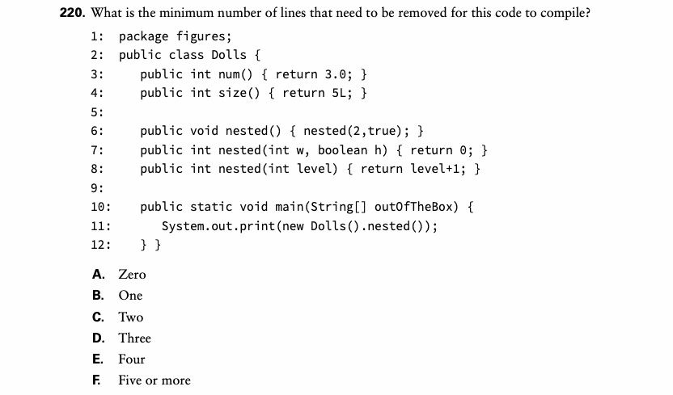

- **A.** Zero
- **B.** One
- **C.** Two
- **D.** Three
- **E.** Four
- **F.** Five or more

**Answer:** D

**Explanation:** Lines 3 and 4 do not compile because the returned values of `double` and `long` are not compatible with `int`. Lines 6 through 8 compile without issue, since each method takes a different set of input arguments. The first line of the `main()` method does not compile either, making option D correct. The no-argument version of the `nested()` method does not return a value, and trying to output a `void` return type in the `print()` method doesn’t compile.

## 829-03-221

How many of these lines compile?

```java
18: Comparator<String> c1 = (j, k) -> 0;
19: Comparator<String> c2 = (String j, String k) -> 0;
20: Comparator<String> c3 = (var j, String k) -> 0;
21: Comparator<String> c4 = (var j, k) -> 0;
22: Comparator<String> c5 = (var j, var k) -> 0;
```

- **A.** Zero
- **B.** One
- **C.** Two
- **D.** Three
- **E.** Four
- **F.** Five

**Answer:** D

**Explanation:** Line 18 compiles because neither type is specified for the lambda parameters. Lines 19 and 22 compile because the lambda parameters use a type or `var` consistently. These are the three lines that compile, making option D correct. Lines 20 and 21 do not compile because `var` must be used for all parameters in a lambda if it is used for any.

## 829-03-222

What is the output of the following code?

```java
public class Bunny {
   static interface Rabbit { }
   static class FlemishRabbit implements Rabbit { }
  private static void hop(Rabbit r) {
    System.out.print("hop");
  }
  private static void hop(FlemishRabbit r) {
    System.out.print("HOP");
  }
  public static void main(String[] args) {
    Rabbit r1 = new FlemishRabbit();
    FlemishRabbit r2 = new FlemishRabbit();
    hop(r1);
    hop(r2);
  } }
```

- **A.** `hophop`
- **B.** `HOPhop`
- **C.** `hopHOP`
- **D.** `HOPHOP`
- **E.** The code does not compile.

**Answer:** C

**Explanation:** This example deals with method signatures rather than polymorphism. Since the `hop()` methods are `static`, the precise method called depends on the reference type rather than the actual type of the object. Since the first reference is `Rabbit`, the first value printed is `hop`. The second reference actually is `FlemishRabbit`, so `HOP` is printed, and option C is the answer.

## 829-03-223

Which is one of the lines output by this code?

```java
10: var list = new ArrayList<Integer>();
11: list.add(10);
12: list.add(9);
13: list.add(8);
14:
15: var num = 9;
16: list.removeIf(x -> {int keep = num; return x != keep;});
17: System.out.println(list);
18:
19: list.removeIf(x -> {int keep = num; return x == keep;});
20: System.out.println(list);
```

- **A.** `[]`
- **B.** `[8]`
- **C.** `[8, 10]`
- **D.** `[8, 9, 10]`
- **E.** `[10, 8]`
- **F.** The code does not compile.

**Answer:** A

**Explanation:** The code starts by creating a list of three elements. On line 16, it removes two elements and then removes the final one on line 19. Line 17 prints `[9]`, although this is not an answer choice. Line 20 prints an empty list, making option A the correct answer. Note that `num` is effectively final so can be used in a lambda.

## 829-03-224

What does this code output?

```java
var babies = Arrays.asList("chick", "cygnet", "duckling");
babies.replaceAll(x -> { var newValue = "baby";
   return newValue; });
System.out.println(babies);
```

- **A.** `[baby]`
- **B.** `[baby, baby, baby]`
- **C.** `[chick, cygnet, duckling]`
- **D.** `[]`
- **E.** None of the above.
- **F.** The code does not compile.

**Answer:** B

**Explanation:** The code successfully defines a local variable inside the lambda. The lambda returns `baby` each time it is executed. Since we have a `List`, all three are output, and option B is the correct answer.

## 829-03-225

Which statement best describes this class?

```java
import java.util.*;
public final class Forest {
   private final int flora;
   private final List<String> fauna;
   public Forest() {
     this.flora = 5;
     this.fauna = new ArrayList<>();
   }
   public int getFlora() {
     return flora;
   }
   public List<String> getFauna() {
     return fauna;
   } }
```

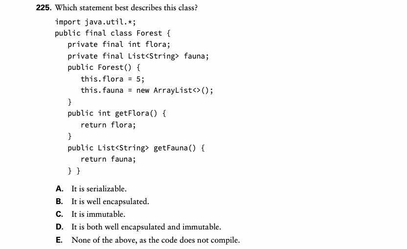

- **A.** It is serializable.
- **B.** It is well encapsulated.
- **C.** It is immutable.
- **D.** It is both well encapsulated and immutable.
- **E.** None of the above, as the code does not compile.

**Answer:** B

**Explanation:** This class does not implement `Serializable`, so option A is incorrect. This code is well encapsulated because the instance variables are `private`. While the instance variable references do not change after the object is created, the contents of `fauna` can be modified, so it is not immutable. For these reasons, option B is correct.

## 829-03-226

What is the output of the following program?

```java
public record Light(String type, float lumens) {
   final static String DEFAULT_TYPE = "PAR";
   public Light {
     if(type == null)
       throw new IllegalArgumentException();
    else type = DEFAULT_TYPE;
  }
  public Light(String type) {
    this.type = "B";
    this.lumens = 10f;
  }
  public static void main(String[] p) {
    final var bulb = new Light("A", 300);
    System.out.print(bulb.type());
  } }
```

- **A.** `null`
- **B.** `A`
- **C.** `PAR`
- **D.** An exception is thrown at runtime.
- **E.** The code does not compile.
- **F.** None of the above.

**Answer:** E

**Explanation:** While the compact constructor declaration is valid, the overloaded constructor declaration is not. An overloaded record constructor must begin with an explicit call to another constructor via `this()`. Even if a call were added, such as `this("B", 10f)`, the constructor would not compile since record fields are `final` and cannot be set twice. For this reason, option E is correct.

## 829-03-227

Which statement about the following code is correct?

```java
public class Dress {
   int size = 10;
   default int getSize() {
     display();
     return size;
   }
   static void display() {
     System.out.print("What a pretty outfit!");
   }
   private int getLength() {
     display();
     return 15;
   }
   private static void tryOn() {
     display();
   } }
```

- **A.** The code contains an invalid constant.
- **B.** The `getSize()` method does not compile.
- **C.** The `getLength()` method does not compile.
- **D.** The `tryOn()` method does not compile.
- **E.** The code compiles.
- **F.** None of the above.

**Answer:** B

**Explanation:** The `Dress` type is declared as a `class`, not an `interface`. For this reason, it cannot contain the `default` method `getSize()`, making option B correct. The rest of the methods compile within the class declaration without issue.

## 829-03-228

Which of the following are the best reasons for creating a `private` interface method? (Choose two.)

- **A.** Add backward compatibility to existing interfaces.
- **B.** Provide an implementation that a class implementing the interface can override.
- **C.** Increase code reuse within the interface.
- **D.** Allow interface methods to be inherited.
- **E.** Improve encapsulation of the interface.
- **F.** Allow `static` methods to access instance methods.

**Answer:** C, E

**Explanation:** Options A and B are incorrect and describe properties of `default` interface methods. Option C is correct and one of the primary reasons to add a `private` interface method. Option D is not a property of `private` interface methods. Option E is also correct, as `private` interface methods are not exposed to classes implementing the interface. Option F is a nonsensical statement.

## 829-03-229

How many subclasses of `Snack` compile?

```java
public abstract sealed class Snack permits Snack.Lollipop {
   final static class Toast extends Snack {}
   sealed static class Lollipop extends Snack {}
   final class Treat extends Lollipop {}
   abstract non-sealed class IceCream extends Snack {}
}
```

- **A.** Zero
- **B.** One
- **C.** Two
- **D.** Three
- **E.** Four
- **F.** Trick question! `Snack` does not compile.

**Answer:** C

**Explanation:** The `permits` clause is optional if the subclasses are contained within the same file. When provided, though, all of the subclasses must be specified. Since `Toast` and `IceCream` are not listed, they do not compile. Since only `Lollipop` and `Treat` compile, option C is correct. Note that if the `permits` clause were removed, then all of the classes would compile.

## 829-03-230

Given the following two classes, each in a different package, which line inserted into the code allows the second class to compile?

```java
 package commerce;
 public class Bank {
    public static void withdrawal(int amountInCents) {}
    public static void deposit(int amountInCents) {}
 }
package employee;
// INSERT CODE HERE
public class Teller {
   public void processAccount(int deposit, int withdrawal) {
     withdrawal(withdrawal);
     deposit(deposit);
   } }
```

- **A.** `import static commerce.Bank.*;`
- **B.** `import static commerce.Bank;`
- **C.** `static import commerce.Bank.*;`
- **D.** `static import commerce.Bank;`
- **E.** None of the above Chapter Handling Exceptions 4 THE OCP EXAM TOPICS COVERED IN THIS PRACTICE TEST INCLUDE THE FOLLOWING: ✓ Handling Exceptions ■ Handle exceptions using try/catch/finally, try-with-resources, and multi-catch blocks, including custom exceptions

**Answer:** A

**Explanation:** A `static` import is used to import `static` members of another class. Option A is the correct way to import the `static` members of a class. Options C and D reverse the keywords `static` and `import`, while option B incorrectly imports a class, which cannot be imported via a `static` import.
