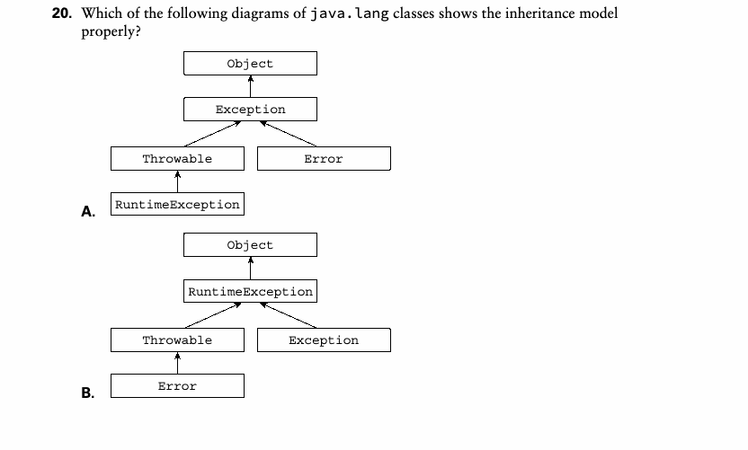
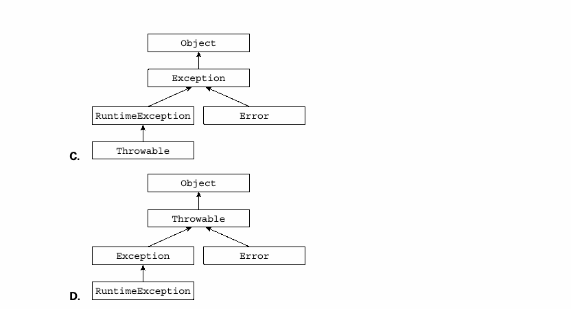
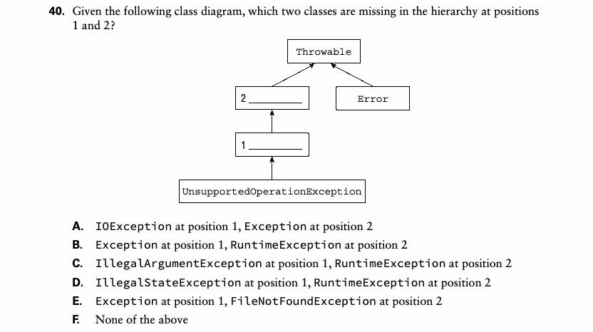

# Chapter 4: Handling Exceptions

> Source: *OCP Oracle Certified Professional Java SE 17 Developer Practice Tests (Exam 1Z0-829)*. Extracted from your PDF for personal study. Questions with figures/tables include a scan of the original page.

## 829-04-001

Fill in the blanks: The \_\_\_\_\_\_\_\_\_\_\_\_\_\_\_\_\_\_\_ keyword is used in method declarations, whereas the \_\_\_\_\_\_\_\_\_\_\_\_\_\_\_\_\_\_\_ keyword is used to send an exception to the surrounding process.

- **A.** `throwing`, `catch`
- **B.** `throws`, `throw`
- **C.** `catch`, `throw`
- **D.** `throws`, `catch`
- **E.** `throw`, `throws`
- **F.** `catch`, `throwing`

**Answer:** B

**Explanation:** The `throws` keyword is used in method declarations, whereas the `throw` keyword is used to send an exception to the surrounding process, making option B the correct answer. The `catch` keyword is used to handle exceptions. There is no `throwing` keyword in Java.

## 829-04-002

What is the output of the following application?

```java
package paper;
import java.io.Closeable;
public class PrintCompany {
   class Printer implements Closeable {     // r1
     public void print() {
        System.out.println("This just in!");
     }
     public void close() {}
   }
   public void printHeadlines() {
     try {Printer p = new Printer()} {     // r2
        p.print();
     }
   }
   public static void main(String[] headlines) {
     new PrintCompany().printHeadlines();     // r3
   } }
```

- **A.** `This just in!`
- **B.** The code does not compile because of line `r1`.
- **C.** The code does not compile because of line `r2`.
- **D.** The code does not compile because of line `r3`.
- **E.** The code does not compile for a different reason.
- **F.** None of the above.

**Answer:** C

**Explanation:** The class does not compile because in line `r2`, curly braces, `{}`, are used instead of parentheses, `()`, in the try-with-resources statement, making option C the correct answer. If this line was fixed to use parentheses, `()`, then the rest of the class would compile without issue and print `This just in!` at runtime.

## 829-04-003

What is the result of compiling and executing the following application?

```java
package mind;
import java.io.*;
public class Remember {
    public static void think() throws IOException {     // k1
       try {
         throw Exception();
       } catch (RuntimeException r) {}              // k2
    }
    public static void main(String[] ideas) throws Exception {
       think();
    } }
```

- **A.** The code compiles and runs without printing anything.
- **B.** The code compiles, but a stack trace is printed at runtime.
- **C.** The code does not compile because of line `k1`.
- **D.** The code does not compile because of line `k2`.
- **E.** None of the above.

**Answer:** E

**Explanation:** To throw an exception with the `throw` keyword, an existing or new exception must be provided. In this case, the `new` keyword is missing in front of `Exception()` in the `think()` method. It is treated as a method call that does not exist, and this line does not compile, making option E correct. If the `new` keyword were added, though, the line would still not compile, as the checked exception is not handled or declared within the `think()` method.

## 829-04-004

Given the following keywords, in which order could they be used? (Choose two.)

- **A.** `try`, `finally`
- **B.** `catch`, `try`, `finally`
- **C.** `try`, `catch`, `catch`, `finally`
- **D.** `finally`, `catch`, `try`
- **E.** `try`, `finally`, `catch`
- **F.** `try`, `catch`, `finally`, `finally`

**Answer:** A, C

**Explanation:** The correct order of blocks is `try`, `catch`, and `finally`. For a traditional `try`/`catch` block at least one `catch` or `finally` must be used. In addition, multiple `catch` blocks are allowed, although at most one `finally` block is allowed. For these reasons, options A and C are correct and the rest are incorrect.

## 829-04-005

Assuming `-g:vars` is used when the code is compiled to include debug information, what is the output of the following code snippet?

```java
13: String cogsworth = null;
14: Integer lumiere = null;
15: Object mrsPotts = null;
16: if(lumiere > cogsworth.length()) {
17:    System.out.println(mrsPotts.toString());
18: }
```

- **A.** A `NullPointerException` that does not include any variable names in the stack trace
- **B.** A `NullPointerException` naming `cogsworth` in the stack trace
- **C.** A `NullPointerException` naming `lumiere` in the stack trace
- **D.** A `NullPointerException` naming `mrsPotts` in the stack trace
- **E.** A `NullPointerException` naming `cogsworth` and `lumiere` in the stack trace
- **F.** None of the above

**Answer:** C

**Explanation:** With a helpful `NullPointerException`, the program will print the variable that triggered the exception. In this case, the first exception is when `lumiere` is unboxed to an `int` on line 16, making option C correct. Note that only one `NullPointerException` can be thrown at a time, making option E incorrect.

## 829-04-006

What is the output of the following application?

```java
package park;
class LostBallException extends Exception {}
public class Ball {
   public void toss() throws LostBallException {
     var windUp = new int[1];
     System.out.println(windUp[1]);
   }
   public static void main(String[] bouncy) {
     try {
        new Ball().toss();
     } catch (Throwable e) {
        System.out.print("Caught!");
     }
   } }
```

- **A.** `0`
- **B.** `Caught!`
- **C.** The code does not compile because `LostBallException` is not handled or declared in the `main()` method.
- **D.** The code does not compile because `ArrayIndexOutOfBoundsException` is not handled or declared in the `toss()` method.
- **E.** The code does not compile for a different reason.
- **F.** None of the above.

**Answer:** B

**Explanation:** The code compiles just fine. The `toss()` method creates an array with one element, but tries to read the second element. This triggers an `ArrayIndexOutOfBoundsException`, which is caught by the `catch` block in the `main()` method. At runtime, `Caught!` is printed, making option B correct.

## 829-04-007

Assuming `Scanner` is a valid class that implements `AutoCloseable`,what is the expected output of the following code?

```java
try (Scanner s = new Scanner(System.in)) {
   System.out.print(1);
   s.nextLine();
   System.out.print(2);
} catch (IllegalArgumentException | NullPointerException x) {
   s.nextLine();
   System.out.print(3);
} finally {
   s.nextLine();
   System.out.print(4);
}
System.out.print(5);
```

- **A.** `1245`
- **B.** `125`
- **C.** `1234` followed by a stack trace
- **D.** `124` followed by a stack trace
- **E.** Does not compile
- **F.** None of the above

**Answer:** E

**Explanation:** The code does not compile because `s` is defined within the try-with-resources block. It is out of scope by the time it reaches the `catch` and `finally` blocks, making option E correct.

## 829-04-008

How many constructors in `WhaleSharkException` compile in the following class?

```java
package friendly;
public class WhaleSharkException extends Exception {
   public WhaleSharkException() {
     super("Friendly shark!");
   }
   public WhaleSharkException(String message) {
     super(new Exception(new WhaleSharkException()));
   }
   public WhaleSharkException(Exception cause) {}
}
```

- **A.** None
- **B.** One
- **C.** Two
- **D.** Three

**Answer:** D

**Explanation:** The `Exception` class contains multiple constructors, including one that takes `Throwable`, one that takes `String`, and a no-argument constructor. The first `WhaleSharkException` constructor compiles, using the `Exception` constructor that takes a `String`. The second `WhaleSharkException` constructor also compiles. The two statements, `super()` and `new Exception()`, actually call the same constructor in the `Exception` class, one after another. The last `WhaleSharkException` compiles, with the compiler inserting the default no-argument constructor `super()`, because it exists in the `Exception` class. For these reasons, all of the constructors compile, and option D is the correct answer.

## 829-04-009

What is the output of the following application?

```java
package game;
public class Football {
   public static void main(String officials[]) {
     try {
        System.out.print('W');
        throw new ArrayIndexOutOfBoundsException();
     } catch (RuntimeException r) {
        System.out.print('X');
        throw r;
     } catch (Exception e) {
        System.out.print('Y');
     } finally {
        System.out.print('Z');
     }
   } }
```

- **A.** `WXY`
- **B.** `WXZ`
- **C.** `WXY` followed by a stack trace
- **D.** `WXZ` followed by a stack trace
- **E.** `WZ` followed by a stack trace
- **F.** None of the above

**Answer:** D

**Explanation:** The application first enters the `try` block and prints `W`. It then throws an `ArrayIndexOutOfBoundsException`, which is caught by the first `catch` block since `ArrayIndexOutOfBoundsException` is a subclass of `RuntimeException`, printing `X`. The exception is then rethrown, but since there isn’t a separate `try`/`catch` block around it, it does not get caught by the second `catch` block. Before printing the stack trace, though, the `finally` block is called, and `Z` is printed. For these reasons, option D is correct.

## 829-04-010

Which of the following types are not recommended to catch in your application? (Choose two.)

- **A.** `Exception`
- **B.** `CheckedException`
- **C.** `Throwable`
- **D.** `RuntimeException`
- **E.** `UncheckedException`
- **F.** `Error`

**Answer:** C, F

**Explanation:** While `Exception` and `RuntimeException` are commonly caught in Java applications, it is not recommended that `Error` and `Throwable` (which includes `Error`) be caught. An `Error` often indicates a failure of the JVM, which cannot be recovered from. For these reasons, options C and F are correct, and options A and D are incorrect. Options B and E are class names that are not part of the standard Java API.

## 829-04-011

What is the output of the following program?

```java
package buffet;
class Garden implements AutoCloseable {
   private final int g;
   Garden(int g) { this.g = g; }
   public void close() throws Exception {
     System.out.print(g);
   } }
public class Salad {
   public static void main(String[] u) throws Exception {
     var g = new Garden(5);
     try (g;
           var h = new Garden(4);
           var i = new Garden(2)) {
     } finally {
        System.out.println(9);
     }
     g = null;
   } }
```

- **A.** `2459`
- **B.** `9245`
- **C.** `5429`
- **D.** `9542`
- **E.** The code does not compile.
- **F.** None of the above.

**Answer:** E

**Explanation:** A variable declared before the start of a try-with-resources statement may be used if it is `final` or effectively `final`. Since `g` is modified after it is set, it is neither; therefore, the class does not compile, and option E is correct. If the last line of the `main()` method were removed, then the code would compile and print `2459` at runtime.

## 829-04-012

How many of these custom exceptions are unchecked exceptions?

```java
class ColoringException extends IOException {}
class CursiveException extends WritingException {}
class DrawingException extends IllegalStateException {}
class SketchingException extends DrawingException {}
class WritingException extends Exception {}
```

- **A.** None
- **B.** One
- **C.** Two
- **D.** Three
- **E.** Four
- **F.** Five

**Answer:** C

**Explanation:** Since `IOException` and `Exception` are checked exceptions, `ColoringException` and `WritingException` are checked exceptions. Further, `CursiveException` is also checked since it extends a checked exception. By contrast, `IllegalStateException` is an unchecked exception. This means that `DrawingException` and `SketchingException` are also unchecked, and option C is the answer.

## 829-04-013

How many lines of text does the following program print?

```java
package lighting;
import java.io.IOException;
public class Light {
   public static void main(String[] v) throws Exception {
     try {
        new Light().turnOn();
     } catch (RuntimeException v) {     // y1
        System.out.println(v);
        throw new IOException();     // y2
     } finally {
        System.out.println("complete");
     }
   }
   public void turnOn() throws IOException {
     new IOException("Not ready");     // y3
   } }
```

- **A.** One.
- **B.** Two.
- **C.** The code does not compile because of line `y1`.
- **D.** The code does not compile because of line `y2`.
- **E.** The code does not compile because of line `y3`.
- **F.** None of the above.

**Answer:** C

**Explanation:** The code does not compile because the variable `v` is used twice in the `main()` method, both in the method declaration and in the `catch` block, making option C the correct answer. If a different variable name were used in one of the locations, the program would compile and print `complete`. Note that while an exception is created inside the `turnOn()` method, it is not thrown.

## 829-04-014

Which statements about try-with-resources are true? (Choose three.)

- **A.** If more than one resource is used, the resources are closed in the order they were created.
- **B.** Parentheses are used for the resource declaration section, even if more than one resource is used.
- **C.** If the `try` block and `close()` method both throw an exception, then the one thrown by the `close()` method is suppressed.
- **D.** A resource may be declared before it is used in a try-with-resources statement.
- **E.** Resources declarations are separated by commas.
- **F.** A `catch` block is required.

**Answer:** B, C, D

**Explanation:** When more than one resource is used in a try-with-resources statement, they are closed in the reverse order in which they are declared, making option A incorrect. Option B is correct and describes how resources are listed. Option C is also correct and describes how suppressed exceptions are handled. Option D is the third correct answer, as `final` or effectively `final` resources may be used in try-with-resources statements. Option E is incorrect, as resources are separated by semicolons, not commas. Option F is also incorrect, as `catch` blocks are optional for try-with-resources statements.

## 829-04-015

How many lines of text does the following program print?

```java
package bee;
class SpellingException extends RuntimeException {}
public class SpellChecker {
   public final static void main(String[] participants) {
     try {
        if(!"cat".equals("kat")) {
           new SpellingException();
        }
     } catch (SpellingException | NullPointerException e) {
        System.out.println("Spelling problem!");
     } catch (Exception e) {
        System.out.println("Unknown Problem!");
     } finally {
        System.out.println("Done!");
     } } }
```

- **A.** One.
- **B.** Two.
- **C.** Three.
- **D.** The code does not compile.
- **E.** None of the above.

**Answer:** A

**Explanation:** The program compiles without issue, so option D is incorrect. The narrower `SpellingException` and `NullPointerException`, which inherit from `Exception`, are correctly presented in the first `catch` block, with the broader `Exception` being in the second `catch` block. The `if` statement evaluates to `true`, and a new `SpellingException` instance is created, but it is not thrown because it is missing the `throw` keyword. For this reason, the `try` block ends without any of the `catch` blocks being executed. The `finally` block is then called, making `Done!` the only line printed. For this reason, option A is the correct answer.

## 829-04-016

Which of the following exception types must be handled or declared by the method in which they are thrown? (Choose three.)

- **A.** `FileNotFoundException`
- **B.** `ClassCastException`
- **C.** `Error`
- **D.** `IOException`
- **E.** `NullPointerException`
- **F.** `Exception`

**Answer:** A, D, F

**Explanation:** Any class that inherits `Exception` but not `RuntimeException` is a checked exception and must be handled or declared. For this reason, option F is trivially correct. Options A and D are also checked exceptions. Options B and E are incorrect since they inherit `RuntimeException`. Finally, option C is incorrect as `Error` inherits `Throwable` but not `Exception`.

## 829-04-017

What is the output of the following application?

```java
package bed;
public class Sleep {
   public static void snore() {
     try {
        String sheep[] = new String[3];
        System.out.print(sheep[3]);
     } catch (RuntimeException | Error e) {
        System.out.print("Awake!");
        throw e;                           // x1
     } finally {
        throw new Exception();              // x2
     }
   }
   public static void main(String[] sheep) {
     new Sleep().snore();                   // x3
   } }
```

- **A.** `Awake!`
- **B.** `Awake!` followed by a stack trace
- **C.** Does not compile because of line `x1`
- **D.** Does not compile because of line `x2`
- **E.** Does not compile because of line `x3`
- **F.** None of the above

**Answer:** D

**Explanation:** The `finally` block of the `snore()` method throws a new checked exception on line `x2`, but there is no try-catch block around it to handle it, nor does the `snore()` method declare any checked exceptions. For these reasons, line `x2` does not compile, and option D is the correct answer. Note that line `x1` compiles because it is rethrowing an unchecked exception.

## 829-04-018

What is the output of the following code?

```java
class ProblemException extends Exception {
   ProblemException(Exception e) { super(e); }
}
class MajorProblemException extends ProblemException {
   MajorProblemException(String message) { super(message); }
}
public class Unfortunate {
   public static void main(String[] args) throws Exception {
     try {
        System.out.print(1);
        throw new MajorProblemException("Uh oh");
     } catch (ProblemException | RuntimeException e) {
        System.out.print(2);
        try {
           throw new MajorProblemException("yikes");
       } finally {
          System.out.print(3);
       }
    } finally {
       System.out.print(4);
    } } }
```

- **A.** `123`
- **B.** `123` followed by an exception stack trace
- **C.** `1234`
- **D.** `1234` followed by an exception stack trace
- **E.** The code does not compile.
- **F.** None of the above

**Answer:** E

**Explanation:** The `ProblemException` class compiles without error. However, the `MajorProblemException` class has, well, a major problem. The constructor attempts to call a superclass constructor with a `String` parameter, but the `ProblemException` class only has a constructor with an `Exception` parameter. This causes a compiler error, making option E correct.

## 829-04-019

Which statements best describe how a class that implements the `AutoCloseable` interface should be written? (Choose two.)

- **A.** The`close()` methodisoptionalsincethe `AutoCloseable` interfacedefinesa `default` implementation.
- **B.** The `close()` method should avoid modifying data after it has been run once.
- **C.** The `close()` method should not throw any exceptions.
- **D.** The `close()` method should throw an exception if there is a problem closing the resource.
- **E.** The `close()` method should return a status code.

**Answer:** B, D

**Explanation:** First, option A is an incorrect statement, because the `AutoCloseable` interface does not define a `default` implementation of `close()`. Next, the `close()` method should be idempotent, which means it is able to be run multiple times without triggering any side effects. For this reason, option B is correct. After being run once, future calls to `close()` should not change any data. Option D is correct, and option C is incorrect because the `close()` method is fully capable of throwing exceptions if there is a problem. In fact, the signature of the method in `AutoCloseable` throws a checked `Exception`. Option E is incorrect because the return type of `close()` is `void`, which means no return value can be returned.

## 829-04-020

Which of the following diagrams of `java.lang` classes shows the inheritance model properly?

```java
             Object
           Exception
   Throwable ________ Error
RuntimeException
```





- **A.** 

  ```java
            Object
       RuntimeException
  Throwable _______ Exception
    Error
  ```
- **B.** 

  ```java
               Object
             Exception
  RuntimeException _____ Error
     Throwable
  ```
- **C.** 

  ```java
               Object
             Throwable
     Exception ________ Error
  RuntimeException
  ```
- **D.** 

**Answer:** D

**Explanation:** Option D is the correct model. The class `RuntimeException` extends `Exception`, and both `Exception` and `Error` extend `Throwable`. Finally, like all Java classes, they all inherit from `Object`. Notice that `Error` does not extend `Exception`, even though we often refer to these generally as exceptions.

## 829-04-021

Which exception classes, when inserted into the blank in the `Problems` class, allow the code to compile?

```java
class MissingMoneyException {}
class MissingFoodException {}
public class Problems {
   public void doIHaveAProblem()
        throws MissingMoneyException, MissingFoodException {
     System.out.println("No problems");
   }
   public static void main(String[] s) throws _____________ {
     try {
        final Problems p = new Problems();
        p.doIHaveAProblem();
     } catch (Exception e) {
        throw e;
     } } }
```

- **A.** `Exception`
- **B.** `RuntimeException`
- **C.** `MissingFoodException`
- **D.** `MissingMoneyException, MissingFoodException`
- **E.** `MissingMoneyException`
- **F.** None of the above

**Answer:** F

**Explanation:** The classes `MissingMoneyException` and `MissingFoodException` do not extend any exception classes; therefore, they cannot be used in a method declaration. The code does not compile regardless of what is placed in the blank, making option F correct.

## 829-04-022

Which statements about `Closeable` and `AutoCloseable` are true? (Choose two.)

- **A.** `AutoCloseable` extends `Closeable`.
- **B.** `Closeable` extends `AutoCloseable`.
- **C.** The `close()` method in a class that implements `AutoCloseable` cannot throw an `IOException`.
- **D.** The `close()` method in a class that implements `Closeable` cannot throw an `Exception`.
- **E.** There is no difference; one was added for backward compatibility.
- **F.** Both have a generic return type.

**Answer:** B, D

**Explanation:** `Closeable` extends `AutoCloseable`, making option B correct and option A incorrect. The `close()` method in `AutoCloseable` throws `Exception`, while the `close()` method in `Closeable` throws `IOException`, making option E incorrect. Since `IOException` is a subclass of `Exception`, both `close()` methods can throw an `IOException`, making option C incorrect. On the other hand, `Exception` is not a subclass of `IOException`. For this reason, the `close()` method in a class that implements `Closeable` cannot throw an instance of the `Exception` class, because it is an invalid override using a broader exception type. This makes option D the correct answer. Finally, the return type for both is `void`, making option F incorrect.

## 829-04-023

Which expressions, when inserted into the blank in the following class, allow the code to compile? (Choose two.)

```java
package sun;
import java.io.*;
public class Beach {
   class TideException extends Exception {}
   public void surf() throws RuntimeException {
     try {
        throw new TideException();
     } catch ( _________________ ) {}
   }
}
```

- **A.** `Exception a | RuntimeException f`
- **B.** `IllegalStateException | TideException t`
- **C.** `TideException | IOException i`
- **D.** `TideException | Exception x`
- **E.** `Error e`
- **F.** `Exception z`

**Answer:** B, F

**Explanation:** Option A does not compile because a multi-catch expression uses a single variable, not two variables. Since the `TideException` is handled and neither exception class is a subtype of the other, option B is correct. Option C does not compile because the compiler notices that it is not possible to throw a checked `IOException` in this `try` block. Option D does not compile because multi-catch blocks cannot contain two exceptions in which one is a subclass of the other. If it did, one of the two exceptions would be redundant. Option E does not compile because the checked `TideException` is not handled or declared by the `surf()` method. Remember, `Error` and `Exception` are not subclasses of each other, although they both inherit `Throwable`. Option F is correct because `TideException` is a subclass of `Exception`, so both are handled by `Exception`.

## 829-04-024

Which of the following are the best scenarios in which to use and catch an exception? (Choose two.)

- **A.** The computer caught fire.
- **B.** A network connection goes down.
- **C.** A caller passes invalid data to a method.
- **D.** The code does not compile.
- **E.** A method finishes sooner than expected.
- **F.** The program runs out of memory.
- **G.** A search returned no results.

**Answer:** B, C

**Explanation:** Option A is incorrect. You should probably seek help if the computer is on fire! Options B and C are correct answers, as invalid or missing data/resources should be expected of most programs. Option D is incorrect because code that does not compile cannot run and therefore cannot throw any exceptions. Option E is incorrect; finishing sooner is rarely considered a problem. Option F is incorrect because an `Error` is thrown in this situation, and it should not be caught, as the JVM cannot usually recover from this scenario. Option G is also incorrect. While it is possible to throw an exception if a search fails, it is not recommended and options B and C are better options.

## 829-04-025

Which statement about the following program is correct?

```java
1: package dogpark;
2: public class Fetch {
3:     public int play(String name) throws RuntimeException {
4:       try {
5:          throw new RuntimeException(name);
6:       } catch (Throwable e) {
7:          throw new RuntimeException(e);
8:       }
9:     }
10:    public static final void main(String[] ball)
11:         throws RuntimeException {
12:      new Fetch().play("Webby");
13:      new Fetch().play("Georgette");
14:    } }
```

- **A.** One exception is thrown to the caller at runtime.
- **B.** Two exceptions are thrown to the caller at runtime.
- **C.** More than two exceptions are thrown to the caller at runtime.
- **D.** The class does not compile because of the `play()` method.
- **E.** The class does not compile because of the `main()` method.
- **F.** None of the above.

**Answer:** A

**Explanation:** The program compiles, making options D and E incorrect. At runtime, line 12 is executed, calling the `play()` method. Line 5 then throws an exception that is immediately caught on line 6. Line 7 throws a new unchecked exception that is not caught by the program, with this exception being thrown to the caller, and making option A correct. In this case, line 13 is never executed. Even though the stack trace for the exception may include information about the cause, only one exception is actually thrown to the caller.

## 829-04-026

What is the output of the following application?

```java
package body;
import java.io.IOException;
class Organ {
   public void operate() throws IOException {
     throw new RuntimeException("Not supported");
   }
}
public class Heart extends Organ {
   public void operate() throws Exception {
     System.out.print("beat");
   }
   public static void main(String[] c) throws Exception {
     try {
       new Heart().operate();
    } finally {
       System.out.print("!");
    }
  } }
```

- **A.** `beat`
- **B.** `beat!`
- **C.** `Not supported`
- **D.** The code does not compile.
- **E.** The code compiles, but a stack trace is printed at runtime.
- **F.** None of the above.

**Answer:** D

**Explanation:** The code does not compile due to an invalid override of the `operate()` method. An overridden method must not throw any new or broader checked exceptions than the method it inherits. While both `IOException` and `Exception` are checked exceptions, `Exception` is broader than `IOException`. For this reason, the declaration of `operate()` in `Heart` does not compile, and option D is correct.

## 829-04-027

Which of the following are true of using a try-with-resources statement? (Choose two.)

- **A.** It shortens the amount of code a developer must write.
- **B.** It is possible to manually close a resource before the end of the `try` block.
- **C.** Associated `catch` blocks are run before the declared resources have been closed.
- **D.** It is only compatible with all classes that implement the `Close` interface.
- **E.** It is only compatible with all classes that implement the `AutoClose` interface.
- **F.** It cannot be used with a `finally` block.

**Answer:** A, B

**Explanation:** Option A is correct and is one of the primary motivations for using a try-with-resources statement. Option B is also correct, although it is recommended that you let the try-withresources statement automatically close the resource. The `catch` blocks are run after the declared resources have been closed, making option C incorrect. Options D and E are both incorrect, as a try-with-resources statement is compatible with `Closeable` or `AutoClose-` `able`. A try-with-resources statement can be used with a `finally` block, making option F incorrect.

## 829-04-028

What is the output of the following application?

```java
package zoo;
class BigCat {
   void roar(int level) throws RuntimeException {
     if(level<3) throw new IllegalArgumentException();
     System.out.print("Roar!");
   } }
public class Lion extends BigCat {
   public void roar() { System.out.print("Roar!!!"); }
   @Override void roar(int sound) throws IllegalStateException {
     System.out.print("Meow");
   }
   public static void main(String[] cubs) {
     final BigCat kitty = new Lion();
     kitty.roar(2);
   } }
```

- **A.** `Meow`
- **B.** `Roar!`
- **C.** `Roar!!!`
- **D.** `MeowRoar!`
- **E.** A stack trace is printed at runtime.
- **F.** None of the above.

**Answer:** A

**Explanation:** The application compiles and runs, printing `Meow` at runtime and making option A correct. The override in `Lion` is valid, as overridden methods are free to declare new unchecked exceptions.

## 829-04-029

What is the result of compiling and executing the following class?

```java
package wind;
public class Storm {
   public static void main(String[] rain) throws Exception {
     var weatherTracker = new AutoCloseable() {
        public void close() throws RuntimeException {
           System.out.println("Thunder");
        }
     };
     try (weatherTracker) {
        System.out.println("Tracking");
     } catch (Exception e) {
        System.out.println("Lightning");
     } finally {
        System.out.println("Storm gone");
        weatherTracker.close();
     }
   } }
```

- **A.** It prints one line.
- **B.** It prints two lines.
- **C.** It prints three lines.
- **D.** It prints four lines.
- **E.** It does not compile due to an error in the declaration of the `weatherTracker` resource.
- **F.** It does not compile for a different reason.
- **G.** None of the above.

**Answer:** D

**Explanation:** The code compiles without issue. It first prints `Tracking` from the `try` block. Upon the completion of the `try` block, the `close()` method is called, and `Thunder` is printed. No exception is thrown so the `catch` block is skipped. In the `finally` block, `Storm gone` is printed, followed by `Thunder`. Since four lines were printed, option D is correct. Although it is not recommended to close a resource twice, it is allowed.

## 829-04-030

How many of the following are valid exception declarations?

```java
 class Error extends Exception {}
 class _X extends IllegalArgumentException {}
 class 2BeOrNot2Be extends RuntimeException {}
class NumberException<Integer> extends NumberFormatException {}
interface Worry implements NumberFormatException {}
```

- **A.** Zero
- **B.** One
- **C.** Two
- **D.** Three
- **E.** Four
- **F.** Five

**Answer:** C

**Explanation:** `Error` is a terrible name for an exception since it is a built-in class. However, it is legal. Next, `_X` is also a bad choice, but it is a valid exception, as Java identifiers can begin with underscores. By contrast, `2BeOrNot2Be` does not compile because identifiers are not allowed to begin with a number. `NumberException` is not a valid exception, because it uses generics and the parent class does not. Finally, `Worry` is not an exception, because it is an interface. Since only two are valid exceptions, option C is the answer.

## 829-04-031

If a `try` statement has `catch` blocks for both `ClassCastException` and `RuntimeException`, then which of the following statements is correct?

- **A.** The `catch` blocks for these two exception types can be declared in any order.
- **B.** A `try` statement cannot be declared with these two `catch` block types because they are incompatible.
- **C.** The `catch` block for `ClassCastException` must appear before the `catch` block for `RuntimeException`.
- **D.** The `catch` block for `RuntimeException` must appear before the `catch` block for

  ```java
  ClassCastException.
  ```
- **E.** None of the above.

**Answer:** C

**Explanation:** `ClassCastException` is a subclass of `RuntimeException`, so it must appear first in any related `catch` blocks. For this reason, option C is correct.

## 829-04-032

Assuming `Scanner` is a valid class that implements `AutoCloseable`,what is the expected output of the following application?

```java
package castles;
import java.util.Scanner;
public class Fortress {
   public void openDrawbridge() throws Exception {     // p1
     try {
        throw new Exception("Circle");            // p2
     } catch (Exception | Error e) {
        System.out.print("Opening!");
     } finally {
        System.out.print("Walls");
     }
   }
   public static void main(String[] moat) {
     try (var e = new Scanner(System.in)) {
        new Fortress().openDrawbridge();          // p3
     }
   } }
```

- **A.** `Opening!Walls`
- **B.** The code does not compile because of line `p1`.
- **C.** The code does not compile because of line `p2`.
- **D.** The code does not compile because of line `p3`.
- **E.** The code compiles, but a stack trace is printed at runtime.
- **F.** None of the above.

**Answer:** D

**Explanation:** The `openDrawbridge()` method declares a checked exception that is not handled or declared in the `main()` method where it is called. For this reason, line `p3` does not compile, and option D is correct. The rest of the lines do not contain any compiler errors. If the `main()` method were changed to declare `Exception`, then the class would compile and print `Opening!Walls` at runtime.

## 829-04-033

What is the output of the following application?

```java
package game;
public class BasketBall {
   public static void main(String[] dribble) {
     try {
        System.out.print(1);
        throw new ClassCastException();
     } catch (ArrayIndexOutOfBoundsException ex) {
        System.out.print(2);
     } catch (Throwable ex) {
        System.out.print(3);
     } finally {
        System.out.print(4);
     }
     System.out.print(5);
   } }
```

- **A.** `145`
- **B.** `1345`
- **C.** `1235`
- **D.** The code does not compile.
- **E.** The code compiles but throws an exception at runtime.
- **F.** None of the above.

**Answer:** B

**Explanation:** The code compiles and runs without issues. The `try` block throws a `ClassCastException`. Since `ClassCastException` is not a subclass of `ArrayIndexOutOfBoundsException`, the first `catch` block is skipped. For the second `catch` block, `ClassCastException` is a subclass of `Throwable` so that block is executed. Afterward, the `finally` block is executed, and then control returns to the `main()` method with no exception being thrown. The result is that `1345` is printed, making option B the correct answer.

## 829-04-034

Assuming `-g:vars` is used when the code is compiled to include debug information, what is the output of the following code snippet?

```java
41: String mode = null;
42: int grade = (Integer)null;
43: Integer average = null;
44: if(grade >= average && Integer.parseInt(mode) > 0) {
45:    System.out.println("You passed!");
46: }
```

- **A.** A `NullPointerException` naming `mode` in the stack trace
- **B.** A `NullPointerException` naming `grade` in the stack trace
- **C.** A `NullPointerException` naming `average` in the stack trace
- **D.** A `NullPointerException` naming `grade`, `average`, and `mode` in the stack trace
- **E.** None of the above

**Answer:** E

**Explanation:** With a helpful `NullPointerException`, the program will print the variable that triggered the exception. In this case, the first exception is on line 42. The `Integer` value of `null` is unboxed to an `int`, but since this fails, a `NullPointerException` is thrown at runtime. Since the exception happens on the right side of the assignment, the name of the variable printed is `null`, making option E correct.

## 829-04-035

What is the output of the following application?

```java
package signlanguage;
import java.io.Closeable;
class ReadSign implements Closeable {
   public void close() {}
   public String get() { return "Hello"; } }
class MakeSign implements AutoCloseable {
   public void close() {}
   public void send(String message) {
     System.out.print(message);
   } }
public class Translate {
   public static void main(String[] hands) {
     try (ReadSign r = new ReadSign();
        MakeSign w = new MakeSign();) {
        w.send(r.get());
     }
   } }
```

- **A.** `Hello`
- **B.** The code does not compile because of the `ReadSign` class.
- **C.** The code does not compile because of the `MakeSign` class.
- **D.** The code does not compile because of the try-with-resources statement.
- **E.** None of the above.

**Answer:** A

**Explanation:** The application compiles without issue and prints `Hello`, making option A the correct answer. The `ReadSign` and `MakeSign` classes are both correctly implemented, with both overridden versions of `close()` dropping the checked exceptions. The try-with-resources statement is also correctly implemented for two resources and does not cause any compilation errors or runtime exceptions. Note that the semicolon (`;`) after the second resource declaration is optional.

## 829-04-036

What is the output of the following application?

```java
package what;
class FunEvent implements AutoCloseable {
   private final int value;
   FunEvent(int value) { this.value = value; }
   public void close() {
     System.out.print(value);
   }
}
 public class Happening {
    public static void main(String[] lots) {
       FunEvent e = new FunEvent(1);
       try (e; var f = new FunEvent(8)) {
         System.out.print("2");
         throw new ArithmeticException();
       } catch (Exception x) {
         System.out.print("3");
       } finally {
         System.out.print("4");
       }
    } }
```

- **A.** `24`
- **B.** `21834`
- **C.** `23418`
- **D.** `23481`
- **E.** `28134`
- **F.** The code does not compile.

**Answer:** E

**Explanation:** The `try` block is entered and `2` is printed, followed by an exception. Upon completion of the `try` block, the resources are closed in the reverse order in which they are declared, printing `8` followed by `1`. Next, the `catch` block executes, printing `3`, followed by the `finally` block printing `4`. For these reasons, option E is correct.

## 829-04-037

What is the output of the following application?

```java
package office;
import java.io.*;
public class Printer {
   public void print() {
     try {
        throw new FileNotFoundException();
     } catch (Exception | RuntimeException e) {
        System.out.print("Z");
     } catch (Throwable f) {
        System.out.print("X");
     } finally {
        System.out.print("Y");
     }
   }
   public static void main(String[] ink) {
     new Printer().print();
   } }
```

- **A.** `Y`
- **B.** `XY`
- **C.** `ZY`
- **D.** The code does not compile.
- **E.** The code compiles, but a stack trace is printed at runtime.
- **F.** None of the above.

**Answer:** D

**Explanation:** A multi-catch block cannot contain two exception types in which one inherits from the other. Since `RuntimeException` inherits `Exception`, `RuntimeException` is redundant. For this reason, the code does not compile, and option D is correct.

## 829-04-038

What is the output of the following program?

```java
class ProblemException extends Exception {
   ProblemException(Exception e) { super(e); }
}
class MajorProblemException extends ProblemException {
   MajorProblemException(Exception e) { super(e); }
}
public class Unfortunate {
   public static void main(String[] args) throws Exception {
     try {
        System.out.print(1);
        throw new MajorProblemException(
           new IllegalStateException());
     } catch (ProblemException | RuntimeException e) {
        System.out.print(2);
        try {
           throw new MajorProblemException(e);
        } finally {
           System.out.print(3);
        }
     } finally {
        System.out.print(4);
     } } }
```

- **A.** `123`
- **B.** `123` followed by an exception stack trace
- **C.** `1234`
- **D.** `1234` followed by an exception stack trace
- **E.** Does not compile
- **F.** None of the above

**Answer:** D

**Explanation:** In the `try` block, the code prints `1` and throws an exception. The `catch` block successfully handles it by printing `2` and throwing another exception. Both the inner and outer `finally` blocks run printing `3` and `4`, respectively. Then the stack trace for the exception thrown by the inner `try` block is printed. For this reason, option D is correct.

## 829-04-039

What is the output of the following application?

```java
1: package robots.are.real;
2: public class Computer {
3:     public void compute() throws Exception {
4:       throw new NullPointerException("Does not compute!");
5:     }
6:     public static void main(String[] b) throws Exception {
7:       try {
8:          new Computer().compute();
9:       } catch (RuntimeException e) {
10:         System.out.print("zero");
11:         throw e;
12:      } catch (Exception e) {
13:         System.out.print("one");
14:         throw e;
15:      } } }
```

- **A.** `zero`
- **B.** `one`
- **C.** `zero` followed by a stack trace
- **D.** `one` followed by a stack trace
- **E.** Does not compile
- **F.** None of the above

**Answer:** C

**Explanation:** The code compiles without issue. Line 8 calls the `compute()` method, which throws a `NullPointerException` on line 4. This is caught in the `main()` method on line 9, since `NullPointerException` is a subclass of `RuntimeException`, printing `zero` followed by rethrowing to the caller and making option C correct.

## 829-04-040

Given the following class diagram, which two classes are missing in the hierarchy at positions 1 and 2?

```java
Throwable
```

2 `Error` 1

```java
UnsupportedOperationException
```




- **A.** `IOException` at position 1, `Exception` at position 2
- **B.** `Exception` at position 1, `RuntimeException` at position 2
- **C.** `IllegalArgumentException` at position 1, `RuntimeException` at position 2
- **D.** `IllegalStateException` at position 1, `RuntimeException` at position 2
- **E.** `Exception` at position 1, `FileNotFoundException` at position 2
- **F.** None of the above

**Answer:** F

**Explanation:** The `UnsupportedOperationException` class is an unchecked exception that is a direct child of `RuntimeException`. For this reason, we can eliminate any answer that does not inherit from `RuntimeException`, including options A and E. Options C and D are close, but `UnsupportedOperationException` is a direct subclass of `RuntimeException`. Option B is incorrect because `RuntimeException` is a subclass, not a superclass, of `Exception`. The correct diagram would be to reverse option B and put `RuntimeException` at position 1 and `Exception` at position 2. Since this is not available, option F is correct.

## 829-04-041

What is the output of the following application?

```java
package vortex;
class TimeException extends Exception {}
class TimeMachine implements AutoCloseable {
   int v;
   public TimeMachine(int v) {this.v = v;}
   public void close() throws Exception {
     System.out.print(v);
   } }
public class TimeTraveler {
   public static void main(String[] twelve) {
     try (var timeSled = new TimeMachine(1);
          var delorean = new TimeMachine(2);
          var tardis = new TimeMachine(3)) {
     } catch (TimeException e) {
        System.out.print(4);
     } finally {
        System.out.print(5);
     } } }
```

- **A.** `1235`
- **B.** `3215`
- **C.** `5123`
- **D.** `5321`
- **E.** The code does not compile.
- **F.** None of the above.

**Answer:** E

**Explanation:** The `close()` method in each of the resources throws an `Exception`, which must be handled or declared in the `main()` method. The `catch` block supports `TimeException`, but it is too narrow to catch `Exception`. Since there are no other `catch` blocks present and the `main()` method does not declare `Exception`, the try-with-resources statement does not compile, and option E is the correct answer. If the `catch` block were modified to handle `Exception` instead of `TimeException`, the code would compile without issue and print `3215` at runtime, closing the resources in the reverse order in which they were declared.

## 829-04-042

Which of the following are common reasons to add a checked exception to a method signature? (Choose three.)

- **A.** To alert developers that the state of the JVM has been corrupted
- **B.** To force a caller to handle or declare potential problems
- **C.** To ensure that exceptions never cause the application to terminate
- **D.** To notify the caller of potential types of problems
- **E.** To give the caller a chance to recover from a problem
- **F.** To annoy other developers

**Answer:** B, D, E

**Explanation:** Checked exceptions are commonly used to notify or force a caller to deal with an expected type of problem, such as the inability to write a file to the file system and give them the opportunity to recover without terminating the program. For these reasons, options B, D, and E are correct. Option A is incorrect as a corrupted JVM is likely an `Error` that cannot be recovered from. Option C is also incorrect, as some problems should result in the application terminating. Finally, option F is incorrect and is ideally never the motivation for adding a checked exception to a method signature!

## 829-04-043

Which statement about the following application is correct?

```java
package highway;
import java.io.*;
class CarCrash extends Error {
   CarCrash(Exception e) {}                            // w1
}
 public class Car {
    public static void main(String[] s) throws Exception { // w2
       try {
         throw new IOException("Auto-pilot error");
       } catch (IOException | CarCrash e) {              // w3
         throw e;
       } catch (FileNotFoundException a) {               // w4
         throw a;
       } } }
```

- **A.** The code does not compile because of line `w1`.
- **B.** The code does not compile because of line `w2`.
- **C.** The code does not compile because of line `w3`.
- **D.** The code does not compile because of line `w4`.
- **E.** The code compiles and prints a stack trace at runtime.
- **F.** None of the above.

**Answer:** D

**Explanation:** First off, lines `w1` and `w2` compile without issue. On line `w3`, the multi-catch block can contain two exceptions, provided they are not subtypes of each other. Since one is a checked `Exception` and the other is an `Error`, line `w3` compiles without issue. Line `w4` contains a compilation error. Since `FileNotFoundException` is a subclass of the already caught `IOException`, it is not reachable on line `w4`, making option D correct.

## 829-04-044

Which of the following exception classes must be handled or declared in the method in which they are thrown? (Choose three.)

```java
public class Happy extends IOException {}
public class Dopey extends Grumpy {}
public class Sleepy extends IllegalStateException {}
public class Sneezy extends UnsupportedOperationException {}
public class Doc extends AssertionError {}
public class Grumpy extends SQLException {}
```

- **A.** `Happy`
- **B.** `Dopey`
- **C.** `Sleepy`
- **D.** `Sneezy`
- **E.** `Doc`
- **F.** `Grumpy`

**Answer:** A, B, F

**Explanation:** Since `IOException` and `SQLException` are checked exceptions, `Happy` and `Grumpy` are checked exceptions, respectively, making options A and F correct. Since `Dopey` inherits `Grumpy`, option B is also a checked exception. Options C and D are unchecked exceptions because those classes inherit `RuntimeException`. Option E is also an unchecked exception because all `Error` classes are unchecked.

## 829-04-045

What is the output of the following application?

```java
 package pond;
 import java.io.*;
 abstract class Duck {
    protected int count;
    public abstract int getDuckies() throws IOException;
 }
public class Ducklings extends Duck {
   private int age;
   public Ducklings(int age) { this.age = age; }
   public int getDuckies() { return this.age/count; }
   public static void main(String[] pondInfo) throws Exception {
     var itQuacks = new Ducklings(5);
     System.out.print(itQuacks.getDuckies());
   } }
```

- **A.** `0`
- **B.** `1`
- **C.** `5`
- **D.** The code does not compile.
- **E.** The code compiles but throws an exception at runtime.
- **F.** None of the above.

**Answer:** E

**Explanation:** The code compiles without issue, so option D is incorrect. First off, the override of `getDuckies()` in `Ducklings` is valid, as checked exceptions can be dropped (but not added). The key here is noticing that `count`, an instance variable, is initialized with a value of `0`. The `getDuckies()` method ends up computing `5/0`, which leads to an unchecked `ArithmeticException` at runtime, making option E the correct answer.

## 829-04-046

Which statements about the following line of code are correct? (Choose three.)

```java
throw new IllegalArgumentException();
```

- **A.** The method where this is called must declare a compatible exception.
- **B.** The code where this is called can include a try-with-resources block that handles this exception.
- **C.** This exception should not be handled or declared.
- **D.** The code where this is called can include a `try`/`catch` block that handles this exception.
- **E.** This exception should be thrown only at the start of a method.
- **F.** This exception does not need to be handled by the method in which it is called.

**Answer:** B, D, F

**Explanation:** An `IllegalArgumentException` is an unchecked exception. It can be handled or declared in the method in which it is defined, although it is optional and not required. For this reason, options B, D, and F are correct, and options A and C are incorrect. Option E is incorrect, as there is no requirement where in a method this exception can be thrown.

## 829-04-047

What is the output of the following application?

```java
package storage;
import java.io.*;
public class Backup {
   public void performBackup() {
     try {
        throw new IOException("Disk not found");     // z1
     } catch (Exception e) {
        try {
           throw new FileNotFoundException("File not found");
        } catch (FileNotFoundException e) {      // z2
           System.out.print("Failed");
        } } }
    public static void main(String[] files) {
       new Backup().performBackup();              // z3
    } }
```

- **A.** `Failed`
- **B.** The application compiles, but a stack trace is printed at runtime.
- **C.** The code does not compile because of line `z1`.
- **D.** The code does not compile because of line `z2`.
- **E.** The code does not compile because of line `z3`.
- **F.** None of the above.

**Answer:** D

**Explanation:** While a `catch` block is permitted to include an embedded try-catch block, the issue here is that the variable name `e` is already used by the first `catch` block. In the second `catch` block, it is equivalent to declaring a variable `e` twice. For this reason, line `z2` does not compile, and option D is the correct answer. If a different variable name was used for either `catch` block, then the code would compile without issue, printing `Failed` at runtime.

## 829-04-048

What is the output of the following?

```java
package com.tps;
import java.io.IOException;
public class IncidentReportException extends RuntimeException {
   public static void main(String[] args) throws Exception {
     try {
        throw new IncidentReportException(new IOException());
     } catch (RuntimeException e) {
        System.out.println(e.getCause());
     } } }
```

- **A.** `com.tps.IncidentReportException`
- **B.** `java.lang.IOException`
- **C.** The code does not compile because `IOException` is a checked exception.
- **D.** The code does not compile due to the declaration of the `IncidentReportException` object.
- **E.** None of the above.

**Answer:** D

**Explanation:** The declaration of `IncidentReportException` does not provide any constructors, which means only the default constructor is available. Since the code attempts to pass an `IOException` as a parameter, the `main()` method does not compile, so the correct answer is option D.

## 829-04-049

Which expressions, when inserted into the blank in the following class, allow the code to compile? (Choose two.)

```java
package music;
import java.sql.*;
public class Bells {
   class Player implements AutoCloseable {
     @Override public void close() throws RingException {}
   }
   class RingException extends Exception {
     public RingException(String message) {}
   }
  public static void main(String[] notes) throws Throwable {
    try (Player p = null) {
       throw new Exception();
    } catch (Exception e) {
    } catch ( _________________ q) {
    } } }
```

- **A.** `Error`
- **B.** `IllegalStateException`
- **C.** `RingException`
- **D.** `SQLException`
- **E.** `Throwable`
- **F.** `RuntimeException`

**Answer:** A, E

**Explanation:** The try-catch block already catches `Exception`, so the correct answer would be the one that is not a subtype of `Exception`. In this case, `Error` and `Throwable` are the only choices that allow the code to compile, making options A and E correct.

## 829-04-050

Which statement about the following program is true?

```java
package tag;
class MissedCallException extends Exception {}
public class Phone {
   static void makeCall() throws RuntimeException {
     throw new ArrayIndexOutOfBoundsException("Call");
   }
   public static void main(String[] messages) {
     try {
        makeCall();
     } catch (MissedCallException e) {
        throw new RuntimeException("Voicemail");
     } finally {
        throw new RuntimeException("Text");
     } } }
```

- **A.** An exception is printed at runtime with `Call` in the message.
- **B.** An exception is printed at runtime with `Voicemail` in the message.
- **C.** An exception is printed at runtime with `Text` in the message.
- **D.** The code does not compile.
- **E.** None of the above.

**Answer:** D

**Explanation:** The `MissedCallException` is a checked exception since it extends `Exception` and does not inherit `RuntimeException`. For this reason, the first `catch` block fails to compile, since the compiler detects that it is not possible to throw this checked exception inside the `try` block, making option D the correct answer. Note that if `MissedCallException` was changed to extend the unchecked `RuntimeException` class, then the code would compile and the `RuntimeException` from the `finally` block would replace the `ArrayIndexOutOfBoundsException` from the `try` block and `Text` would be in the message to the caller.

## 829-04-051

If a `try` statement has `catch` blocks for both `IllegalArgumentException` and `NullPointerException`, then which of the following statements is correct?

- **A.** The `catch` blocks for these two exception types can be declared in any order.
- **B.** A `try` statement cannot be declared with these two `catch` block types because they are incompatible.
- **C.** The `catch` block for `IllegalArgumentException` must appear before the `catch` block for `NullPointerException`.
- **D.** The `catch` block for `NullPointerException` must appear before the `catch` block for `IllegalArgumentException`.
- **E.** None of the above.

**Answer:** A

**Explanation:** Both `IllegalArgumentException` and `NullPointerException` inherit `RuntimeException`, but neither inherits from each other. For this reason, they can be listed in `catch` blocks in either order, making option A the correct statement.

## 829-04-052

What is the output of the following application?

```java
package furniture;
class Chair {
   public void sit() throws IllegalArgumentException {
     System.out.print("creak");
     throw new RuntimeException();
   }
}
public class Stool extends Chair {
   public void sit() throws RuntimeException {
     System.out.print("thud");
   }
   public static void main(String[] c) throws Exception {
     try {
        new Stool().sit();
     } finally {
        System.out.print("?");
     } } }
```

- **A.** `creak`
- **B.** `thud`
- **C.** `thud?`
- **D.** The code does not compile.
- **E.** The code compiles, but a stack trace is printed at runtime.
- **F.** None of the above.

**Answer:** C

**Explanation:** While `RuntimeException` is broader than `IllegalArgumentException`, the restriction on overriding methods applies only to checked exceptions, not unchecked exceptions. In other words, the code would not compile if both of the exceptions were checked. Since they are unchecked, though, the method override is valid. The program compiles and prints `thud?` at runtime, making option C correct.

## 829-04-053

What is the output of the following application?

```java
import java.io.*;
import java.sql.*;
public class DatabaseHelper {
   static class MyDatabase implements Closeable {
     public void close() throws SQLException {
        System.out.print("2");
     }
     public void write(String data) {}
     public String read() {return null;}
   }
   public static void main(String[] files) throws Exception {
     try (MyDatabase myDb = new MyDatabase()) {
        // TODO: Decide what to read/rite
     } finally {
        System.out.print("1");
     } } }
```

- **A.** `12`
- **B.** `21`
- **C.** The code does not compile because of the `MyDatabase` nested class.
- **D.** The code does not compile because of the try-with-resources statement.
- **E.** The code does not compile for a different reason.

**Answer:** C

**Explanation:** The `Closeable` interface defines a `close()` method that throws `IOException`. The overridden implementation of `MyDatabase`, which implements `Closeable`, declares a `SQLException`. This is a new checked exception not found in the inherited method signature. Therefore, the method override is invalid, and the `close()` method in `MyDatabase` does not compile, making option C the correct answer.

## 829-04-054

What constructors are capable of being called on a custom exception class that directly extends the `Exception` class?

- **A.** One that takes a single `Exception`
- **B.** One that takes a single `String`
- **C.** Both of these
- **D.** Neither of these

**Answer:** C

**Explanation:** Custom exception classes may simply use the default constructor. It is also common to override the constructors that take a single `Exception` or a single `String`, making option C correct.

## 829-04-055

What is the result of compiling and running the following application?

```java
package dinner;
public class Pizza {
   Exception order(RuntimeException e) {         // h1
     throw e;                                // h2
   }
   public static void main(String[] u) {
     var p = new Pizza();
     try {
        p.order(new IllegalArgumentException()); // h3
     } catch(RuntimeException e) {              // h4
         System.out.print(e);
       } } }
```

- **A.** `java.lang.IllegalArgumentException` is printed.
- **B.** The code does not compile because of line `h1`.
- **C.** The code does not compile because of line `h2`.
- **D.** The code does not compile because of line `h3`.
- **E.** The code does not compile because of line `h4`.
- **F.** The code compiles, but a stack trace is printed at runtime.

**Answer:** A

**Explanation:** While this code looks a bit strange, it does compile. An exception can be passed to a method or set as the return type of a method. In this case, the exception passed to the `order()` method is thrown and caught on line `h4`. The output is just the name of the class, making option A correct.

## 829-04-056

Given an application that hosts a website, which of the following would most likely result in a `java.lang.Error` being thrown? (Choose two.)

- **A.** A user tries to sign in too many times.
- **B.** Two users try to register an account at the same time.
- **C.** An order update page calls itself infinitely.
- **D.** The application temporarily loses connection to the network.
- **E.** A user enters their password incorrectly.
- **F.** The connections to a database are never released and keep accumulating.

**Answer:** C, F

**Explanation:** A Java application tends to only throw an `Error` when the application has encountered an unrecoverable error. Failure of a user to sign in or register are common occurrences, making options A, B, and E incorrect. On the other hand, calling a method infinitely can lead to an unrecoverable `StackOverflowError`, making option C correct. Option D uses the word temporarily, meaning the network connection could come back up allowing the application to recover. Option F is the other correct answer. Over time, failing to release database connections could result in the application running out of available database connections or worse, out of memory, and being unable to recover.

## 829-04-057

How many lines of text does the following program print?

```java
package tron;
class DiskPlayer implements AutoCloseable {
   public void close() {}
}
public class LightCycle {
   public static void main(String[] bits) {
     try (DiskPlayer john = new DiskPlayer()) {
        System.out.println("ping");
        john.close();
     } finally {
        System.out.println("pong");
        john.close();
     }
     System.out.println("return");
   } }
```

- **A.** One.
- **B.** Two.
- **C.** Three.
- **D.** The code does not compile because of the `DiskPlayer` class.
- **E.** The code does not compile for a different reason.
- **F.** None of the above.

**Answer:** E

**Explanation:** The code does not compile because `john` is declared in the try-with-resources statement and not in scope in the `finally` block. For this reason, option E is correct.

## 829-04-058

What is the output of the following?

```java
package com.tps;
import java.io.IOException;
public class OfficeException extends RuntimeException {
   public OfficeException(Exception e) {
     super(e);
   }
   public static void main(String[] args) throws Exception {
     try {
        throw new OfficeException(new IOException());
     } catch (RuntimeException e) {
        System.out.println(e.getCause());
     } } }
```

- **A.** `com.tps.OfficeException`
- **B.** `java.lang.IOException`
- **C.** The code does not compile because `IOException` is a checked exception.
- **D.** The code does not compile due to the declaration of `OfficeException`.
- **E.** None of the above.

**Answer:** B

**Explanation:** The code does compile, making options C and D incorrect. The `catch` block successfully catches the `OfficeException` and prints the `IOException` passed to its constructor, making option B the correct answer.

## 829-04-059

Given the following application, what is the name of the class printed at line `e1`?

```java
package canyon;
final class FallenException extends Exception {}
final class HikingGear implements AutoCloseable {
   @Override public void close() throws Exception {
     throw new FallenException();
   } }
public class Cliff {
   public final void climb() throws Exception {
     try (HikingGear gear = new HikingGear()) {
        throw new RuntimeException();
     } }
   public static void main(String[] rocks) {
     try {
        new Cliff().climb();
     } catch (Throwable t) {
        System.out.println(t);     // e1
     } } }
```

- **A.** `java.lang.RuntimeException`
- **B.** `canyon.FallenException`
- **C.** The code does not compile.
- **D.** The code compiles, but the answer cannot be determined until runtime.
- **E.** None of the above.

**Answer:** A

**Explanation:** The code compiles without issue, making option C incorrect. In the `climb()` method, two exceptions are thrown. The `RuntimeException` thrown in the `try` block is considered the primary exception, while the `FallenException` thrown by the `close()` method is suppressed. For this reason, `java.lang.RuntimeException` is reported to the caller in the `main()` method, and option A is the correct answer.

## 829-04-060

Given the following application, which specific type of exception will be printed in the stack trace at runtime?

```java
package carnival;
public class WhackAnException {
   public static void main(String[] hammer) {
     try {
        throw new ClassCastException();
     } catch (IllegalArgumentException e) {
        throw new IllegalArgumentException();
     } catch (RuntimeException e) {
        throw new NullPointerException();
     } finally {
        throw new RuntimeException();
     } } }
```

- **A.** `ClassCastException`
- **B.** `IllegalArgumentException`
- **C.** `NullPointerException`
- **D.** `RuntimeException`
- **E.** The code does not compile.
- **F.** None of the above. Chapter Working with Arrays 5 and Collections THE OCP EXAM TOPICS COVERED IN THIS PRACTICE TEST INCLUDE THE FOLLOWING: ✓ Working with Arrays and Collections ■ Create Java arrays, List, Set, Map, and Deque collections, and add, remove, update, retrieve and sort their elements

**Answer:** D

**Explanation:** For this question, notice that all the exceptions thrown or caught are unchecked exceptions. First, the `ClassCastException` is thrown in the `try` block and caught by the second `catch` block since it inherits from `RuntimeException`, not `IllegalArgumentException`. Next, a `NullPointerException` is thrown, but before it can be returned the `finally` block is executed and a `RuntimeException` replaces it. The application exits, and the caller sees the `RuntimeException` in the stack trace, making option D the correct answer. If the `finally` block did not throw any exceptions, then `NullPointerException` would be printed at runtime. and Collections
