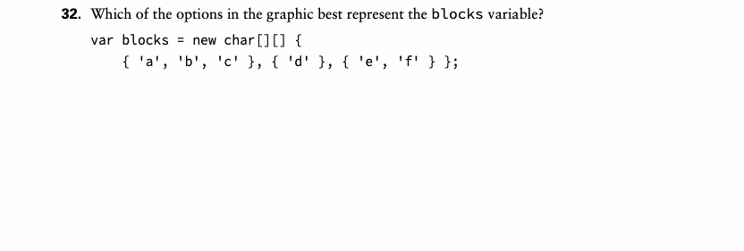
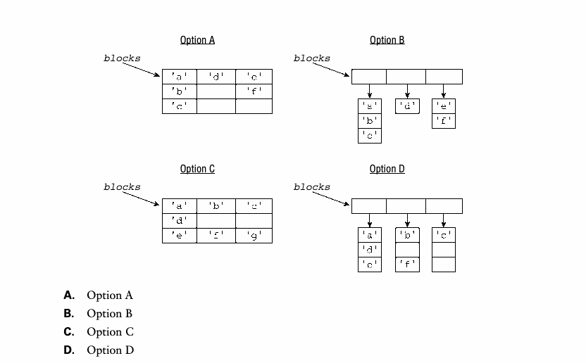
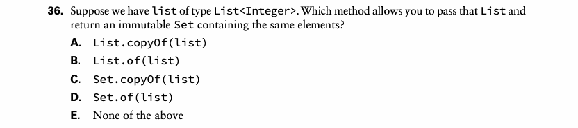
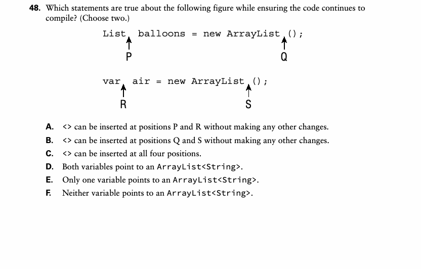

# Chapter 5: Working with Arrays and Collections

> Source: *OCP Oracle Certified Professional Java SE 17 Developer Practice Tests (Exam 1Z0-829)*. Extracted from your PDF for personal study. Questions with figures/tables include a scan of the original page.

## 829-05-001

What is the output of the following?

```java
List<String> museums = new ArrayList<>(1);
museums.add("Natural History");
museums.add("Science");
museums.add("Art");
museums.remove(2);
System.out.println(museums);
```

- **A.** `[Natural History, Science]`
- **B.** `[Natural History, Art, Science]`
- **C.** The code does not compile.
- **D.** The code compiles but throws an exception at runtime.

**Answer:** A

**Explanation:** While the `ArrayList` is declared with an initial capacity of one element, it is free to expand as more elements are added. Each of the three calls to the `add()` method adds an element to the end of the `ArrayList`. The `remove()` method call deletes the element at index 2, which is `Art`. Therefore, option A is correct.

## 829-05-002

How many of the following are legal declarations?

```java
[]String lions = new String[];
String[] tigers = new String[1] {"tiger"};
String bears[] = new String[] {};
String ohMy [] = new String[0] {};
```

- **A.** None
- **B.** One
- **C.** Two
- **D.** Three
- **E.** Four

**Answer:** B

**Explanation:** The array brackets, `[]`, are not allowed to appear before the type, making the `lions` declaration incorrect. When using an array initializer with braces, `{}`, you are not allowed to specify the size separately. The size is inferred from the number of elements listed. Therefore, `tigers` and `ohMy` are incorrect. When you’re not using an array initializer, the size is required. An empty array initializer is allowed. Option B is correct because only `bears` is legal.

## 829-05-003

Which of the following can fill in the blank to make the code compile?

```java
public class News< ___ > {}
```

- **A.** `?` only
- **B.** `N` only
- **C.** `?` and `N`
- **D.** `News`, and `Object`
- **E.** `N`, `News`, and `Object`
- **F.** None of the above

**Answer:** E

**Explanation:** When declaring a class that uses generics, you must specify a name for the formal type parameter. Java uses the standard rules for naming a variable or class. A question mark is not allowed in a variable name, making options A and C incorrect. While it is common practice to use a single uppercase letter for the type parameter, this is not required. It certainly isn’t a good idea to use existing class names like the `News` class being declared here or the `Object` class built into Java. However, both are allowed, making option E the correct answer.

## 829-05-004

Which of the following are true about this code? (Choose two.)

```java
26: List<String> strings = new ArrayList<?>();
27: var ints = new HashSet<Integer>();
28: Double dbl = 5.0;
29: ints.add(2);
30: ints.add(null);
```

- **A.** The code compiles as is.
- **B.** One line needs to be removed for the code to compile.
- **C.** Two lines need to be removed for the code to compile.
- **D.** One line of code uses autoboxing.
- **E.** Two lines of code use autoboxing
- **F.** Three lines of code use autoboxing

**Answer:** B, E

**Explanation:** Option B is one answer because line 26 does not compile. The `?` wildcard cannot be used when instantiating a type on the right side of the assignment operator. The other lines do compile. Additionally, option E is correct because lines 28 and 29 use autoboxing. They convert a primitive to a wrapper object, in this case `Double` and `Integer`, respectively. Line 30 is correct and does not use autoboxing. It places a `null` reference as the `Integer` object.

## 829-05-005

Which of the following creates an empty two-dimensional array with dimensions 2×2?

- **A.** `int[][] blue = new int[2, 2];`
- **B.** `int[][] blue = new int[2], [2];`
- **C.** `int[][] blue = new int[2][2];`
- **D.** `int[][] blue = new int[2 x 2];`
- **E.** None of the above

**Answer:** C

**Explanation:** A two-dimensional array is declared by listing both sizes in separate pairs of brackets, `[]`. Option C correctly shows this syntax.

## 829-05-006

What is the output of the following?

```java
var q = new ArrayDeque<String>();
q.offer("snowball");
q.offer("minnie");
q.offer("sugar");
System.out.print(q.peek() + " " + q.peek() + " " + q.size());
```

- **A.** `sugar sugar 3`
- **B.** `sugar minnie 1`
- **C.** `snowball minnie 1`
- **D.** `snowball snowball 3`
- **E.** The code does not compile.
- **F.** None of the above.

**Answer:** D

**Explanation:** The `offer()` method inserts an element at the end of the queue. This means the queue contains `[snowball, minnie, sugar]`. The `peek()` method returns the element at the front of the queue without removing it. Therefore, `snowball` is printed twice, but the queue remains with three elements. This matches option D.

## 829-05-007

You are running a library. Patrons select books by name. They get at the back of the checkout line. When they get to the front, they scan the book’s ISBN, a unique identification number. The checkout system finds the book based on this number and marks the book as checked out. Of these choices, which data structures best represent the line to check out the book and the book lookup to mark it as checked out, respectively?

- **A.** `ArrayList`, `HashSet`
- **B.** `ArrayList`, `TreeMap`
- **C.** `ArrayList`, `TreeSet`
- **D.** `LinkedList`, `HashSet`
- **E.** `LinkedList`, `TreeMap`
- **F.** `LinkedList`, `TreeSet`

**Answer:** E

**Explanation:** Notice how there is unnecessary information in this description. The fact that patrons select books by name is irrelevant. The checkout line is a perfect example of a `Queue`. You need easy access to one end of the `Queue` for patrons to add themselves to the queue. You also need easy access for patrons to get off the queue when it is their turn. Since a `LinkedList` is a `Queue`, this narrows down the answer to options D, E, and F. The book lookup by ISBN is a lookup by key. You need a map for this. A `HashMap` is probably better here, but it isn’t a choice. So the answer is option E, which does include both a `Queue` and a `Map`.

## 829-05-008

What is the result of running the following program?

```java
1: package fun;
2: public class Sudoku {
3:     static int[][] game;
4:
5:     public static void main(String[] args) {
6:       game[3][3] = 6;
7:       Object[] obj = game;
8:       game[3][3] = "X";
9:       System.out.println(game[3][3]);
10:    } }
```

- **A.** `X`
- **B.** The code does not compile.
- **C.** The code compiles but throws a `NullPointerException` at runtime.
- **D.** The code compiles but throws a different exception at runtime.
- **E.** None of the above.

**Answer:** B

**Explanation:** Line 8 attempts to store a `String` in an array meant for an `int`. Line 8 does not compile, and option B is correct.

## 829-05-009

Suppose you want to implement a `Comparator<String>` so that it sorts the longest strings first. You may assume there are no `null` values. Which method could implement such a comparator?

- **A.** 

  ```java
  public int compare(String s1, String s2) {
     return s1.length() - s2.length();
  }
  ```
- **B.** 

  ```java
  public int compare(String s1, String s2) {
     return s2.length() - s1.length();
  }
  ```
- **C.** 

  ```java
  public int compare(Object obj1, Object obj2) {
     String s1 = (String) obj1;
     String s2 = (String) obj2;
     return s1.length() - s2.length();
  }
  ```
- **D.** 

  ```java
  public int compare(Object obj1, Object obj2) {
     String s1 = (String) obj1;
      String s2 = (String) obj2;
      return s2.length() - s1.length();
   }
  ```
- **E.** None of the above

**Answer:** B

**Explanation:** Options C and D are incorrect because the method signature is incorrect. Unlike the `equals()` method, the method in `Comparator<String>` takes the type being compared as the parameters when using generics. Option A is a valid `Comparator<String>`. However, it sorts in ascending order by length. Option B is correct. If `s1` is three characters and `s2` is one character, it returns `-2`. The negative value says that `s1` should sort first, which is correct, because you want the longest `String` first.

## 829-05-010

How many lines does the following code output?

```java
var days = new String[] { "Sunday", "Monday", "Tuesday",
   "Wednesday", "Thursday", "Friday", "Saturday" };
for (int i = 1; i < days.length; i++)
     System.out.println(days[i]);
```

- **A.** Zero
- **B.** Six
- **C.** Seven
- **D.** The code does not compile.
- **E.** The code compiles but throws an exception at runtime.

**Answer:** B

**Explanation:** In Java, arrays are indexed starting with `0`. Although it is unusual for the loop to start with `1`, this does not cause an error. It does cause the code to output six lines instead of seven since the loop doesn’t cover the first array element. Therefore, option B is correct.

## 829-05-011

Which cannot fill in the blank for this code to compile and print `true` at runtime?

```java
var c = new ______________ <String>();
c.add("pen");
c.remove("pen");
System.out.println(c.isEmpty());
```

- **A.** `ArrayDeque`
- **B.** `ArrayList`
- **C.** `TreeMap`
- **D.** `TreeSet`
- **E.** All of these can fill in the blank.

**Answer:** C

**Explanation:** Java talks about the Collections Framework, but the `Map` interface does not actually implement the `Collection` interface. `TreeMap` has different methods than the other options. It cannot fill in the blank, so option C is correct. The other options compile and print `true` at runtime.

## 829-05-012

What is true of the following code? (Choose two.)

```java
import java.util.*;
public class Garden {
   private static void sortAndSearch(String x, String y) {
     var coll = Arrays.asList(x,y);
     Collections.sort(coll);
             result = Collections.binarySearch(coll, x);
     System.out.println(result);
   }
  public static void main(String[] args) {
    sortAndSearch("seed", "flower");
  } }
```

- **A.** If the blank contains `int`, then the code outputs `0`.
- **B.** If the blank contains `int`, then the code outputs `1`.
- **C.** If the blank contains `int`, then the code does not compile.
- **D.** If the blank contains `String`, then the code outputs `flower`.
- **E.** If the blank contains `String`, then the code outputs `seed`.
- **F.** If the blank contains `String`, then the code does not compile.

**Answer:** B, F

**Explanation:** In Java, `Arrays.binarySearch()` returns a positive `int`, representing the index of a match if one is found. An `int` cannot be stored in a `String` variable, making option F one of the answers. When using the correct data type and searching for `seed`, we find it at index `1`. Therefore, option B is the other answer.

## 829-05-013

How many of the following are legal declarations?

```java
public void greek() {
   [][]String alpha;
   []String beta;
   String[][] gamma;
   String[] delta[];
   String epsilon[][];
   var[][] zeta;
}
```

- **A.** One
- **B.** Two
- **C.** Three
- **D.** Four
- **E.** Five
- **F.** Six

**Answer:** C

**Explanation:** As with a one-dimensional array, the brackets, `[]`, must be after the type, making `alpha` and `beta` illegal declarations. For a multidimensional array, the brackets may be before and/ or after the variable name. They do not need to be in the same place. Therefore, `gamma`, `delta`, and `epsilon` are correct. Finally, `var` can be used as a local variable but not with array brackets after it. The code would compile if it said `var zeta` and it was assigned an array of a specified type. Since three options are correct, the answer is option C.

## 829-05-014

What is the result of the following?

```java
var list = new ArrayList<Integer>();
list.add(56);
list.add(56);
list.add(3);
var set = new TreeSet<Integer>(list);
System.out.print(set.size());
System.out.print(" ");
System.out.print(set.iterator().next());
```

- **A.** `2 3`
- **B.** `2 56`
- **C.** `3 3`
- **D.** `3 56`
- **E.** None of the above

**Answer:** A

**Explanation:** First, the code creates an `ArrayList` of three elements. Then the list is transformed into a `TreeSet`. Since sets are not allowed to have duplicates, the set has only two elements. Remember that a `TreeSet` is sorted, which means that the first element in the `TreeSet` is `3`. Therefore, option A is correct.

## 829-05-015

What is true of this code when run as `java Copier.java` with no arguments? (Choose two.)

```java
1: import java.util.Arrays;
2:
3: public class Copier {
4:     public static void main(String... original) {
5:       String... copy = original;
6:       Arrays.linearSort(original);
7:       Arrays.search(original, "");
8:       System.out.println(original.size()
9:          + " " + original[0]);
10:    } }
```

- **A.** One line contains a compiler error.
- **B.** Two lines contain a compiler error.
- **C.** Three lines contain a compiler error.
- **D.** Four lines contain a compiler error.
- **E.** If the compiler errors were fixed, the code would throw an exception.
- **F.** If the compiler errors were fixed, the code would run successfully.

**Answer:** D, E

**Explanation:** Three dots in a row is a varargs parameter. While varargs is used like an array from within the method, it can only be used as a method parameter. This syntax is not allowed for a variable, causing a compiler error on line 5. Line 6 does not compile because `linearSort()` should be `sort()`. On line 7, the method name is also incorrect. The `search()` method should be `binarySearch()`. Finally, line 8 uses `size()` instead of `length`. Since there are four errors, option D is correct. If all these errors were corrected, `original[0]` would cause an exception because the array is empty. Therefore, option E is also correct.

## 829-05-016

What is the output of the following? (Choose three.)

```java
20: var chars = new __________________ <Character>();
21: chars.add('a');
22: chars.add(Character.valueOf('b'));
23: chars.set(1, 'c');
24: chars.remove(0);
25: System.out.print(chars.size() + " " + chars.contains('b'));
```

- **A.** When inserting `ArrayList` into the blank, the code prints `1 false`.
- **B.** When inserting `ArrayList` into the blank, the code does not compile.
- **C.** When inserting `HashMap` into the blank, the code prints `1 false`.
- **D.** When inserting `HashMap` into the blank, the code does not compile.
- **E.** When inserting `HashSet` into the blank, the code prints `1 false`.
- **F.** When inserting `HashSet` into the blank, the code does not compile.

**Answer:** A, D, F

**Explanation:** Line 20 does not compile for a `Map` because it requires two generic types. Line 23 does not compile for a `Set` because the elements are unordered and do not have an index. This makes options D and F correct. Additionally, option A is correct because line 23 replaces the second element with a new value, making `chars` contain `[a, c]`. Then line 24 removes the first element, making it just `[c]`. There is only one element, but it is not the value `b`.

## 829-05-017

What is the output of the following?

```java
import java.util.*;
record Magazine(String name) {
   public int compareTo(Magazine m) {
     return name.compareTo(m.name);
   }
}
public class Newsstand {
   public static void main(String[] args) {
     var set = new TreeSet<Magazine>();
     set.add(new Magazine("highlights"));
     set.add(new Magazine("Newsweek"));
     set.add(new Magazine("highlights"));
     System.out.println(set.iterator().next());
   } }
```

- **A.** `Magazine[name=highlights]`
- **B.** `Magazine[name=Newsweek]`
- **C.** `null`
- **D.** The code does not compile.
- **E.** The code compiles but throws an exception at runtime.

**Answer:** E

**Explanation:** The `Magazine` class doesn’t implement `Comparable<Magazine>`. It happens to implement the `compareTo()` method properly, but it is missing actually writing `implements` `Comparable`. Since `TreeSet` doesn’t look to see if the object can be compared until runtime, this code throws a `ClassCastException` when `TreeSet` calls `add()`, so option E is correct.

## 829-05-018

Which is the first line to prevent this code from compiling or running without error?

```java
11: char[][] ticTacToe = new char[3][3];
12: ticTacToe[1][3] = 'X';
13: ticTacToe[2][2] = 'X';
14: ticTacToe[3][1] = 'X';
15: System.out.println(ticTacToe.length + " in a row!");
```

- **A.** Line 11
- **B.** Line 12
- **C.** Line 13
- **D.** Line 14
- **E.** Line 15
- **F.** None of the above; the code compiles and runs without issue.

**Answer:** B

**Explanation:** Arrays begin with an index of `0`. This array is a 3×3 array, making only indexes `0`, `1`, and `2` valid. All of the lines compile, but line 12 is the first to throw an `ArrayIndexOutOfBoundsException` at runtime. Therefore, option B is correct.

## 829-05-019

What is the first line with a compiler error?

```java
class Mammal {}
class Bat extends Mammal {}
class Cat extends Mammal {}
class Sat {}
 class Fur<T extends Mammal> {     // line R
    void clean() {
       var bat = new Fur<Bat>();     // line S
       var cat = new Fur<Cat>();     // line T
       var sat = new Fur<Sat>();     // line U
    }
 }
```

- **A.** `Line R`
- **B.** `Line S`
- **C.** `Line T`
- **D.** `Line U`
- **E.** None of the above

**Answer:** D

**Explanation:** The generic declaration on line `R` is valid. It sets a constraint on the generic type used when declaring a `Fur` object. Lines `S` and `T` compile as they meet this constraint. However, line `U` has a problem since `Sat` does not extend `Mammal`. Since this line does not compile, option D is the answer.

## 829-05-020

What is a possible result of this code?

```java
17: var nums = new HashSet<Long>();
18: nums.add((long) Math.min(5, 3));
19: nums.add(Math.round(3.14));
20: nums.add((long) Math.pow(4,2));
21: System.out.println(nums);
```

- **A.** `[3]`
- **B.** `[16]`
- **C.** `[16, 3]`
- **D.** `[16, 3, 3]`
- **E.** None of the above

**Answer:** C

**Explanation:** Line 18 puts `3` in `nums` since it is the smaller value. Since a `Set` must have unique elements, line 19 does not add another value to `nums`. Line 20 adds the final value of `16`. The set has a total of two elements, `3` and `16`. A `HashSet` does not commit to an output order, making option C correct.

## 829-05-021

What is the output of the following?

```java
5: var x = new ArrayDeque<Integer>();
6: x.offer(18);
7: x.offer(5);
8: x.push(13);
9: System.out.println(x.poll() + " " + x.poll());
```

- **A.** `13 5`
- **B.** `13 18`
- **C.** `18 5`
- **D.** `18 13`
- **E.** The code does not compile.
- **F.** The code compiles but prints something else.

**Answer:** B

**Explanation:** A `Deque` lets us add elements at both ends. The `offer()` method adds an element to the back of the queue. After line 7 completes, the queue contains `18` and `5` in that order. The `push()` method adds an element to the front of the queue. How rude! The element `13` pushes past everyone on the line. After line 8 completes, the queue now contains `13`, `18`, and `5`, in that order. Then we get the first two elements from the front, which are `13` and `18`, making option B correct.

## 829-05-022

Suppose we want to store `JellyBean` objects. Which of the following require `JellyBean` to implement the `Comparable` interface or create a `Comparator` to add them to the collection? (Choose two.)

- **A.** `ArrayList`
- **B.** `HashMap`
- **C.** `HashSet`
- **D.** `SortedArray`
- **E.** `TreeMap`
- **F.** `TreeSet`

**Answer:** E, F

**Explanation:** `TreeMap` and `TreeSet` sort as you insert elements. `TreeMap` sorts the keys and `TreeSet` sorts the objects in the set. This makes options E and F correct. Note that you have the option of having `JellyBean` implement `Comparable`, or you can pass a `Comparator` to the constructor of `TreeMap` or `TreeSet`. Option D is trying to trick you, as `SortedArray` is not a class or an interface in the Collections Framework.

## 829-05-023

Which of the following references the first and last elements in a nonempty array?

- **A.** `trains[0]` and `trains[trains.length]`
- **B.** `trains[0]` and `trains[trains.length - 1]`
- **C.** `trains[1]` and `trains[trains.length]`
- **D.** `trains[1]` and `trains[trains.length - 1]`
- **E.** None of the above

**Answer:** B

**Explanation:** Array indices start with `0`, making options C and D incorrect. The `length` attribute refers to the number of elements in an array. It is 1 past the last valid array index. Therefore, option B is correct.

## 829-05-024

Which of the following fills in the blank so this code compiles?

```java
public static void throwOne(Collection< ______ > coll) {
   var iter = coll.iterator();
   if (iter.hasNext())
     throw iter.next();
}
```

- **A.** `?`
- **B.** `? extends RuntimeException`
- **C.** `? super RuntimeException`
- **D.** `T`
- **E.** `T extends RuntimeException`
- **F.** `T super RuntimeException`
- **G.** None of the above

**Answer:** B

**Explanation:** Options D, E, and F do not compile because only a wildcard can be used here. Since the method does not have any declared exceptions, it can only throw unchecked exceptions. Option B is correct because it is the only one that requires the elements of `coll` to be `RuntimeException` or any subclasses.

## 829-05-025

Which of these four array declarations produces a different array than the others?

- **A.** `int[][] nums = new int[2][1];`
- **B.** `int[] nums[] = new int[2][1];`
- **C.** `int[] nums[] = new int[][] { { 0 }, { 0 } };`
- **D.** `int[] nums[] = new int[][] { { 0, 0 } };`

**Answer:** D

**Explanation:** Options A and B show that the brackets, `[]`, can be before or after the variable name and produce the same array. Option C specifies the same array the long way with two arrays of length 1. Option D is the answer because it is different from the others. It instead specifies an array of length 1 where that element is of length 2.

## 829-05-026

What does the following output?

```java
var laptops = new String[] { "Linux", "Mac", "Windows" };
var desktops = new String[] { "Mac", "Linux", "Windows" };
var search = Arrays.binarySearch(laptops, "Linux");
var mismatch1 = Arrays.mismatch(laptops, desktops);
var mismatch2 = Arrays.mismatch(desktops, desktops);
System.out.println(search + " " + mismatch1 + " " + mismatch2);
```

- **A.** `-1 0 -1` is guaranteed
- **B.** `-1 -1 0` is guaranteed
- **C.** `0 -1 0` is guaranteed
- **D.** `0 0 -1` is guaranteed
- **E.** The output is not defined.
- **F.** The code does not compile.

**Answer:** D

**Explanation:** Java requires having a sorted array before calling the `binarySearch()` method. You do not have to call `Arrays.sort` to perform the sort, though. This array happens to already be sorted, so it meets the precondition. The target string of `"Linux"` is the first element in the array. Since Java uses zero-based indexing, `search` is `0`. The `Arrays.mismatch()` method returns `-1` if the arrays are the same and returns the index of the first difference if they are not. In our example, `mismatch1` is `0` because the first element differs, and `mismatch2` is `-1` because the arrays are the same. This makes option D the answer.

## 829-05-027

Which line in the `main()` method doesn’t compile or points to a class that doesn’t compile?

```java
 1: interface Comic<S> {
 2:     void draw(S s);
 3: }
 4: class ComicClass<S> implements Comic<S> {
 5:     public void draw(S s) {
 6:       System.out.println(s);
 7:     }
 8: }
 9: class SnoopyClass implements Comic<Snoopy> {
 10:    public void draw(Snoopy s) {
 11:      System.out.println(s);
 12:    }
 13: }
 14: class SnoopyComic implements Comic<Snoopy> {
 15:    public void draw(S s) {
 16:      System.out.println(s);
 17:    }
 18: }
 19: public class Snoopy {
20:    public static void main(String[] args) {
21:      Comic<Snoopy> s1 = s -> System.out.println(s);
22:      Comic<Snoopy> s2 = new ComicClass<>();
23:      Comic<Snoopy> s3 = new SnoopyClass();
24:      Comic<Snoopy> s4 = new SnoopyComic();
25:    } }
```

- **A.** Line 21
- **B.** Line 22
- **C.** Line 23
- **D.** Line 24
- **E.** None of the above. All of the code compiles.

**Answer:** D

**Explanation:** The `Comic<S>` interface declares a formal type parameter. This means that a class implementing it needs to specify this type. The code on line 21 compiles because the lambda reference supplies the necessary context, making option A incorrect. Option B declares a generic class. Although this doesn’t tell us the type is `Snoopy`, it punts the problem to the caller of the class. The declaration of `s2` on line 22 compiles because it supplies the type, making option B incorrect. The code on line 23 compiles because the `SnoopyClass` itself supplies the type, making option C incorrect. Option D has a problem. `SnoopyClass` and `SnoopyComic` appear similar. However, `SnoopyComic` refers to `S`. This type parameter exists in the interface. It isn’t available in the class because the class has said it is using `Snoopy` as the type. Since the `SnoopyComic` class itself doesn’t compile, the line with `s4` can’t instantiate it, and option D is the answer.

## 829-05-028

Fill in the blank to make this code compile:

```java
public class Truck implements Comparable<Truck> {
   private int id;
   public Truck(int id) {
     this.id = id;
   }
   @Override
   public int ____________________ {
     return id - t.id;
   } }
```

- **A.** `compare(Truck t)`
- **B.** `compare(Truck t1, Truck t2)`
- **C.** `compareTo(Truck t)`
- **D.** `compareTo(Truck t1, Truck t2)`
- **E.** None of the above

**Answer:** C

**Explanation:** When implementing `Comparable<Truck>`, you implement the `compareTo()` method. Since this is an instance method, it already has a reference to itself and only needs the item it is comparing. Only one parameter is specified, and option C is correct. By contrast, the `Comparator<Truck>` interface uses the `compare()` method, and the method takes two parameters.

## 829-05-029

How many lines does the following code output?

```java
var days = new String[] { "Sunday", "Monday", "Tuesday",
   "Wednesday", "Thursday", "Friday", "Saturday" };
for (int i = 0; i < days.length; i++)
   System.out.println(days[i]);
```

- **A.** Six
- **B.** Seven
- **C.** The code does not compile.
- **D.** The code compiles but throws an exception at runtime.

**Answer:** B

**Explanation:** There is nothing wrong or tricky about this code. It correctly creates a seven-element array. The loop starts with index `0` and ends with index `6`. Each line is correctly output. Therefore, option B is correct.

## 829-05-030

Which of the following fill in the blank to print out `true`? (Choose two.)

```java
String[] array = {"Natural History", "Science"};
var museums = ______________ ;
museums.set(0, "Art");
System.out.println(museums.contains("Art"));
```

- **A.** `Arrays.asList(array)`
- **B.** `Arrays.asList("Natural History, Science")`
- **C.** `List.of(array)`
- **D.** `List.of("Natural History", "Science")`
- **E.** `new ArrayList<String>("Natural History", "Science")`
- **F.** `new List<String>("Natural History", "Science")`

**Answer:** A, B

**Explanation:** Options E and F are incorrect because they do not compile. `List` is an interface and does not have a constructor. `ArrayList` has a constructor but not one that takes individual elements as parameters. Options C and D are incorrect because `List.of()` creates an immutable list. Trying to change one of its values causes an exception at runtime. Options A and B are correct. Since we are creating the list from an array, it is a fifixed size. We are allowed to change elements. When successfully completing this code, `museums` is `[Art,` `Science]` for both solutions.

## 829-05-031

Which option cannot fill in the blank to print `Clean socks`?

```java
class Wash<T> {
   T item;
   public void clean(T item) {
     System.out.println("Clean " + item);
   } }
public class LaundryTime {
   public static void main(String[] args) {
     wash.clean("socks");
   } }
```

- **A.** `var wash = new Wash<String>();`
- **B.** `var wash = new Wash<>();`
- **C.** `Wash wash = new Wash();`
- **D.** `Wash wash = new Wash<String>();`
- **E.** `Wash<String> wash = new Wash<>();`
- **F.** All of these can fill in the blank.

**Answer:** F

**Explanation:** The `Wash` class takes a formal type parameter named `T`. Options A and E show the best ways to call it. These options declare a generic reference type that specifies the type is `String`. Option A uses local variable type inference, whereas option E uses the diamond syntax to avoid redundantly specifying the type of the assignment. Options B, C, and D show that you can omit the generic type in the reference and still have the code compile. You do get a compiler warning, scolding you for having a raw type. But compiler warnings do not prevent compilation. With the raw type, the compiler treats `T` as if it is of type `Object`. That is okay in this example because the only method we call is `toString()` implicitly when printing the value. Since `toString()` is defifined on the `Object` class, we are safe, and options B, C, and D work. Since all can fifill in the blank, option F is the answer.

## 829-05-032

Which of the options in the graphic best represent the `blocks` variable?

```java
var blocks = new char[][] {
    { 'a', 'b', 'c' }, { 'd' }, { 'e', 'f' } };
```

Option A Option B

```java
blocks ____________________ blocks
```

Option C Option D

```java
blocks ____________________ blocks
```





- **A.** Option A
- **B.** Option B
- **C.** Option C
- **D.** Option D

**Answer:** B

**Explanation:** Options A, C, and D represent 3×3 2D arrays. Option B is correct because it best represents the array in the code. It shows there are three different arrays of different lengths.

## 829-05-033

Fill in the blank so the code prints `gamma`. (Choose two.)

```java
var list = Arrays.asList("alpha", "beta", "gamma");
Collections.sort(list, ______________ );
System.out.println(list.get(0));
```

- **A.** `(s, t) -> s.compareTo(t)`
- **B.** `(s, t) -> t.compareTo(s)`
- **C.** `Comparator.comparing((String s) -> s.charAt(0))`
- **D.** `Comparator.comparing((String s) -> s.charAt(0)).reverse()`
- **E.** `Comparator.comparing((String s) -> s.charAt(0)).reversed()`

**Answer:** B, E

**Explanation:** The goal is to write code that sorts in descending order. Option A sorts ascendingly and option B sorts descendingly. Similarly, option C sorts ascendingly and option E sorts descendingly. Option D attempts to call the `reverse()` method, which is not defined. Therefore, options B and E are the answers.

## 829-05-034

How many of the following are legal declarations?

```java
float[] lion = new float[];
float[] tiger = new float[1];
float[] bear = new[] float;
float[] ohMy = new[1] float;
```

- **A.** None
- **B.** One
- **C.** Two
- **D.** Three
- **E.** Four

**Answer:** B

**Explanation:** When creating an array object, a set of elements or size is required. Therefore, `lion` and `bear` are incorrect. The brackets containing the size are required to be after the type, making `ohMy` incorrect. The only one that is correct is `tiger`, making option B the answer.

## 829-05-035

Which is the first line of code that causes an `ArrayIndexOutOfBoundsException`?

```java
var matrix = new String[1][2];
matrix[0][0] = "Don't think you are, know you are.";     // m1
matrix[0][1] = "I'm trying to free your mind Neo";       // m2
matrix[1][0] = "Is all around you ";                    // m3
matrix[1][1] = "Why oh why didn't I take the BLUE pill?"; // m4
```

- **A.** `m1`
- **B.** `m2`
- **C.** `m3`
- **D.** `m4`
- **E.** The code does not compile.
- **F.** None of the above.

**Answer:** C

**Explanation:** This code creates a two-dimensional array of size 1×2. Lines `m1` and `m2` assign values to both elements in the inner array. Line `m3` attempts to reference the second element of the outer array. Since there is no such position, it throws an exception, and option C is correct.

## 829-05-036

Suppose we have `list` of type `List<Integer>`.Which method allows you to pass that `List` and return an immutable `Set` containing the same elements?



- **A.** `List.copyOf(list)`
- **B.** `List.of(list)`
- **C.** `Set.copyOf(list)`
- **D.** `Set.of(list)`
- **E.** None of the above

**Answer:** C

**Explanation:** All four of these return immutable collections. Options B and D take a varargs rather than a `List`, returning a `List<List<Integer>>` and `Set<List<Integer>>`, respectively. Option A returns a `List`, not a `Set`. Option C meets both our requirements and is the answer.

## 829-05-037

What does the following output? (Choose two.)

```java
var os = new String[] { "Mac", "Linux", "Windows" };
Arrays.sort(os);
System.out.println(Arrays.binarySearch(os, "RedHat"));
System.out.println(Arrays.binarySearch(os, "Mac"));
```

- **A.** `-1`
- **B.** `-2`
- **C.** `-3`
- **D.** `0`
- **E.** `1`
- **F.** `2`

**Answer:** C, E

**Explanation:** The code sorts before calling the `binarySearch()` method, so it meets the precondition for that method. The target string of `"RedHat"` is not found in the sorted array. If it were found, it would be between the second and third elements. The rule is to take the negative index of where it would be inserted and subtract 1. It would need to be inserted as the third element. Since indexes are zero-based, this is index 2. We take the negative, which is –2, and subtract 1, giving `-3`. The target string of `"Mac"` is the second element in the sorted array. Since array indices begin with 0, the second position is index 1. This makes options C and E the answer.

## 829-05-038

What does the following output?

```java
var names = new HashMap<String, String>();
names.put("peter", "pan");
names.put("wendy", "darling");
var first = names.entrySet();       // line x1
System.out.println(first.getKey());     // line x2
```

- **A.** `peter`
- **B.** `wendy`
- **C.** It does not compile due to line `x1`.
- **D.** It does not compile due to line `x2`.
- **E.** It does not compile due to another reason.
- **F.** It throws an exception at runtime.

**Answer:** D

**Explanation:** Line `x1` returns a `Set` of map entries. `Set` does not have a `getKey()` method, so line `x2` does not compile, and option D is the answer.

## 829-05-039

Which of these elements are in the output of the following? (Choose three.)

```java
var q = new ArrayDeque<String>();
q.offerFirst("snowball");
q.offer("sugar");
q.offerLast("minnie");
System.out.println(q.poll());
System.out.println(q.removeFirst());
System.out.println(q.size());
```

- **A.** `sugar`
- **B.** `minnie`
- **C.** `snowball`
- **D.** `1`
- **E.** `2`
- **F.** `3`

**Answer:** A, C, D

**Explanation:** The `offerLast()` and `offer()` methods insert an element at the back of the queue, while the `offerFirst()` method inserts the element at the front of the queue. This means the queue initially contains `[snowball, sugar, minnie]`. The `poll()` method returns the element at the front of the queue and removes it. In this case, it prints `snowball`, and the queue is reduced from three elements to `[sugar, minnie]`. Then, the `removeFirst()` method removes `sugar`, leaving the queue containing only `[minnie]`. Further, the queue becomes one smaller, and `1` is printed. Therefore, options A, C, and D are correct.

## 829-05-040

Which of these pairs of declarations can point to an array that is different from the others?

- **A.** `int[][][][] nums1a, nums1b;`
- **B.** `int[][][] nums2a[], nums2b;`
- **C.** `int[][] nums3a[][], nums3b[][];`
- **D.** `int[] nums4a[][][], numbs4b[][][];`

**Answer:** B

**Explanation:** All of the variables point to a 4D array, except `nums2b`, which points to a 3D array. Don’t create a 4D array in practice; it’s confusing. The options show that the brackets, `[]`, can be before or after the variable in any combination. Option B is the answer because `nums2b` points to a 3D array. It has only three pairs of brackets before the variable and none after. By comparison, `nums2a` has three pairs of brackets before the variable and the fourth pair of brackets after.

## 829-05-041

Which of the following does not behave the same way as the others?

- **A.** `var set = new HashSet<>();`
- **B.** `var set = new HashSet<Object>();`
- **C.** `HashSet<> set = new HashSet<Object>();`
- **D.** `HashSet<Object> set = new HashSet<>();`
- **E.** `HashSet<Object> set = new HashSet<Object>();`

**Answer:** C

**Explanation:** Option E is the longest way to specify this code. Options A and D shorten it by using the diamond operator (`<>`). Options A and B shorten it using `var`. Option C is the answer since it does not compile because the diamond operator cannot be used on the left side of the assignment.

## 829-05-042

What is true about the output of the following code?

```java
var ints = new int[] {3,1,4};
var others = new int[] {2,7,1,8};
System.out.println(Arrays.compare(ints, others));
```

- **A.** It is negative because `ints` has fewer elements.
- **B.** It is `0` because the arrays can’t be compared.
- **C.** It is positive because the first element is larger.
- **D.** It is undefined.
- **E.** The code does not compile.

**Answer:** C

**Explanation:** The `Arrays.compare()` method looks at each element in turn. Since the first elements are different, we get the result of comparing them. In this case, we get a positive number because `3` is larger than `2` and option C is correct.

## 829-05-043

Fill in the blank so that the code prints `beta`.

```java
var list = List.of("alpha", "beta", "gamma");
Collections.sort(list, ______________ );
System.out.println(list.get(0));
```

- **A.** `(s, t) -> s.compareTo(t)`
- **B.** `(s, t) -> t.compareTo(s)`
- **C.** `Comparator.comparing(String::length)`
- **D.** `Comparator.comparing(String::length).reversed()`
- **E.** None of the above

**Answer:** E

**Explanation:** `List.of()` makes an immutable list. Attempting to sort throws an exception, so option E is the answer. If we were calling `Arrays.asList()` instead, option C would be the answer because it is the only option to sort ascendingly by length.

## 829-05-044

What is the output of the following?

```java
12: var queue = new ArrayDeque<>();
13: queue.offer("exelsior");
14: queue.peekFirst();
15: queue.addFirst("edwin");
16: queue.removeLast();
17: System.out.println(queue);
```

- **A.** `[edwin]`
- **B.** `[excelsior]`
- **C.** `[edwin, excelsior]`
- **D.** `[excelsior, edwin]`
- **E.** The code does not compile.
- **F.** The code throws an exception at runtime.

**Answer:** A

**Explanation:** Line 13 adds `excelsior` to the double-ended queue. Line 14 checks if an element is there but does not change it. Line 15 adds `edwin` to the front. Since line 16 removes from the back, we are left with `[edwin]` and option A is the answer.

## 829-05-045

How many dimensions does the array reference `moreBools` allow?

```java
boolean[][] bools[], moreBools;
```

- **A.** One dimension
- **B.** Two dimensions
- **C.** Three dimensions
- **D.** None of the above

**Answer:** B

**Explanation:** This one is tricky since the array brackets, `[]`, are split up. This means that `bools` is a 3D array reference. The brackets both before and after the variable name count. For `moreBools`, it is only a 2D array reference because there are only two pairs of brackets next to the type. In other words, `boolean[][]` applies to both variables. Then `bools` gets another dimension from the brackets right after the variable name. However, `moreBools` stays at 2D, making option B correct.

## 829-05-046

What is the result of the following?

```java
Comparator<Integer> c = (x, y) -> y - x;
var ints = Arrays.asList(3, 1, 4);
Collections.sort(ints, c);
System.out.println(Collections.binarySearch(ints, 1));
```

- **A.** `-1` is guaranteed.
- **B.** `0` is guaranteed.
- **C.** `1` is guaranteed.
- **D.** The code does not compile.
- **E.** The result is not defined.

**Answer:** E

**Explanation:** A custom sort order is specified using a `Comparator` to sort in descending order. However, this `Comparator` is not passed when searching. When a different sort order is used for searching and sorting, the result is undefined. Therefore, option E is correct.

## 829-05-047

Which statement most accurately represents the relationship between searching and sorting with respect to the `Arrays` class?

- **A.** If the array is not sorted, calling `Arrays.binarySearch()` will be accurate, but slower than if it were sorted.
- **B.** The array does not need to be sorted before calling `Arrays.binarySearch()` to get an accurate result.
- **C.** The array must be sorted before calling `Arrays.binarySearch()` to get an accurate result.
- **D.** None of the above.

**Answer:** C

**Explanation:** The `binarySearch()` method requires a sorted array in order to return a correct result. If the array is not sorted, the results of a binary search are undefined, making option C the answer.

## 829-05-048

Which statements are true about the following figure while ensuring the code continues to compile? (Choose two.)

```java
List ___ balloons = new ArrayList ();
```

P Q

```java
var ___ air = new ArrayList ();
```

R S




- **A.** `<>` can be inserted at positions P and R without making any other changes.
- **B.** `<>` can be inserted at positions Q and S without making any other changes.
- **C.** `<>` can be inserted at all four positions.
- **D.** Both variables point to an `ArrayList<String>`.
- **E.** Only one variable points to an `ArrayList<String>`.
- **F.** Neither variable points to an `ArrayList<String>`.

**Answer:** B, F

**Explanation:** The `<>` is known as the diamond operator. Here, it works as a shortcut to avoid repeating the generic type twice for the same declaration. On the right side of the expression, this is a handy shortcut. Java still needs the type on the left side, so there is something to infer. Positions Q and S are on the right side, making option B correct. In this question, the generic type is never specified, so it is `Object`. Since it is not `String`, option F is correct.

## 829-05-049

What is the result of the following when called without any command-line arguments? (Choose two.)

```java
1: import java.util.*;
2: public class Binary {
3:
4:    public static void main(String... args) {
5:      Arrays.sort(args);
6:      System.out.println(Arrays.toString(args));
7:      System.out.println(args[0]);
8:    } }
```

- **A.** `null`
- **B.** `[]`
- **C.** `Binary`
- **D.** The code throws an `ArrayIndexOutOfBoundsException`.
- **E.** The code throws a `NullPointerException`.
- **F.** The code does not compile.

**Answer:** B, D

**Explanation:** Since no arguments are passed from the command line, this creates an empty array. Sorting an empty array is valid and results in an empty array printed on line 6. Then line 7 attempts to access an element of the empty array and throws an `ArrayIndexOutOfBoundsException`. Therefore, options B and D are correct.

## 829-05-050

What is the first line with a compiler error?

```java
class Mammal {}
class Bat extends Mammal {}
class Cat extends Mammal {}
class Sat {}
class Fur<? extends Mammal> {     // line R
   void clean() {
     var bat = new Fur<Bat>();     // line S
     var cat = new Fur<Cat>();     // line T
     var sat = new Fur<Sat>();     // line U
   } }
```

- **A.** Line R
- **B.** Line S
- **C.** Line T
- **D.** Line U
- **E.** None of the above

**Answer:** A

**Explanation:** The generic declaration on line R is not valid due to the question mark (`?`) wildcard. While a question mark is allowed on the left side of a declaration, it is not allowed when specifying a constraint on a class. Since line R does not compile, option A is the answer.

## 829-05-051

What is the result of running the following program?

```java
 1: package fun;
 2: public class Sudoku {
3:     static int[][] game = new int[6][6];
4:
5:     public static void main(String[] args) {
6:       game[3][3] = 6;
7:       Object[] obj = game;
8:       obj[3] = "X";
9:       System.out.println(game[3][3]);
10:    } }
```

- **A.** `6`
- **B.** `X`
- **C.** The code does not compile.
- **D.** The code compiles but throws a `NullPointerException` at runtime.
- **E.** The code compiles but throws a different exception at runtime.

**Answer:** E

**Explanation:** Line 6 assigns an `int` to a cell in a 2D array. This is fine. Line 7 casts to a general `Object[]`. This is dangerous, but legal. Why is it dangerous, you ask? That brings us to line 8. The compiler can’t protect us from assigning a `String` to the `int[]` because the reference is more generic. Therefore, line 8 throws an `ArrayStoreException` because the type is incorrect, and option E is correct. You couldn’t have assigned an `int` on line 8 either because `obj[3]` is really an `int[]` behind the scenes and not an `int`.

## 829-05-052

Howmanyoftheseallowinserting `null` values: `ArrayList`,`LinkedList`,`HashSet`,and `TreeSet`?

- **A.** 0
- **B.** 1
- **C.** 2
- **D.** 3
- **E.** 4

**Answer:** D

**Explanation:** `TreeSet` does not allow `null` values because it compares the values when they are added, leading to a `NullPointerException`. A `HashSet` does support `null` values, although you can only have one since `HashSet` guarantees uniqueness. `ArrayList` and `LinkedList` both support any number of `null` entries. Since three of the four collections allow inserting `null` values, option D is correct.

## 829-05-053

What is the output of the following?

```java
var threes = Arrays.asList("3", "three", "THREE");
Collections.sort(threes);
System.out.println(threes);
```

- **A.** [`3, three, THREE]`
- **B.** [`3, THREE, three]`
- **C.** [`three, THREE, 3]`
- **D.** [`THREE, three, 3]`
- **E.** None of the above

**Answer:** B

**Explanation:** Unfortunately, you do have to memorize two facts about sort order. First, numbers sort before letters. Second, uppercase sorts before lowercase. Since the first value is `3` and the last is `three`, option B is correct.

## 829-05-054

How many dimensions does the array reference `moreBools` allow?

```java
boolean[][][] bools, moreBools;
```

- **A.** One dimension
- **B.** Two dimensions
- **C.** Three dimensions
- **D.** None of the above

**Answer:** C

**Explanation:** Since the brackets in the declaration are before the variable names, the variable type `boolean[][][]` applies to both variables. Therefore, both `bools` and `moreBools` can reference a 3D array and option C is correct.

## 829-05-055

What is the output of the following?

```java
20: List<Character> chars = new ArrayList<>();
21: chars.add('a');
22: chars.add('b');
23: chars.clear();
24: chars.remove(0);
25: System.out.print(chars.isEmpty() + " " + chars.length());
```

- **A.** `false 1`
- **B.** `true 0`
- **C.** `2`
- **D.** The code does not compile.
- **E.** The code throws an exception at runtime.

**Answer:** D

**Explanation:** Line 25 does not compile, making option D the answer. On an `ArrayList`, the method to get the number of elements is `size()`. The `length()` method is used for a `String` or `StringBuilder`. If this were fixed, the answer would be option E. Line 23 empties the `ArrayList`. Then line 24 attempts to access an index that is not present.

## 829-05-056

Which fills in the blank in the method signature to allow this code to compile and print `[duck, duck, goose]` at runtime?

```java
import java.util.*;
public class ExtendingGenerics {
   private static < ___________ , U> U add(T list, U element) {
     list.add(element);
     return element;
   }
   public static void main(String[] args) {
     var values = new ArrayList<String>();
     add(values, "duck");
     add(values, "duck");
     add(values, "goose");
     System.out.println(values);
   } }
```

- **A.** `? extends Collection<U>`
- **B.** `? implements Collection<U>`
- **C.** `T extends Collection<U>`
- **D.** `T implements Collection<U>`
- **E.** None of the above

**Answer:** C

**Explanation:** The `?` is an unbounded wildcard. It is used in variable references but is not allowed in declarations. In a `static` method, the type parameter specified inside the `<>` is used in the rest of the method declaration. Since it needs an actual name, options A and B are incorrect. We need to specify a type constraint so that we can call the `add()` method. Regardless of whether the type is a class or interface, Java uses the `extends` keyword for generics. Therefore, option D is incorrect, and option C is the answer.

## 829-05-057

What does the following output?

```java
String[] os = new String[] { "Mac", "Linux", "Windows" };
System.out.println(Arrays.binarySearch(os, "Linux"));
```

- **A.** `0` is guaranteed.
- **B.** `1` is guaranteed.
- **C.** `2` is guaranteed
- **D.** The output is not defined.
- **E.** The code does not compile.

**Answer:** D

**Explanation:** Java requires having a sorted array before calling the `binarySearch()` method. Since the array is not sorted, the result is undefined, and option D is correct. It may happen that you get `1` as the result, but this behavior is not guaranteed. You need to know for the exam that this is undefined even if you happen to get the “right” answer.

## 829-05-058

Which is the first line to prevent this code from compiling and running without error?

```java
11: char[][] ticTacToe = new char[3,3];
12: ticTacToe[1][3] = 'X';
13: ticTacToe[2][2] = 'X';
14: ticTacToe[3][1] = 'X';
15: System.out.println(ticTacToe.length + " in a row!");
```

- **A.** Line 11
- **B.** Line 12
- **C.** Line 13
- **D.** Line 14
- **E.** Line 15
- **F.** None of the above; the code compiles and runs without issue.

**Answer:** A

**Explanation:** A multidimensional array is created with multiple sets of size parameters. Line 11 should be `char[] ticTacToe = new char[3][3];`. Therefore, option A is the answer.

## 829-05-059

What is the result of the following?

```java
var list = new ArrayList<String>();
list.add("Austin");
list.add("Boston");
list.add("San Francisco");
list.removeIf(a -> a.length() > 10);
System.out.println(list.size());
```

- **A.** `0`
- **B.** `1`
- **C.** `2`
- **D.** `3`
- **E.** The code does not compile.

**Answer:** C

**Explanation:** On a stream, the `filter()` method only keeps values matching the lambda. The `removeIf()` does the reverse on a `Collection` and keeps the elements that do not match. In this case, that is `Austin` and `Boston`, so option C is correct.

## 829-05-060

What happens when calling the following method with a non-null and non-empty array?

```java
public static void addStationName(String[] names) {
   names[names.length] = "Times Square";
}
```

- **A.** It adds an element to the array whose value is `Times Square`.
- **B.** It replaces the last element in the array with the value `Times Square`.
- **C.** It throws an exception.
- **D.** It does not compile regardless of what is passed in.
- **E.** None of the above.

**Answer:** C

**Explanation:** The `names.length` value is the number of elements in the array. The last valid index in the array is one less than `names.length`. Therefore, the code throws an `ArrayIndexOutOfBoundsException`, and option C is correct.

## 829-05-061

Which is not a true statement about an array?

- **A.** An array expands automatically when it is full.
- **B.** An array is allowed to contain duplicate values.
- **C.** An array understands the concept of ordered elements.
- **D.** An array uses a zero index to reference the first element.

**Answer:** A

**Explanation:** An `ArrayList` expands automatically when it is full. An array does not, making option A the answer. The other three statements are true of both an array and an `ArrayList`.

## 829-05-062

Which of the following cannot fill in the blank to make the code compile?

```java
private void output( _____________ <?> x) {
   x.forEach(System.out::println);
}
```

- **A.** `Collection`
- **B.** `LinkedList`
- **C.** `TreeMap`
- **D.** None of these can fill in the blank.
- **E.** All of these can fill in the blank.

**Answer:** C

**Explanation:** The `forEach()` method that takes one parameter is defined on the `Collection` interface, allowing options A and B to fill in the blank. Option C requires you to notice that only one generic parameter is passed. A `Map` needs two parameters, so option C is the answer.

## 829-05-063

Which of the following fills in the blank so this code compiles?

```java
public static void getExceptions(Collection< _____________ > coll) {
   coll.add(new RuntimeException());
   coll.add(new Exception());
}
```

- **A.** `?`
- **B.** `? extends RuntimeException`
- **C.** `? super RuntimeException`
- **D.** `T`
- **E.** `T extends RuntimeException`
- **F.** `T super RuntimeException`
- **G.** None of the above

**Answer:** G

**Explanation:** Options D, E, and F do not compile because a wildcard must be used here. Option A is incorrect because `coll` could be any type, which doesn’t necessarily allow anything to be added, including exceptions. Option B is incorrect because neither `add()` method compiles. We could have `Collection<IllegalStateException>` as a parameter. That would not allow either type to be added. Finally, option C is incorrect as the second `add()` method does not compile because broader types than the generic allows are a problem when adding to `coll`. Therefore, option G is the answer.

## 829-05-064

What is the output of the following? (Choose two.)

```java
35: var mags = new HashMap<String, Integer>();
36: mags.put("People", 1974);
37: mags.put("Readers Digest", 1922);
38: mags.put("The Economist", 1843);
39:
40: Collection<Integer> years = mags.values();
41:
42: List<Integer> sorted = new ArrayList<>(years);
43: Collections.sort(sorted);
44:
45: int first = sorted.get(0);
46: System.out.println(first);
47:
48: Integer last = sorted.get(sorted.size());
49: System.out.println(last);
```

- **A.** `1843`
- **B.** `1922`
- **C.** `1974`
- **D.** The code compiles but throws an exception at runtime.
- **E.** The code does not compile.

**Answer:** A, D

**Explanation:** Lines 35–38 create a `Map` with three key/value pairs. Lines 40–43 sort just the values ascendingly by year. Lines 45 and 48 show you can assign the `Integer` values to an `int` via unboxing or an `Integer` directly. Line 46 shows the values are properly sorted, making option A correct. Finally, line 48 throws an exception because `sorted.size()` returns `3` and the maximum index in the `List` is `2`. This makes option D correct as well.

## 829-05-065

How do you access the array element with the value of `"z"`?

```java
dimensions
            "one" ___ "two" ___ "three"
                            "x"
             "p" ___________ "y"
                            "z"
                    "x"
                    "y"
```

- **A.** `dimensions["three"][2]`
- **B.** `dimensions["three"][3]`
- **C.** `dimensions[2][2]`
- **D.** `dimensions[3][3]`

**Answer:** C

**Explanation:** Arrays are indexed using numbers, not strings, making options A and B incorrect. Since array indexes are zero-based, option C is the answer.

## 829-05-066

What is the output of the following?

```java
import java.util.*;
record Magazine(String name) implements Comparable<Magazine> {
   public int compareTo(Magazine m) {
     return name.compareTo(m.name);
   }
}
public class Newsstand {
   public static void main(String[] args) {
     var set = new TreeSet<Magazine>();
     set.add(new Magazine("highlights"));
     set.add(new Magazine("Newsweek"));
     set.add(new Magazine("highlights"));
     System.out.println(set.iterator().next());
   } }
```

- **A.** `Magazine[name=highlights]`
- **B.** `Magazine[name=Newsweek]`
- **C.** The code does not compile.
- **D.** The code compiles but throws an exception at runtime.

**Answer:** B

**Explanation:** This code shows a proper implementation of `Comparable`. It has the correct method signature. It compares the magazine names in alphabetical order. Remember that uppercase letters sort before lowercase letters. Since `Newsweek` starts with uppercase, option B is correct.

## 829-05-067

Which can fill in the blanks to print `Cleaned 2 items`?

```java
import java.util.*;
class Wash<T ________ Collection> {
   public void clean(T items) {
     System.out.println("Cleaned " + items.size() + " items");
   } }
public class LaundryTime {
   public static void main(String[] args) {
     Wash<List> wash = new Wash< _____________ >();
     wash.clean(List.of("sock", "tie"));
   } }
```

- **A.** `extends`, `ArrayList`
- **B.** `extends`, `List`
- **C.** `super`, `ArrayList`
- **D.** `super`, `List`
- **E.** None of the above

**Answer:** B

**Explanation:** Options A and C are incorrect because a generic type cannot be assigned to another direct type unless you are using upper or lower bounds in that statement. Now, we just have to decide whether a lower or upper bound is correct for the `T` formal type parameter in `Wash`. The clue is that the method calls `size()`. This method is available on `Collection` and all classes that extend/implement it. Therefore, option B is correct.

## 829-05-068

How many lines does the following code output?

```java
var days = new String[] { "Sunday", "Monday", "Tuesday",
   "Wednesday", "Thursday", "Friday", "Saturday" };
for (int i = 1; i <= days.length; i++)
   System.out.println(days[i]);
```

- **A.** Six
- **B.** Seven
- **C.** The code does not compile.
- **D.** The code compiles but throws an exception at runtime.

**Answer:** D

**Explanation:** In Java, arrays are indexed starting with `0`. While it is unusual for the loop to start with `1`, this does not cause an error. What does cause an error is the loop ending at `data.length`, because the `<=` operator is used instead of the `<` operator. The last array index is 6, not 7. On the last iteration of the loop, the code throws an `ArrayIndexOutOfBoundsException`. Therefore, option D is correct.

## 829-05-069

What is the output of the following?

```java
var listing = new String[][] {
    { "Book" }, { "Game", "29.99" } };
System.out.println(listing.length + " " + listing[0].length);
```

- **A.** `1 1`
- **B.** `1 2`
- **C.** `2 1`
- **D.** `2 2`
- **E.** The code does not compile.
- **F.** The code compiles but throws an exception at runtime.

**Answer:** C

**Explanation:** This array has two elements, making `listing.length` output `2`. While each array element does not have the same size, this does not matter because we are only looking at the first element. The first element has one. This makes option C the answer.

## 829-05-070

What is the output of the following?

```java
Queue<String> q = new ArrayDeque<>();
q.add("snowball");
q.addLast("sugar");
q.addFirst("minnie");
System.out.println(q.peek() + " " + q.peek() + " " + q.size());
```

- **A.** `sugar sugar 3`
- **B.** `sugar minnie 1`
- **C.** `minnie minnie 3`
- **D.** `minnie snowball 1`
- **E.** The code does not compile.
- **F.** None of the above.

**Answer:** E

**Explanation:** The `addFirst()` and `addLast()` methods are on the `Deque` interface. While `ArrayDeque` does implement this interface, it also implements `Queue`. Since the `q` variable is of type `Queue`, these methods do not compile, and option E is the answer.

## 829-05-071

What is the result of the following?

```java
13: var numbers = Arrays.asList(3, 1, 4);
14: numbers.set(1, null);
 15: int first = numbers.get(0);
 16: int middle = numbers.get(1);
 17: int last = numbers.get(3);
 18: System.out.println(first + " " + middle + " " + last);
```

- **A.** The code does not compile.
- **B.** Line 14 throws an exception.
- **C.** Line 15 throws an exception.
- **D.** Line 16 throws an exception.
- **E.** Line 17 throws an exception.
- **F.** `3null4`

**Answer:** D

**Explanation:** The code does compile, making option A incorrect. Line 13 creates a fixed-size list. While we are using `var`, the type is `List<Integer>`. Line 14 successfully changes the contents of the list to `[3, null, 4]`. Line 15 automatically unboxes to the primitive `3`. Line 16 has a problem. The list has a `null` value at index `1`. This cannot be unboxed to a primitive and throws a `NullPointerException`. Therefore, option D is the answer.

## 829-05-072

Fill in the blank so the code prints `gamma`.

```java
var list = Arrays.asList("alpha", "beta", "gamma");
Collections.sort(list, ___________________________ );
System.out.println(list.get(0));
```

- **A.** 

  ```java
  Comparator.comparing(String::length)
     .andCompare(s -> s.charAt(0))
  ```
- **B.** 

  ```java
  Comparator.comparing(String::length)
     .thenCompare(s -> s.charAt(0))
  ```
- **C.** 

  ```java
  Comparator.comparing(String::length)
     .thenComparing(s -> s.charAt(0))
  ```
- **D.** 

  ```java
  Comparator.comparing(String::length)
     .andCompare(s -> s.charAt(0))
     .reversed()
  ```
- **E.** 

  ```java
  Comparator.comparing(String::length)
     .thenCompare(s -> s.charAt(0))
     .reversed()
  ```
- **F.** 

  ```java
  Comparator.comparing(String::length)
     .thenComparing(s -> s.charAt(0))
     .reversed()
  ```

**Answer:** F

**Explanation:** Options A, B, D, and E call the `andCompare()` and `thenCompare()` methods, which do not exist. Option C is missing the logic to sort descendingly, printing `alpha` at runtime. This leaves option F, which correctly sorts the elements, reverses them, and prints `gamma` at runtime.

## 829-05-073

What is the output of the following when run as `java FirstName.java Wolfie`? (Choose two.)

```java
public class FirstName {
   public static void main(String... names) {
     System.out.println(names[0]);
     System.out.println(names[1]);
   } }
```

- **A.** `FirstName`
- **B.** `Wolfie`
- **C.** The code throws an `ArrayIndexOutOfBoundsException`.
- **D.** The code throws a `NullPointerException`.
- **E.** The code throws a different exception.

**Answer:** B, C

**Explanation:** Array indexes begin with 0. `FirstName` is the name of the class, not an argument. The first argument is `Wolfie`, making option B correct. There is not a second argument, and the array is of size 1, so option C is also correct.

## 829-05-074

What does the following output?

```java
11: var pennies = new ArrayList<>();
12: pennies.add(1);
13: pennies.add(2);
14: pennies.add(Integer.valueOf(3));
15: pennies.add(Integer.valueOf(4));
16: pennies.remove(2);
17: pennies.remove(Integer.valueOf(1));
18: System.out.println(pennies);
```

- **A.** `[1, 2]`
- **B.** `[1, 4]`
- **C.** `[2, 4]`
- **D.** `[2, 3]`
- **E.** `[3, 4]`
- **F.** The code does not compile.

**Answer:** C

**Explanation:** This one is tricky. Line 11 creates an `ArrayList` with a generic type `Object` rather than `Integer`. This is allowed since we aren’t trying to assign any of the values to an `int` or `Integer` after getting them from `pennies`. This gives us the list `[1, 2, 3, 4]`. The next trick is that there are two `remove()` methods available on `ArrayList`. One removes an element by index and takes an `int` parameter. The other removes an element by value and takes an `Object`. On line 16, the `int` primitive is a better match, and the element with index 2 is removed, which is the value of `3`. At this point, we have `[1, 2, 4]`. Then on line 17, the other `remove()` method is called because we are explicitly using the wrapper object. This deletes the object that is equal to 1, and now we have `[2, 4]`. This brings us to option C as the answer.

## 829-05-075

What is true of the following code? (Choose two.)

```java
private static void sortAndSearch(String... args) {
   var one = args[1];
   Comparator<String> comp = (x, y) -> ______________ ;
   Arrays.sort(args, comp);
   var result = Arrays.binarySearch(args, one, comp);
   System.out.println(result);
}
public static void main(String[] args) {
   sortAndSearch("seed", "flower");
}
```

- **A.** If the blank contains `-x.compareTo(y)`, then the code outputs `0`.
- **B.** If the blank contains `-x.compareTo(y)`, then the code outputs `-1`.
- **C.** If the blank contains `x.compareTo(y)`, then the code outputs `0`.
- **D.** If the blank contains `-y.compareTo(x)`, then the code outputs `0`.
- **E.** If the blank contains `-y.compareTo(x)`, then the code outputs `-1`.
- **F.** If the blank contains `y.compareTo(x)`, then the code outputs `0`.
- **G.** If the blank contains `y.compareTo(x)`, then the code outputs `-1`.

**Answer:** C, D

**Explanation:** The code will output `0` when the array is sorted in ascending order since `flower` will be first. Option C is the most straightforward way of doing this, making it one of the answers. Reversing the order of the variables or adding a negative sign sorts in descending order making options A, B, E, F, and G incorrect. Doing both is a complicated way of sorting in ascending order, making option D the other correct answer.

## 829-05-076

What does this code output?

```java
String[] nums = new String[] { "1", "9", "10" };
Arrays.sort(nums);
System.out.println(Arrays.toString(nums));
```

- **A.** `[1, 9, 10]`
- **B.** `[1, 10, 9]`
- **C.** `[9, 1, 10]`
- **D.** `[9, 10, 1]`
- **E.** `[10, 1, 9]`
- **F.** `[10, 9, 1]`

**Answer:** B

**Explanation:** The elements of the array are of type `String` rather than `int`. Therefore, we use alphabetical order when sorting. The character `1` sorts before the character `9`, alphabetically making option A incorrect. Shorter strings sort before longer strings when all the other characters are the same, making option B the answer.

## 829-05-077

Which is the first line to prevent this code from compiling and running without error?

```java
11: char[][] ticTacToe = new char[3][3];
12: ticTacToe[0][0] = 'X';
13: ticTacToe[1][1] = 'X';
14: ticTacToe[2][2] = 'X';
15: System.out.println(ticTacToe.length + " in a row!");
```

- **A.** Line 11
- **B.** Line 12
- **C.** Line 13
- **D.** Line 14
- **E.** Line 15
- **F.** None of the above; the code compiles and runs without issue.

**Answer:** F

**Explanation:** This code is correct. Line 11 correctly creates a 2D array. The next three lines correctly assign a value to an array element. Line 15 correctly outputs `3 in a row!`, making option F correct.

## 829-05-078

What is true of the following code? (Choose three.)

```java
 36: var names = new HashMap<String, String>();
 37: names.put("peter", "pan");
 38: names.put("wendy", "darling");
 39:
 40: String w = names.getOrDefault("peter");
41: String x = names.getOrDefault("peter", "x");
42: String y = names.getOrDefault("john", "x");
```

- **A.** Exactly one line does not compile.
- **B.** Exactly two lines do not compile.
- **C.** If any lines that do not compile are removed, the `String` on line 40 is set to `null`.
- **D.** If any lines that do not compile are removed, the `String` on line 41 is set to `"pan"`.
- **E.** If any lines that do not compile are removed, the `String` on line 41 is set to `"x"`.
- **F.** If any lines that do not compile are removed, the `String` on line 42 is set to `"x"`.

**Answer:** A, D, F

**Explanation:** Line 40 does not compile since `getOrDefault()` requires two parameters. This makes option A the first answer. The rest of the code does compile. Option D is the next answer because `getOrDefault()` returns the value from the map when the key is present. Finally, option F is correct because `getOrDefault()` returns the second parameter when the key is not present.

## 829-05-079

What does the following output?

```java
18: List<String> list = List.of(
19:    "Mary", "had", "a", "little", "lamb");
20: Set<String> set = new HashSet<>(list);
21: set.addAll(list);
22: for(String sheep : set)
23:    if (sheep.length() > 1)
24:      set.remove(sheep);
25: System.out.println(set);
```

- **A.** `[a, lamb, had, Mary, little]`
- **B.** `[a]`
- **C.** `[a, a]`
- **D.** The code does not compile.
- **E.** The code throws an exception at runtime.

**Answer:** E

**Explanation:** Lines 18 and 19 create a list with five elements. Line 20 makes a set with the same five elements. Line 21 does not change the contents of the set since sets must have unique elements. The loop on line 22 tries to delete elements but instead throws a `ConcurrentModificationException`, making option E the answer.

## 829-05-080

Which of the following fills in the blank so this code compiles?

```java
public static void getExceptions(Collection< _______ > coll) {
   coll.add(new RuntimeException());
   coll.add(new Exception());
}
```

- **A.** `?`
- **B.** `? extends Exception`
- **C.** `? super Exception`
- **D.** `T`
- **E.** `T extends Exception`
- **F.** `T super Exception`
- **G.** None of the above Chapter Working 6 with Streams and Lambda Expressions THE OCP EXAM TOPICS COVERED IN THIS PRACTICE TEST INCLUDE THE FOLLOWING: ✓ Working with Streams and Lambda expressions ■ Use Java object and primitive Streams, including lambda expressions implementing functional interfaces, to supply, filter, map, consume, and sort data ■ Perform decomposition, concatenation and reduction, and grouping and partitioning on sequential and parallel streams

**Answer:** C

**Explanation:** Options D, E, and F do not compile because only a wildcard can be used here. Option C is correct because all the types being added are of type `Exception` or direct subclasses. Lambda Expressions
