# Chapter 6: Working with Streams and Lambda Expressions

> Source: *OCP Oracle Certified Professional Java SE 17 Developer Practice Tests (Exam 1Z0-829)*. Extracted from your PDF for personal study. Questions with figures/tables include a scan of the original page.

## 829-06-001

The following figure represents a stream pipeline. Given this, what would the boxes `X`, `Y`, `Z` best represent? X Y Z

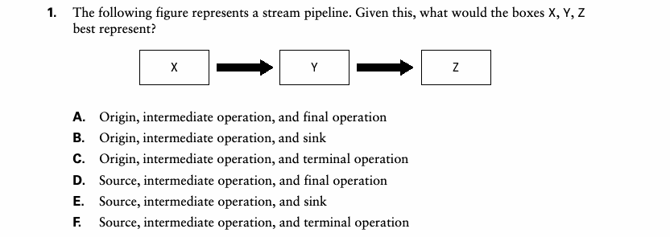

- **A.** Origin, intermediate operation, and final operation
- **B.** Origin, intermediate operation, and sink
- **C.** Origin, intermediate operation, and terminal operation
- **D.** Source, intermediate operation, and final operation
- **E.** Source, intermediate operation, and sink
- **F.** Source, intermediate operation, and terminal operation

**Answer:** F

**Explanation:** The source is the first operation, and the terminal operation comes last, making option F the answer. You need to know this terminology.

## 829-06-002

Which of the following is required for all valid lambda expressions?

- **A.** `()`
- **B.** `->`
- **C.** `{}`
- **D.** Parameter data type(s)
- **E.** None of the above

**Answer:** B

**Explanation:** The lambda expression `s -> true` is valid, making options A, C, and D incorrect. Parentheses, `()`, are not required on the left side if there is only one variable. Braces, `{}`, are not required if the right side is a single expression. Parameter data types are only required if the data type for at least one parameter is specified; otherwise, none are required. The remaining choice, the arrow operator, `->`, is required for all lambda expressions, making option B the correct answer.

## 829-06-003

Fill in the blanks: The functional interface does not take any inputs, while the functional interface does not return any data.

- **A.** `IntConsumer`, `LongSupplier`
- **B.** `IntSupplier`, `Function`
- **C.** `Supplier`, `DoubleConsumer`
- **D.** `UnaryOperator`, `Consumer`
- **E.** None of the above

**Answer:** C

**Explanation:** The `Supplier` functional interface does not take any inputs, while the `Consumer` functional interface does not return any data. This behavior extends to the primitive versions of the functional interfaces, making option C the correct answer. Option A is incorrect because `IntConsumer` takes a value, while `LongSupplier` returns a value. Options B and D are incorrect because `Function` and `UnaryOperator` both take an input and produce a value.

## 829-06-004

A lambda expression for which of the following functional interfaces could be used to return a `Double` value? (Choose two.)

- **A.** `UnaryOperator`
- **B.** `BiPredicate`
- **C.** `BiOperator`
- **D.** `BiConsumer`
- **E.** `BiFunction`
- **F.** `BiSupplier`

**Answer:** A, E

**Explanation:** The `UnaryOperator` and `BiFunction` return a generic argument, such as `Double`, making options A and E correct. Option B is incorrect because all predicate functions return `boolean`. Option C is incorrect because `BiOperator` does not exist in the `java.util.` `function` package. The correct name is `BinaryOperator`. Option D is incorrect because all consumer functions return `void`. Finally, option F is incorrect because `BiSupplier` does not exist in the `java.util.function` package. `Supplier` functions return values, and Java does not support methods with more than one return type.

## 829-06-005

What does the following output?

```java
var list = List.of("Austin", "Boston",
   "San Francisco");
 var c = list.stream()
    .filter(a -> a.length() > 10) // line x
    .count();
 System.out.println(c + " " + list.size());
```

- **A.** `1 1`
- **B.** `1 3`
- **C.** `2 3`
- **D.** The code does not compile due to line `x`.
- **E.** The code throws an exception.

**Answer:** B

**Explanation:** The stream pipeline is correct and filters all values out that are ten characters or smaller. Only `San Francisco` is long enough, so `c` is `1`. The `stream()` call creates a new object, so stream operations do not affect the original list. Since the original list is still three elements, option B is correct.

## 829-06-006

Identify the correct functional interfaces to fill in this table correctly. (Choose three.) Functional interface Possible return type Interface X `Boolean` Interface Y `int` Interface Z `void`

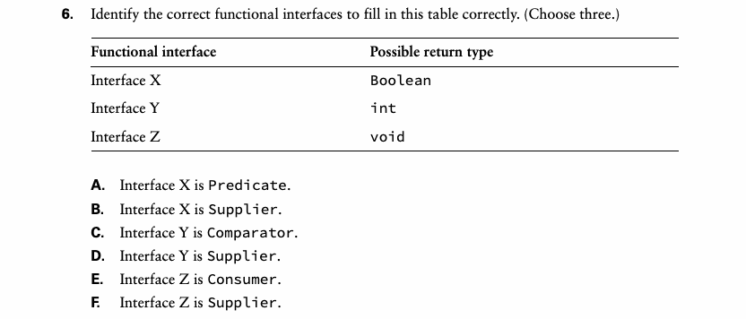

- **A.** Interface X is `Predicate`.
- **B.** Interface X is `Supplier`.
- **C.** Interface Y is `Comparator`.
- **D.** Interface Y is `Supplier`.
- **E.** Interface Z is `Consumer`.
- **F.** Interface Z is `Supplier`.

**Answer:** B, C, E

**Explanation:** Interface X is tricky. If it returned a `boolean` primitive, option A would be correct, as `Predicate` returns a `boolean`. However, it returns a wrapper object, so it has to be a `Supplier`, making option B the answer instead. We can tell interface Y is a `Comparator` because it returns a primitive `int`, not an object like `Integer`, and interface Z is a `Consumer` because it returns `void`. This makes options C and E the final two answers.

## 829-06-007

What is the most likely reason for a stream pipeline not to run?

- **A.** The source doesn’t generate any items.
- **B.** There are no intermediate operations.
- **C.** The terminal operation is missing.
- **D.** The version of Java is too old.
- **E.** None of the above.

**Answer:** C

**Explanation:** Option A is incorrect because a pipeline still runs if the source doesn’t generate any items and the rest of the pipeline is correct. Granted, some of the operations have nothing to do, but control still passes to the terminal operation. Option B is incorrect because intermediate operations are optional. Option C is the answer. The terminal operation triggers the pipeline to run. Option D is incorrect because the code would not compile at all if the version of Java were too old.

## 829-06-008

Which functional interface takes a `long` value as an input argument and has an `accept()` method?

- **A.** `LongConsumer`
- **B.** `LongFunction`
- **C.** `LongPredicate`
- **D.** `LongSupplier`
- **E.** None of the above

**Answer:** A

**Explanation:** The `LongSupplier` interface does not take any input, making option D incorrect. It also uses the method name `getAsLong()`. The rest of the functional interfaces all take a `long` value but vary on the name of the `abstract` method they use. `LongFunction` contains `apply()` and `LongPredicate` contains `test()`, making options B and C, respectively, incorrect. That leaves us with `LongConsumer`, which contains `accept()`, making option A the correct answer.

## 829-06-009

Given a parallel `Stream<T>`, which method would you use to obtain an equivalent serial `Stream<T>`?

- **A.** `unordered()`
- **B.** `reduce()`
- **C.** `concat()`
- **D.** `stream()`
- **E.** `boxed()`
- **F.** None of the above

**Answer:** F

**Explanation:** The correct method to obtain an equivalent sequential stream of an existing stream is `sequential()`, which is inherited by any class that implements `BaseStream<T>`. Since this isn’t an option, option F is correct. Note that `unordered()` creates a stream that can be evaluated in any order, but it can still be processed in a sequential or parallel stream.

## 829-06-010

What is the output of the following code?

```java
var odds = IntStream.iterate(1, a -> a+2);
var evens = IntStream.iterate(2, a -> a+2);
var sum = IntStream.concat(odds, evens).limit(3).sum();
System.out.print(sum);
```

- **A.** `6`
- **B.** `8`
- **C.** `9`
- **D.** `12`
- **E.** The code does not compile.
- **F.** The program does not terminate.

**Answer:** C

**Explanation:** Since we are concatenating two infinite streams, `concat()` creates an infinite stream. The `limit()` method turns it into a finite stream by ignoring all but the first three values of `odd`. Adding `1`, `3`, and `5` gives us `9`, making option C the answer.

## 829-06-011

Which of the following is a valid lambda expression?

- **A.** `r -> {return 1==2}`
- **B.** `(q) -> true`
- **C.** `(x,y) -> {int test; return test>0;}`
- **D.** `a,b -> true`
- **E.** None of the above

**Answer:** B

**Explanation:** Option A is incorrect because the lambda expression is missing a semicolon (`;`) at the end of the `return` statement. Option C is incorrect because the local variable `test` is used without being initialized. Option D is also incorrect. The parentheses are required on the left side of the lambda expression when there is more than one value or a data type is specified. Option B is the correct answer and the only valid lambda expression.

## 829-06-012

Which are true of running these lines independently of each other? (Choose two.)

```java
var empty = Optional.empty();
var param = Optional.of(null);
var method = Optional.ofNullable(null);
```

- **A.** All of these will run without error.
- **B.** Exactly one line fails to compile or throws an exception.
- **C.** Exactly two lines fail to compile or throw an exception.
- **D.** None of these returns `true` when calling `opt.isPresent()`.
- **E.** One of these returns `true` when calling `opt.isPresent()`.
- **F.** Two of these return `true` when calling `opt.isPresent()`.

**Answer:** B, D

**Explanation:** The second line throws a `NullPointerException` when you pass a `null` reference to the `of()` method. The others compile and run successfully, making option B correct. The first and third lines return `false` because they represent an empty `Optional`. This makes option D the other answer.

## 829-06-013

Which of the following statements about `DoubleSupplier` and `Supplier<Double>` is not true?

- **A.** Both are functional interfaces.
- **B.** Both take zero parameters.
- **C.** Lambdas for both can return a `double` value.
- **D.** Lambdas for both can return a `null` value.
- **E.** One supports a generic type; the other does not.
- **F.** All of these are true.

**Answer:** D

**Explanation:** Both are functional interfaces in the `java.util.function` package, making option A true. Additionally, both lack parameters, making option B true. The major difference between the two is that `Supplier<Double>` takes the generic type `Double`, while the other does not take any generic type and instead uses the primitive `double`. For this reason, options C and E are true statements. For `Supplier<Double>` in option C, remember that the returned `double` value can be implicitly autoboxed to `Double`. Option D is the correct answer. Lambdas for `Supplier<Double>` can return a `null` value since `Double` is an object type, while lambdas for `DoubleSupplier` cannot; they can only return primitive `double` values.

## 829-06-014

Fill in the blank with the functional interface from `java.util.function` that allows the code to compile and print `3` at runtime.

```java
             transformer = x -> x;
var prime = List.of(3,1,4,1,5,9)
   .stream()
   .limit(1)
   .peek(s -> {})
   .mapToInt(transformer)
   .peek(s -> {})
   .sum();
System.out.println(prime);
```

- **A.** `Function<Integer,Integer>`
- **B.** `UnaryOperator<Integer>`
- **C.** `ToIntFunction<Integer>`
- **D.** `IntUnaryOperator`
- **E.** The code does not compile regardless of what functional interface is placed in the blank.
- **F.** The code is capable of compiling, but since `prime` is an `OptionalInt` value, it cannot be `3` at runtime.

**Answer:** C

**Explanation:** The first line that contains the lambda expression will actually compile with any of the functional interfaces listed in the options. The stream operation, though, will compile only if `ToIntFunction<Integer>` is used. It requires this functional interface, which takes a generic argument and returns `int`. For this reason, option C is correct. Option F is incorrect because `sum()` on an `IntStream` returns an `int`, not an `OptionalInt`. Note that the `peek()` operations in this stream have no effect.

## 829-06-015

Which fills in the blank so the code is guaranteed to print `1`?

```java
var stream = Stream.of(1, 2, 3);
System.out.print(stream. __________ );
```

- **A.** `anyMatch()`
- **B.** `findAny()`
- **C.** `first()`
- **D.** `min()`
- **E.** None of the above

**Answer:** E

**Explanation:** Option A is incorrect because `anyMatch()` takes a `Predicate` and returns a `boolean`. Option B is incorrect because `findAny()` returns an `Optional`, not a primitive. Option C is incorrect because there is no `first()` method available as a terminal operation. Option D is tempting because there is a `min()` method. However, since we are working with a `Stream` (not a primitive stream like `IntStream`), this method requires a `Comparator` as a parameter. Therefore, option E is the answer.

## 829-06-016

What is the result of the following?

```java
6: var list = new ArrayList<String>();
7: list.add("Monday");
8: list.add(String::new);
9: list.add("Tuesday");
10: list.remove(0);
11: System.out.println(list.get(0));
```

- **A.** `null`
- **B.** An empty `String`
- **C.** `Monday`
- **D.** The code does not compile.
- **E.** The code compiles but throws an exception at runtime.

**Answer:** D

**Explanation:** Line 8 does not compile. `String::new` is a constructor reference. This constructor reference is equivalent to writing the lambda `() -> new String()`. It participates in deferred execution. When it is executed later, it will return a `String`. It does not return a `String` on line 8, though. The method reference is a `Supplier<String>`, which cannot be stored in `list`. Since the code does not compile, option D is correct.

## 829-06-017

Which functional interface, when filled in the blank, allows the class to compile?

```java
package space;
import java.util.function.*;
public class Asteroid {
   public void mine( ___________ lambda) {
     // IMPLEMENTATION OMITTED
   }
   public static void main(String[] debris) {
     new Asteroid().mine((s,p) -> s+p);
   } }
```

- **A.** `BiConsumer<Integer,Double>`
- **B.** `BiConsumer<Integer,Double,Double>`
- **C.** `BiFunction<Integer,Double,Double>`
- **D.** `BiFunction<Integer,Integer,Double>`
- **E.** `Function<Integer,Double>`
- **F.** None of the above

**Answer:** C

**Explanation:** The lambda `(s,p) -> s+p` takes two arguments and returns a value. For this reason, options A and B are incorrect because `BiConsumer` does not return any values. Option E is also incorrect, since `Function` takes only one argument and returns a value. This leaves us with options C and D, which both use `BiFunction`, which takes two generic arguments and returns a generic value. Option D is incorrect because the data type of the unboxed sum `s+q` is `int`, and `int` cannot be both autoboxed and implicitly cast to `Double`. Option C is correct. The sum `s+p` is of type `double`, and `double` can be autoboxed to `Double`.

## 829-06-018

What best describes a reduction?

- **A.** A source operation that creates a small value
- **B.** An intermediate operation where it filters the stream it receives
- **C.** An intermediate operation where it mathematically divides each element in the stream
- **D.** A terminal operation where a single value or object is generated by reading each element in the prior step in a stream pipeline
- **E.** A terminal operation where one element is returned from the prior step in a stream pipeline without reading all the elements

**Answer:** D

**Explanation:** The word reduction is used with streams for a terminal operation, so options A, B, and C are incorrect. Option E describes a valid terminal operation like `anyMatch()`, but is not a reduction. Option D is correct because a reduction has to look at each element in the stream to determine the result.

## 829-06-019

Suppose you have a stream with exactly one element and the following line of code. Filling in `xxxx` from top to bottom in the table, how many elements can be printed out? Assume a valid lambda expression is passed to each method in the table.

```java
stream.xxxx.forEach(System.out::print);
```

Method Number elements printed `filter()` ? `flatMap()` ? `map()` ?

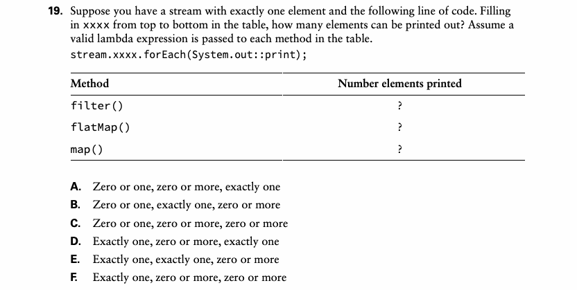

- **A.** Zero or one, zero or more, exactly one
- **B.** Zero or one, exactly one, zero or more
- **C.** Zero or one, zero or more, zero or more
- **D.** Exactly one, zero or more, exactly one
- **E.** Exactly one, exactly one, zero or more
- **F.** Exactly one, zero or more, zero or more

**Answer:** A

**Explanation:** The `filter()` method either passes along a given element or doesn’t, making options D, E, and F incorrect. The `flatMap()` method doesn’t pass along any elements for empty streams. For nonempty streams, it flattens the elements, allowing it to return zero or more elements. This makes option B incorrect. Finally, the `map()` method applies a oneto-one function for each element. It has to return exactly one element, so option A is the correct answer.

## 829-06-020

Assuming the proper generic types are used, which lambda expressions can be assigned to a `ToDoubleBiFunction` functional interface reference? (Choose three.)

- **A.** `(Integer a, Double b) -> {int c; return b;}`
- **B.** `(h,i) -> (long)h`
- **C.** `(String u, Object v) -> u.length()+v.length()`
- **D.** `(x,y) -> {int z=2; return y/z;}`
- **E.** `z -> z`
- **F.** `(double y, double z) -> y + z`

**Answer:** A, B, D

**Explanation:** To begin with, `ToDoubleBiFunction<T,U>` takes two generic inputs and returns a `double` value. Option A is correct because it takes an `Integer` and `Double` and returns a `Double` value that can be implicitly unboxed to `double`. Option B is correct because `long` can be implicitly cast to `double`. While we don’t know the data types for the input arguments, we know that some values, such as using `Integer` for both, will work. Option C cannot be assigned and does not compile because the variable `v` is of type `Object` and `Object` does not have a `length()` method. Option D is correct. The variable `y` could be declared `Double` in the generic argument to the functional interface, making `y/z` a `double` return value. Option E is not correct because the lambda only has one parameter. Finally, option F is incorrect because the interface uses the class `Double` rather than primitive `double`.

## 829-06-021

Given a `Stream<T>`, which method would you use to obtain an equivalent parallel `Stream<T>`?

- **A.** `getParallelStream()`
- **B.** `parallelStream()`
- **C.** `parallel()`
- **D.** `getParallel()`
- **E.** `parallels()`
- **F.** None of the above

**Answer:** C

**Explanation:** The correct method to obtain an equivalent parallel stream of an existing stream is `parallel()`, which is inherited by any class that implements `BaseStream<T>`. For this reason, option C is correct.

## 829-06-022

Rewrite this lambda that takes an `int n` using a constructor reference:

```java
n -> new ArrayList<>(n)
```

- **A.** `ArrayList::new`
- **B.** `ArrayList::new()`
- **C.** `ArrayList::new(n)`
- **D.** `ArrayList::new[n]`
- **E.** None of the above

**Answer:** A

**Explanation:** The lambda is a `Function<Integer, ArrayList>`. We need a constructor reference that uses the `new` keyword where a method name would normally go in a method reference. It can implicitly take zero or one parameter just like a method reference. In this case, we have one parameter, which gets passed to the constructor. Option A is correct. Options B, C, and D use syntax that is not supported with method references.

## 829-06-023

Ona `DoubleStream`,howmanyofthe `average()`,`count()`,`max()`,and `sum()`methodsreturnan `OptionalDouble`?

- **A.** None
- **B.** One
- **C.** Two
- **D.** Three
- **E.** Four

**Answer:** C

**Explanation:** The `average()` method returns an `OptionalDouble`. This reflects that it doesn’t make sense to calculate an average when you don’t have any numbers. Similarly, `max()` returns an `OptionalDouble` because there isn’t a maximum of no number. By contrast, counting without any numbers gives the `long` number `0` and summing gives the `double` number `0.0`. Since only two methods match the desired return type, option C is correct.

## 829-06-024

Which of the following are not functional interfaces in the `java.util.function` package? (Choose two.)

- **A.** `BiPredicate`
- **B.** `DoubleUnaryOperator`
- **C.** `IntUnaryOperator`
- **D.** `ObjectDoubleConsumer`
- **E.** `ObjectIntConsumer`
- **F.** `ToLongFunction`

**Answer:** D, E

**Explanation:** The `BiPredicate` interface takes two generic arguments and returns a `boolean` value. Next, `DoubleUnaryOperator` and `IntUnaryOperator` exist and transform values of type `double` and `int`, respectively. Last, `ToLongFunction` takes a generic argument and returns a `long` value. That leaves options D and E, which are the answers. Remember `Object` is abbreviated to `Obj` in the built-in functional interfaces.

## 829-06-025

Five of the following six methods always produce the same result whether they are executed on an ordered serial or parallel stream. Which one does not?

- **A.** `findAny()`
- **B.** `findFirst()`
- **C.** `limit()`
- **D.** `skip()`
- **E.** `anyMatch()`
- **F.** `count()`

**Answer:** A

**Explanation:** The `findAny()` method can return the first, last, or any element of the stream, regardless of whether the stream is serial or parallel. While on serial streams this is likely to be the first element in the stream, on parallel streams the result is less certain. For this reason, option A is the correct answer.

## 829-06-026

In a stream pipeline, which can return a value other than a `Stream`?

- **A.** Source
- **B.** Intermediate operation
- **C.** Terminal operation
- **D.** None of the above

**Answer:** C

**Explanation:** The result of the source and any intermediate operations are chained and eventually passed to the terminal operation. The terminal operation is where a result with a type other than stream is possible, making option C correct.

## 829-06-027

When working with a `Stream<String>`, which of these types can be returned from the `collect()` terminal operator by passing arguments to `Collectors.groupingBy()`?

- **A.** Only `Map<Boolean, HashSet<String>>`
- **B.** Only `Map<Integer, List<String>>`
- **C.** Both `Map<Boolean, HashSet<String>>` and `Map<Integer, List<String>>`
- **D.** Only `List<Integer>`
- **E.** Only `List<String>`
- **F.** Both `List<Integer>` and `List<String>`

**Answer:** C

**Explanation:** The `groupingBy()` collector always returns a `Map` (or a specific implementation class of `Map`), so options D, E, and F are incorrect. The other two are definitely possible. To get one, you can group using a `Function` that returns an `Integer` such as `s.collect(` `groupingBy(String::length))`. To get the other, you need to group using a `Function` that returns a `Boolean` and specify the type, such as `s`.`collect(` `groupingBy(String::isEmpty, toCollection(HashSet::new)))`. Therefore, option C is correct.

## 829-06-028

What does the following output?

```java
12: Set<String> set = new HashSet<>();
13: set.add("tire-");
14: List<String> list = new LinkedList<>();
15: Deque<String> queue = new ArrayDeque<>();
16: queue.push("wheel-");
17: Stream.of(set, list, queue)
18:    .flatMap(x -> x)
19:    .forEach(System.out::print);
```

- **A.** `[tire-][wheel-]`
- **B.** `tire-wheel-`
- **C.** `[wheel-][tire-]`
- **D.** `wheel-tire-`
- **E.** None of the above
- **F.** The code does not compile.

**Answer:** F

**Explanation:** The `flatMap()` method works with streams rather than collections. Line 18 is problematic because the return value is not a stream. Since the code does not compile, option F is correct.

## 829-06-029

What is the result of executing the following?

```java
var list = new LinkedList<>();
list.add("Archie");
list.add("X-Men");
Stream s = list.stream(); // line w
s.forEach(System.out::println);
s.forEach(System.out::println);
```

- **A.** The code runs without exception and prints two lines.
- **B.** The code runs without exception and prints four lines.
- **C.** The code does not compile due to line `w`.
- **D.** The code does not compile due to another line.
- **E.** The code compiles but throws an exception at runtime.

**Answer:** E

**Explanation:** Since no generic type is specified, `list` is a `LinkedList<Object>`. Line `w` compiles because no generic type is specified. However, Java allows you to operate on a stream only once. The final line of code throws an `IllegalStateException` because the stream has already been used up, making option E correct.

## 829-06-030

What is the output of the following application?

```java
package zoo;
import java.util.function.*;
   public class TicketTaker {
   private static int AT_CAPACITY = 100;
   public int takeTicket(int currentCount,
        IntUnaryOperator<Integer> counter) {
     return counter.applyAsInt(currentCount);
   }
  public static void main(String[] theater) {
    final TicketTaker bob = new TicketTaker();
    final int oldCount = 50;
    final int newCount = bob.takeTicket(oldCount,t -> {
       if(t>AT_CAPACITY) {
          throw new RuntimeException(
            "Sorry, max has been reached");
       }
       return t+1;
    });
    System.out.print(newCount);
  } }
```

- **A.** `50`
- **B.** `51`
- **C.** The code does not compile because of the lambda expression.
- **D.** The code does not compile for a different reason.
- **E.** The code compiles but prints an exception at runtime.

**Answer:** D

**Explanation:** The code does not compile, so options A, B, and E are incorrect. The `IntUnaryOperator` functional interface is not generic, so the argument `IntUnaryOperator<Integer>` in the `takeTicket()` does not compile, making option D the correct answer. The lambda expression compiles without issue, making option C incorrect. If the generic argument `<Integer>` was dropped from the argument declaration, the class would compile without issue and output `51` at runtime, which would make option B the correct answer.

## 829-06-031

What are the three requirements for performing a parallel reduction with the `collect()` method, which takes a `Collector` argument? (Choose three.)

- **A.** The `Collector` argument is marked concurrent.
- **B.** The elements of the stream implement the `Comparable` interface.
- **C.** The stream is parallel.
- **D.** The stream is thread-safe.
- **E.** The stream or `Collector` is marked unordered.
- **F.** The stream is not a primitive stream.

**Answer:** A, C, E

**Explanation:** Options A, C, and E are correct because they are the precise requirements for Java to perform a concurrent reduction using the `collect()` method, which takes a `Collector` argument. Recall from your studies that a `Collector` is considered concurrent and unordered if it has the `Collector.Characteristics` enum values `CONCURRENT` and `UNORDERED`, respectively. The rest of the options are not required for a parallel reduction.

## 829-06-032

Which are true about the following code? (Choose two.)

```java
27: public static void main(String[] s) {
28:    Predicate dash = c -> c.startsWith("-");
29:    System.out.println(dash.test("–"));
30:
31:    Consumer clear = x -> System.out.println(x);
32:    clear.accept("pink");
33:
34:    Comparator<String> c = (String s, String t) -> 0;
35:    System.out.println(c.compare("s", "t"));
36: }
```

- **A.** The code compiles successfully.
- **B.** One line does not compile.
- **C.** Two lines do not compile.
- **D.** Three lines do not compile.
- **E.** If any lines that do not compile are fixed, the output includes `pink`.
- **F.** If any lines that do not compile are fixed, the output does not include `pink`.

**Answer:** C, E

**Explanation:** While it is common for a `Predicate` to have a generic type, it is not required. However, it is treated like a `Predicate` of type `Object` if the generic type is missing. Since `startsWith()` does not exist on `Object`, line 28 does not compile. Line 34 would be a correct lambda declaration in isolation. However, it uses the variable `s`, which is already taken by the `main()` method parameter. This causes a compiler error on line 34. These are the only two compiler errors, making option C correct. If `Predicate` were changed to `Predicate<String>` and lambda variable were changed to `x`, then the `Consumer` would in fact print `pink`, making option E the other answer.

## 829-06-033

Which functional interface returns a primitive value?

- **A.** `BiPredicate`
- **B.** `CharSupplier`
- **C.** `LongFunction`
- **D.** `UnaryOperator`
- **E.** `TriDoublePredicate`
- **F.** None of the above

**Answer:** A

**Explanation:** Option A is the correct answer because `BiPredicate` takes two generic types and returns a primitive `boolean` value. Options B and E are incorrect, since `CharSupplier` and `TriDoublePredicate` do not exist. Option C is also incorrect, since `LongFunction` takes a primitive `long` value and returns a generic type. Finally, option D is incorrect because `UnaryOperator` takes a generic type and returns a generic value.

## 829-06-034

Given the following code snippet, which lambda expressions are the best choices for an accumulator? (Choose two.)

```java
import java.util.*;
import java.util.function.*;
public class GoodAccumulator {
   int i = 0;
   List<String> words = new ArrayList<>();
   public void test() {
     BiFunction<Integer,Integer,Integer> x = ___________ ;
     System.out.print(List.of(1,2,3,4,5)
        .parallelStream()
        .reduce(0, x, (s1, s2) -> s1 + s2));
   } }
```

- **A.** `(a,b) -> (a-b)`
- **B.** `(a,b) -> 5`
- **C.** `(a,b) -> i++`
- **D.** `(a,b) -> {words.add("awesome"); return 0;}`
- **E.** `(a,b) -> {return 0;}`
- **F.** `(a,b) -> words.add("awesome")`

**Answer:** B, E

**Explanation:** An accumulator in a serial or parallel reduction should be associative and stateless. In a parallel reduction, problematic accumulators tend to produce more visible errors. Option A is not associative, since `(a-b)-c` is not the same as `a-(b-c)` for all values `a`, `b`, and `c`. Options C and D are incorrect because they represent stateful lambda expressions, which should be avoided especially on parallel streams. In particular, option C could return different results each time it is run. Option F doesn’t even compile, since the return type is a `boolean`, not an `Integer`. That leaves us with the correct answers, options B and E. While these accumulators may not seem useful, they are both stateless and associative, which meets the qualifications for performing a reduction.

## 829-06-035

Fill in the blanks so that both methods produce the same output for all inputs.

```java
 private static void longer(Optional<Boolean> opt) {
    if (opt. __________ ())
       System.out.println("run: " + opt.get());
 }
private static void shorter(Optional<Boolean> opt) {
   opt.map(x -> "run: " + x)
     . __________ (System.out::println);
}
```

- **A.** `isNotNull`, `isPresent`
- **B.** `ifPresent`, `isPresent`
- **C.** `isPresent`, `forEach`
- **D.** `isPresent`, `ifPresent`
- **E.** None of the above

**Answer:** D

**Explanation:** Options A and C do not compile because there are no `isNotNull()` or `forEach()` methods in the `Optional` class. The `Optional` class does have an `isPresent()` method that doesn’t take any parameters, making option B incorrect since it is used with a parameter. The method returns a `boolean` and is commonly used in `if` statements. There is also an `ifPresent()` method that takes a `Consumer` parameter and runs it only if the `Optional` is nonempty. Therefore, option D is correct.

## 829-06-036

Rewrite this lambda using a method reference:

```java
() -> Math.random()
```

- **A.** `Math.random`
- **B.** `Math::random`
- **C.** `Math::random()`
- **D.** `java.lang::Math.random`
- **E.** None of the above

**Answer:** B

**Explanation:** The lambda is a `Supplier<Double>`. Since the `random()` method is `static`, we need a `static` method reference. It uses `::` to separate the class name and method name. Option B is correct. Options A, C, and D use syntax that is not supported with method references.

## 829-06-037

Which operation can occur more than once in a stream pipeline?

- **A.** Origin
- **B.** Sink
- **C.** Source
- **D.** Intermediate operation
- **E.** Terminal operation
- **F.** None of the above

**Answer:** D

**Explanation:** Options A and B are incorrect because they are not operations in a stream pipeline. A source and the terminal operation are required parts of a stream pipeline and must occur exactly once. The intermediate operation is optional. It can appear zero or more times. Since more than one falls within zero or more, option D is correct.

## 829-06-038

What is true of the following code?

```java
21: var list = List.of('c', 'b', 'a');
22:
23: list.stream()
24:    .sorted()
25:    .findAny()
26:    .ifPresent(System.out::println);
27:
28: System.out.println(list.stream().sorted().findFirst());
```

- **A.** Both streams are guaranteed to print the single character `a`.
- **B.** Both streams will print a single character of `a`, `b`, or `c`.
- **C.** Only one stream is guaranteed to print the single character `a`.
- **D.** Only one stream will print a single character of `a`, `b`, or `c`.
- **E.** The code does not compile.

**Answer:** D

**Explanation:** All of the code compiles. The first stream source has three elements. The intermediate operations both sort the elements of this stream and then we request one from `findAny()`. The `findAny()` method is not guaranteed to return a specific element. Since we are not using parallelization, it is highly likely that the code will print `a`. However, you need to know this is not guaranteed. Additionally, the stream on line 28 prints `Optional[a]`, `Optional[b]`, or `Optional[c]`. Since only lines 23–26 print a single character, option D is the answer.

## 829-06-039

Which functional interface, when entered into the following blank, allows the class to compile?

```java
package groceries;
import java.util.*;
import java.util.function.*;
public class Market {
   private static void checkPrices(List<Double> prices,
                     scanner) {
     prices.forEach(scanner);
   }
   public static void main(String[] right) {
     List<Double> prices = List.of(1.2, 6.5, 3.0);
     checkPrices(prices,
           p -> {
              String result = p<5 ? "Correct" : "Too high";
              System.out.println(result);
           });
   } }
```

- **A.** `Consumer`
- **B.** `Consumer<Integer>`
- **C.** `DoubleConsumer`
- **D.** `Supplier<Double>`
- **E.** None of the above

**Answer:** E

**Explanation:** First, the `forEach()` method requires a `Consumer` instance. Option D can be immediately discarded because `Supplier<Double>` does not inherit `Consumer`. For this same reason, option C is also incorrect. `DoubleConsumer` does not inherit from `Consumer`. In this manner, primitive functional interfaces cannot be used in the `forEach()` method. Option A seems correct, since `forEach()` does take a `Consumer` instance, but it is missing a generic argument. Without the generic argument, the lambda expression does not compile because the expression `p<5` cannot be applied to an `Object`. Option B is also close. However, a `Double` cannot be passed to an `Integer`. The correct functional interface is `Consumer<Double>`, and since that is not available, option E is the correct answer.

## 829-06-040

Which of the following is not a valid lambda expression?

- **A.** `(Integer j, k) -> 5`
- **B.** `(p,q) -> p+q`
- **C.** `(Integer x, Integer y) -> x*y`
- **D.** `(left,right) -> {return "null";}`
- **E.** All of these are valid.

**Answer:** A

**Explanation:** Option A is the invalid lambda expression because the type is specified for the variable `j`, but not the variable `k`. The rest of the options are valid lambda expressions. To be a valid lambda expression, the type must be specified for all of the variables, as in option C, or none of them, as in options B and D.

## 829-06-041

What is the output of the following application?

```java
import java.util.*;
public class Concat {
   public String concat1(List<String> values) {
     return values.parallelStream()
        .reduce("a",
           (x,y)->x+y,
           String::concat);
   }
  public String concat2(List<String> values) {
    return values.parallelStream()
       .reduce((w,z)->z+w).get();
  }
  public static void main(String[] questions) {
    Concat c = new Concat();
    var list = List.of("Cat","Hat");
    String x = c.concat1(list);
    String y = c.concat2(list);
    System.out.print(x+" "+y);
  } }
```

- **A.** `CatHat CatHat`
- **B.** `aCataHat HatCat`
- **C.** The code does not compile because the stream in `concat1()` returns an `Optional`.
- **D.** The code does not compile for a different reason.
- **E.** An exception is printed at runtime.
- **F.** None of the above.

**Answer:** B

**Explanation:** The code compiles and runs without issue. The three-argument `reduce()` method returns a generic type, while the one-argument `reduce()` method returns an `Optional`. The `concat1()` method is passed an identity `"a"`, which it applies to each element, resulting in the reduction to `aCataHat`. The lambda expression in the `concat2()` method reverses the order of its inputs, leading to a value of `HatCat`. For these reasons, option B is the correct answer.

## 829-06-042

Which of the following three functional interfaces is not equivalent to the other two?

- **A.** `BiFunction<Double,Double,Double>`
- **B.** `BinaryOperator<Double>`
- **C.** `DoubleFunction<Double>`
- **D.** None of the above. All three are equivalent.

**Answer:** C

**Explanation:** Options A and B take two `Double` input arguments and return a `Double` value, making them equivalent to each other. On the other hand, option C takes a single `double` value and returns a `Double` value. For this reason, it is different from the other two, making option C correct.

## 829-06-043

Given the following code snippet, what changes should be made for the JVM to correctly process this as a concurrent reduction? (Choose two.)

```java
var w = Stream.of("c","a","t")
   .collect(HashSet::new, Set::add, Set::addAll);
System.out.println(w);
```

- **A.** Replace `HashSet` with `LinkedHashSet`.
- **B.** Mark the stream parallel.
- **C.** Remove the second argument of the `collect()` method.
- **D.** Remove the third argument of the `collect()` method.
- **E.** Replace `HashSet` with `ConcurrentSkipListSet`.
- **F.** Mark the stream unordered.

**Answer:** B, E

**Explanation:** For a concurrent reduction, the underlying type should be a thread-safe collection. For this reason, option A is incorrect and option E is correct. The streams must all be parallel, making option B correct and option F incorrect. Options C and D are incorrect, as there is no two-argument version of `collect()` within the `Stream` interface.

## 829-06-044

Fill in the blank so this code outputs three lines:

```java
var list = new ArrayList<String>();
list.add("Atlanta");
list.add("Chicago");
 list.add("New York");
 list.stream()
    .filter( __________ )
    .forEach(System.out::println);
```

- **A.** `String::isEmpty`
- **B.** ! `String::isEmpty`
- **C.** `String::! isEmpty`
- **D.** `String::isNotEmpty`
- **E.** None of the above

**Answer:** E

**Explanation:** Option A is the only one of the three options to compile. However, it results in no lines being output since none of the three strings is empty. Options B and C do not even compile because a method reference cannot have an operator next to it. Option D does not compile because `String` does not have an `isNotEmpty()` method. Therefore, option E is correct.

## 829-06-045

What does the following output?

```java
var chars = Stream.generate(() -> 'a');
chars.filter(c -> c < 'b')
    .sorted()
    .findFirst()
    .ifPresent(System.out::print);
```

- **A.** `a`
- **B.** The code runs successfully without any output.
- **C.** The code does not complete.
- **D.** None of the above.

**Answer:** C

**Explanation:** The source of this stream is infinite. Sorting something infinite never finishes, so the stream pipeline never completes and option C is the answer.

## 829-06-046

What is the expected output of the following code snippet?

```java
Stream.iterate(1, x -> x + 1)
   .limit(5)
   .skip(2)
   .peek(System.out::print)
   .collect(Collectors.toList())
   .forEach(System.out::print);
```

- **A.** It does not compile.
- **B.** It throws an exception at runtime.
- **C.** It does not print any output at runtime.
- **D.** `345345`
- **E.** `334455`
- **F.** The behavior of the code snippet cannot be determined until runtime.

**Answer:** D

**Explanation:** The code compiles and does not throw any exceptions at runtime, so options A and B are incorrect. The code snippet is serial, by default, so the order is predictable, making option F incorrect. The `peek()` method executes on each member of the pipeline, printing five numbers as the elements are then collected into a `List`, which gives us `345`. They are then printed again, making the final output `345345` and option D correct.

## 829-06-047

What is the output of the following program?

```java
package ai;
import java.util.function.*;
public class Android {
  public void wakeUp(Supplier supplier) {            // d1
    supplier.get();
  }
  public static void main(String[] electricSheep) {
    Android data = new Android();
    data.wakeUp(() -> System.out.print("Started!")); // d2
  } }
```

- **A.** `Started!`
- **B.** The code does not compile because of line `d1` only.
- **C.** The code does not compile because of line `d2` only.
- **D.** The code does not compile because of lines `d1` and `d2`.
- **E.** The code does not compile for another reason.

**Answer:** C

**Explanation:** The `Supplier` functional interface normally takes a generic argument, although generic types are not strictly required since they are removed by the compiler. Therefore, line `d1` compiles while triggering a compiler warning. On the other hand, line `d2` does cause a compiler error, because the lambda expression does not return a value. Therefore, it is not compatible with `Supplier`, making option C the correct answer.

## 829-06-048

Fill in the blanks so this code prints `*8.0-8.0*` (Choose two.)

```java
var ints = IntStream.of(6, 10);
var longs = ints.mapToLong(i -> i);
var first = longs. ____________ ;
var moreLongs = LongStream.of(6, 10);
var stats = moreLongs.summaryStatistics();
var second = stats. __________________ ;
System.out.println("*" + first + "-" + second + "*");
```

- **A.** `averageAsDouble()` in the first blank
- **B.** `average().getAsDouble()` in the first blank
- **C.** `getAverage().get()` in the first blank
- **D.** `average()` in the second blank
- **E.** `average().get()` in the second blank
- **F.** `getAverage()` in the second blank

**Answer:** B, F

**Explanation:** Primitive streams, like `LongStream`, declare an `average()` method that returns an `OptionalDouble` object. This object declares a `getAsDouble()` method rather than a `get()` method. Therefore, option B is correct. By contrast, the summary statistics classes provide getters in order to access the data. The `getAverage()` method returns a `double` and not an `OptionalDouble`, which makes option F correct.

## 829-06-049

Starting with `DoubleConsumer` and going downward, fill in the missing values for the table. Functional interface # Parameters in method signature

```java
DoubleConsumer
IntFunction
LongSupplier
ObjDoubleConsumer
```

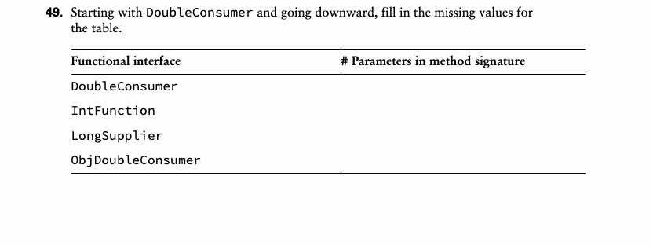

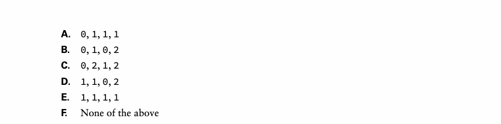

- **A.** `0`, `1`, `1`, `1`
- **B.** `0`, `1`, `0`, `2`
- **C.** `0`, `2`, `1`, `2`
- **D.** `1`, `1`, `0`, `2`
- **E.** `1`, `1`, `1`, `1`
- **F.** None of the above

**Answer:** D

**Explanation:** Remember that all `Supplier` interfaces take zero parameters. For this reason, the third value in the table is `0`, making options A, C, and E incorrect. Next, `DoubleConsumer` and `IntFunction` each take one value, `double` and `int`, respectively. On the other hand, `ObjDoubleConsumer` takes two values, a generic value and a `double`, and returns `void`. For this reason, option D is correct, and option B is incorrect.

## 829-06-050

Starting with `DoubleConsumer` and going downward, fill in the values for the table. For the following choices, assume `R` is a generic type. Functional interface Return type

```java
DoubleConsumer
IntFunction
LongSupplier
ObjDoubleConsumer
```

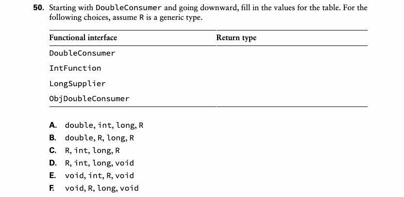

- **A.** `double`, `int`, `long`, `R`
- **B.** `double`, `R`, `long`, `R`
- **C.** `R`, `int`, `long`, `R`
- **D.** `R`, `int`, `long`, `void`
- **E.** `void`, `int`, `R`, `void`
- **F.** `void`, `R`, `long`, `void`

**Answer:** F

**Explanation:** All `Consumer` functional interfaces have a `void` return type. For this reason, the first and last values in the table are both `void`, making options A, B, and C incorrect. `IntFunction` takes an `int` and returns a generic value, ruling out option D. Finally, `LongSupplier` does not take any values and returns a long value. For this reason, option E is incorrect, and option F is correct.

## 829-06-051

What is a possible output of the following application?

```java
package salvage;
import java.util.*;
import java.util.stream.*;
public record Car(String model, int year) {
   @Override public String toString() {return model;}
   public static void main(String[] make) {
     var cars = new ArrayList<Car>();
     cars.add(new Car("Mustang",1967));
     cars.add(new Car("Thunderbird",1967));
     cars.add(new Car("Escort",1975));
     var map = cars
        .stream()
        .collect(
          Collectors.groupingByConcurrent(Car::year));
    System.out.print(map);
  } }
```

- **A.** `{1975=[Escort], 1967=[Mustang, Thunderbird]}`
- **B.** `{Escort=[1975], Thunderbird=[1967], Mustang=[1967]}`
- **C.** The code does not compile.
- **D.** The code hangs indefinitely at runtime.
- **E.** The application throws an exception at runtime because the stream is not parallel.
- **F.** None of the above.

**Answer:** A

**Explanation:** The code compiles and runs without issue. The JVM will fall back to a single-threaded process if all of the conditions for performing the parallel reduction are not met. The stream used in the `main()` method is not parallel, but the `groupingByConcurrent()` method can still be applied without throwing an exception at runtime. Although performance will suffer from not using a parallel stream, the application will still process the results correctly. Since the process groups the data by year, option A is the correct answer.

## 829-06-052

How many lines does this code output?

```java
var list = new LinkedList<String>();
list.add("Archie");
list.add("X-Men");
list.stream().forEach(System.out.println);
list.stream().forEach(System.out.println);
```

- **A.** Two
- **B.** Four
- **C.** The code does not compile.
- **D.** The code compiles but throws an exception at runtime.

**Answer:** C

**Explanation:** This code is almost correct. Calling two different streams is allowed. The code attempts to use a method reference when calling the `forEach()` method. However, it does not use the right syntax for a method reference. A double colon needs to be used. If the code were changed to `System.out::println`, it would print two lines for each call, for a total of four lines. Since it does not compile, option C is correct.

## 829-06-053

Which lambda expression can replace the instance of `new BiologyMaterial()` on line `h1` and produce the same results under various inputted values?

```java
package university;
@FunctionalInterface interface Study {
   abstract int learn(String subject, int duration);
}
class BiologyMaterial implements Study {
   @Override public int learn(String subject, int duration) {
     if(subject == null)
        return duration;
     else
        return duration+1;
   } }
public class Scientist {
   public static void main(String[] courses) {
     final Study s = new BiologyMaterial();     // h1
     System.out.print(s.learn(courses[0],
        Integer.parseInt(courses[1])));
    } }
```

- **A.** `(p,q) -> q==null ? p : p+1`
- **B.** `(c,d) -> {int d=1; return c!=null ? d+1 : d;}`
- **C.** `(x,y) -> {return x==null ? y : y+1;}`
- **D.** `(a,b) -> 1`
- **E.** None of the above

**Answer:** C

**Explanation:** First, option A does not compile since the variables `p` and `q` are reversed, making the return type of the method and usage of operators invalid. The first argument, `p`, is a `String` and `q` is an `int`, but the lambda expression reverses them, and the code does not compile. Option B also does not compile. The variable `d` is declared twice, first in the lambda argument list and then in the body of the lambda expression. The second declaration in the body of the lambda expression causes the compiler to generate a duplicate local variable message. Note that other than it being used twice, the expression is valid; the ternary operator is functionally equivalent to the `learn()` method in the `BiologyMaterial` class. Option C is the correct answer since it compiles and handles the input in the same way as the `learn()` method in the `BiologyMaterial` class. Option D compiles but does not return the same result.

## 829-06-054

Which are true of the following? (Choose two.)

```java
var s = Stream.of("speak", "bark", "meow", "growl");
BinaryOperator<String> merge = (a, b) -> a;
var map = s.collect(Collectors.toMap(
   String::length, k -> k, merge));
System.out.println(map.size() + " " + map.get(4));
```

- **A.** The output is `2 bark`.
- **B.** The output is `2 meow`.
- **C.** The output is `4 bark`.
- **D.** The output is `4 meow`.
- **E.** If `"meow"` were replaced by a `null` reference, the output would remain the same.
- **F.** If `"meow"` were replaced by a `null` reference, the output would change.

**Answer:** A, F

**Explanation:** This code does compile. Remember that imports are implied, including the `static` import for `Collectors`. The collector tries to use the number of characters in each stream element as the key in a map. This works fine for the first two elements, `speak` and `bark`, because they are of length 5 and 4, respectively. When it gets to `meow`, it sees another key of 4. The merge function says to use the first one, so it chooses `bark` for the value. Similarly, `growl` is five characters, but the first value of `speak` is used. There are only two distinct lengths, so option A is correct. If the stream had a `null` instead of `"meow"`, then the code would throw a `NullPointerException` since we need to check the length of the `String` to determine which part of the `Map` it goes in. Since you cannot call a method on `null`, option F is also correct.

## 829-06-055

Which statement about a source in a `Stream` is true?

- **A.** The source is mandatory in a stream pipeline.
- **B.** The source is only allowed to return primitives.
- **C.** The source must be retrieved by calling the `stream()` method.
- **D.** The source must return a finite number of elements.
- **E.** None of the above.

**Answer:** A

**Explanation:** Option A is correct as the source and terminal operation are mandatory parts of a stream pipeline. Option B is incorrect because a `Stream` must return objects. Specialized interfaces like `IntStream` are needed to return primitives. Option C is incorrect because `Stream` has methods such as `of()` and `iterate()` that return a `Stream`. Option D is incorrect because infinite streams are possible.

## 829-06-056

Given an `IntStream`, which method would you use to obtain an equivalent parallel `Stream<T>`?

- **A.** `parallel()`
- **B.** `parallelStream()`
- **C.** `parallels()`
- **D.** `getParallel()`
- **E.** `getParallelStream()`
- **F.** None of the above

**Answer:** F

**Explanation:** Trick question! The correct method to obtain an equivalent parallel stream of an existing `IntStream` is `parallel()`, but for an `IntStream` this returns another `IntStream`, not a generic `Stream<T>`. The correct solution would be to call `boxed().parallel()`, but since this isn’t available, option F is correct.

## 829-06-057

Which can fill in the blank to have the code print `true`?

```java
var stream = Stream.iterate(1, i -> i+1);
var b = stream. __________ (i -> i > 5);
System.out.println(b);
```

- **A.** `anyMatch`
- **B.** `allMatch`
- **C.** `findAny`
- **D.** `findFirst`
- **E.** `noneMatch`
- **F.** None of the above

**Answer:** A

**Explanation:** We can rule out options C and D because they do not take any parameters, so they do not compile. This code generates an infinite stream of integers: 1, 2, 3, 4, 5, 6, 7, etc. The `Predicate` checks if the element is greater than 5. With `anyMatch()`, the stream pipeline ends once element 6 is hit and the code prints `true`. For the `allMatch()` operator, it sees that the first element in the stream does not match and the code prints `false`. Similarly, the `noneMatch()` operator gets to the point where `i` is `6` and returns `false` because there is a match. Therefore, option A is correct.

## 829-06-058

Which of the following fills in the blank so that the code outputs `weasel` but uses a poor practice?

```java
import java.util.*;
public class Cheater {
   int count = 0;
   public void sneak(Collection<String> coll) {
     coll.stream(). ____________________________ ;
   }
   public static void main(String[] args) {
     var c = new Cheater();
     c.sneak(Arrays.asList("weasel"));
  } }
```

- **A.** `peek(System.out::println)`
- **B.** `peek(System.out::println).findFirst()`
- **C.** `peek(r -> System.out.println(r)).findFirst()`
- **D.** `peek(r -> {count++; System.out.println(r); }).findFirst()`
- **E.** None of the above compile.
- **F.** None of these are bad practice.

**Answer:** D

**Explanation:** Option A is incorrect because it doesn’t print out any text. The `peek()` method is an intermediate operation. Since there is no terminal operation, the stream pipeline is not executed, so the `peek()` method is never executed, and nothing is printed. Options B and C are incorrect because they correctly output one line using a method reference and lambda, respectively, and don’t use any bad practices. Option D is the correct answer. It does output one line. However, it is bad practice to have a `peek()` method that has side effects like modifying a variable.

## 829-06-059

What is the output of the following application?

```java
package nesting;
import java.util.function.*;
public class Doll {
   private int layer;
   public Doll(int layer) {
     super();
     this.layer = layer;
   }
    public static void open(
       UnaryOperator<Doll> task, Doll doll) {
       while((doll = task.accept(doll)) != null)
         System.out.print("X");
    }
    public static void main(String[] wood) {
       open(s -> {
         if(s.layer<=0) return null;
         else return new Doll(s.layer--);
       }, new Doll(5));
    } }
```

- **A.** `XXXXX`
- **B.** The code does not compile because of the lambda expression in the `main()` method.
- **C.** The code does not compile for a different reason.
- **D.** The code compiles but produces an infinite loop at runtime.
- **E.** The code compiles but throws an exception at runtime.

**Answer:** C

**Explanation:** The lambda expression compiles without issue, making option B incorrect. The `task` variable is of type `UnaryOperator<Doll>`, with the abstract method `apply()`. There is no `accept()` method defined on that interface, therefore the code does not compile, and option C is the correct answer.

## 829-06-060

What is the expected output of the following code snippet?

```java
Random r = new Random();
Stream.generate(r::nextDouble)
   .skip(2)
   .limit(4)
   .sorted()
   .peek(System.out::println)
   .forEach(System.out::println);
```

- **A.** It does not compile.
- **B.** It throws an exception at runtime.
- **C.** It does not print any output at runtime.
- **D.** It prints four numbers twice each.
- **E.** It can print up to eight distinct numbers.
- **F.** The behavior of the code snippet cannot be determined until runtime.

**Answer:** D

**Explanation:** The code compiles and does not throw any exceptions at runtime, so options A and B are incorrect. As an element goes through the pipeline, it is printed once by the `peek()` method, then once by the `forEach()` method. For example, `0.1 0.1 0.54 0.54 0.6 0.6 0.3` `0.3` is a possible output from this code. For this reason, option D is correct.

## 829-06-061

Which statements about the `findAny()` method applied to a stream are correct? (Choose three.)

- **A.** It always returns the first element on an ordered serial stream.
- **B.** It may return any element on an ordered serial stream.
- **C.** It always returns the first element on an unordered stream.
- **D.** It may return any element on an unordered stream.
- **E.** It always returns the first element on an ordered parallel stream.
- **F.** It may return any element on an ordered parallel stream.

**Answer:** B, D, F

**Explanation:** The `findAny()` method is capable of returning any element of the stream regardless of whether it is serial, parallel, ordered, or unordered. For this reason, options B, D, and F are correct. Option C is actually invalid, as an unordered stream does not have a first element.

## 829-06-062

Which functional interface has a `get()` method?

- **A.** `Consumer`
- **B.** `Function`
- **C.** `Supplier`
- **D.** `UnaryOperator`
- **E.** `Producer`
- **F.** None of the above

**Answer:** C

**Explanation:** To begin with, `Consumer` uses `accept()`, making option A incorrect. Next, `Function` and `UnaryOperator` use `apply()`, making options B and D, respectively, incorrect. Option E is also incorrect, as there is no `Producer` functional interface. Finally, `Supplier` uses `get()`, making option C the correct answer.

## 829-06-063

Why can’t `String::charAt` be used as a method reference within a `Function`?

- **A.** Method references can only be used on `static` methods.
- **B.** The `charAt()` method takes an `int` rather than `Integer` parameter.
- **C.** The method reference is not compatible with `Function`.
- **D.** The method reference syntax is illegal.
- **E.** There is no `charAt()` method in the `String` class.
- **F.** None of the above.

**Answer:** C

**Explanation:** Option D is incorrect as the syntax is fine. Option E is incorrect because there is a `charAt()` instance method. While option B is correct that the method takes an `int` parameter, autoboxing would take care of conversion for us if there were no other problems. So option B is not the answer either. Option A is not true because there are constructor and instance method references. This method reference could be assigned to `BiFunction<String, Integer, Character>`. However, it cannot be assigned to a `Function`. This makes option C the correct answer.

## 829-06-064

Given the following independent stream operations, which statements are correct? (Choose three.)

```java
List.of(2,4,6,8)
   .parallel()
   .parallelStream()
   .forEach(System.out::print);
List.of(2,4,6,8)
   .parallelStream()
   .parallel()
   .forEach(System.out::print);
List.of(2,4,6,8)
   .parallelStream()
   .parallel().parallel().parallel()
   .forEach(System.out::print);
```

- **A.** The first stream operation compiles.
- **B.** The second stream operation compiles.
- **C.** The third stream operation compiles.
- **D.** None of the stream operations that compile produce an exception at runtime.
- **E.** At least one of the stream operations that compiles produces an exception at runtime.
- **F.** The output of the stream operations that compile is consistent between executions.

**Answer:** B, C, D

**Explanation:** While the second and third stream operations compile, the first does not. The `parallel()` method should be applied to a stream, while the `parallelStream()` method should be applied to a `Collection<E>`. For this reason, option A is incorrect, and options B and C are correct. Neither the second nor the third stream operation is expected to produce an exception at runtime, making option D correct and option E incorrect. Note that calling `parallel()` on an already parallel stream is unnecessary but allowed. Finally, the output of the second and third stream operations will vary at runtime since the streams are parallel, making option F incorrect.

## 829-06-065

Which method reference can replace the lambda on the first line so the output is the same?

```java
BiPredicate<String, String> pred = (a, b) -> a.contains(b);
System.out.println(pred.test("fish", "is"));
```

- **A.** `a::contains(b)`
- **B.** `a::contains`
- **C.** `String::contains(b)`
- **D.** `String::contains`
- **E.** The supplied code does not compile.
- **F.** None of the above.

**Answer:** D

**Explanation:** Since the code uses a `BiPredicate`, it takes two parameters in the `test()` call. The first is the instance of `String` and the second is the substring value to check. Since both parameters are passed in, we use the type of `String` in the method reference, making option D the correct answer.

## 829-06-066

What is the result of the following?

```java
import static java.util.stream.Collectors.*;
import java.util.stream.Stream;
public class Speaking {
   record Ballot(String name, int judgeNumber, int score) {}
   public static void main(String[] args) {
     Stream<Ballot> ballots = Stream.of(
        new Ballot("Mario", 1, 10),
        new Ballot("Christina", 1, 8),
        new Ballot("Mario", 2, 9),
        new Ballot("Christina", 2, 8)
     );
     var scores = ballots.collect(
        groupingBy(Ballot::name,
        summingInt(Ballot::score)));
     System.out.println(scores.get("Mario"));
   } }
```

- **A.** `2`
- **B.** `18`
- **C.** `19`
- **D.** `110`
- **E.** The code does not compile.

**Answer:** C

**Explanation:** This code compiles. It creates a stream of `Ballot` objects. Then it creates a map with the contestant’s name as the key and the sum of the scores as the value. For `Mario`, this is `10` + `9`, or `19`, so option C is correct.

## 829-06-067

Which of the following can fill in the blank to have the code print `44`?

```java
var stream = Stream.of("base", "ball");
stream. ____ (s -> s.length()).forEach(System.out::print);
```

- **A.** Only `map`
- **B.** Only `mapToInt`
- **C.** Only `mapToObject`
- **D.** Both `map` and `mapToInt`
- **E.** Both `map` and `mapToObject`
- **F.** `map`, `mapToInt`, and `mapToObject`

**Answer:** D

**Explanation:** The `map()` method can fill in the blank. The lambda converts a `String` to an `int`, and Java uses autoboxing to turn that into an `Integer`. The `mapToInt()` method can also fill in the blank, and Java doesn’t even need to autobox. There isn’t a `mapToObject()` in the stream API. Note there is a similarly named `mapToObj()` method on `IntStream`. Since both `map()` and `mapToInt()` work here, option D is correct.

## 829-06-068

What does the following do? (Choose two.)

```java
public class Player {
   interface Basket {
     boolean needToAim(double angle);
   }
   static void prepare(double angle, Basket t) {
     boolean ready = t.needToAim(angle);     // k1
     System.out.println(ready);
   }
   public static void main(String[] args) {
     prepare(45, d -> d > 5 || d < -5);     // k2
   } }
```

- **A.** If any compiler errors are fixed, it prints `true`.
- **B.** If any compiler errors are fixed, it prints `false`.
- **C.** It compiles without issue.
- **D.** It doesn’t compile due to line `k1`.
- **E.** It doesn’t compile due to line `k2`.

**Answer:** A, C

**Explanation:** This is a correct example of code that uses a lambda. The interface has a single abstract method. The lambda correctly takes one `double` parameter and returns a `boolean`. This matches the interface. The lambda syntax is correct. Since it compiles, option C is correct. Finally, option A is correct because 45 is greater than 5.

## 829-06-069

Which statements about the following code are correct?

```java
var data = List.of(1,2,3);
int f = data.parallelStream()
   .reduce(1, (a,b) -> a+b, (a,b) -> a+b);
System.out.println(f);
```

- **A.** It consistently prints `6`.
- **B.** It consistently prints `7`.
- **C.** It consistently prints another value.
- **D.** It does not consistently print the same value on every execution.
- **E.** It compiles but throws an exception at runtime.
- **F.** None of the above.

**Answer:** C

**Explanation:** The reduction is parallel, but since the accumulator and combiner are well-behaved (stateless and associative), the result is consistent, making option D incorrect. The identity is `1`, which is applied to every element, meaning the operation sums the values `(1+1)`, `(1+2)`, and `(1+3)`. For this reason, `9` is consistently printed at runtime, making option C correct.

## 829-06-070

What is the result of the following?

```java
11: var s1 = IntStream.empty();
12: System.out.print(s1.average().getAsDouble());
13:
14: var s2 = IntStream.of(-1,0, 1);
15: System.out.print(s2.average().getAsDouble());
```

- **A.** Both statements print `0`.
- **B.** Both statements print `0.0`.
- **C.** The statements print different values.
- **D.** The code does not compile.
- **E.** The code compiles but throws an exception at runtime.

**Answer:** E

**Explanation:** The `average()` method returns an `OptionalDouble`. This interface has a `getAsDouble()` method rather than a `get()` method, so the code does compile. However, the stream is empty, so the optional is also empty. When trying to get the value on line 12, the code throws a `NoSuchElementException`, making option E correct.

## 829-06-071

Which lambdas can replace the method references in this code? (Choose two.)

```java
11: Stream.of("fish", "mammal", "amphibian")
12:    .map(String::length)
13:    .findFirst()
14:    .ifPresent(System.out::println);
```

- **A.** `x.length()` on line 12
- **B.** `x -> x.length()` on line 12
- **C.** `x -> x::length` on line 12
- **D.** `System.out.println(s)` on line 14
- **E.** `s -> System.out.println(s)` on line 14
- **F.** `s -> System.out::println` on line 14

**Answer:** B, E

**Explanation:** Options A and D are incorrect since they are missing the arrow (`->`), which makes them lambdas. Options C and F are incorrect, as they try to mix lambdas and method references. This leaves options B and E as the answers.

## 829-06-072

In the image, what collector can turn the stream at left to the `Map` at right? Sree Ken true Sree Kumar Kumar false Ye Ken Ye Dan Dan

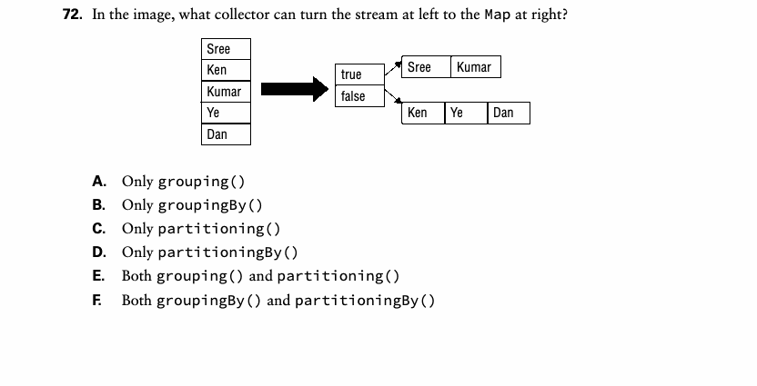


- **A.** Only `grouping()`
- **B.** Only `groupingBy()`
- **C.** Only `partitioning()`
- **D.** Only `partitioningBy()`
- **E.** Both `grouping()` and `partitioning()`
- **F.** Both `groupingBy()` and `partitioningBy()`

**Answer:** F

**Explanation:** Both `Collectors.groupingBy()` and `Collectors.partitioningBy()` are useful for turning a stream into a `Map`. The other two methods do not exist. The `partitioningBy()` method automatically groups using a `Boolean` key. However, we can also have a `Boolean` key with `groupingBy()`. For example, we could write `s -> s.length() > 3`. Therefore, option F is correct.

## 829-06-073

Which expression is compatible with the `IntSupplier` functional interface?

- **A.** `() -> 1<10 ? "3" : 4`
- **B.** `() -> {return 1/0;}`
- **C.** `() -> return 4`
- **D.** `System.out::print`
- **E.** None of the above

**Answer:** B

**Explanation:** Option A is incorrect because `"3"` is a `String`, which is not compatible with the return type `int` required for `IntSupplier`. Option B is the correct answer. Although this will result in a divide-by-zero issue at runtime, the lambda is valid and compatible with `IntSupplier`. Option C is incorrect because the lambda expression is invalid. The return statement is allowed only inside a set of braces (`{}`). Finally, option D is incorrect. The method reference is used for `Consumer`, not `Supplier`, since it takes a value and does not return anything.

## 829-06-074

What is the output of the following application?

```java
package beach;
import java.util.function.*;
public class Lifeguard {
   record Tourist(double distance) { }
   private void saveLife(Predicate<Tourist> canSave,
     Tourist tourist) {
     System.out.print(canSave.test(tourist)
        ? "Saved" : "Too far");
   }
   public final static void main(String[] sand) {
     new Lifeguard().saveLife(s -> s.distance<4,
        new Tourist(2));
   } }
```

- **A.** `Saved`
- **B.** `Too far`
- **C.** The code does not compile because of the `main()` method.
- **D.** The code does not compile because of the `saveLife()` method.
- **E.** None of the above.

**Answer:** A

**Explanation:** The code compiles without issue, so options C and D are incorrect. The value for distance is `2`, which based on the lambda for the `Predicate` will result in a `true` expression, and `Saved` will be printed, making option A correct.

## 829-06-075

Given a `LinkedList<E>`, which method would you call to obtain a parallel stream that uses it as a data source?

- **A.** `getParallel()`
- **B.** `parallels()`
- **C.** `getParallelStream()`
- **D.** `parallel()`
- **E.** `parallelStream()`
- **F.** None of the above

**Answer:** E

**Explanation:** The correct method to obtain a parallel stream from a `Collection<E>` is `parallelStream()`, making option E correct.

## 829-06-076

How many lines does the following code output?

```java
import java.util.*;
public class PreSchool {
   record Blankie(String color) { }
   public static void main(String[] args) {
     var b1 = new Blankie("pink");
     var b2 = new Blankie("blue");
     var list = Arrays.asList(b1, b2);
     list.stream()
        .filter(Blankie::getColor)      // line x
        .forEach(System.out::println);     // line y
   } }
```

- **A.** One
- **B.** Two
- **C.** The code does not compile due to line `x`.
- **D.** The code does not compile due to line `y`.
- **E.** The code compiles but throws an exception at runtime.

**Answer:** C

**Explanation:** The `filter()` method takes a `Predicate`, which requires a `boolean` return type from the lambda or method reference. The `getColor()` method returns a `String` and is not compatible. This causes the code to not compile and option C to be the answer.

## 829-06-077

Which are true statements? (Choose two.)

- **A.** A source cannot return an infinite stream.
- **B.** A source may return an infinite stream.
- **C.** A source must return an infinite stream.
- **D.** An intermediate operation cannot return an infinite stream.
- **E.** An intermediate operation may return an infinite stream.
- **F.** An intermediate operation must return an infinite stream.

**Answer:** B, E

**Explanation:** The `generate()` and `iterate()` sources return an infinite stream. Further, the `of()` source returns a finite stream, which shows option B is one of the answers. The `limit()` intermediate operation returns a finite stream. When given an infinite stream, the `map()` intermediate operation keeps the infinite stream, which means option E is the other correct answer.

## 829-06-078

How many of these lines have compiler errors?

```java
14: Consumer<Object> c1 = ArrayList::new;
15: Consumer<Object> c2 = String::new;
16: Consumer<Object> c3 = System.out::println;
17: var c4 = ArrayList::new;
18: var c5 = String::new;
19: var c6 = System.out::println;
```

- **A.** One
- **B.** Two
- **C.** Three
- **D.** Four
- **E.** Five
- **F.** The code compiles as is.

**Answer:** E

**Explanation:** Like a lambda, method references use type inference. When assigned to a local variable, `var` cannot be used because there is not enough information to infer the type. Because of this, lines 17, 18, and 19 do not compile. `Consumer<Object>` takes a single `Object` argument and does not return any data. The `ArrayList` and `String` classes do not contain constructors that take an `Object`, so lines 14 and 15 do not compile either. Line 16 does support an `Object` variable, since the `System.out.println(Object)` method exists. For these reasons, option E is the correct answer.

## 829-06-079

What is the output of the following program?

```java
var p = List.of(new StringBuilder("hello"),
   new StringBuilder("goodbye"));
var q = p.parallelStream().reduce(0,
   (w,x) -> w.length() + x.length(),
   (y,z) -> y.length() + z.length());
System.out.print(q);
```

- **A.** `0`
- **B.** `12`
- **C.** `14`
- **D.** One line does not compile.
- **E.** Two lines do not compile.
- **F.** None of the above.

**Answer:** E

**Explanation:** Based on the reduction operation, the data types of `w`, `y`, and `z` are `Integer`, while the data type of `x` is `StringBuilder`. Since `Integer` does not define a `length()` method, both the accumulator and combiner lambda expressions are invalid, making option E correct.

## 829-06-080

Which are true of this code? (Choose two.)

```java
var bools = Stream.of(Boolean.TRUE, null);
var map = bools
   .limit(1)     // line k
   .collect(Collectors.partitioningBy(b -> b));
System.out.println(map);
```

- **A.** It outputs `{true=[true]}`.
- **B.** It outputs `{false=null, true=[true]}`.
- **C.** It outputs `{false=[], true=[true]}`.
- **D.** It outputs `{false=[null], true=[true]}`.
- **E.** The output is the same if line `k` is removed.
- **F.** The output is different after line `k` is removed.

**Answer:** C, F

**Explanation:** The first intermediate operation, `limit(1)`, gets rid of the `null`. The `partitioningBy()` method returns a map with two keys, `true` and `false`, regardless of whether any elements actually match. If there are no matches, the value is an empty list, making option C correct. If line `k` is removed, the code throws a `NullPointerException` since `null` is neither `true` nor `false`. Therefore, option F is the other answer.

## 829-06-081

What is the output of the following code snippet?

```java
var apples = List.of(1, 2);
var oranges = List.of(1, 2);
final var count = Stream.of(apples, oranges)
   .flatMapToInt(List::stream)
   .peek(System.out::print)
   .count();
System.out.print(count);
```

- **A.** `12124`
- **B.** `11224`
- **C.** `122`
- **D.** The code does not compile.
- **E.** The code compiles but does not output anything at runtime.
- **F.** None of the above.

**Answer:** D

**Explanation:** The code does not compile because `flatMapToInt()` requires a `Function` with a return value of `IntStream`, not `Stream<Integer>`, making option D correct.

## 829-06-082

Which functional interface, when filled in the blank, prevents the class from compiling?

```java
package morning;
import java.util.function.*;
public class Sun {
   public static void dawn( ___________ sunrise) {}
   public static void main(String[] rays) {
     dawn(s -> s+1);
   } }
```

- **A.** `DoubleUnaryOperator`
- **B.** `Function<String,String>`
- **C.** `IntToLongFunction`
- **D.** `UnaryOperator`
- **E.** All of the above allow the code to compile.

**Answer:** D

**Explanation:** A lambda expression can match multiple functional interfaces. It matches option A, which takes a `double` value and returns a `double` value. Note that the data type of `s+1` is `double` because one of the operands, in this case `s`, is `double`. It also matches option B since the addition (`+`) operator can be used for `String` concatenation. Finally, it matches option C since the `int` value `s+1` can be implicitly cast to long. On the other hand, the lambda expression is not compatible with `UnaryOperator` without a generic type. When `UnaryOperator` is used without a generic argument, the type is assumed to be `Object`. Since the addition operator is not defined on `Object`, the code does not compile due to the lambda expression body, making option D the correct answer.

## 829-06-083

Which statements about applying `forEachOrdered()` to a parallel ordered stream instead of using `forEach()` are correct? (Choose two.)

- **A.** The operation will likely be faster.
- **B.** The operation will likely be slower.
- **C.** There is no expected change in performance.
- **D.** It forces some stream operations in the pipeline to be performed in a serial manner.
- **E.** It forces all stream operations in the pipeline to be performed in a serial manner.
- **F.** All stream operations will continue to be performed in a parallel manner.

**Answer:** B, D

**Explanation:** Applying `forEachOrdered()` to a parallel stream forces the terminal operation to be performed in a single-threaded, rather than parallel, manner. For this reason, it is likely that it will be slower, making option B correct. Intermediate operations can still take advantage of parallel processing, since `forEachOrdered()` is only applied at the end of the pipeline. For this reason, option D is also correct.

## 829-06-084

Which are true of the following? (Choose two.)

```java
IntegerSummaryStatistics stats = Stream.of(20, 40)
   .mapToInt(i -> i)
   .summaryStatistics();
long total = stats.getSum();
long count = stats.getCount();
long max = stats.getMax();
System.out.println(total + "-" + count + "-" + max);
```

- **A.** The output is `60-0-40`.
- **B.** The output is `60-2-40`.
- **C.** The code does not compile for one reason.
- **D.** The code does not compile for two reasons.
- **E.** Correct code could be written without summary statistics using a single stream pipeline.
- **F.** Correct code could not be written without summary statistics using a single stream pipeline.

**Answer:** C, F

**Explanation:** The code does not compile because the class should be `IntSummaryStatistics`, not `IntegerSummaryStatistics`. This makes option C correct. The purpose of using the summary statistics class is to avoid multiple trips through the stream pipeline, making option F the other answer.

## 829-06-085

What is a difference between lambdas and method references?

- **A.** Only one can take a method parameter.
- **B.** Only one can reference an effectively final local variable.
- **C.** Only one can make a method call where the method parameter is the hard-coded number `3`.
- **D.** Only one can use deferred execution.
- **E.** None of the above.

**Answer:** C

**Explanation:** Both lambda and method references can accept a parameter and be executed later, ruling out options A and D. One big difference is with a lambda like: `() -> s.charAt(3)`. The `s` variable must be `final` or effectively final variable in both lambdas and method references, making option B incorrect. However, there isn’t a way to use the hard-coded number in a method reference. Therefore, option C is a difference and the answer.

## 829-06-086

How many of these print `3`?

```java
System.out.println(IntStream.of(1, 2).reduce(0, Integer::sum));
System.out.println(IntStream.of(1, 2).sum());
System.out.println(Stream.of(1, 2).reduce(0, Integer::sum));
System.out.println(Stream.of(1, 2).sum());
```

- **A.** Zero
- **B.** `One`
- **C.** `Two`
- **D.** `Three`
- **E.** Four

**Answer:** D

**Explanation:** All but the last line compile and print `3`, making option D the answer. The last line does not compile because addition is not allowed on a generic stream.

## 829-06-087

Which of the four method calls in this code can be removed and have the method still compile and run without error?

```java
Stream.generate(() -> 'a')
   .limit(5)
   .filter(c -> c < 'b')
   .sorted()
   .findFirst()
   .ifPresent(System.out::print);
```

- **A.** `filter()`
- **B.** `sorted()`
- **C.** `filter()` and `sorted()`
- **D.** `filter()` and `ifPresent()`
- **E.** `filter()`, `sorted()`, and `ifPresent()`
- **F.** `filter()`, `sorted()`, `findFirst()`, and `ifPresent()`

**Answer:** E

**Explanation:** A stream pipeline is allowed to have zero or more intermediate operations. This means both `filter()` and `sorted()` can be removed. The source and terminal operations are required, so cannot be removed. Therefore, `generate()` and `findFirst()` must stay. The `ifPresent()` call is not part of the stream pipeline. It is a method on `Optional`. Option E matches the methods we can remove.

## 829-06-088

Which are true of the following? (Choose three.)

```java
import java.util.*;
public class Catch {
   public static void main(String[] args) {
     Optional opt = Optional.empty();
     var message = "";
     try {
        message = ___________ (opt);
     } catch (IllegalArgumentException e) {
        System.out.print("Caught it");
     }
     System.out.print(message);
   }
   private static String x(Optional<String> opt) {
     return opt.orElseThrow();
   }
   private static String y(Optional<String> opt) {
     return opt.orElseThrow(IllegalArgumentException::new);
   }
   private static String z(Optional<String> opt) {
     return opt.orElse("Caught it");
   } }
```

- **A.** If filling in the blank with method `x`, the code outputs `Caught it`.
- **B.** If filling in the blank with method `x`, the code prints a stack trace.
- **C.** If filling in the blank with method `y`, the code outputs `Caught it`.
- **D.** If filling in the blank with method `y`, the code prints a stack trace.
- **E.** If filling in the blank with method `z`, the code outputs `Caught it`.
- **F.** If filling in the blank with method `z`, the code prints a stack trace.

**Answer:** B, C, E

**Explanation:** The `orElseThrow()` method throws a `NoSuchElementException` when the `Optional` is empty. Since this exception is not caught, a stack trace is printed. This matches option B. The overloaded method that takes a parameter throws the specified exception. Since we do catch an `IllegalArgumentException`, the code prints the message, which is option C. Finally, the `orElse()` method returns the specified string and option E is correct.

## 829-06-089

Which statement is not true of `Predicate`?

- **A.** A `boolean` is returned from the method it declares.
- **B.** It is an interface.
- **C.** The method it declares accepts two parameters.
- **D.** The method it declares is named `test()`.
- **E.** All of the above are true.

**Answer:** C

**Explanation:** `Predicate<T>` is a generic interface with one method. The method signature is `boolean test(T t)`. Option C is the answer because the method accepts one parameter rather than two.

## 829-06-090

Which functional interfaces do not have the correct number of generic arguments? (Choose two.)

- **A.** `BiFunction<T,U,R>`
- **B.** `BinaryOperator<T, U>`
- **C.** `DoubleFunction<T,R>`
- **D.** `ToDoubleFunction<T>`
- **E.** `ToIntBiFunction<T,U>`

**Answer:** B, C

**Explanation:** The `BiFunction` interface takes two different generic values and returns a generic value, taking a total of three generic arguments. Next, `ToDoubleFunction` takes exactly one generic value and returns a `double` value, requiring one generic argument. The `ToIntBiFunction` interface takes two generic values and returns an `int` value, for a total of two generic arguments. For these reasons, options A, D, and E have the correct number of generics. `BinaryOperator<T>` takes two parameters of a generic type and returns the same type. Therefore, only one generic is needed when declaring the type. `DoubleFunction<R>` takes a `double` value and returns a generic result, taking exactly one generic argument, not two. This makes the answer options B and C.

## 829-06-091

How many changes need to be made to the following stream operation to execute a parallel reduction?

```java
var r = new Random();
var data = Stream.generate(() -> String.valueOf(r.nextInt()))
   .limit(50_000_000)
   .collect(Collectors.toSet());
var map = data.stream()
   .collect(Collectors.groupingBy(String::length));
```

- **A.** None, it is already a parallel reduction.
- **B.** One
- **C.** Two
- **D.** Three
- **E.** The code does not compile.
- **F.** None of the above.

**Answer:** C

**Explanation:** To execute a parallel reduction with the `collect()` method, the stream or `Collector` must be unordered, the `Collector` must be concurrent, and the stream must be parallel. Since an unordered `Set` is used as the data source, the first property is fulfilled. To be a parallel reduction, though, `Collectors.groupingByConcurrent()` should be used instead of `Collectors.groupingBy()`. In addition, `parallelStream()` should be called on the `Set`, instead of `stream()`. For these two reasons, option C is correct.

## 829-06-092

What is the output of this code?

```java
Stream.of("one", "two", "bloat")
   .limit(1)
   .map(String::toUpperCase) // line x
   .sorted()
   .forEach(System.out::println);
```

- **A.** `bloat`
- **B.** `BLOAT`
- **C.** `one`
- **D.** `ONE`
- **E.** The code does not compile due to line `x`.
- **F.** None of the above.

**Answer:** D

**Explanation:** This is a correct stream pipeline. The source creates a stream of three elements. The first operation makes a stream of one element, `one`. Then that single element is made uppercase and sorted to complete the intermediate operations. Finally, the terminal operation prints `ONE`, which corresponds to option D.

## 829-06-093

Which lambda expression can be passed to the `magic()` method?

```java
package show;
import java.util.function.*;
public class Magician {
   public void magic(BinaryOperator<Long> lambda) {
     lambda.apply(3L, 7L);
   } }
```

- **A.** `(a) -> a`
- **B.** `(b,w) -> (long)w.intValue()`
- **C.** `(c,m) -> {long c=4; return c+m;}`
- **D.** `(Integer d, Integer r) -> (Long)r+d`
- **E.** All of these can be passed to the method.
- **F.** None of the above.

**Answer:** B

**Explanation:** `BinaryOperator<Long>` takes two `Long` arguments and returns a `Long` value. For this reason, option A, which takes one argument, and option D, which takes two `Integer` values that do not inherit from `Long`, are both incorrect. Option C is incorrect because the local variable `c` is re-declared inside the lambda expression, causing the expression to fail to compile. The correct answer is option B because `intValue()` can be called on a `Long` object. The result is then be cast to `long`, which is autoboxed to `Long`.

## 829-06-094

Fill in the blank: is the only functional interface that does not involve `double`, `int`, or `long`.

- **A.** `BooleanSupplier`
- **B.** `CharPredicate`
- **C.** `FloatUnaryOperator`
- **D.** `ShortConsumer`
- **E.** None of the above

**Answer:** A

**Explanation:** `BooleanSupplier` is the only functional interface that does not involve `double`, `int`, or `long`, making option A the correct answer. The others do not exist in the `java.util` `.function` package.

## 829-06-095

Which statements about parallel streams are correct? (Choose two.)

- **A.** A parallel stream is always faster than a serial stream.
- **B.** The JVM will automatically apply a parallel stream operation to an arbitrary stream in order to boost performance.
- **C.** A parallel stream synchronizes its operations so that they are atomic.
- **D.** All streams can be converted to a parallel stream.
- **E.** If a stream uses a reduction method, the result will be the same regardless of whether the stream is parallel or serial.
- **F.** Sometimes, a parallel stream will still operate in a single-threaded manner.

**Answer:** D, F

**Explanation:** Certain stream operations, such as `limit()` or `skip()`, force a parallel stream to behave in a serial manner, so option A is incorrect and option F is correct. Option B is also incorrect. The stream must be explicitly set to be parallel in order for the JVM to apply a parallel operation. Option C is incorrect because parallel stream operations are not synchronized. It is up to the developer to provide synchronization or use a concurrent collection if required. Option D is correct. The `BaseStream` interface, which all streams inherit, includes a `parallel()` method. Of course, the results of an operation may change in the presence of a parallel stream, such as using a problematic (non-associative) accumulator. For this reason, option E is incorrect.

## 829-06-096

What is the output of the following?

```java
 var s = Stream.of("over the river",
     "through the woods",
     "to grandmother's house we go");
s.filter(n -> n.startsWith("t"))
   .sorted(Comparator::reverseOrder)
   .findFirst()
   .ifPresent(System.out::println);
```

- **A.** `over the river`
- **B.** `through the woods`
- **C.** `to grandmother's house we go`
- **D.** The output cannot be determined ahead of time.
- **E.** None of the above.

**Answer:** E

**Explanation:** The `sorted()` method allows an optional `Comparator` to be passed as a reference. However, `Comparator.reverseOrder()` does not implement the `Comparator` interface. It takes zero parameters instead of the required two. Since it cannot be used as a method reference, the code does not compile, and option E is correct.

## 829-06-097

Which can fill in the blank to have the code print the single digit `9`?

```java
var stream = LongStream.of(9);
stream. __________ (p -> p).forEach(System.out::print);
```

- **A.** Only `mapToDouble`
- **B.** Only `mapToInt`
- **C.** Only `mapToLong`
- **D.** Both `mapToDouble` and `mapToInt`
- **E.** `mapToDouble`, `mapToInt`, and `mapToLong`
- **F.** None of the above

**Answer:** F

**Explanation:** The `mapToDouble()` method compiles. However, it converts `9` into `9.0` rather than the single digit `9`. The `mapToInt()` method does not compile because a `long` cannot be converted into an `int` without casting. The `mapToLong()` method is not available on `LongStream` so it does not compile. It is available on `DoubleStream`, `IntStream`, and `Stream` implementations. Since none of the options outputs the single digit `9`, option F is correct.

## 829-06-098

What is the output of the following application?

```java
package savings;
import java.util.function.*;
public class Bank {
   private int savingsInCents;
   private static class ConvertToCents {
     static DoubleToIntFunction f = p -> p*100;
   }
   public static void main(String[] currency) {
     Bank creditUnion = new Bank();
     creditUnion.savingsInCents = 100;
     double deposit = 1.5;
     creditUnion.savingsInCents +=
        ConvertToCents.f.applyAsInt(deposit);     // j1
     System.out.print(creditUnion.savingsInCents);
   } }
```

- **A.** `100`
- **B.** `200`
- **C.** `250`
- **D.** The code does not compile because of line `j1`.
- **E.** None of the above.

**Answer:** E

**Explanation:** The code does not compile because the lambda expression `p -> p*100` is not compatible with the `DoubleToIntFunction` functional interface. The input to the functional interface is `double`, meaning `p*100` is also `double`. The functional interface requires a return value of `int`, and since `double` cannot be implicitly cast to `int`, the code does not compile, making option E the correct answer.

## 829-06-099

Which statements about stateful lambda expressions are correct? (Choose two.)

- **A.** Stateful lambda expressions should be avoided on both serial and parallel streams.
- **B.** Stateful lambda expressions should be avoided only on serial streams.
- **C.** Stateful lambda expressions should be avoided only on parallel streams.
- **D.** One way to avoid modifying a `List` with a stateful lambda expression is to use a concurrent collection.
- **E.** One way to avoid modifying a `List` with a stateful lambda expression is to use a collector that outputs a `List`.
- **F.** One way to avoid modifying a `List` with a stateful lambda expression is to use a synchronized list.

**Answer:** A, E

**Explanation:** Stateful lambda expressions should be avoided with both serial and parallel streams because they can lead to unintended side effects, making option A correct. A common way to remove a stateful lambda expression that modifies a `List` is to have the stream operation output a new `List`. For this reason, option E is correct. Options D and F are incorrect because, while a concurrent or synchronized list may make the stream operation threadsafe, they are still stateful lambda expressions.

## 829-06-100

Which method reference can replace the lambda on the second line so the output is the same?

```java
var s = "fish";
Predicate<String> pred = (a) -> s.contains(a);
System.out.println(pred.test("fish", "is"));
```

- **A.** `a::contains(b)`
- **B.** `a::contains`
- **C.** `String::contains(b)`
- **D.** `String::contains`
- **E.** The supplied code does not compile.
- **F.** None of the above.

**Answer:** E

**Explanation:** The code does not compile, making option E the answer. In particular, the call to `test()` should have one parameter instead of two.

## 829-06-101

What is the best example of lazy evaluation?

- **A.** The pipeline can execute before seeing all the data.
- **B.** The pipeline does not begin until the terminal operation is executed.
- **C.** The pipeline executes all operations as quickly as possible.
- **D.** The pipeline loses data.
- **E.** The pipeline takes a nap.

**Answer:** B

**Explanation:** Lazy evaluation delays execution until it is needed. Option B is the only one that matches this requirement. While option A is true, this can be done without lazy evaluation. Option C requires parallelization rather than deferred execution. Option D is incorrect, as losing the data is bad. Finally, pipelines are run by the computer, which does not get tired.

## 829-06-102

Which method can be applied to an existing `Stream<T>` to return a stream with a different generic type?

- **A.** `distinct()`
- **B.** `iterate()`
- **C.** `peek()`
- **D.** `sorted()`
- **E.** `filter()`
- **F.** None of the above

**Answer:** F

**Explanation:** The `distinct()` and `filter()` methods can reduce the number of elements in a stream but do not change the generic type, making options A and E incorrect. The `iterate()` method is `static` and creates a new stream. It cannot be applied to an existing stream, making option B incorrect. The `peek()` and `sorted()` methods do not alter the generic type of the stream, making options C and D incorrect. For these reasons, option F is correct.

## 829-06-103

The functional interface has an `apply()` method, while the functional interface has an `applyAsDouble()` method. (Choose two.)

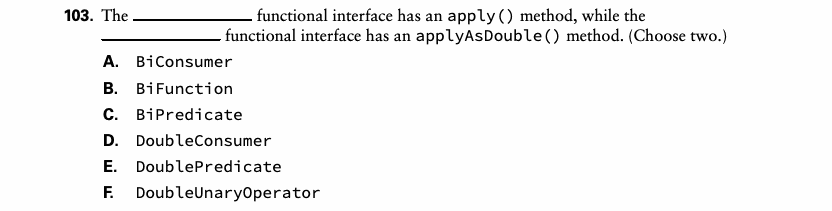

- **A.** `BiConsumer`
- **B.** `BiFunction`
- **C.** `BiPredicate`
- **D.** `DoubleConsumer`
- **E.** `DoublePredicate`
- **F.** `DoubleUnaryOperator`

**Answer:** B, F

**Explanation:** Option B fills in the first blank because `BiFunction` includes the `apply()` method. `DoubleUnaryOperator` contains the `applyAsDouble()` method, making option F correct. For the exam, pay attention to methods that have a different name for primitives.

## 829-06-104

Which of the following can fill in the blank to have the code print out `*`?

```java
Stream.generate(() -> "*")
   .limit(3)
   .sorted( ________________ )
   .distinct()
   .forEach(System.out::println);
```

- **A.** `(s,t) -> s.length() - t.length()`
- **B.** `String::isEmpty`
- **C.** Both of these will produce the desired output.
- **D.** Neither of these will allow the code to compile.
- **E.** The code does not complete regardless of what goes in the blank.

**Answer:** A

**Explanation:** The `sorted()` method takes an optional `Comparator` as the parameter, which takes two `String` parameters and returns an `int`. Option A is correct because the lambda implements this interface. Option B is incorrect because the method reference doesn’t return an `int`. While `generate()` starts with an infinite stream, the `limit()` intermediate operation immediately makes it finite. Finally, the `distinct()` intermediate operation gives us one star instead of three.

## 829-06-105

Which statement about functional interfaces and lambda expressions is not true?

- **A.** A lambda expression may be compatible with multiple functional interfaces.
- **B.** A lambda expression must be assigned to a functional interface when it is declared.
- **C.** A method can return a lambda expression in the form of a functional interface instance.
- **D.** The compiler uses deferred execution to skip determining whether or not a lambda expression compiles.
- **E.** All of these are true.

**Answer:** D

**Explanation:** Options A, B, and C are true statements about functional interfaces. A lambda may be compatible with multiple functional interfaces, but it must be assigned to a functional interface when it is declared or passed as a method argument. Also, a method can be created with the return type that matches a functional interface, allowing a lambda expression to be returned. Option D is the correct answer. Deferred execution means the lambda expression is not evaluated until runtime, but it is compiled. Compiler errors in the lambda expression will still prevent the code from compiling.

## 829-06-106

Which of the following are output by this code? (Choose two.)

```java
16: void shareToys() {
17:    record Toy(String name){ }
18:
19:    var toys = Stream.of(
20:      new Toy("Jack in the Box"),
21:      new Toy("Slinky"),
22:      new Toy("Yo-Yo"),
23:      new Toy("Rubik's Cube"));
24:
25:    var spliterator = toys.spliterator();
26:    var batch = spliterator.trySplit();
27:
28:    var more = batch.tryAdvance(x -> {});
29:    System.out.println(more);
30:    spliterator.tryAdvance(System.out::println);
31: }
```

- **A.** `false`
- **B.** `true`
- **C.** `Toy[name=Jack in the Box]`
- **D.** `Toy[name=Slinky]`
- **E.** `Toy[name=Rubik's Cube]`
- **F.** `Toy[name=Yo-Yo]`

**Answer:** B, F

**Explanation:** Line 25 creates a `Spliterator` containing four toys. Line 26 splits them into two equal groups by removing the first half of the elements and making them available to `batch`. On line 28, we remove `Jack in the Box` from `batch` passing it to a lambda that doesn’t print anything. Line 29 prints true since `Slinky` is still in `batch`. Therefore, option B is one of the answers. Option F is the other correct answer since `Yo-Yo` is the first toy in the half that remained in the original `spliterator`.

## 829-06-107

Which can fill in the blank to have the code print `true`?

```java
var stream = Stream.iterate(1, i -> i);
var b = stream. ______ (i -> i > 5);
System.out.println(b);
```

- **A.** `anyMatch`
- **B.** `allMatch`
- **C.** `findAny`
- **D.** `findFirst`
- **E.** `noneMatch`
- **F.** None of the above

**Answer:** F

**Explanation:** We can rule out options C and D because they do not take any parameters, so they do not compile. Further, this code generates an infinite stream of the number `1`. The `Predicate` checks if the element is greater than `5`. This will never be `true`. With `allMatch()`, the stream pipeline ends after checking the first element. It doesn’t match, so the code prints `false`. Both `anyMatch()` and `noneMatch()` keep checking and don’t find any matches. However, they don’t know if a future stream element will be different, so the code executes infinitely until the process is terminated. Therefore, option F is correct.

## 829-06-108

Given the following class, how many changes need to be made for the code to compile?

```java
1: package showtimes;
2: import java.util.*;
3: import java.util.function.*;
4: public class FindMovie {
5:     private Function<String> printer;
6:     protected FindMovie() {
7:       printer = s -> {System.out.println(s); return s;}
8:     }
9:     void printMovies(List<String> movies) {
10:      movies.forEach(printer);
11:    }
12:    public static void main(String[] screen) {
13:      List<String> movies = new ArrayList<>();
14:      movies.add("Stream 3");
15:      movies.add("Lord of the Recursion");
16:      movies.add("Silence of the Lambdas");
17:      new FindMovie().printMovies(movies);
18:    } }
```

- **A.** None. The code compiles as is.
- **B.** One
- **C.** Two
- **D.** Three
- **E.** Four
- **F.** Five

**Answer:** D

**Explanation:** Line 5 needs to be modified to take a second generic argument since it uses `Function`. Second, the assignment statement on line 7 is missing an ending semicolon (`;`). Finally, the `forEach()` method on line 10 needs to be commented out since it requires a `Consumer`, not a `Function`. Alternatively, you can change `Function` to `Consumer`, add the missing semicolon, and remove the `return` from the lambda. Since either of these approaches is three changes, option D is the correct answer.

## 829-06-109

Which statements about the `findFirst()` method applied to a stream are correct? (Choose three.)

- **A.** It always returns the first element on an ordered serial stream.
- **B.** It may return any element on an ordered serial stream.
- **C.** It always returns the first element on an unordered stream.
- **D.** It may return any element on an unordered stream.
- **E.** It always returns the first element on an ordered parallel stream.
- **F.** It may return any element on an ordered parallel stream.

**Answer:** A, D, E

**Explanation:** The `findFirst()` method always returns the first element on an ordered stream, regardless if it is serial or parallel, making options A and E correct. Option D is also correct, as it is free to return any element if the stream is unordered. Option C is actually invalid, as an unordered stream does not have a first element.

## 829-06-110

Which method reference can replace the lambda in the first line of the `main()` method to produce the same output?

```java
interface Marsupial {
   void carryInPouch(int size);
}
 public class Opossum {
    public static void main(String[] args) {
       Marsupial mar =
         x -> System.out.println("Carrying " + x);
       mar.carryInPouch(1);
    } }
```

- **A.** `System:out:println`
- **B.** `System::out:println`
- **C.** `System::out::println`
- **D.** `System.out::println`
- **E.** None of the above

**Answer:** E

**Explanation:** The only one of these references to compile is option D. However, the original code prints `Carrying 1`. The version with a method reference would just print `1`. Option E is the answer because this is not the same output.

## 829-06-111

What is true of the following code?

```java
21: Stream<Integer> s1 = Stream.of(8, 2);
22: Stream<Integer> s2 = Stream.of(10, 20);
23: s2 = s1.filter(n -> n > 4);
24: s1 = s2.filter(n -> n < 1);
25: System.out.println(s1.count());
26: System.out.println(s2.count());
```

- **A.** The code runs without error and prints `0`.
- **B.** The code runs without error and prints `1`.
- **C.** The code throws an exception on line 23.
- **D.** The code throws an exception on line 24.
- **E.** The code throws an exception on line 25.
- **F.** The code throws an exception on line 26.

**Answer:** F

**Explanation:** A stream cannot be used again once it is executed. Line 21 creates a stream. Line 22 creates a second stream; however, the reference is lost on line 23. Lines 23 and 24 add intermediate operations to the stream that was created on line 21. Due to lazy evaluation, they do not run it. Line 25 does execute the stream pipeline and prints `0`. However, line 26 attempts to execute the same stream and throws an `IllegalStateException`. This matches option F.

## 829-06-112

Which changes can be independently made to this code and have it still compile? (Choose three.)

```java
Predicate<StringBuilder> p =
   (StringBuilder b) -> {return true;};
```

- **A.** Change `StringBuilder b` to `var b`.
- **B.** Change `StringBuilder b` to `b`.
- **C.** Remove `StringBuilder b`.
- **D.** Remove `->`.
- **E.** Remove `{` and `;}`.
- **F.** Remove `{ return` and `;}`.

**Answer:** A, B, F

**Explanation:** Options A and B are correct because the type may be `var` or omitted in a lambda. If there are multiple parameters, all must be handled the same way. Option C is tricky but incorrect. While a lambda can have zero parameters, a `Predicate` cannot. A `Predicate` is defined as a type mapping to a `boolean`. Option D is clearly incorrect, as `->` separates the parts of a lambda. Options E and F are similar. Option E is incorrect because `return` is allowed only when the braces are present. Option F is correct.

## 829-06-113

What does this code output?

```java
var babies = Arrays.asList("chick", "cygnet", "duckling");
babies.replaceAll(x -> { var newValue = "baby";
   return newValue; });
System.out.println(newValue);
```

- **A.** `baby`
- **B.** `chick`
- **C.** `cygnet`
- **D.** `duckling`
- **E.** The code does not compile.

**Answer:** E

**Explanation:** The `newValue` variable is locally scoped to the lambda. It is not available outside the lambda, so the `println()` does not compile, and option E is the answer.

## 829-06-114

Which lambda expression cannot be assigned to a `DoubleToLongFunction` functional interface?

- **A.** `a -> null==null ? 1 : 2L`
- **B.** `e -> (int)(10.0*e)`
- **C.** `(double m) -> {long p = (long)m; return p;}`
- **D.** `(Double s) -> s.longValue()`
- **E.** All of these can be assigned.

**Answer:** D

**Explanation:** The `DoubleToLongFunction` interface takes a `double` argument and returns a `long` value. Option A is compatible since the `int` value `1` can be implicitly cast to `long`, and `2L` is already a `long`. Option B is also compatible, since the `double` value `10.0*e` is explicitly cast to `int` then implicitly cast to `long`. Next, option C is compatible because an explicit cast of the `double` to a `long` value is used. Option D cannot be assigned and is the correct answer. Although the `Double` class does have a `longValue()` method, the left side of the lambda expression must use the primitive `double`, not the wrapper `Double`. This lambda expression violates the signature of the functional interface, since it allows `Double` values to be sent to the interface, including those that could be `null`.

## 829-06-115

Given the following code snippet, which values of `x` will allow the call `divide(x)` to compile and provide predictable results at runtime? (Choose two.)

```java
import java.util.*;
import java.util.stream.*;
public class Divide {
   static float divide(Stream<Float> s) {
     return s.reduce(1.0f, (a,b) -> a/b, (a,b) -> a/b);
   } }
```

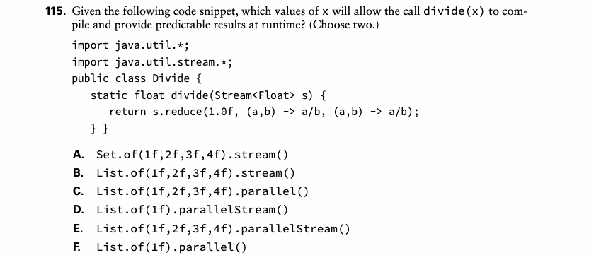

- **A.** `Set.of(1f,2f,3f,4f).stream()`
- **B.** `List.of(1f,2f,3f,4f).stream()`
- **C.** `List.of(1f,2f,3f,4f).parallel()`
- **D.** `List.of(1f).parallelStream()`
- **E.** `List.of(1f,2f,3f,4f).parallelStream()`
- **F.** `List.of(1f).parallel()`

**Answer:** B, D

**Explanation:** Option A is incorrect because sets are unordered. Options C and F are incorrect because they do not compile. The correct method call is `parallelStream()`. Option E is incorrect because the accumulator and combiner in the `divide()` method are not well-behaved. In particular, they are not associative and in a parallel stream could produce various results at runtime. On a serial ordered stream, though, the results will be processed sequentially and in a predictable order, making option B correct. Option D is also correct because the stream has only one element, so the identity is the only thing that will be applied.

## 829-06-116

Which of the following produces different output than the others?

- **A.** 

  ```java
  Stream.of("eeny", "meeny", "miny", "moe")
     .collect(Collectors.partitioningBy(x -> x.charAt(0) == 'e'))
      .get(false)
      .stream()
      .collect(Collectors.groupingBy(String::length))
      .get(4)
      .forEach(System.out::println);
  ```
- **B.** 

  ```java
  Stream.of("eeny", "meeny", "miny", "moe")
     .filter(x -> x.charAt(0) != 'e')
     .collect(Collectors.groupingBy(String::length))
     .get(4)
     .forEach(System.out::println);
  ```
- **C.** 

  ```java
  Stream.of("eeny", "meeny", "miny", "moe")
     .collect(Collectors.groupingBy(x -> x.charAt(0) == 'e'))
     .get(false)
     .stream()
     .collect(Collectors.partitioningBy(String::length))
     .get(4)
     .forEach(System.out::println);
  ```
- **D.** 

  ```java
  Stream.of("eeny", "meeny", "miny", "moe")
     .collect(Collectors.groupingBy(x -> x.charAt(0) == 'e'))
     .get(false)
     .stream()
     .collect(Collectors.groupingBy(String::length))
     .get(4)
     .forEach(System.out::println);
  ```
- **E.** 

  ```java
  Stream.of("eeny", "meeny", "miny", "moe")
     .collect(Collectors.partitioningBy(x -> x.charAt(0) == 'e'))
     .get(false)
     .stream()
     .collect(Collectors.partitioningBy(x -> x.length() == 4))
     .get(true)
     .forEach(System.out::println);
  ```
- **F.** They all produce the same output.

**Answer:** C

**Explanation:** Four of the five examples print `miny`. Option C does not compile. The difference is that `partitioningBy()` requires a `Predicate` that returns a `boolean`. When you get a question like this on the exam, focus on the differences between the provided options.

## 829-06-117

Given an `IntStream`, which method would you use to obtain an equivalent parallel `IntStream`?

- **A.** `parallelStream()`
- **B.** `parallels()`
- **C.** `getParallelStream()`
- **D.** `parallel()`
- **E.** `getParallel()`
- **F.** None of the above

**Answer:** D

**Explanation:** The correct method to obtain an equivalent parallel stream of an existing stream is `parallel()`, which is inherited by any class that implements `BaseStream<T>`, including the primitive streams. For this reason, option D is correct.

## 829-06-118

Which of these statements is true?

- **A.** All lambdas can be converted to method references.
- **B.** All method references can be converted to lambdas.
- **C.** Both of these statements are true.
- **D.** None of the above.

**Answer:** B

**Explanation:** Method references are a shorter way of writing lambdas, and all method references can be expanded to lambdas. However, this does not apply in reverse. Consider the lambda: `() -> s.charAt(3)`. The number three cannot be passed to a method reference. Since only method references can always be converted, option B is correct.

## 829-06-119

The following diagram shows input arguments being used in three functional interface methods of unknown type. Which three functional interfaces, inserted in order from left to right, could be used to complete the diagram? ? ? ?

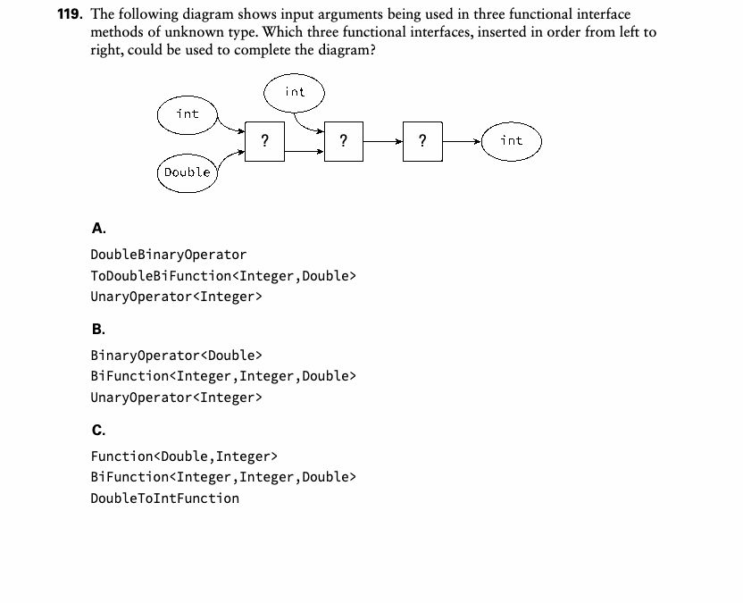

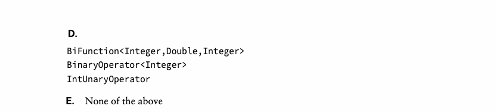

- **A.** 

  ```java
  DoubleBinaryOperator
  ToDoubleBiFunction<Integer,Double>
  UnaryOperator<Integer>
  ```
- **B.** 

  ```java
  BinaryOperator<Double>
  BiFunction<Integer,Integer,Double>
  UnaryOperator<Integer>
  ```
- **C.** 

  ```java
  Function<Double,Integer>
  BiFunction<Integer,Integer,Double>
  DoubleToIntFunction
  ```
- **D.** 

  ```java
  BiFunction<Integer,Double,Integer>
  BinaryOperator<Integer>
  IntUnaryOperator
  ```
- **E.** None of the above

**Answer:** D

**Explanation:** First, options A and B are incorrect because the second functions for both return a `double` or `Double` value, respectively. Neither of these values can be sent to a `UnaryOperator<Integer>` without an explicit cast. Next, option C is incorrect. The first functional interface `Function<Double,Integer>` takes only one input, but the diagram shows two inputs for the first functional interface. That leaves us with option D. The fifirst functional interface `BiFunction<` `Integer,Double,Integer>` takes an `int`, which can be implicitly autoboxed to `Integer`, and a `Double` and returns an `Integer`. The next functional interface, `BinaryOperator<Integer>`, takes two `Integer` values and returns an `Integer` value. Finally, this `Integer` value can be implicitly unboxed and sent to `IntUnaryOperator`, returning an `int`. Since these behaviors match our diagram, option D is the correct answer.

## 829-06-120

Which of the following are functional interfaces in the `java.util.function` package? (Choose three.)

- **A.** `DoublePredicate`
- **B.** `LongUnaryOperator`
- **C.** `NullOperator`
- **D.** `ShortSupplier`
- **E.** `ToIntBiFunction`
- **F.** `ToStringOperator`

**Answer:** A, B, E

**Explanation:** The `DoublePredicate` interface takes a `double` value and returns a `boolean` value. `LongUnaryOperator` takes a `long` value and returns a `long` value. `ToIntBiFunction` takes two generic values and returns an `int` value. For these reasons, options A, B, and E are correct. `NullOperator`, `ShortSupplier`, and `ToStringOperator` are not built-in functional interfaces.

## 829-06-121

What is the output of the following application?

```java
package tps;
import java.util.*;
record Boss(String name) {
   @Override public String toString() {
     return name.toUpperCase();
   }
}
public class Initech {
   public static void main(String[] reports) {
     final List<Boss> bosses = new ArrayList(8);
     bosses.add(new Boss("Peter"));
     bosses.add(new Boss("Samir"));
     bosses.add(new Boss("Michael"));
     bosses.removeIf(s -> s.equalsIgnoreCase("samir"));
     System.out.print(bosses);
   } }
```

- **A.** `[PETER, MICHAEL]`
- **B.** `[samir]`
- **C.** `[tps.Boss@4218224c, tps.Boss@815f19a]`
- **D.** The code does not compile because of the lambda expression.
- **E.** The code does not compile for a different reason.

**Answer:** D

**Explanation:** The lambda expression is invalid because the input argument is of type `Boss`, and `Boss` does not define an `equalsIgnoreCase()` method, making option D the correct answer. If the lambda was corrected to use `s.toString()` instead of `s`, the code would compile and run without issue, printing `[PETER, MICHAEL]` at runtime and making option A the correct answer.

## 829-06-122

Which lambda can implement this functional interface?

```java
public interface Serval {
   static void printName(String name) {}
   boolean cat(String name) { return true; }
}
```

- **A.** `() -> System.out.println()`
- **B.** `n -> System.out.println(n)`
- **C.** `() -> true`
- **D.** `n -> true`
- **E.** None of the above

**Answer:** E

**Explanation:** `Serval` is not a valid interface let alone a functional interface. The `cat()` method specifies an implementation, but does not have one of the modifiers that allows a body: `default`, `private`, or `static`. For this reason, option E is correct.

## 829-06-123

How many of these lines compile?

```java
17: Comparator<String> c1 = s -> false;
18: Comparator<String, String> c2 = (s1, s2) -> false;
19: Predicate<String> p1 = String s -> false;
20: Predicate<String> p2 = (String s) -> false;
21: Supplier<String> s1 = String s -> false;
22: Supplier<String> s2 = (String s) -> false;
```

- **A.** One
- **B.** Two
- **C.** Three
- **D.** Four
- **E.** Five
- **F.** Six

**Answer:** A

**Explanation:** Let’s use the process of elimination here. `Comparator` returns an `int`, causing lines 17 and 18 to not compile. `Supplier` does not take any parameters further, ruling out lines 21 and 22. `Predicate` at least has the right number of parameters and the correct `boolean` return type. However, line 19 is not correct because the parentheses are missing around the type and variable. The parentheses can be omitted only if no type declaration is present, making line 20 correct. Since only one of these lines of code compiles, option A is the answer.

## 829-06-124

What is the output of the following code?

```java
public static void main(String[] args) {
   record Pet(int age) {}
   record PetSummary(long count, int sum) {}
   var summary = Stream.of(new Pet(2), new Pet(5), new Pet(8))
     .collect(Collectors.teeing(
        Collectors.counting(),
        Collectors.summingInt(Pet::age),
        PetSummary::new));
   System.out.println(summary);
}
```

- **A.** `PetSummary[count=1, sum=3]`
- **B.** `PetSummary[count=1, sum=15]`
- **C.** `PetSummary[count=3, sum=3]`
- **D.** `PetSummary[count=3, sum=15]`
- **E.** The code does not compile due to the `teeing()` call.
- **F.** The code does not compile since records are defined inside a method.
- **G.** The code does not compile for another reason.

**Answer:** D

**Explanation:** The code is correct, ruling out options E, F, and G. There are three `Pet` records and the ages add up to `15`, making option D the answer.

## 829-06-125

Which method is not available on the `IntSummaryStatistics` class?

- **A.** `getCountAsLong()`
- **B.** `getMax()`
- **C.** `toString()`
- **D.** None of these methods are available.
- **E.** All of these methods are available.

**Answer:** A

**Explanation:** Option A is the answer because there is a `getCount()` method that returns a `long` rather than a method named `getCountAsLong()`. Option B is incorrect because there is in fact a `getMax()` method. Option C is incorrect because `toString()` is declared on `Object`, which means it is inherited by all classes.

## 829-06-126

Which functional interface, when placed in the blank, allows the class to compile?

```java
package sleep;
import java.util.function.*;
class Sheep {}
public class Dream {
   int MAX_SHEEP = 10;
   int sheepCount;
   public void countSheep( ___________ backToSleep) {
     while(sheepCount<MAX_SHEEP) {
        // TODO: Apply lambda
        sheepCount++;
     }
   }
   public static void main(String[] dark) {
     new Dream().countSheep(System.out::println);
   } }
```

- **A.** `Consumer<Sheep>`
- **B.** `Function<Sheep,void>`
- **C.** `Supplier<Sheep>`
- **D.** `UnaryOperator<Sheep>`
- **E.** None of the above

**Answer:** A

**Explanation:** The method reference `System.out::println` takes a single input and does not return any data. `Consumer<Sheep>` is compatible with this behavior, making option A the correct answer. Note that option B does not even compile because `void` cannot be used as a generic argument. Similarly, option C does not take a parameter. Option D is also incorrect since `System.out::println()` does not return any data, and `UnaryOperator` requires a return value.

## 829-06-127

Given an instance of `Stream s` and `Collection c`, which of the following are valid ways of creating a parallel stream? (Choose three.)

- **A.** `c.parallel()`
- **B.** `c.parallel().parallelStream()`
- **C.** `c.parallelStream()`
- **D.** `s.parallelStream()`
- **E.** `c.parallelStream().parallel()`
- **F.** `s.parallel()`

**Answer:** C, E, F

**Explanation:** The correct method to obtain a parallel stream of an arbitrary stream is `parallel()`, while the correct method to obtain a parallel stream that operates on a `Collection` is `parallelStream()`. For this reason, options C, E, and F are correct. Note that option E retrieves a parallel stream of an already parallel stream, which is allowed.

## 829-06-128

Which are true of the following code? (Choose two.)

```java
3: public static void main(String[] args) {
4:     var prefix = "r";
5:     var pets = List.of("rabbit", "snake", "turtle");
6:
7:     // prefix = "t";
8:     pets.forEach(p -> {
9:       if (p.startsWith(prefix)) System.out.println(p); } );
10: }
```

- **A.** As written, the code prints one line.
- **B.** As written, the code prints two lines.
- **C.** As written, the code does not compile.
- **D.** If line 7 is uncommented, the code prints one line.
- **E.** If line 7 is uncommented, the code prints two lines.
- **F.** If line 7 is uncommented, the code does not compile.

**Answer:** A, F

**Explanation:** The code, as written, prints `rabbit` since it starts with the letter `r`. This is option A. The `prefix` variable is effectively final and therefore safe to use in a lambda. Uncommenting line 7 changes the `prefix` variable, and it is no longer effectively final. Since this causes a compiler error, option F is the other answer.

## 829-06-129

What is the output of the following code snippet?

```java
10: var pears = List.of(1, 2, 3, 4, 5, 6);
11: final var sum = pears.stream()
12:    .skip(1)
13:    .limit(3)
14:    .flatMapToInt(s -> IntStream.of(s))
15:    .skip(1)
16:    .boxed()
17:    .mapToDouble(s -> s)
18:    .sum();
19: System.out.print(sum);
```

- **A.** `6`
- **B.** `7.0`
- **C.** `6.0`
- **D.** `7`
- **E.** Exactly one line contains a compiler error.
- **F.** More than one line contains a compiler error.

**Answer:** B

**Explanation:** The code compiles, so options E and F are incorrect. The stream operations on lines 12–13 reduce the stream to the values `[2, 3, 4]`. Line 14 then converts the `Stream<Integer>` to an `IntStream`. On line 15, the first element of the `IntStream` is skipped, so the stream has only two elements `[3, 4]`. On line 16–17, the `IntStream` is converted to a `Stream<Integer>`, then a `DoubleStream`. Finally, on lines 18–19 the sum of the remaining elements is calculated and printed. Since `7.0` is printed, option B is correct.

## 829-06-130

What is the minimum number of intermediate operations that can fill in each box `[M, N, O, P]` to have the pipeline complete given any intermediate operation? Source Intermediate operation Terminal operation Finite Stream Source `M __________ count()` Finite Stream Source `N __________ findFirst()` Infinite Stream Source `O __________ count()` Infinite Stream Source `P __________ findFirst()`

- **A.** `[0, 0, 0, 1]`
- **B.** `[0, 0, 1, 0]`
- **C.** `[0, 0, 1, 1]`
- **D.** `[1, 1, 0, 1]`
- **E.** `[1, 1 ,1, 0]`
- **F.** `[1, 1, 1, 1]`

**Answer:** B

**Explanation:** Since the first two rows are already finite streams, boxes M and N do not require an intermediate operation to complete, so options D, E, and F are incorrect. Box P does not need an intermediate operation either since `findFirst()` will cause the stream to terminate, making options A and C incorrect. Box O does need to be filled in with code such as `limit(1)`. This allows the code to terminate, and option B is the answer.

## 829-06-131

Given the table in the previous question, how many of the boxes in the Intermediate operation column will have the pipeline complete regardless of which intermediate operation is placed in the box?

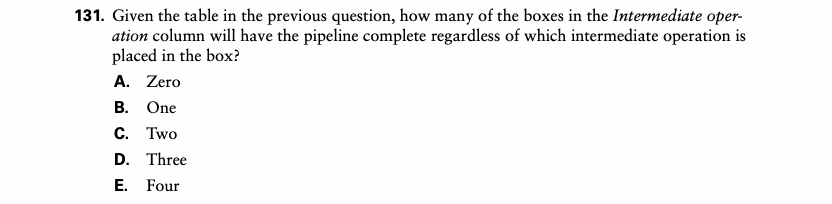

- **A.** Zero
- **B.** One
- **C.** Two
- **D.** Three
- **E.** Four

**Answer:** C

**Explanation:** Since the first two rows are already finite streams, boxes M and N meet these criteria. The last two rows can be filled in with code such as `sorted()`, which does not terminate for an infinite stream. Therefore, neither allows the code to terminate, and option C is the answer.

## 829-06-132

Which of the following declares a `Comparator` where all objects are treated as equal?

- **A.** `Comparator<Character> comp = (c1) -> 0;`
- **B.** `Comparator<Character> comp = (c1) -> {0};`
- **C.** `Comparator<Character> comp = (c1, c2) -> 0;`
- **D.** `Comparator<Character> comp = (c1, c2) -> {0};`
- **E.** None of the above

**Answer:** C

**Explanation:** A `Comparator` takes two parameters, so options A and B are incorrect. Option D doesn’t compile. When returning a value using braces, a `return` keyword and semicolon are required. Option C is a correct implementation.

## 829-06-133

Which can fill in the blank so this code outputs `true`?

```java
import java.util.function.*;
import java.util.stream.*;
public class HideAndSeek {
   public static void main(String[] args) {
     var hide = Stream.of(true, false, true);
     var found = hide.filter(b -> b). __________ ();
     System.out.println(found);
   } }
```

- **A.** Only `anyMatch`
- **B.** Only `allMatch`
- **C.** Both `anyMatch` and `allMatch`
- **D.** Only `noneMatch`
- **E.** The code does not compile with any of these options.

**Answer:** E

**Explanation:** The `anyMatch()`, `allMatch()`, and `noneMatch()` methods take a `Predicate` as a parameter. This code does not compile because the parameter is missing, making option E correct.

## 829-06-134

Which method reference can replace the lambda on the second line so the output is the same?

```java
var s = "fish";
Predicate<String> pred = (a) -> s.contains(a);
System.out.println(pred.test("is"));
```

- **A.** `s::contains(a)`
- **B.** `s::contains`
- **C.** `String::contains(a)`
- **D.** `String::contains`
- **E.** The supplied code does not compile.
- **F.** None of the above.

**Answer:** B

**Explanation:** Since the lambda references an effectively final variable, the method reference needs to as well. Option B is a correct method reference that meets this criteria. Options A and C use syntax that is not supported with method references. Option D is incorrect because the `Predicate` passes only one value at runtime, so either the instance variable or method parameter would need to be supplied.

## 829-06-135

How many of these lines compile?

```java
Predicate<String> pred1 = (final String s) -> s.isEmpty();
Predicate<String> pred2 = (final s) -> s.isEmpty();
Predicate<String> pred3 = (final var s) -> s.isEmpty();
Predicate<String> pred4 = (String s) -> s.isEmpty();
Predicate<String> pred5 = (var s) -> s.isEmpty();
```

- **A.** 0
- **B.** 1
- **C.** 2
- **D.** 3
- **E.** 4
- **F.** 5

**Answer:** E

**Explanation:** Both `pred4` and `pred5` are valid, as they use a type or `var` without `final`. Both `pred1` and `pred3` are valid because the `final` modifier can only be used if a type or `var` is specified. Since `pred2` is missing a data type and is the only line that does not compile, option E is the answer.

## 829-06-136

What is the output of the following application?

```java
package pet;
import java.util.*;
import java.util.function.*;
public class DogSearch {
   void reduceList(List<String> names,
        Predicate<String> tester) {
     names.removeIf(tester);
   }
   public static void main(String[] treats) {
     int MAX_LENGTH = 2;
     DogSearch search = new DogSearch();
     List<String> names = new ArrayList<>();
     names.add("Lassie");
     names.add("Benji");
     names.add("Brian");
     search.reduceList(names, d -> d.length()>MAX_LENGTH);
     System.out.print(names.size());
   } }
```

- **A.** `0`
- **B.** `2`
- **C.** `3`
- **D.** The code does not compile because of the lambda expression.
- **E.** The code does not compile for a different reason.

**Answer:** A

**Explanation:** This code does compile, making options D and E incorrect. It correctly uses a `Predicate<String>` and removes all the elements from `names` and prints out `0`. Therefore, option A is the answer.

## 829-06-137

What is the output of the following program?

```java
var p = List.of(1,3,5);
var q = p.parallelStream().reduce(0f,
   (w,x) -> w.floatValue() + x.floatValue(),
   (y,z) -> y.floatValue() + z.floatValue());
System.out.println(q);
```

- **A.** `0.0`
- **B.** `9.0`
- **C.** `11.0`
- **D.** One line does not compile.
- **E.** Two lines do not compile.
- **F.** None of the above.

**Answer:** B

**Explanation:** Since it’s not a primitive stream, the underlying type is `Stream<Integer>`, which means the data type of `x` is `Integer`. On the other hand, the data type of `w`, `y`, and `z` is `Float`. Because `Integer` and `Float` both define a `floatValue()` method, all of the lines compile. The code snippet prints `9.0` at runtime, making option B correct.

## 829-06-138

What does the following output?

```java
Set<String> set = new HashSet<>();
set.add("tire-");
List<String> list = new LinkedList<>();
Deque<String> queue = new ArrayDeque<>();
queue.push("wheel-");
Stream.of(set, list, queue)
   .flatMap(x -> x.stream())
   .forEach(System.out::print);
```

- **A.** `[tire-][wheel-]`
- **B.** `tire-wheel-`
- **C.** None of the above.
- **D.** The code does not compile.

**Answer:** B

**Explanation:** The `flatMap()` method is used to turn a stream of collections into a one-dimensional stream. This means it gets rid of the empty `list` and flattens the other two. Option A is incorrect because this is the output you’d get using the regular `map()` method. Option B is correct because it flattens the elements. Notice how it doesn’t matter that all three elements are different types of `Collection` implementations.

## 829-06-139

How many lines does this code output?

```java
1: import java.util.*;
2: public class PrintNegative {
3:     public static void main(String[] args) {
4:       List<String> list = new ArrayList<>();
5:       list.add("-5");
6:       list.add("0");
7:       list.add("5");
8:       list.removeIf(e -> e < 0);
9:       list.forEach(x -> System.out.println(x));
10:    } }
```

- **A.** One
- **B.** Two
- **C.** Three
- **D.** None. The code does not compile.
- **E.** None. The code throws an exception at runtime.

**Answer:** D

**Explanation:** Pay attention to the data types. The `forEach()` method is looping through a list of objects. This is a good example of using a lambda with `list`. By contrast, the `Predicate` passed to `removeIf()` uses an `Integer`. Since `Integer` is not compatible with `String`, line 8 does not compile and option D is the answer.

## 829-06-140

How many of the following lines compile?

```java
8: IntFunction<Integer> f1 =(Integer f) -> f;
9: IntFunction<Integer> f2 = (v) -> null;
10: IntFunction<Integer> f3 = s -> s;
11: IntFunction<Integer> f4 = () -> 5;
12: IntFunction<Integer> f5 = () -> Integer.valueOf(9);
```

- **A.** None
- **B.** One
- **C.** Two
- **D.** Three
- **E.** Four
- **F.** Five

**Answer:** C

**Explanation:** To start with, `IntFunction<Integer>` takes an `int` value and returns an `Integer`. Line 8 takes an `Integer` instead of `int` as the input argument and is therefore not compatible. Line 9 is compatible, since the return type `null` can be used as an `Integer` return type. Line 10 is also valid. An `int` can be autoboxed to `Integer`. Lines 11 and 12 do not compile because they do not take a parameter. Since only two statements compile, option C is the correct answer.

## 829-06-141

Which statements about using a parallel stream instead of a serial stream are correct? (Choose three.)

- **A.** The number of threads used is guaranteed to be higher.
- **B.** It requires a stateful lambda expression.
- **C.** The stream operation may execute faster.
- **D.** The stream operation may execute slower.
- **E.** The result of the stream operation will be the same.
- **F.** The result of the stream operation may change.

**Answer:** C, D, F

**Explanation:** Using a parallel stream does not guarantee concurrent execution or a specific number of threads, making option A incorrect. Option B is also incorrect, as stateful lambda expressions should be avoided with all streams, serial or parallel. In fact, if a stateful lambda expression is used, the result of the stream may change, making option F correct and option E incorrect. Option C is correct, as a parallel stream may improve performance. Option D is also correct, though, as a parallel stream may add extra overhead to a stream that is forced into a serial operation, such as when the `findFirst()` method is called.

## 829-06-142

Which is a possible output of the following code snippet?

```java
var landmarks = Set.of("Eiffel Tower", "Statue of Liberty",
   "Stonehenge", "Mount Fuji");
var result = landmarks
   .stream()
   .collect(Collectors.partitioningBy(b -> b.contains(" ")))
   .entrySet()
   .stream()
   .flatMap(t -> t.getValue().stream())
   .collect(Collectors.groupingBy(s -> !s.startsWith("S")));
System.out.print(result);
```

- **A.** `{false=[Stonehenge, Statue of Liberty], true=[Eiffel Tower,`

  ```java
  Mount Fuji]}
  ```
- **B.** `{false=[Stonehenge], true=[Mount Fuji, Eiffel Tower, Statue of`

  ```java
  Liberty]}
  ```
- **C.** `{false=[Mount Fuji, Stonehenge], true=[Eiffel Tower, Statue of`

  ```java
  Liberty]}
  ```
- **D.** Exactly one line contains a compiler error.
- **E.** More than one line contains a compiler error.
- **F.** None of the above.

**Answer:** A

**Explanation:** The code compiles, so options D and E are incorrect. The code first splits the stream into a `Map<Boolean, List<String>` based on whether the landmark contains a space. Using the `flatMap()` method, it then takes the `List<String>` values of the `Map` and reforms them as a `Stream<String>`. This new stream is similar to the original stream, although with elements in a possibly different order. Finally, the `groupingBy()` collector splits the stream based on whether it does not start with an `"S"`. Since `Set` and `Map` were used, the order may vary, but option A is one possible output.

## 829-06-143

Which can independently fill in the blank to output `No dessert today`?

```java
import java.util.*;
public class Dessert {
  public static void main(String[] yum) {
    eatDessert(Optional.of("Cupcake"));
  }
  private static void eatDessert(Optional<String> opt) {
    System.out.println(opt. __________ );
  } }
```

- **A.** `get("No dessert today")`
- **B.** `orElse("No dessert today")`
- **C.** `orElseGet(() -> "No dessert today")`
- **D.** `orElseThrow()`
- **E.** None of the above

**Answer:** E

**Explanation:** Option A doesn’t compile because the `get()` method on `Optional` doesn’t take any parameters. Options B, C, and D do compile but print `Cupcake` since the `Optional` is not empty. Therefore, option E is correct.

## 829-06-144

What is the output of this code?

```java
List.of("one", "two", "bloat")
   .limit(1)
   .map(String::toUpperCase) // line x
   .sorted()
   .forEach(System.out::println);
```

- **A.** `bloat`
- **B.** `BLOAT`
- **C.** `one`
- **D.** `ONE`
- **E.** The code does not compile due to line `x`.
- **F.** None of the above.

**Answer:** F

**Explanation:** There is no source in this attempt at a stream pipeline. While a `Collection` does have some of the same methods as a stream, such as `forEach()`, the `limit()` method is not one of them, so the code as written causes a compile error. Since this error is not on line `x`, option F is the answer.

## 829-06-145

Which is one of the lines output by this code?

```java
10: var list = new ArrayList<Integer>();
11: list.add(10);
12: list.add(9);
13: list.add(8);
14:
15: var num = 9;
16: list.removeIf(x -> {int keep = num; return x == keep;});
17: System.out.println(list);
18:
 19: num = 8;
 20: list.removeIf(x -> {int keep = num; return x == keep;});
 21: System.out.println(list);
```

- **A.** `[]`
- **B.** `[8]`
- **C.** `[9]`
- **D.** `[10]`
- **E.** The code does not compile.

**Answer:** E

**Explanation:** The `num` variable is not effectively final because the value changes. This means it cannot be used in a lambda and the code does not compile, which is option E.

## 829-06-146

What is the output of the following?

```java
import java.util.*;
import java.util.stream.*;
public class Compete {
   public static void main(String[] args) {
     Stream<Integer> is = Stream.of(8, 6, 9);
     Comparator<Integer> c = (a, b) -> a - b;
     is.sort(c).forEach(System.out::print);
   } }
```

- **A.** `689`
- **B.** `869`
- **C.** `986`
- **D.** The code does not compile.
- **E.** The code compiles but throws an exception at runtime.

**Answer:** D

**Explanation:** There is not a stream pipeline method called `sort()`. There is one called `sorted()`. Since the code does not compile, option D is correct. If `sorted()` were used, then the output would be `689`.

## 829-06-147

What can a lambda implement?

- **A.** Any functional interface
- **B.** Any interface
- **C.** Only functional interfaces in the JDK
- **D.** None of the above

**Answer:** A

**Explanation:** A lambda can only implement an interface with a single abstract method, ruling out option B. Developers can write their own functional interfaces, making option A correct.

## 829-06-148

What is the output of the following application?

```java
package lot;
import java.util.function.*;
public class Warehouse {
   private int quantity = 40;
   private final BooleanSupplier stock;
   {
     stock = () -> quantity>0;
   }
  public void checkInventory() {
    if(stock.get())
       System.out.print("Plenty!");
    else
       System.out.print("On Backorder!");
  }
  public static void main(String[] widget) {
    final Warehouse w13 = new Warehouse();
    w13.checkInventory();
  } }
```

- **A.** `Plenty!`
- **B.** `On Backorder!`
- **C.** The code does not compile because of the `checkInventory()` method.
- **D.** The code does not compile for a different reason.

**Answer:** C

**Explanation:** The primitive `Supplier` functional interfaces, such as `BooleanSupplier` and `LongSupplier`, do not have a `get()` method. Instead, they have methods such as `getAsBoolean()` and `getAsLong()`, respectively. For this reason, the first line of the `checkInventory()` method does not compile, making option C the correct answer.

## 829-06-149

What is a possible output of the following application?

```java
import java.util.*;
import java.util.stream.*;
public record Thermometer(String feelsLike, double temp) {
   @Override public String toString() { return feelsLike; }
   public static void main(String[] season) {
     var readings = List.of(new Thermometer("HOT!",72),
           new Thermometer("Too Cold!",0),
           new Thermometer("Just right!",72));
     readings
        .parallelStream()              // k1
        .collect(Collectors.groupingByConcurrent(
           Thermometer::temp))         // k2
        .forEach(System.out::println);     // k3
   } }
```

- **A.** `{0.0=[Cold!], 72.0=[HOT!, Just right!]}`
- **B.** `{0.0=[Cold!], 72.0=[Just right!] , 72.0=[HOT!]}`
- **C.** The code does not compile because of line `k1`.
- **D.** The code does not compile because of line `k2`.
- **E.** The code does not compile because of line `k3`.
- **F.** None of the above.

**Answer:** E

**Explanation:** The code does not compile because the collector returns a `ConcurrentMap`, which requires a `BiConsumer` in the `forEach()` method. For this reason, option E is correct.

## 829-06-150

What is the output of the following code?

```java
var odds = IntStream.iterate(1, a -> a+2);
var evens = IntStream.iterate(2, a -> a+2);
var sum = Stream.concat(odds, evens).limit(3).sum();
System.out.println(sum);
```

- **A.** `6`
- **B.** `9`
- **C.** `12`
- **D.** The code does not compile.
- **E.** The program does not terminate. Chapter Packaging and 7 Deploying Java Code and Use the Java Platform Module System THE OCP EXAM TOPICS COVERED IN THIS PRACTICE TEST INCLUDE THE FOLLOWING: ✓ Packaging and deploying Java code and use the Java Platform Module System ■ Define modules and their dependencies, expose module content including for reflection. Define services, producers, and consumers ■ Compile Java code, produce modular and non-modular jars, runtime images, and implement migration using unnamed and automatic modules

**Answer:** D

**Explanation:** When calling `Stream.concat()`, we need to pass `Stream` references, not `IntStream`. The code does not compile as written and option D is the answer. Java Code and Use the Java Platform Module System
