# Chapter 7: Packaging and Deploying Java Code and Use the Java Platform Module System

> Source: *OCP Oracle Certified Professional Java SE 17 Developer Practice Tests (Exam 1Z0-829)*. Extracted from your PDF for personal study. Questions with figures/tables include a scan of the original page.

## 829-07-001

What is the name of a file that declares a module?

- **A.** `mod.java`
- **B.** `mod-data.java`
- **C.** `mod-info.java`
- **D.** `module.java`
- **E.** `module-data.java`
- **F.** `module-info.java`

**Answer:** F

**Explanation:** The `module-info.java` file is used to declare a module, making option F the answer. You must memorize the name of this file.

## 829-07-002

Suppose you have a module that calls `exports`(`ChocolateLab.class)` using a service locator. Which part of the module service contains this class?

- **A.** Consumer
- **B.** Service locator
- **C.** Service provider
- **D.** Service provider interface
- **E.** None of the above

**Answer:** E

**Explanation:** The service locator contains a `load()` method, not an `exports()` method, making option E the answer.

## 829-07-003

Which are considered part of a service? (Choose two.)

- **A.** Consumer
- **B.** Service locator
- **C.** Service provider
- **D.** Service provider interface

**Answer:** B, D

**Explanation:** A service consists of the interface, any classes the interface references, and a way to look up implementations of the interface. Option B covers the lookup, and option D covers the interface itself.

## 829-07-004

Given the following diagram, how many of the following are named modules? classpath module path dog.flfluffy.jar dog.hair.jar dog.flfluffy dog.hair dog.husky.jar dog.bark.jar dog.husky dog.bark module-info module-info

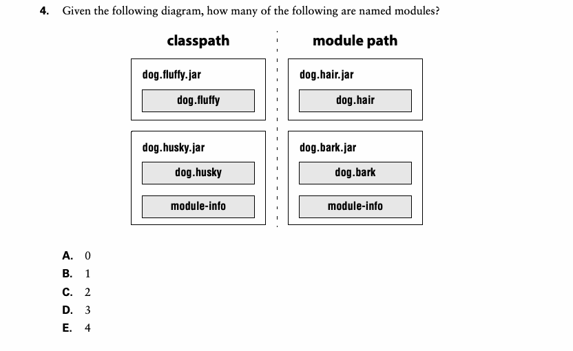


- **A.** 0
- **B.** 1
- **C.** 2
- **D.** 3
- **E.** 4

**Answer:** B

**Explanation:** A named module must be on the module path and contain a `module-info` file. Only `dog.bark` meets this criterion, making option B the answer.

## 829-07-005

Given the diagram from the previous question, which is an automatic module?


- **A.** `dog.bark`
- **B.** `dog.fluffy`
- **C.** `dog.hair`
- **D.** `dog.husky`
- **E.** None of the above

**Answer:** C

**Explanation:** An automatic module must be on the module path but does not contain a `module-info` file. Option C is correct because `dog.hair` matches this description.

## 829-07-006

Given the diagram from Question 4, which is a default module?


- **A.** `dog.bark`
- **B.** `dog.fluffy`
- **C.** `dog.hair`
- **D.** `dog.husky`
- **E.** None of the above

**Answer:** E

**Explanation:** You need to know about three types of modules for the exam: automatic, named, and unnamed. There is no such thing as a default module. The question was trying to trick you, and option E is correct.

## 829-07-007

Given the diagram from Question 4, how many are unnamed modules?


- **A.** 0
- **B.** 1
- **C.** 2
- **D.** 3
- **E.** 4

**Answer:** C

**Explanation:** An unnamed module must be on the classpath. It is rare to have a `module-info` file in an unnamed module, but it is allowed. Therefore, `dog.fluffy` and `dog.husky` both meet this criterion, making option C correct.

## 829-07-008

Which of the following statements are true? (Choose two.)

- **A.** It is a good practice to add the `--add-exports` option to your `java` command.
- **B.** It is permitted, but not recommended, to add the `--add-exports` option to your `java` command.
- **C.** There is no `--add-exports` option on the `java` command.
- **D.** It is a good practice to add the `--add-requires` option to your `java` command.
- **E.** It is permitted, but not recommended, to add the `--add-requires` option to your `java` command.
- **F.** There is no `--add-requires` option on the `java` command.

**Answer:** B, F

**Explanation:** It is recommended to specify all `exports` directives in the `module-info` file. While it is legal to use the `--add-exports` option, it is not recommended, making option B correct. You do not need to know how to use it for the exam, just that it is not a good idea. There is no equivalent option for `requires`, making option F correct.

## 829-07-009

How many of the following are legal `module-info.java` files?

```java
 module com.koala {
   exports cute;
 }
 module com-koala {
   exports cute;
 }
 public module com.koala {
   exports cute;
 }
public module com-koala {
  exports cute;
}
```

- **A.** None
- **B.** One
- **C.** Two
- **D.** Three
- **E.** Four

**Answer:** B

**Explanation:** Since Java does not allow dashes in identifier names, the second and fourth declarations are invalid. Additionally, access modifiers like `public` are not permitted in module declarations, making the third and fourth declarations invalid. The only one that is legal is the first declaration, so option B is correct.

## 829-07-010

Which two would be best to combine into a single module?

- **A.** Consumer and service locator
- **B.** Consumer and service provider
- **C.** Consumer and service provider interface
- **D.** Service locator and service provider interface
- **E.** Service locator and service provider
- **F.** Service provider and service provider interface

**Answer:** D

**Explanation:** The consumer is generally separate, ruling out options A, B, and C. The service provider is decoupled from the service provider interface, ruling out option F. It is most logical to combine the service locator and service provider interface because neither has a direct reference to the service provider. Therefore, option D is correct.

## 829-07-011

Which command could you run to print output similar to the following?

```java
java.base@17
java.compiler@17
java.datatransfer@17
java.desktop@17
...
```

- **A.** `java --all-modules`
- **B.** `java --describe-modules`
- **C.** `java --list-modules`
- **D.** `java --output-modules`
- **E.** `java --show-modules`
- **F.** None of the above

**Answer:** C

**Explanation:** The `java` command has an option to list all the modules that come with the JDK. Option C is correct since that option is called `--list-modules`. The other options are not supported by the `java` command. Options B and E are similar to options that exist: `--describe-module` and `--show-module-resolution`. But neither gives a list of all the modules that come with the JDK.

## 829-07-012

Suppose we have an automatic module on the module path named `dog-arthur2.jar` and no `Automatic-Module-Name` specified. What module name should named modules use to reference it?

- **A.** `dog-arthur`
- **B.** `dog-arthur2`
- **C.** `dog.arthur`
- **D.** `dog.arthur2`
- **E.** None of the above

**Answer:** D

**Explanation:** The rules for determining the name include removing the extension and changing special characters to periods (`.`). This leaves us with `dog.arthur2`, which is option D.

## 829-07-013

Each box in the diagram corresponds to a module. Given the module dependencies in the diagram, which boxes represent the service provider interface and service provider, respectively? W X Y Z

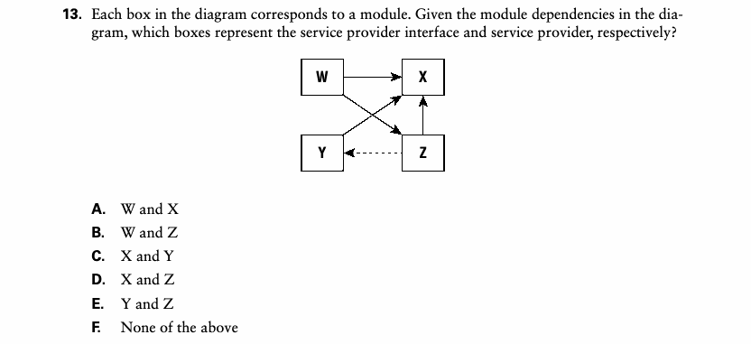

- **A.** W and X
- **B.** W and Z
- **C.** X and Y
- **D.** X and Z
- **E.** Y and Z
- **F.** None of the above

**Answer:** C

**Explanation:** All parts of a module’s service must point to the service provider interface. This tells us the service provider interface must be X, ruling out options A, B, and E. Now we have to decide if Y or Z is the service provider. We can tell because nothing has a direct dependency on the service provider. Since this makes the service provider Y, the answer is option C.

## 829-07-014

Using the diagram in the previous question, which boxes represent the consumer and service locator, respectively?

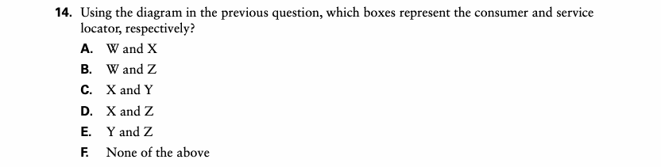

- **A.** W and X
- **B.** W and Z
- **C.** X and Y
- **D.** X and Z
- **E.** Y and Z
- **F.** None of the above

**Answer:** B

**Explanation:** The consumer depends on the service provider interface and service locator, but not on the service provider. Only W has two arrows starting from it, so it must be the consumer. This rules out options C, D, and E. The service locator references the service provider interface directly and the service provider indirectly, making the service locator Z and option B the answer.

## 829-07-015

What is the minimum number of JAR files you need for a cyclic dependency?

- **A.** 0
- **B.** 1
- **C.** 2
- **D.** 3
- **E.** 4

**Answer:** C

**Explanation:** A cyclic dependency is when two things directly or indirectly depend on each other. If `chicken.jar` depends on `egg.jar`, and `egg.jar` depends on `chicken.jar`, we have a cyclic dependency. Since only two JAR files are needed to create this situation, option C is the answer.

## 829-07-016

Fill in the blank with code to look up and call a service.

```java
String cheese = ServiceLoader.load(Mouse.class)
   .map( _____________ )
   .map(Mouse::favoriteFood)
   .findFirst()
   .orElse("");
```

- **A.** `Mouse.get()`
- **B.** `Mouse::get`
- **C.** `Provider.get()`
- **D.** `Provider::get`
- **E.** None of the above

**Answer:** E

**Explanation:** The `ServiceLoader` class has a `load()` method that returns a `Collection` of `Provider`, not a stream. Since the call to `stream()` is missing, option E is the answer. If the call to `stream()` were added, option D would be the answer.

## 829-07-017

Suppose we want to have two modules: `com.ny` and `com.sf`. Which is true about the placement of the `module-info.java` file(s)? module com.ny module com.sf package com.ny.city package com.sf.city V X W Y Z

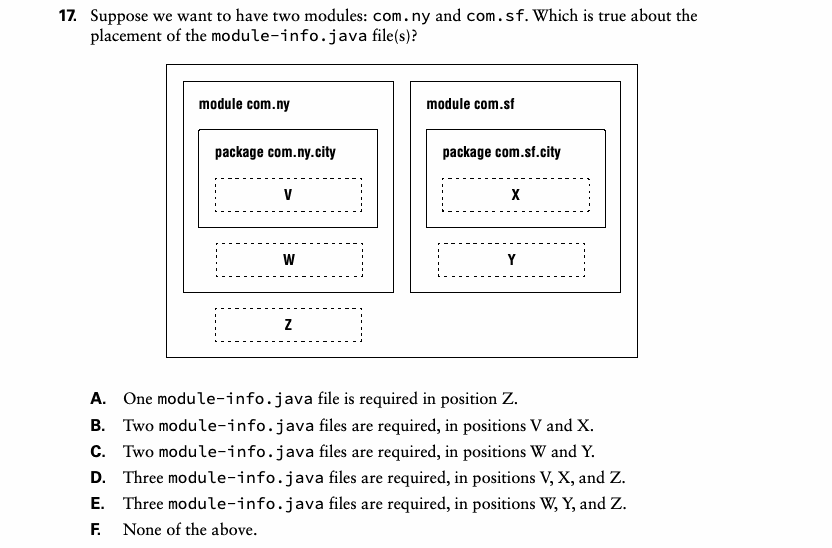

- **A.** One `module-info.java` file is required in position Z.
- **B.** Two `module-info.java` files are required, in positions V and X.
- **C.** Two `module-info.java` files are required, in positions W and Y.
- **D.** Three `module-info.java` files are required, in positions V, X, and Z.
- **E.** Three `module-info.java` files are required, in positions W, Y, and Z.
- **F.** None of the above.

**Answer:** C

**Explanation:** Each module is required to have its own `module-info.java` file in the root directory of the module. For module `com.ny`, that is location W, and for module `com.sf`, that is location Y. Therefore, option C is correct.

## 829-07-018

Consider the modules in the previous diagram. Suppose we want the code in module `com.sf` to depend on code in module `com.ny`. Which of the following directives goes into module `com.sf`’s `module-info` file to configure that behavior?

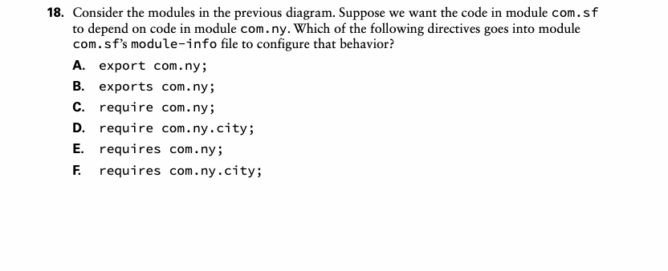


- **A.** `export com.ny;`
- **B.** `exports com.ny;`
- **C.** `require com.ny;`
- **D.** `require com.ny.city;`
- **E.** `requires com.ny;`
- **F.** `requires com.ny.city;`

**Answer:** E

**Explanation:** Options A, C, and D are incorrect because `export` and `require` are not directives in modules. Option B is incorrect because that directive goes in the `com.ny` module, not the `com.sf` one. Option E is correct rather than option F because the `requires` directive references a module name rather than a package.

## 829-07-019

Consider the modules diagram in Question 17. Suppose we want the code in module `com.sf` to depend on code in module `com.ny`. Which of the following directives goes into module `com.ny`’s `module-info` file to configure that behavior?

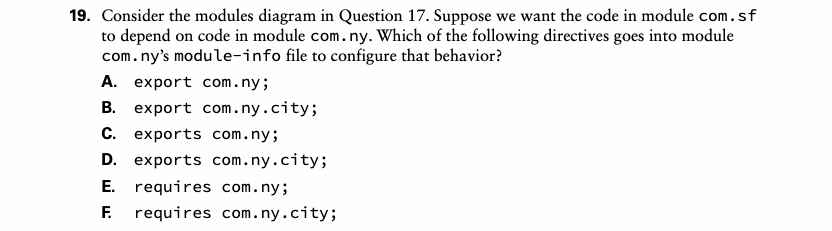

- **A.** `export com.ny;`
- **B.** `export com.ny.city;`
- **C.** `exports com.ny;`
- **D.** `exports com.ny.city;`
- **E.** `requires com.ny;`
- **F.** `requires com.ny.city;`

**Answer:** D

**Explanation:** Options A and B are incorrect because `export` is not a directive in modules. Option E belongs in the `com.sf` module, not the `com.ny` one. Option F is incorrect because the `requires` directive should reference a module name rather than a package. Finally, option D is the answer rather than option C because the `exports` directive should reference a package name rather than a module.

## 829-07-020

Suppose the consumer, service locator, service provider, and service provider interface are each in separate modules. Which of the following best describes the following `module-info` file?

```java
module nature.tree {
  provides nature.sapling.Tree with nature.tree.Maple;
}
```

- **A.** Consumer
- **B.** Service locator
- **C.** Service provider
- **D.** Service provider interface
- **E.** None of the above

**Answer:** E

**Explanation:** The `Maple` class is intended to be an implementation of the `Tree` interface. However, this interface needs to be accessible. This module is missing a `requires nature.sapling;` statement, making option E the correct answer.

## 829-07-021

Which options are commonly used when compiling a module with the `javac` command?

- **A.** `-c` and `-d`
- **B.** `-d` and `-p`
- **C.** `-c` and `-p`
- **D.** `-c`, `-d`, and `-p`
- **E.** None of the above

**Answer:** B

**Explanation:** The `–c` option is not on the `javac` command. The `–d` option specifies the directory. The `–p` option specifies the module path. Therefore, option B is correct.

## 829-07-022

Which of the following are modules supplied by the JDK? (Choose three.)

- **A.** `java.base`
- **B.** `java.basic`
- **C.** `java.desktop`
- **D.** `java.sdk`
- **E.** `java.sql`
- **F.** `java.swing`

**Answer:** A, C, E

**Explanation:** The `java.base` module is automatically available to any module without specifying it, making option A correct. Options C and E are also correct because `java.desktop` and `java.sql` are modules supplied with the JDK. You do need to be able to identify builtin modules for the exam.

## 829-07-023

Which best describes a top-down migration? (Choose two.)

- **A.** The first step is to move all the modules to the module path.
- **B.** The first step is to move a single module to the module path.
- **C.** Most steps consist of changing an automatic module to a named module.
- **D.** Most steps consist of changing an automatic module to an unnamed module.
- **E.** Most steps consist of changing an unnamed module to an automatic module.
- **F.** Most steps consist of changing an unnamed module to a named module.

**Answer:** A, C

**Explanation:** Option A is correct because a top-down migration starts by moving all the modules to the module path as automatic modules. Then, the migration changes each module from an automatic module to a named module, making option C the other correct answer.

## 829-07-024

Suppose the consumer, service locator, service provider, and service provider interface are each in separate modules. Which of the following best describes the following `module-info` file?

```java
module nature.tree {
  requires nature.sapling;
  requires nature.bush;
}
```

- **A.** Consumer
- **B.** Service locator
- **C.** Service provider
- **D.** Service provider interface
- **E.** None of the above

**Answer:** A

**Explanation:** Option A is correct because a consumer has two dependencies. It `requires` both the service provider interface and the service locator.

## 829-07-025

Suppose you have these two JARs that are not modules. Which steps, when taken together, would be the best way to make them modules? (Choose two.) baby.otter food.fifish

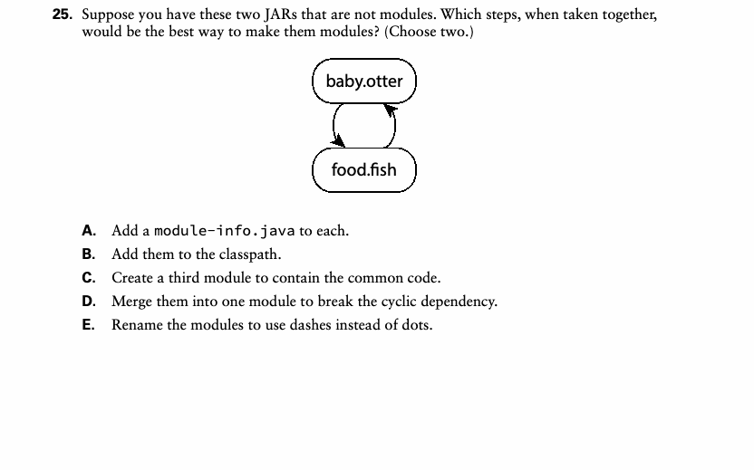


- **A.** Add a `module-info.java` to each.
- **B.** Add them to the classpath.
- **C.** Create a third module to contain the common code.
- **D.** Merge them into one module to break the cyclic dependency.
- **E.** Rename the modules to use dashes instead of dots.

**Answer:** A, C

**Explanation:** Option A is correct, and option B is incorrect as we want to create named modules when possible. We also need to be on the lookout for cyclic dependencies. While option D would work, it is better to be more granular and create a third module as in option C. Option E is incorrect because dots are used as separators in names.

## 829-07-026

Which command produces output such as the following?

```java
animal.puppy -> animal.dog
```

- **A.** `jdeps –d zoo.animal.puppy.jar`
- **B.** `jdeps –s zoo.animal.puppy.jar`
- **C.** `jmod –d zoo.animal.puppy.jar`
- **D.** `jmod –s zoo.animal.puppy.jar`
- **E.** None of the above

**Answer:** B

**Explanation:** The `jdeps` command lists information about dependencies within a module. The `–s` option provides a summary of output rather than verbose output, making option B the correct answer. There is no `–d` option. The `jmod` command is for working with JMOD files.

## 829-07-027

Suppose the consumer, service locator, service provider, and service provider interface are each in separate modules. Which of the following best describes the following `module-info` file?

```java
module nature.tree{
   requires nature.sapling;
   provides nature.sapling.Tree with nature.tree.Maple
}
```

- **A.** Consumer
- **B.** Service locator
- **C.** Service provider
- **D.** Service provider interface
- **E.** None of the above

**Answer:** C

**Explanation:** Option C is correct because a service provider `requires` the interface. It also `provides` the implementation.

## 829-07-028

Suppose we have a `com.bird` module that contains a `com.bird.tweet` package and a `Tweety` class with a `main()` method. Which of the following can fill in the blank to run this program?

```java
java --module-path mods –module
```

- **A.** `com.bird.Tweety`
- **B.** `com.bird.tweety.Tweety`
- **C.** `com.bird/Tweety`
- **D.** `com.bird.tweet/Tweety`
- **E.** `com.bird/com.bird.tweet.Tweety`
- **F.** `com.bird.tweet/com.bird.Tweety`

**Answer:** E

**Explanation:** When running a module, the module name is listed before the slash, and the fully qualified class name is after the slash. Option E is the only one that meets this criterion.

## 829-07-029

Which types of modules are required to contain a `module-info` file?

- **A.** Automatic only
- **B.** Named only
- **C.** Unnamed only
- **D.** Automatic and named
- **E.** Automatic and unnamed
- **F.** Named and unnamed

**Answer:** B

**Explanation:** An unnamed module is on the classpath. While it is permitted to have a `module-info` file, the file is ignored if present. An automatic module is on the module path and does not have a `module-info` file. A named module is required to have a `module-info` file, making option B the correct answer.

## 829-07-030

Suppose the consumer, service locator, service provider, and service provider interface are each in separate modules. Which of the following best describes the following `module-info` file?

```java
module nature.tree {
  exports nature.tree.leaf;
  requires nature.sapling;
  uses nature.tree.Photosynthesis;
}
```

- **A.** Consumer
- **B.** Service locator
- **C.** Service provider
- **D.** Service provider interface
- **E.** None of the above

**Answer:** B

**Explanation:** Option B is correct because a service locator `uses` the interface. It also `requires` the service provider interface module and `exports` the package with the locator.

## 829-07-031

Which command allows you to create a Java runtime image?


- **A.** `jdeps`
- **B.** `jmod`
- **C.** `jimage`
- **D.** `jlink`
- **E.** None of the above

**Answer:** D

**Explanation:** Option D is correct because the `jlink` command creates a Java runtime using the modules you require and have specified.

## 829-07-032

Suppose the consumer, service locator, service provider, and service provider interface are each in separate modules. Which of the following best describes the following `module-info` file?

```java
module nature.tree{
  requires nature.sapling;
}
```

- **A.** Consumer
- **B.** Service locator
- **C.** Service provider
- **D.** Service provider interface
- **E.** None of the above

**Answer:** E

**Explanation:** A consumer `requires` both the service locator and service provider interface. A service locator and service provider interface need to have an `exports` statement. A service provider needs a `provides` directive. Since none of them match, option E is the answer.

## 829-07-033

Which types of modules are allowed to contain a `module-info` file?

- **A.** Automatic only
- **B.** Named only
- **C.** Unnamed only
- **D.** Automatic and named
- **E.** Automatic and unnamed
- **F.** Named and unnamed

**Answer:** F

**Explanation:** An unnamed module is permitted to have a `module-info` file, but the file is ignored if present. An automatic module does not have a `module-info` file. A named module is required to have a `module-info` file. Therefore, option F is correct.

## 829-07-034

Which of the following is true of this module declaration?

```java
1: class com.mammal {
2:    exports com.mammal.cat;
3:    exports cat.mammal.mouse to com.mice;
4:    uses com.animal;
5: }
```

- **A.** The first line that fails to compile is line 1.
- **B.** The first line that fails to compile is line 2.
- **C.** The first line that fails to compile is line 3.
- **D.** The first line that fails to compile is line 4.
- **E.** The code compiles.

**Answer:** A

**Explanation:** A `module-info` file is required to start with `module` rather than `class`. Therefore, the first line doesn’t compile, and option A is correct.

## 829-07-035

How many of these directives can be used in a `module-info.java` file: `closes`, `export`, `import`, `require`, and `uses`?

- **A.** None
- **B.** One
- **C.** Two
- **D.** Three
- **E.** Four
- **F.** Five

**Answer:** B

**Explanation:** You need to know these directives: `exports`, `requires`, `requires transitive`, `provides`, `opens`, and `uses`. Of these, only `uses` is in the list of candidates in the question, which means option B is correct. Note that `export` and `require` are invalid because they should be `exports` and `requires`, respectively.

## 829-07-036

Suppose the consumer, service locator, service provider, and service provider interface are each in separate modules. Which of the following best describes this `module-info` file?

```java
module nature.tree{
  exports nature.tree.leaf;
}
```

- **A.** Consumer
- **B.** Service locator
- **C.** Service provider
- **D.** Service provider interface
- **E.** None of the above

**Answer:** D

**Explanation:** Option D is correct because a service provider interface exposes the interface without depending on any of the other options.

## 829-07-037

Which of the following are modules supplied by the JDK? (Choose three.)

- **A.** `jdk.base`
- **B.** `jdk.basic`
- **C.** `jdk.desktop`
- **D.** `jdk.javadoc`
- **E.** `jdk.jdeps`
- **F.** `jdk.net`

**Answer:** D, E, F

**Explanation:** The `java.base` module is automatically available to any module without specifying it. However, this question tries to trick you with option A by specifying `jdk.base` instead. Similarly, `java.desktop` exists, but not `jdk.deskop`, making option C wrong. Options D, E, and F are correct because `jdk.javadoc` , `jdk.jdeps`, and `jdk.net` are modules supplied with the JDK. You do need to be able to recognize the names of built-in modules.

## 829-07-038

Which are true statements about types of migration? (Choose three.)

- **A.** All modules are immediately moved to the module path in a bottom-up migration.
- **B.** All modules are immediately moved to the module path in a top-down migration.
- **C.** Modules migrate before the modules that depend on them in a bottom-up migration.
- **D.** Modules migrate before the modules that depend on them in a top-down migration.
- **E.** Modules that are not yet named modules are automatic modules in a bottom-up migration.
- **F.** Modules that are not yet named modules are automatic modules in a top-down migration.

**Answer:** B, C, F

**Explanation:** A top-down migration starts by moving all the modules to the module path as automatic modules, making options B and F correct. A bottom-up migration moves each module after all the modules it depends on have been migrated, making option C correct.

## 829-07-039

A class in which of the following parts of a module service should include a method call to `load(ChocolateLab.class)` that would allow callers to use it?

- **A.** Consumer
- **B.** Service locator
- **C.** Service provider
- **D.** Service provider interface
- **E.** None of the above

**Answer:** B

**Explanation:** The service locator contains a `load()` method, making option B correct.

## 829-07-040

How many of these module declarations are valid?

```java
module com.leaf {}
module com.leaf2 {}
module com-leaf { }
module LEAF {}
module leaf2 {}
```

- **A.** Zero
- **B.** One
- **C.** Two
- **D.** Three
- **E.** Four
- **F.** Five

**Answer:** E

**Explanation:** Module names are permitted to be any valid variable name with the addition of dot separators (`.`). The only one that is problematic is `com-leaf` because dashes are not allowed, making option E correct. As a reminder, numbers are permitted as long as they are not the first character in a segment. Capital letters are discouraged but allowed.

## 829-07-041

Which is a benefit of `ServiceLoader`?

- **A.** It allows you to add functionality without recompiling the application.
- **B.** It allows you to load a service written in C++.
- **C.** It is an interface.
- **D.** When implementing a service, it references the `ServiceLoader`.

**Answer:** A

**Explanation:** Option A is correct because `ServiceLoader` allows you to make your application extensible. A service can be added without recompiling the entire application. It is a class, but the service provider implementation does not reference it, making options C and D incorrect. Option B is not a feature of modules.

## 829-07-042

Which are true statements? (Choose two.)

- **A.** Code on the classpath can reference code in automatic, named, and unnamed modules.
- **B.** Code on the classpath can reference code in named modules, but not automatic and unnamed modules.
- **C.** Code on the classpath can reference code in automatic and named modules, but not unnamed modules.
- **D.** Code on the module path can reference code in automatic, named, and unnamed modules.
- **E.** Code on the module path can reference code in named modules, but not automatic and unnamed modules.
- **F.** Code on the module path can reference code in automatic and named modules, but not unnamed modules.

**Answer:** A, F

**Explanation:** Code on the classpath has not yet been migrated to modules and can reference any code in the application. This is true whether that code is in automatic, named, or unnamed modules, matching option A. Code on the module path operates in a stricter world and cannot reference code on the classpath. Since unnamed modules cannot be accessed in this situation, option F is the second answer.

## 829-07-043

Suppose we have the packages in the diagram. What could we add to the `module-info.java` in `com.duck` to allow the `com.park` module to reference the `Duckling` class but not allow the `com.bread` module to do the same? com.duck com.bread com com bread duckling Food.java Duckling.java module-info.java egg com.park com Egg.java park module-info.java Grass.java module-info.java

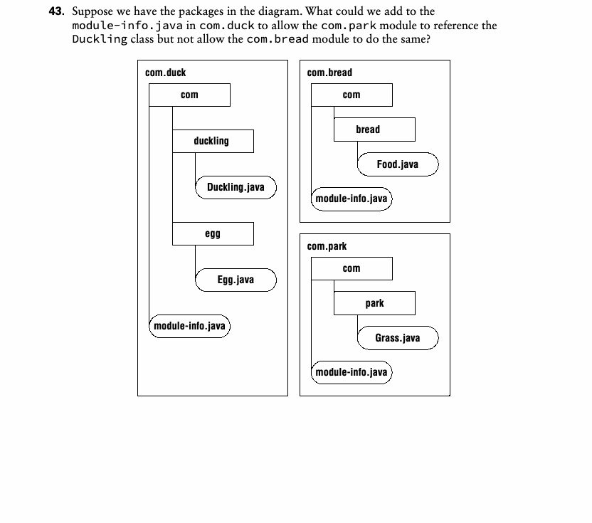


- **A.** `exports com.duckling;`
- **B.** `exports com.duckling from com.park;`
- **C.** `exports com.duckling to com.park;`
- **D.** `exports com.park from com.duckling;`
- **E.** `exports com.park to com.duckling;`
- **F.** None of the above

**Answer:** C

**Explanation:** Option A is incorrect because it exports the package to all modules. Option C is correct because it limits package sharing to the `com.park` module. Option E is incorrect because a package must be exported from the module that contains it. Options B and D are incorrect because `from` is not valid syntax.

## 829-07-044

Given the diagram in the previous question, what could we add to `module-info.java` in `com.duck` to allow the `com.park` package to reference the `Duckling` class, but not allow the `Egg` class to reference the `Duckling` class?

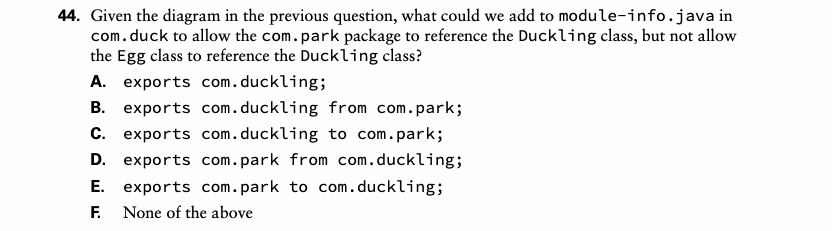

- **A.** `exports com.duckling;`
- **B.** `exports com.duckling from com.park;`
- **C.** `exports com.duckling to com.park;`
- **D.** `exports com.park from com.duckling;`
- **E.** `exports com.park to com.duckling;`
- **F.** None of the above

**Answer:** F

**Explanation:** It is not possible to provide access outside the module while also limiting access within the `com.duck` module. Options A and C are tempting because they do provide access in `com.park`. However, they do not prevent the `Egg` class in the `com.egg` package from accessing the `com.duckling` package. Remember that the `com.egg` package is in the `com.duck` module, so the access cannot be restricted. Therefore, option F is correct.

## 829-07-045

Given the diagram in Question 43 and the correct export statement to share only `com.duckling`, which of the following should be included in the `module-info.java` file of `com.park` to specify that `com.park` should have access to the `com.duckling` and `com.bread` packages, but not the `com.egg` package?

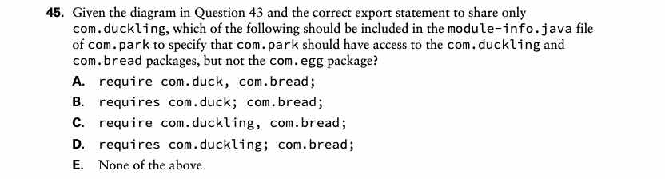

- **A.** `require com.duck, com.bread;`
- **B.** `requires com.duck; com.bread;`
- **C.** `require com.duckling, com.bread;`
- **D.** `requires com.duckling; com.bread;`
- **E.** None of the above

**Answer:** E

**Explanation:** The correct way to specify this is `requires com.duck; requires com.bread;`. There is no way to combine two module `requires` statements into one. Additionally, note that the `requires` statement works with a module name, not a package name. Since none of these are correct, option E is the answer.

## 829-07-046

Which is part of the service and has a `provides` directive?

- **A.** Consumer
- **B.** Service locator
- **C.** Service provider
- **D.** Service provider interface
- **E.** None of the above

**Answer:** E

**Explanation:** Only the service provider has a `provides` directive. Since it is not part of the service, option E is the correct answer.

## 829-07-047

Which command is the simplest way to list suggestions for classes in `jdk.unsupported`?

- **A.** `jdeps cookie.jar`
- **B.** `jdeps –s cookie.jar`
- **C.** `jdeps –jdkinternals cookie.jar`
- **D.** `jdeps --jdkinternals cookie.jar`
- **E.** `jdeps -jdkunsupported cookie.jar`
- **F.** `jdeps --jdkunsupported cookie.jar`

**Answer:** C

**Explanation:** Both options A and B note that the JAR depends on the `jdk.unsupported` module. However, they do not list suggested replacements. Option C is correct and option F is incorrect because the desired flag is `-jdkinternals`.

## 829-07-048

Which modules are on the classpath?

- **A.** Automatic only
- **B.** Named only
- **C.** Unnamed only
- **D.** Automatic and named
- **E.** Automatic and unnamed
- **F.** Named and unnamed

**Answer:** C

**Explanation:** Option C is correct because only unnamed modules are on the classpath.

## 829-07-049

Which line of code belongs in a service locator?

- **A.** `ServiceLoader loader = ServiceLoader.load();`
- **B.** `ServiceLoader loader = ServiceLoader.load(Mouse.class);`
- **C.** `ServiceLoader<Mouse> loader = ServiceLoader.load();`
- **D.** `ServiceLoader<Mouse> loader = ServiceLoader.load(Mouse.class);`
- **E.** `Mouse loader = ServiceLoader.load();`
- **F.** `Mouse loader = ServiceLoader.load(Mouse.class);`

**Answer:** D

**Explanation:** The service locator contains a `ServiceLoader` call to look up the service implementations. It takes the type of class to look up as a parameter and returns a generic, making option D the correct answer.

## 829-07-050

Which are true about a service? (Choose two.)

- **A.** Changing the service provider interface always requires recompiling the service provider.
- **B.** Changing the service provider interface sometimes requires recompiling the service provider.
- **C.** Changing the service provider interface never requires recompiling the service provider.
- **D.** If the service provider interface references other classes in the method signatures, they are considered part of the service.
- **E.** If the service provider interface references other classes in the method signatures, they are not considered part of the service.

**Answer:** B, D

**Explanation:** Option B is correct because it depends on the change. If a method is added to the service provider interface or a `public` method is changed, the service providers must be recompiled. However, if a change is made that does not affect the service provider, such as a new `static` method, recompilation is not needed. Option D is also correct because return types and parameter types are considered part of the service.

## 829-07-051

Which modules are on the module path?

- **A.** Automatic only
- **B.** Named only
- **C.** Unnamed only
- **D.** Automatic and named
- **E.** Automatic and unnamed
- **F.** Named and unnamed

**Answer:** D

**Explanation:** Unnamed modules are on the classpath. Option D is correct because automatic and named modules are on the module path.

## 829-07-052

Each box in the diagram corresponds to a module. The service locator and service provider interface share a module. Which boxes represent the consumer and service provider, respectively? X Z Y

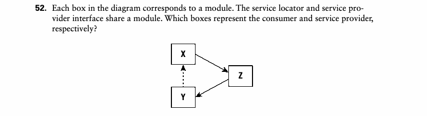


- **A.** X and Y
- **B.** X and Z
- **C.** Y and Z
- **D.** Z and Z
- **E.** Z and Y
- **F.** None of the above

**Answer:** F

**Explanation:** The consumer needs to depend on the shared module, making it X. The shared module then has to be Z, and the service provider has to be Y. However, the service provider should not know about the consumer and the dotted line in the diagram does not make sense. This means none of the options can create a valid scenario, and option F is the answer.

## 829-07-053

Which command is the simplest way to list what modules a JAR depends on without listing package names?

- **A.** `jdeps cookie.jar`
- **B.** `jdeps –s cookie.jar`
- **C.** `jdeps –jdkinternals cookie.jar`
- **D.** `jdeps --jdkinternals cookie.jar`
- **E.** `jdeps -jdk-unsupported cookie.jar`
- **F.** `jdeps --jdk-unsupported cookie.jar`

**Answer:** B

**Explanation:** Without any command-line flags, `jdeps` lists packages and module dependencies. The `-s` flag provides a summary and omits the package name, which means option B is the correct answer.

## 829-07-054

What flag do you use on `jlink` in order to specify the directory where the generated runtime image should be placed?

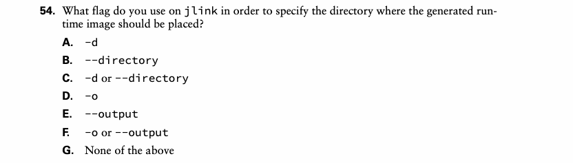

- **A.** `-d`
- **B.** `--directory`
- **C.** `-d` or `--directory`
- **D.** `-o`
- **E.** `--output`
- **F.** `-o` or `--output`
- **G.** None of the above

**Answer:** E

**Explanation:** The `--output` flag provides the desired output directory. There is no abbreviated form for this option, making option E the answer.

## 829-07-055

Fill in the blanks to list a way of getting a lot of useful information in debugging modules.

```java
-m x –p y --
```

- **A.** `jar` and `show-modules`
- **B.** `jar` and `show-module-detail`
- **C.** `jar` and `show-module-resolution`
- **D.** `java` and `show-modules`
- **E.** `java` and `show-module-detail`
- **F.** `java` and `show-module-resolution`

**Answer:** F

**Explanation:** The first clue is that the `-m` and `-p` options are on the `java` command. Beyond that, you need to memorize the name of the `--show-module-resolution` option. This makes option F correct.

## 829-07-056

Suppose you have the following interface in a module named `animal.insect.api`. What needs to be included in the `module-info` file for it to be a service provider interface?

```java
package animal.insect.api.bugs;
public interface Bug {
   int crawl();
}
```

- **A.** `exports animal.insect.api;`
- **B.** `exports animal.insect.api.bugs;`
- **C.** `exports animal.insect.api.bugs.Bug;`
- **D.** `requires animal.insect.api;`
- **E.** `requires animal.insect.api.bugs;`
- **F.** `requires animal.insect.api.bugs.Bug;`

**Answer:** B

**Explanation:** This module is a service provider interface. The only requirement is that the module needs to export the package containing the interface. In this case, that is the `animal.insect.api.bugs` package, which matches option B.

## 829-07-057

Suppose you have the following class in a module named `animal.insect.impl` and the service provider interface module from Question 56. What needs to be included in the `module-info` for it to be a service provider? (Choose two.)

```java
package animal.insect.impl;
import animal.insect.api.bugs.Bug;
public class Worm implements Bug {
   @Override
   public int crawl() {
     return 1;
   } }
```

- **A.** `requires animal.insect.api;`
- **B.** `requires animal.insect.lookup;`
- **C.** `requires animal.printer;`
- **D.** `provides animal.insect.impl.Worm;`
- **E.** `provides animal.insect.api.bugs.Bug with`

  ```java
  animal.insect.impl.Worm;
  ```
- **F.** `provides animal.insect.impl.Worm with`

  ```java
  animal.insect.api.bugs.Bug;
  ```

**Answer:** A, E

**Explanation:** This module is a service provider. It needs a `requires` directive for the service provider interface, which is option A. It also needs a `provides` directive, which specifies both the interface and implementation. Option E has both in the correct order.

## 829-07-058

Suppose you have the following class in a module named `animal.insect.lookup`, the service provider interface from Question 56, and the service provider from Question 57. What needs to be included in the `module-info` file besides an `exports` directive for it to be a service locator? (Choose two.)

```java
package animal.insect.lookup;
import animal.insect.api.bugs.Bug;
import java.util.List;
import java.util.ServiceLoader;
import java.util.stream.Collectors;
public class InsectFinder {
   public static List<Bug> findAllBugs() {
     return ServiceLoader.load(Bug.class)
       .stream()
       .map(ServiceLoader.Provider::get)
       .collect(Collectors.toList());
  } }
```

- **A.** `provides animal.insect.lookup;`
- **B.** `provides animal.insect.lookup.InsectFinder;`
- **C.** `requires animal.insect.api;`
- **D.** `requires animal.insect.api.Bug;`
- **E.** `uses animal.insect.api.bugs;`
- **F.** `uses animal.insect.api.bugs.Bug;`

**Answer:** C, F

**Explanation:** This module is a service locator. It needs three directives: `exports`, `requires`, and `uses`. The `requires` directive specifies the module it depends on, which is option C. The `uses` directive specifies the service provider interface it references, which is option F.

## 829-07-059

Suppose you have the following class in a module named `animal.insect.printer`, the service provider interface from Question 56, the service provider from Question 57, and the service locator from Question 58. What needs to be included in the `module-info` for it to be a consumer? (Choose two.)

```java
package animal.printer;
import animal.insect.lookup.InsectFinder;
public class Print {
   public static void main(String[] args) {
     var bugs = InsectFinder.findAllBugs();
     bugs.forEach(System.out::println);
   } }
```

- **A.** `requires animal.insect.api.bugs;`
- **B.** `requires animal.insect.lookup;`
- **C.** `requires animal.printer;`
- **D.** `uses animal.insect.api.bugs;`
- **E.** `uses animal.insect.api.bugs.Bug;`
- **F.** `uses animal.insect.lookup.InsectFinder;`

**Answer:** A, B

**Explanation:** This module is a consumer. It needs two `requires` directives. Option A is correct because it represents the service provider interface. Additionally, option B is correct as it represents the service locator. The `uses` directive should be in the service locator, not the consumer.

## 829-07-060

Which command is the simplest way to list what modules a JAR depends on, including package names?

- **A.** `jdeps cookie.jar`
- **B.** `jdeps –s cookie.jar`
- **C.** `jdeps –jdkinternals cookie.jar`
- **D.** `jdeps --jdkinternals cookie.jar`
- **E.** `jdeps -jdk-unsupported cookie.jar`
- **F.** `jdeps --jdk-unsupported cookie.jar`

**Answer:** A

**Explanation:** Without any command-line flags, `jdeps` lists packages and module dependencies, making option A correct. Option D will also list the packages; however, it is longer than option A.

## 829-07-061

How many modules are part of the cyclic dependency?

```java
module com.light {
   exports com.light;
}
module com.animal {
   exports com.animal;
   requires com.light;
   requires com.plant;
}
module com.plant {
   exports com.plant;
   requires com.light;
   requires com.animal;
}
module com.worm {
   exports com.worm;
   requires com.light;
   requires com.animal;
   requires com.plant;
}
```

- **A.** 0
- **B.** 1
- **C.** 2
- **D.** 3
- **E.** 4

**Answer:** C

**Explanation:** The `com.light` module does not have any dependencies, so it is fine. However, `com.animal` and `com.plant` depend on each other, giving us a cyclic dependency. Finally, `com.worm` depends on all the modules but does not introduce any more problems. It will not compile until `com.animal` or `com.plant` are fixed but is not part of the cycle itself. Option C is correct, since only two modules are part of the cycle.

## 829-07-062

What is true about the `-d` option?

- **A.** It can be used with the `jar` command, but not the `java` command.
- **B.** It can be used with the `java` command, but not the `jar` command.
- **C.** It can be used with the `jar` and `java` commands and serves the same purpose for both.
- **D.** It can be used with the `jar` and `java` commands, but means “directory” for the former and “describe module” for the latter.
- **E.** None of the above.

**Answer:** C

**Explanation:** The `-d` option is shorthand for `--describe-module` on both the `jar` and `java` commands. Therefore, option C is correct.

## 829-07-063

Assuming all referenced files and directories exist and are correct, what does this code do?

```java
javac –m mods –d mouse mouse/com/mouse/*.java
   mouse/module-info.java
jar –cvf mods/com.mouse.jar –C mouse/ .
```

- **A.** Creates a JAR file representing the `com.mouse` module
- **B.** Creates a JAR file that is not a module
- **C.** Fails on the `javac` command
- **D.** Fails on the `jar` command

**Answer:** C

**Explanation:** The `javac` command takes `-p` for the module path rather than `-m`. Therefore, option C is the correct answer.

## 829-07-064

Which module is always in the `jdeps` output?

- **A.** `java.base`
- **B.** `java.lang`
- **C.** `java.self`
- **D.** `jdk.base`
- **E.** `jdk.lang`
- **F.** `jdk.self`

**Answer:** A

**Explanation:** Option B is tempting because the `java.lang` package is available to all classes. However, the question asks about modules. Option A is the answer because the `java.base` module is available to all modules. The other options are incorrect because those modules do not exist.

## 829-07-065

Which are valid modes on the `jmod` command? (Choose three.)

- **A.** `create`
- **B.** `list`
- **C.** `hash`
- **D.** `show`
- **E.** `verbose`
- **F.** `version`

**Answer:** A, B, C

**Explanation:** The `jmod` command has five possible modes: `create`, `extract`, `describe`, `list`, and `hash`. This makes options A, B, and C the answer.

## 829-07-066

This diagram shows the second step of a migration to modules. What type of migration is this? classpath module path butterflfly caterpillar

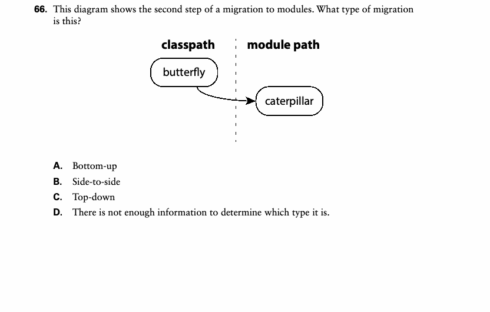


- **A.** Bottom-up
- **B.** Side-to-side
- **C.** Top-down
- **D.** There is not enough information to determine which type it is.

**Answer:** A

**Explanation:** There is no such thing as a side-to-side migration, ruling out option B. In a top-down migration, all modules are moved to the module path first, making option C incorrect. In a bottom-up migration, modules are moved, starting with those without dependencies. Therefore, option A is correct.

## 829-07-067

Which are true statements about the diagram and scenario in the previous question? (Choose two.)

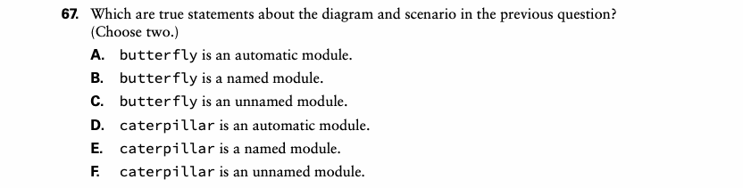

- **A.** `butterfly` is an automatic module.
- **B.** `butterfly` is a named module.
- **C.** `butterfly` is an unnamed module.
- **D.** `caterpillar` is an automatic module.
- **E.** `caterpillar` is a named module.
- **F.** `caterpillar` is an unnamed module.

**Answer:** C, E

**Explanation:** In a bottom-up migration, the lowest-level modules are migrated to named modules on the module path first. This makes option E one of the answers. The modules that remain on the classpath are unnamed modules, making option C the other answer.

## 829-07-068

Suppose we have the two JARs in the diagram on the module path and the `module-info` in the `com.magic` JAR only `exports` one package: `com.magic.unicorn`. There is no `module-info` file in the `com.science` JAR. How many of the four packages in the diagram can a third module on the module path access? com.magic com.science com.magic.dragon com.science.bio com.magic.unicorn com.science.chem module-info

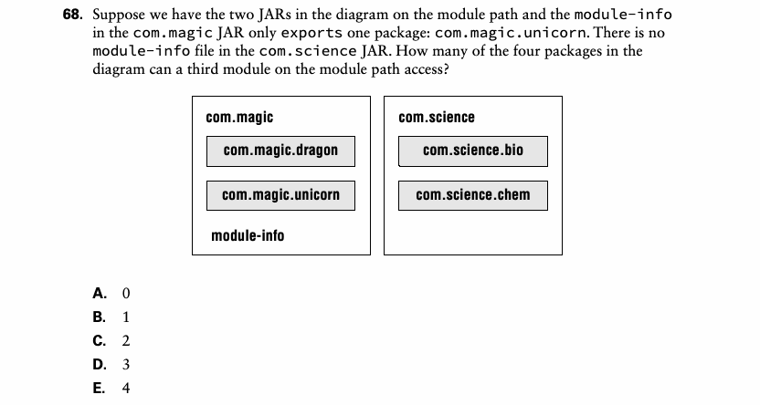

- **A.** 0
- **B.** 1
- **C.** 2
- **D.** 3
- **E.** 4

**Answer:** D

**Explanation:** The `com.magic` module exports only one package. This makes the `com.magic.` `unicorn` package accessible, but not the `com.magic.dragon` package. Both packages in `com.science` are accessible because it is an automatic module. When a module on the module path does not contain a `module-info` file, all packages are exported. This gives us three packages that are accessible and an answer of option D.

## 829-07-069

Suppose the two JARs described in the previous question are on the classpath. How many of the four packages in the diagram can a module on the module path access?

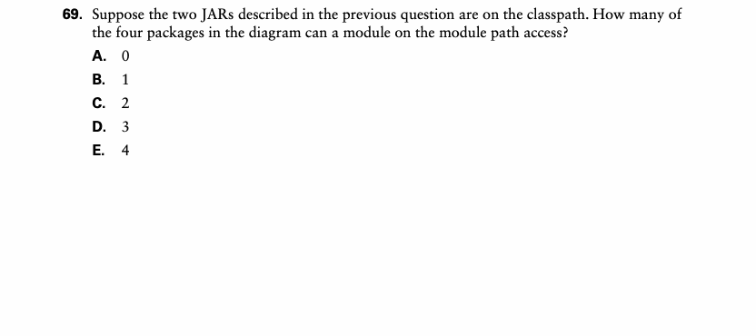


- **A.** 0
- **B.** 1
- **C.** 2
- **D.** 3
- **E.** 4

**Answer:** A

**Explanation:** Modules on the module path cannot access anything from the classpath, making option A the answer.

## 829-07-070

What is true about the following `module-info.java` file?

```java
module Book { }
```

- **A.** It does not compile because it is empty.
- **B.** It does not compile because the module name is uppercase.
- **C.** It does not compile because the module name has only one component.
- **D.** It does not compile for another reason.
- **E.** It compiles.

**Answer:** E

**Explanation:** Option E is correct as this code does compile. Although it is uncommon, a module is not required to have any directives in the body. Similarly, module names are lowercase and have more than one component by convention. None of these problems prevent the file from compiling, though.

## 829-07-071

When adding a new service provider, which of these do you need to recompile?

- **A.** Consumer
- **B.** Service locator
- **C.** Existing service providers
- **D.** Service provider interface
- **E.** None of the above

**Answer:** E

**Explanation:** One of the benefits of services is not having to recompile existing code when adding a new implementation. This makes option E the answer.

## 829-07-072

When working with modules, what option names are equivalent to `-m` and `-s`?

- **A.** `--module` and `--short`
- **B.** `--module` and `--statistics`
- **C.** `--module` and `--summary`
- **D.** `--module-path` and `--short`
- **E.** `--module-path` and `--statistics`
- **F.** `--module-path` and `--summary`

**Answer:** C

**Explanation:** The `java` command uses `-m` and `--module` to supply the module name. The `jdeps` command uses `-s` and `--summary` to specify that the output should be limited. Option C matches both of these.

## 829-07-073

Which are considered part of a service?

- **A.** Classes referenced by the implementation, but not the interface
- **B.** Classes referenced by the interface, but not the implementation
- **C.** Classes referenced by either the implementation or the interface
- **D.** None of the above

**Answer:** B

**Explanation:** A service consists of the interface, any classes the interface references, and a way to look up implementations of the interface. It does not include the implementation. This makes option B the answer.

## 829-07-074

Which command uses `–s` to represent summary?

- **A.** `jdeps`
- **B.** `jlink`
- **C.** `jmod`
- **D.** Both `jdeps` and `jlink`
- **E.** Both `jlink` and `jmod`
- **F.** All of the above
- **G.** None of the above

**Answer:** A

**Explanation:** Option A is correct because only `jdeps` uses this `-s`.

## 829-07-075

Suppose you have the following class in a module named `animal.insect.impl`. Which two most likely go in the `module-info` of the service locator? (Choose two.)

```java
package animal.insect.impl;
import animal.insect.api.bugs.Bug;
public class Worm implements Bug {
   @Override
   public int crawl() {
     return 1;
   } }
```

- **A.** `requires animal.insect.api.bugs;`
- **B.** `requires animal.insect.api.bugs.Bug;`
- **C.** `requires animal.insect.impl;`
- **D.** `uses animal.insect.api.bugs;`
- **E.** `uses animal.insect.api.bugs.Bug;`
- **F.** `uses animal.insect.api.bugs.Bug with animal.insect.impl.Worm;`

**Answer:** A, E

**Explanation:** This question is tricky because the service provider code is shown, but the question asks about the service locator, and you need to infer information about the service provider interface. Option B is incorrect because the `requires` directive references a module name rather than an interface. Option C is incorrect because we need the service provider interface module, and it refers to the service provider module. The `requires` directive is option A due to process of elimination. Option E is easier, since the `uses` directive works with an interface name. Therefore, options A and E are the answers.

## 829-07-076

Which of the following statements are true? (Choose two.)

- **A.** A bottom-up migration has more steps involving the classpath than a top-down migration.
- **B.** A top-down migration has more steps involving the classpath than a bottom-up migration.
- **C.** Both types of migration have the same number of steps involving the classpath.
- **D.** A bottom-up migration has unnamed modules on the module path.
- **E.** A top-down migration has unnamed modules on the module path.
- **F.** Neither migration type has unnamed modules on the module path.

**Answer:** A, F

**Explanation:** A bottom-up migration leaves unnamed modules on the classpath until they are migrated to the module path, making option A correct and option D incorrect. A top-down migration immediately moves all modules to the module path as automatic modules, making options B and E incorrect. Therefore, option F is the other answer.

## 829-07-077

Fill in the blank with code to look up and call a service.

```java
String cheese = ServiceLoader.load(Mouse.class)
   .stream()
   .map( _____________ )
   .map(Mouse::favoriteFood)
   .findFirst()
   .orElse("");
```

- **A.** `Mouse.get()`
- **B.** `Mouse::get`
- **C.** `Provider.get()`
- **D.** `Provider::get`
- **E.** None of the above

**Answer:** D

**Explanation:** The `ServiceLoader` class has a `load()` method that returns a `Collection` of `Provider`. Option D is correct because we need to convert the `Provider` into a `Mouse`.

## 829-07-078

Given the following diagram, with each box representing a module, what statements need to be in `module-info.java` for the `mammal` module? (Choose three.) animal mammal animal.util mammal.eat milk panda milk.store panda.food

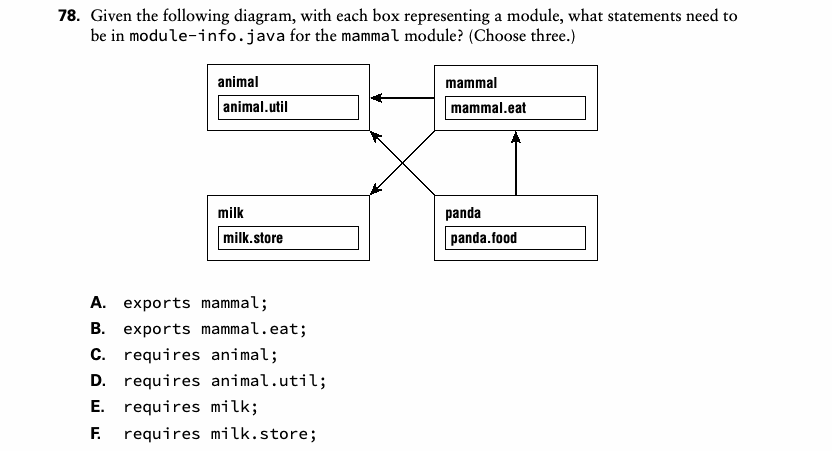

- **A.** `exports mammal;`
- **B.** `exports mammal.eat;`
- **C.** `requires animal;`
- **D.** `requires animal.util;`
- **E.** `requires milk;`
- **F.** `requires milk.store;`

**Answer:** B, C, E

**Explanation:** The `mammal` module depends on two other modules. Since `requires` references module names, options C and E are correct. The module also has one package, which is referenced in the `exports` directive. This makes option B correct as well.

## 829-07-079

Given the previous diagram and the following `module-info.java` for the `panda` module, what change can be made to the `requires` statement?

```java
module panda {
   requires mammal;
}
```

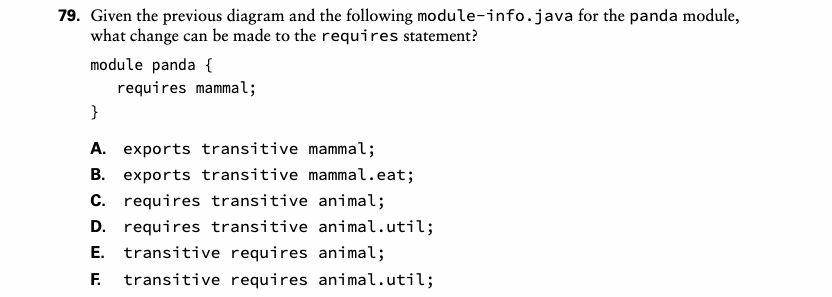

- **A.** `exports transitive mammal;`
- **B.** `exports transitive mammal.eat;`
- **C.** `requires transitive animal;`
- **D.** `requires transitive animal.util;`
- **E.** `transitive requires animal;`
- **F.** `transitive requires animal.util;`

**Answer:** C

**Explanation:** The `transitive` keyword goes after `requires`, ruling out all but options C and D. Just like `requires`, `requires transitive` references a module name, narrowing it down to option C.

## 829-07-080

Given the diagram in Question 78 and the following `module-info.java` for the `panda` module, what is the result of including line `m1`?

```java
module panda {
   requires mammal;
   requires transitive mammal; // line m1
}
```

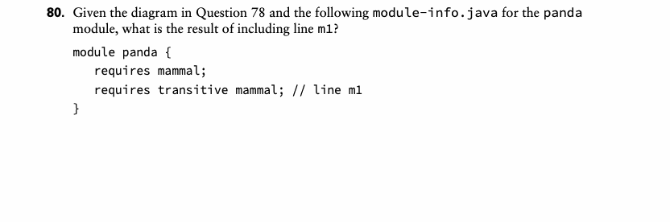


- **A.** Any modules that require `mammal` will automatically get `panda` as well.
- **B.** Any modules that require `panda` will automatically get `mammal` as well.
- **C.** There is no change in behavior.
- **D.** The code does not compile.

**Answer:** D

**Explanation:** Any `requires` directives must reference unique modules. Using the `transitive` keyword does not change this requirement, making option D the answer.

## 829-07-081

How many service providers are allowed to implement a service provider interface?

- **A.** Exactly one
- **B.** Exactly two
- **C.** One or two
- **D.** One or more
- **E.** None of the above

**Answer:** D

**Explanation:** There can be multiple service providers for a single service provider interface, making option D the answer.

## 829-07-082

Which of the following are modules supplied by the JDK? (Choose three.)

- **A.** `java.logging`
- **B.** `java.javadoc`
- **C.** `java.jdk`
- **D.** `java.management`
- **E.** `java.naming`
- **F.** `java.scripts`

**Answer:** A, D, E

**Explanation:** The `java.logging`, `java.management`, and `java.naming` modules exist, making options A, D, and E correct. Option B is tempting. However, `jdk.javadoc` exists, not `java.javadoc`. Options C and F are completely made up.

## 829-07-083

Which are true of a JAR file that has only one `module-info.class` file, placed in the `META-INF` directory? (Choose two.)

- **A.** It is an automatic module if on the classpath.
- **B.** It is an automatic module if on the module path.
- **C.** It is a named module if on the classpath.
- **D.** It is a named module if on the module path.
- **E.** It is an unnamed module if on the classpath.
- **F.** It is an unnamed module if on the module path.

**Answer:** B, E

**Explanation:** Option E is correct because all modules on the classpath are unnamed modules. On the module path, we can have automatic or named modules. In this case, it is an automatic module because there is no `module-info.class` at the root of the JAR. Having that file in another directory is ignored. This makes option B the other answer.

## 829-07-084

Each box in the following diagram corresponds to a module. The service locator and service provider interface share a module. Which boxes represent the consumer and service provider, respectively? X Z Y

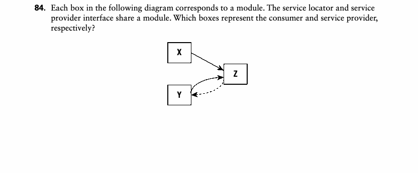


- **A.** X and Y
- **B.** X and Z
- **C.** Y and Z
- **D.** Z and Z
- **E.** Z and Y
- **F.** None of the above

**Answer:** A

**Explanation:** The consumer needs to depend on the shared module, making it X. The shared module then has to be Z, and the service provider has to be Y. This makes option A correct.

## 829-07-085

Which of the following statements are most accurate about the `ServiceLoader` class? (Choose two.)

- **A.** `load()` does not take any parameters.
- **B.** `load()` takes the class type as a parameter.
- **C.** When looping through the results of `load()`, you need to call the `get()` method on `Provider`.
- **D.** When using the results of `load()` in a `Stream`, you need to call the `get()` method on `Provider`.

**Answer:** B, D

**Explanation:** The method call of `ServiceLoader.load()` takes a parameter, making option B correct and option A incorrect. When using a `Stream`, you call `Provider::get`, making option D the other answer. Option C is incorrect because you don’t need to call the `get()` method when using a loop.

## 829-07-086

Suppose we have an automatic module on the module path named `lizard-^-cricket-^-1.0.0-SNAPSHOT.jar` and no `Automatic-Module-Name` specified. What module name should named modules use to reference it?

- **A.** `lizard-cricket`
- **B.** `lizard.cricket`
- **C.** `lizard-cricket-SNAPSHOT`
- **D.** `lizard-cricket.SNAPSHOT`
- **E.** None of the above

**Answer:** B

**Explanation:** The rules for determining the name include removing the extension, removing numbers, and changing special characters to periods (`.`). Additionally, we remove the version information from the end, which is `1.0.0-SNAPSHOT`. Finally, we normalize the duplicate dots, which gives us option B: `lizard.cricket`.

## 829-07-087

What file formats are legal for a module to be distributed in?

- **A.** `jar`
- **B.** `jmod`
- **C.** `zip`
- **D.** `jar` and `jmod`
- **E.** `jar` and `zip`
- **F.** `jmod` and `zip`

**Answer:** D

**Explanation:** The `jar` file format is the most common. The JMOD `jmod` format is used as well. Therefore, option D is correct.

## 829-07-088

Why is this `module-info` incorrect for a service provider?

```java
module plant.flower {
   exports plant.flower.impl;
   requires plant.flower.api;
   provides plant.flower.api.Petal
     with plant.flower.impl.PetalImpl;
}
```

- **A.** The `exports` directive should be `export`.
- **B.** The `exports` directive should not be present because all calls to the service provider should use the service locator.
- **C.** The `provides` directive should be `uses` instead.
- **D.** The `provides` directive has the implementation and interface in the wrong order.
- **E.** The `requires` directive should be `exports` instead.
- **F.** The `requires` directive should not be present because `provides` implies it.

**Answer:** B

**Explanation:** Option B is correct because a service provider should not contain an `exports` directive. The service locator is used to reference any implementation exposed by `provides`.

## 829-07-089

How many modules are part of the cyclic dependency?

```java
module.com.light {
   exports com.light;
}
module com.plant {
   exports com.plant;
   requires com.light;
   requires com.animal;
}
module com.animal {
   exports com.animal;
   requires com.light;
}
module com.worm {
   exports com.worm;
   requires com.light;
   requires com.animal;
   requires com.plant;
}
```

- **A.** 0
- **B.** 1
- **C.** 2
- **D.** 3
- **E.** 4

**Answer:** A

**Explanation:** The `com.light` module is a dependency for all the other modules but does not depend on them. Similarly, the `com.animal` module is a dependency for the two higher-level modules but does not depend on them. Finally, the `com.plant` module is a dependency for the `com.worm` module but does not depend on it. While the modules are not defined in this order, the question is about cyclic dependencies and not order of compilation. There is no cyclic dependency, making option A correct.

## 829-07-090

Which statements are true about `requires mandated java.base`? (Choose two.)

- **A.** This output is expected when running the `java --list-modules` command.
- **B.** This output is expected when running the `java --show-module-resolution` command.
- **C.** This output is expected when running the `jdeps` command.
- **D.** This output is expected when running the `jmod` command.
- **E.** All modules will include this in the output.
- **F.** Some modules will include this in the output. Chapter Managing Concurrent 8 Code Execution THE OCP EXAM TOPICS COVERED IN THIS PRACTICE TEST INCLUDE THE FOLLOWING: ✓ Managing concurrent code execution ■ Create worker threads using Runnable and Callable, manage the thread lifecycle, including automations provided by different Executor services and concurrent API ■ Develop thread-safe code, using different locking mechanisms and concurrent API ■ Process Java collections concurrently including the use of parallel streams

**Answer:** C, E

**Explanation:** The `jdeps` command outputs `requires mandated java.base` except when run in summary mode, making option C correct. Since this module is an implicit dependency in all modules, option E is also correct. Code Execution
