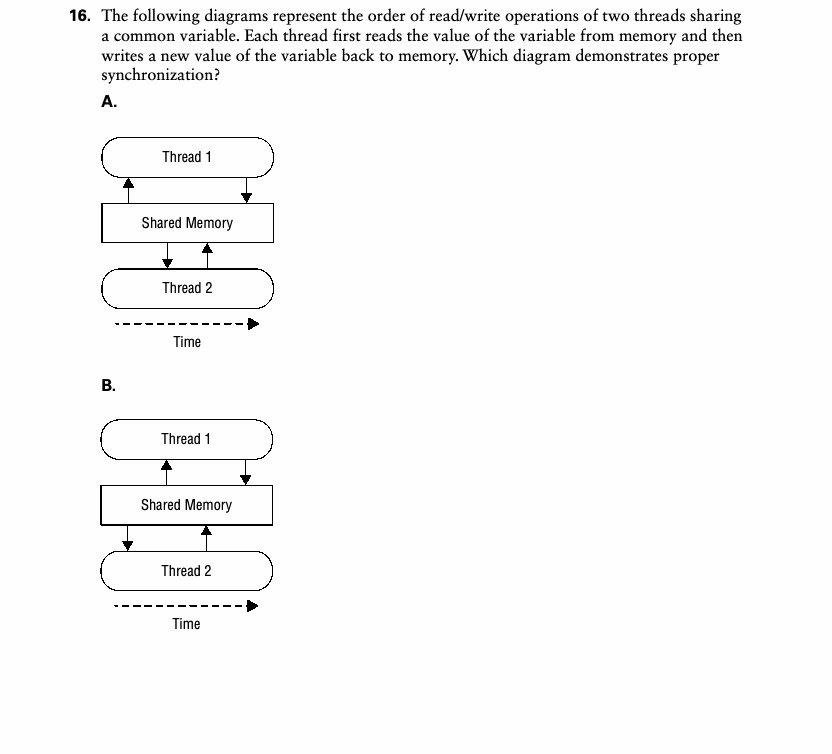
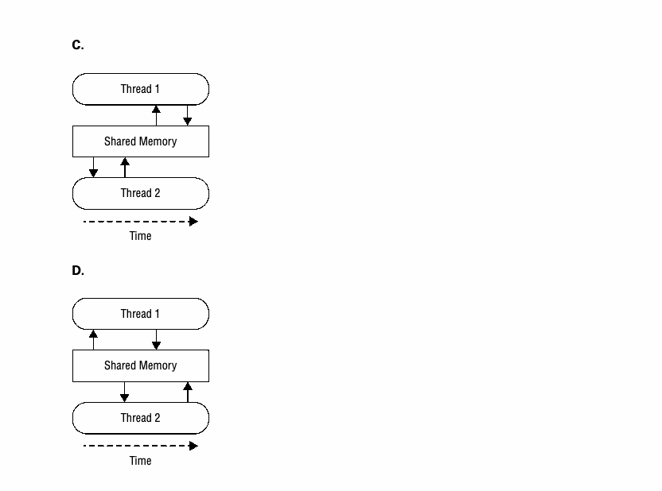

# Chapter 8: Managing Concurrent Code Execution

> Source: *OCP Oracle Certified Professional Java SE 17 Developer Practice Tests (Exam 1Z0-829)*. Extracted from your PDF for personal study. Questions with figures/tables include a scan of the original page.

## 829-08-001

How many times does the following code print `How rude!` at runtime?

```java
public class Speaking {
   void talk() {
     try {
        Thread.sleep(10_000);
     } catch (InterruptedException e) {
        System.out.println("How rude!");
     } }
   public static void main(String[] args) {
     var s = new Speaking();
     var t = new Thread(() -> s.talk());
     t.run();
     t.interrupt();
     t.interrupt();
     t.interrupt();
   } }
```

- **A.** Zero
- **B.** One
- **C.** Two
- **D.** Three
- **E.** The code does not compile.
- **F.** The code compiles but an exception is printed at runtime.

**Answer:** A

**Explanation:** The code compiles, making option E incorrect. The `Thread.run()` method is called instead of `Thread.start()`, so the program is single-threaded. The calls to `interrupt()` have no effect, and nothing is printed at runtime, making option A correct. If `start()` were used instead of `run()`, then the code would print `How rude!` once, as it only catches one

```java
InterruptedException.
```

## 829-08-002

What is the output of the following code snippet?

```java
Callable c = new Callable() {
   public Object run() {
     System.out.print("X");
     return 10;
   }
};
var s = Executors.newScheduledThreadPool(1);
for(int i=0; i<10; i++) {
   Future f = s.submit(c);
   f.get();
}
s.shutdown();
System.out.print("Done!");
```

- **A.** `XXXXXXXXXXDone!`
- **B.** `Done!XXXXXXXXXX`
- **C.** The code does not compile.
- **D.** The code hangs indefinitely at runtime.
- **E.** The code throws an exception at runtime.
- **F.** The output cannot be determined ahead of time.

**Answer:** C

**Explanation:** The code does not compile because `Callable` must define a `call()` method, not a `run()` method, so option C is the correct answer. If the code was fixed to use the correct method name, then it would complete without issue, printing `XXXXXXXXXXDone!` at runtime. The `f.get()` call will block and wait for the results before moving on to the next iteration of the `for` loop.

## 829-08-003

Which of the following methods is not available on an `ExecutorService` instance? (Choose two.)

- **A.** `execute(Callable)`
- **B.** `shutdownNow()`
- **C.** `submit(Runnable)`
- **D.** `exit()`
- **E.** `submit(Callable)`
- **F.** `execute(Runnable)`

**Answer:** A, D

**Explanation:** Option A is correct, as `ExecutorService` does not define nor inherit an overloaded method `execute()` that takes a `Callable` parameter. `ExecutorService` defines two shutdown methods, `shutdown()` and `shutdownNow()`, one of which is shown in option B. Option D is correct, as `exit()` does not exist and is not one of the shutdown methods. The `ExecutorService` interface defines the two `submit()` methods shown in options C and E. Because `ExecutorService` extends `Executor`, it also inherits the `execute(Runnable)` method presented in option F.

## 829-08-004

The following program simulates flipping a coin an even number of times. Assuming five seconds is enough time for all of the tasks to finish, what is the output of the following application?

```java
import java.util.concurrent.*;
import java.util.concurrent.atomic.*;
public class Luck {
   private AtomicBoolean coin = new AtomicBoolean(false);
   void flip() {
     coin.getAndSet(!coin.get());
   }
   public static void main(String[] gamble) throws Exception {
     var luck = new Luck();
     ExecutorService s = Executors.newCachedThreadPool();
     for(int i=0; i<1000; i++) {
        s.execute(() -> luck.flip());
     }
     s.shutdown();
     Thread.sleep(5000);
     System.out.println(luck.coin.get());
   } }
```

- **A.** `false`
- **B.** `true`
- **C.** The code does not compile.
- **D.** The code hangs indefinitely at runtime.
- **E.** The code throws an exception at runtime.
- **F.** The output cannot be determined ahead of time.

**Answer:** F

**Explanation:** The code compiles and runs without issue. Even though the thread-safe `AtomicBoolean` is used, it is not used in a thread-safe manner. The `flip()` method first retrieves the value and then sets a new value. These two calls are not executed together in an atomic or synchronized manner. For this reason, the output could be `true` or `false`, with one or more of the flips possibly being lost, and making option F correct.

## 829-08-005

Which of the following is a recommended way to define an asynchronous task?

- **A.** Create a `Callable` expression and pass it to an instance of an `Executor`.
- **B.** Create a class that extends `Thread` and override the `start()` method.
- **C.** Create a `Runnable` lambda expression and pass it to a `Thread` constructor.
- **D.** Create an anonymous `Runnable` class that overrides the `begin()` method.
- **E.** All of the above.

**Answer:** C

**Explanation:** Option A is incorrect, although it would be correct if `Executor` were replaced with `ExecutorService`. Option B is also incorrect, but it would be correct if `start()` were replaced with `run()`. Option C is correct and is a common way to define an asynchronous task using a lambda expression. Option D is incorrect, as `Runnable` does not inherit a `begin()` method.

## 829-08-006

Assuming five seconds is enough time for the threads in this program to complete, what is the expected result of executing the following program?

```java
import java.util.*;
public class Dance {
   int count = 0;
   synchronized int step() { return count++; }
   public static void main(String[] args) throws InterruptedException {
     var waltz = new Dance();
     var dancers = new ArrayList<Thread>();
     for(int i=0; i<10; i++)
        dancers.add(new Thread(() -> waltz.step()));
     for(Thread dancer : dancers)
        dancer.start();
     dancers.forEach(d -> d.interrupt());
     Thread.sleep(5_000);
     System.out.print(waltz.count);
   } }
```

- **A.** It always prints a number less than `10`.
- **B.** It always prints `10`.
- **C.** It may print `10` or a number less than `10`.
- **D.** The code does not compile.
- **E.** The code compiles but an exception is printed at runtime.
- **F.** None of the above.

**Answer:** B

**Explanation:** The code compiles and is thread-safe, since the call to `step()` is synchronized on the same object. The calls to `interrupt()` have no effect because the threads are never in a waiting state. For this reason, the output is always `10`, making option B correct.

## 829-08-007

Given the following program, how many times is `Locked!` expected to be printed?

```java
import java.util.concurrent.locks.*;
public class Padlock {
   private Lock lock = new ReentrantLock();
   public void lockUp() {
     if (lock.tryLock()) {
         lock.lock();
         System.out.println("Locked!");
         lock.unlock();
       }
    }
    public static void main(String... unused) throws Exception {
       var gate = new Padlock();
       for(int i=0; i<5; i++) {
         new Thread(() -> gate.lockUp()).start();
         Thread.sleep(1_000);
       } } }
```

- **A.** One time.
- **B.** Five times.
- **C.** The code does not compile.
- **D.** The code hangs indefinitely at runtime.
- **E.** The code throws an exception at runtime.
- **F.** The output cannot be determined ahead of time.

**Answer:** A

**Explanation:** If the `tryLock()` method returns `true`, then a lock is acquired that must be released. That means the `lockUp()` method actually contains two calls to lock the object and only one call to unlock it. For this reason, the first thread to reach `tryLock()` obtains a lock that is never released. For this reason, `Locked!` is printed only once, and option A is correct. If the call to `lock()` inside the `if` statement were removed, then the expected output would be to print the statement five times.

## 829-08-008

Which statements about the following application are correct? (Choose two.)

```java
import java.util.concurrent.atomic.*;
import java.util.stream.*;
public class TicketTaker {
   long ticketsSold;
   final AtomicInteger ticketsTaken;
   public TicketTaker() {
     ticketsSold = 0;
     ticketsTaken = new AtomicInteger(0);
   }
   public void performJob() {
     IntStream.iterate(1, p -> p+1)
        .parallel()
        .limit(100)
        .forEach(i -> ticketsTaken.getAndIncrement());
     IntStream.iterate(1, q -> q+1)
        .parallel()
        .limit(500)
        .forEach(i -> ++ticketsSold);
     System.out.print(ticketsTaken+" "+ticketsSold);
   }
  public static void main(String[] matinee) {
    new TicketTaker().performJob();
  } }
```

- **A.** The `TicketTaker` constructor does not compile.
- **B.** The `performJob()` method does not compile.
- **C.** The class compiles.
- **D.** The first number printed is consistently `100`.
- **E.** The second number printed is consistently `500`.
- **F.** A `ConcurrentModificationException` is thrown at runtime.

**Answer:** C, D

**Explanation:** The class compiles and runs without throwing an exception, making option C correct and options A, B, and F incorrect. The class defines two values that are incremented by multiple threads in parallel. The first `IntStream` statement uses an atomic class to update a variable. Since updating an atomic numeric instance is thread-safe by design, the first number printed is always `100`, making option D correct. The second `IntStream` statement uses an `int` with the pre-increment operator (`++`), which is not thread-safe. It is possible two threads could update and set the same value at the same time, a form of race condition, resulting in a value less than `500` and making option E incorrect.

## 829-08-009

Given the `original` array, how many of the following `for` statements result in an exception at runtime, assuming each is executed independently?

```java
var original = List.of(1,2,3,4,5);
var copy1 = new CopyOnWriteArrayList<Integer>(original);
for(Integer w : copy1)
   copy1.remove(w);
var copy2 = Collections.synchronizedList(original);
for(Integer w : copy2)
   copy2.remove(w);
var copy3 = new ArrayList<Integer>(original);
for(Integer w : copy3)
   copy3.remove(w);
var copy4 = new ConcurrentLinkedQueue<Integer>(original);
for(Integer w : copy4)
   copy4.remove(w);
```

- **A.** Zero
- **B.** One
- **C.** Two
- **D.** Three
- **E.** Four
- **F.** The code does not compile.

**Answer:** C

**Explanation:** `CopyOnWriteArrayList` makes a copy of the array every time it is modified, preserving the original list of values the iterator is using, even as the array is modified. For this reason, the `for` loop using `copy1` does not throw an exception at runtime. On the other hand, the `for` loops using `copy2` and `copy3` both throw `ConcurrentModificationException` at runtime since neither allows modification while they are being iterated upon. Finally, the `ConcurrentLinkedQueue` used in `copy4` completes without throwing an exception at runtime. For the exam, remember that the `Concurrent` classes order read/write access such that access to the class is consistent across all threads and processes, while the synchronized classes do not. Because exactly two of the `for` statements produce exceptions at runtime, option C is the correct answer.

## 829-08-010

Fill in the blanks: \_\_\_\_\_\_\_\_\_\_\_\_\_\_ is a special case of \_\_\_\_\_\_\_\_\_\_\_\_\_\_, in which two or more active threads try to acquire the same set of locks and are repeatedly unsuccessful.

- **A.** Deadlock, livelock
- **B.** Deadlock, resource starvation
- **C.** Livelock, resource starvation
- **D.** Resource starvation, race conditions
- **E.** Resource starvation, livelock
- **F.** None of the above

**Answer:** C

**Explanation:** Resource starvation is when a single active thread is perpetually unable to gain access to a shared resource. Livelock is a special case of resource starvation, in which two or more active threads are unable to gain access to shared resources, repeating the process over and over again. For these reasons, option C is the correct answer. Deadlock and livelock are similar, although in a deadlock situation the threads are stuck waiting, rather than being active or performing any work. Finally, a race condition is an undesirable result when two tasks that should be completed sequentially are completed at the same time.

## 829-08-011

What is the output of the following program?

```java
import java.util.stream.*;
public class Bull {
   void charge() {
     IntStream.range(1,6)
        .parallel()
        .forEachOrdered(System.out::print);
   }
   public static void main(String[] args) {
     var b = new Bull();
     b.charge();
   } }
```

- **A.** `12345`
- **B.** `54321`
- **C.** The output cannot be determined ahead of time.
- **D.** The code does not compile.
- **E.** An exception is thrown at runtime.
- **F.** None of the above.

**Answer:** A

**Explanation:** Even though a parallel stream is used, the `forEachOrdered()` method forces the stream to operate in the order of its data source. The code compiles and runs without issue, printing `12345` every time and making option A correct. If `forEach()` were used instead, then the output would vary at runtime.

## 829-08-012

What is the output of the following application?

```java
 3: public class TpsReport {
 4:     public void submitReports() {
 5:       var s = Executors.newCachedThreadPool();
 6:       Future bosses = s.submit(() -> System.out.print("1"));
 7:       s.shutdown();
 8:       System.out.print(bosses.get());
 9:     }
10:    public static void main(String[] memo) {
11:      new TpsReport().submitReports();
12:    } }
```

- **A.** `null`
- **B.** `1null`
- **C.** `1`
- **D.** Line 6 does not compile.
- **E.** Line 8 does not compile.
- **F.** An exception is thrown at runtime.

**Answer:** E

**Explanation:** The class does not compile because the `bosses.get()` on line 8 throws a checked `InterruptedException` and a checked `ExecutionException`, neither of which is handled nor declared by the `submitReports()` method. For this reason, option E is correct.

## 829-08-013

Which of the following `static` methods do not exist in the `Executors` class? (Choose two.)

- **A.** `newFixedScheduledThreadPool()`
- **B.** `newThreadPool()`
- **C.** `newFixedThreadPool(int)`
- **D.** `newSingleThreadExecutor()`
- **E.** `newScheduledThreadPool(int)`
- **F.** `newSingleThreadScheduledExecutor()`

**Answer:** A, B

**Explanation:** Options C, D, E, and F are all proper ways to obtain instances of `ExecutorService`. Remember that `newSingleThreadExecutor()` is equivalent to calling `newFixedThreadPool(int)` with a value of `1`. The correct answers are options A and B, as neither of these methods exists.

## 829-08-014

How many times does the following application print `Ready` at runtime?

```java
package parade;
import java.util.concurrent.*;
public class CartoonCat {
   private void await(CyclicBarrier c) {
     try {
        c.await();
     } catch (Exception e) {}
   }
   public void march(CyclicBarrier c) {
     var s = Executors.newSingleThreadExecutor();
     for(int i=0; i<12; i++)
        s.execute(() -> await(c));
     s.shutdown();
   }
   public static void main(String... strings) {
     new CartoonCat().march(new CyclicBarrier(4,
           () -> System.out.println("Ready")));
   } }
```

- **A.** Zero
- **B.** One
- **C.** Three
- **D.** The code does not compile.
- **E.** An exception is thrown at runtime.

**Answer:** A

**Explanation:** The code compiles without issue but hangs indefinitely at runtime. The application defines a thread executor with a single thread and 12 submitted tasks. Because only one thread is available to work at a time, the first thread will wait endlessly on the call to `await()`. Since the `CyclicBarrier` requires four threads to release it, the application waits endlessly in a frozen condition. Since the barrier is never reached and the code hangs, the application will never output `Ready`, making option A the correct answer.

## 829-08-015

Let’s say you needed a thread executor to create tasks for a `CyclicBarrier` that has a barrier limit of five threads.Which `static` method in `ExecutorService` should you use to obtain it?

- **A.** `newSingleThreadExecutor()`
- **B.** `newSingleThreadScheduledExecutor()`
- **C.** `newCachedThreadPool()`
- **D.** `newFixedThreadPool(2)`
- **E.** None of the above

**Answer:** E

**Explanation:** Trick question! `ExecutorService` does not contain any of these methods. To obtain an instance of a thread executor, you need to use the `Executors` factory class. For this reason, option E is the correct answer. If the question had instead asked which `Executors` method to use, then the correct answer would be option C.

## 829-08-016

The following diagrams represent the order of read/write operations of two threads sharing a common variable. Each thread first reads the value of the variable from memory and then writes a new value of the variable back to memory. Which diagram demonstrates proper synchronization?





- **A.** Thread 1 Shared Memory Thread 2 Time
- **B.** Thread 1 Shared Memory Thread 2 Time
- **C.** Thread 1 Shared Memory Thread 2 Time
- **D.** Thread 1 Shared Memory Thread 2 Time

**Answer:** C

**Explanation:** Part of synchronizing access to a variable is ensuring that read/write operations are atomic or happen without interruption. For example, an increment operation requires reading a value and then immediately writing it. If any thread interrupts this process, then data could be lost. In this regard, option C shows proper synchronized access. Thread 2 reads a value and then writes it without interruption. Thread 1 then reads the new value and writes it. The rest of the answers are incorrect because one thread writes data to the variable in between another thread reading and writing to the same variable.

## 829-08-017

What is the output of the following program? (Choose three.)

```java
import java.util.concurrent.atomic.*;
import java.util.stream.*;
public class Circus {
   private static int seal = 0;
   private static volatile int tiger = 0;
   private static AtomicInteger lion = new AtomicInteger(0);
   public static void main(String[] tent) {
     Stream.iterate(0, x -> x + 1)
        .parallel()
        .limit(100)
        .forEach(q -> {seal++; tiger++; lion.incrementAndGet();});
     System.out.println(seal + "," + tiger + ","+ lion);
   } }
```

- **A.** The first number printed may be less than `100`.
- **B.** The first number printed is always `100`.
- **C.** The second number printed may be less than `100`.
- **D.** The second number printed is always `100`.
- **E.** The third number printed may be less than `100`.
- **F.** The third number printed is always `100`.

**Answer:** A, C, F

**Explanation:** The increment operators on the first two numbers are not thread-safe, so the output could be `100` or a number less than `100`, making options A and C correct. Remember, the `volatile` attribute does not guarantee thread safety. The last number printed is incremented in a thread-safe manner, making option F the other correct answer.

## 829-08-018

What is the output of the following application?

```java
import java.util.*;
import java.util.concurrent.*;
public class Race {
   ExecutorService service = Executors.newFixedThreadPool(8);
   public static int sleep() {
     try { Thread.sleep(1000); } catch (Exception e) {}
     return 1;
   }
   public void hare() {
     try {
        Callable<Integer> c = () -> sleep();
        final var r = List.of(c,c,c);
        var results = service.invokeAll(r);
        System.out.println("Hare won the race!");
     } catch (Exception e) {e.printStackTrace();}
   }
   public void tortoise() {
     try {
        Callable<Integer> c = () -> sleep();
        final var r = List.of(c,c,c);
        Integer result = service.invokeAny(r);
        System.out.println("Tortoise won the race!");
     } catch (Exception e) {e.printStackTrace();}
   }
   public static void main(String[] p) throws Exception {
     var race = new Race();
     race.service.execute(() -> race.hare());
     race.service.execute(() -> race.tortoise());
   } }
```

- **A.** `Hare won the race!` is printed first.
- **B.** `Tortoise won the race!` is printed first.
- **C.** The code does not compile.
- **D.** The code hangs indefinitely at runtime.
- **E.** The code throws an exception at runtime.
- **F.** The output cannot be determined ahead of time.

**Answer:** F

**Explanation:** The code compiles and runs without issue. The two methods `hare()` and `tortoise()` are nearly identical, with one calling `invokeAll()` and the other calling `invokeAny()`. Calling the `invokeAll()` method causes the current thread to wait until all tasks are finished, while calling the `invokeAny()` method will cause the current thread to wait until at least one task is complete. Both `ExecutorService` methods operate synchronously, waiting for a result from one or more tasks, but each method call has been submitted to the thread executor as an asynchronous task. For this reason, both methods will take about one second to complete, and since either can finish first, the output will vary at runtime, making option F correct. Note that this program does not terminate, since the `ExecutorService` is not shut down.

## 829-08-019

Which of the following concurrent collections is sorted? (Choose two.)

- **A.** `ConcurrentSkipList`
- **B.** `ConcurrentSkipListSet`
- **C.** `CopyOnWriteArrayList`
- **D.** `ConcurrentSkipListMap`
- **E.** `ConcurrentLinkedQueue`
- **F.** `LinkedBlockingQueue`

**Answer:** B, D

**Explanation:** `ConcurrentSkipList` does not exist as a concurrent collection, making option A incorrect. `ConcurrentSkipListSet` implements the `SortedSet` interface, in which the elements are kept sorted, making option B correct. `ConcurrentSkipListMap` implements the `SortedMap` interface, in which the keys are kept sorted, making option D correct. The other options define structures that are ordered, but not sorted. Remember, if you see `SkipList` as part of a concurrent class name, it means it is sorted in some way.

## 829-08-020

What is the output of the following application?

```java
package taxes;
import java.util.concurrent.*;
public class Accountant {
   public static void completePaperwork() {
     System.out.print("[Filing]");
   }
   public static double getPi() {
     return 3.14159;
   }
   public static void main(String[] args) throws Exception {
     ExecutorService x = Executors.newSingleThreadExecutor();
     Future<?> f1 = x.submit(() -> completePaperwork());
     Future<Object> f2 = x.submit(() -> getPi());
     System.out.print(f1.get()+" "+f2.get());
     x.shutdown();
   } }
```

- **A.** `[Filing]`
- **B.** `[Filing]3.14159`
- **C.** `[Filing]null 3.14159`
- **D.** The declaration of `f1` does not compile.
- **E.** The declaration of `f2` does not compile.
- **F.** The output cannot be determined ahead of time.

**Answer:** C

**Explanation:** The code compiles without issue, so options D and E are incorrect. The `f1` declaration uses the version of `submit()` in `ExecutorService`, which takes a `Runnable` and returns a `Future<?>`, while the `f2` declaration uses an overloaded version of `submit()`, which takes a `Callable` expression and returns a generic `Future` object. The call `f1.get()` waits until the task is finished and always returns `null`, since `Runnable` expressions have a `void` return type, so `[Filing]null` is printed first. The call to the `f2.get()` return then prints `3.14159`. For these reasons, option C is the correct answer.

## 829-08-021

Assuming 10 seconds is enough time for all the tasks to finish, what statements about the following program are correct? (Choose two.)

```java
import java.util.concurrent.*;
import java.util.concurrent.atomic.*;
public class Clock {
   private AtomicLong bigHand = new AtomicLong(0);
   void incrementBy10() {
     bigHand.getAndSet(bigHand.get() + 10);
   }
   public static void main(String[] c) throws Exception {
     var smartWatch = new Clock();
     ExecutorService s = Executors.newCachedThreadPool();
     for(int i=0; i<100; i++) {
        s.submit(() -> smartWatch.incrementBy10()).get();
     }
     s.shutdown();
     s.awaitTermination(10, TimeUnit.SECONDS);
     System.out.println(smartWatch.bigHand.get());
   } }
```

- **A.** The code does not compile.
- **B.** The `incrementBy10()` method is thread-safe.
- **C.** The `incrementBy10()` method is not thread-safe.
- **D.** The output is `1000` on every execution.
- **E.** The output cannot be determined ahead of time.
- **F.** The code hangs indefinitely at runtime.

**Answer:** C, D

**Explanation:** The code compiles and runs without issue. While an `AtomicLong` is used, there are two calls on this variable, the first to retrieve the value and the second to set the new value. These two calls are not executed together in an atomic or synchronized manner. For this reason, the `incrementBy10()` method is not thread-safe, and option C is correct. That said, the code performs in single-threaded manner at runtime because the call to `get()` in the `main()` method waits for each thread to finish. For this reason, the output is consistently `1000`, making option D correct.

## 829-08-022

What is the most likely result of executing the following application?

```java
package jokes;
import java.util.concurrent.*;
public class Riddle {
   public void sleep() {
     try { Thread.sleep(5000); } catch (Exception e) {}
   }
   public String getQuestion(Riddle r) {
     synchronized {
        sleep();
        if(r != null) r.getAnswer(null);
        return "How many programmers does it take "
              + "to change a light bulb?";
     } }
  public synchronized String getAnswer(Riddle r) {
    sleep();
    if(r != null) r.getAnswer(null);
    return "None, that's a hardware problem";
  }
  public static void main(String... ununused) {
    var r1 = new Riddle();
    var r2 = new Riddle();
    var s = Executors.newFixedThreadPool(2);
    s.submit(() -> r1.getQuestion(r2));
    s.execute(() -> r2.getAnswer(r1));
    s.shutdown();
  } }
```

- **A.** A deadlock is produced at runtime.
- **B.** A livelock is produced at runtime.
- **C.** The application completes successfully.
- **D.** The code does not compile.
- **E.** The code hangs indefinitely at runtime.
- **F.** The output cannot be determined ahead of time.

**Answer:** D

**Explanation:** The `synchronized` block used in the `getQuestion()` method requires an object to synchronize on. Without it, the code does not compile, and option D is the correct answer.

## 829-08-023

Which `ScheduledExecutorService` method can result in the same action being executed by two threads at the same time?

- **A.** `scheduleAtFixedDelay()`
- **B.** `scheduleAtFixedRate()`
- **C.** `scheduleWithFixedDelay()`
- **D.** `scheduleAtSameRate()`
- **E.** `scheduleWithRate()`
- **F.** None of the above

**Answer:** B

**Explanation:** Options A, D, and E include method names that do not exist in `ScheduledExecutorService`. The `scheduleAtFixedRate()` method creates a new task for the associated action at a set time interval, even if previous tasks for the same action are still active. In this manner, multiple threads working on the same action could be executing at the same time, making option B the correct answer. On the other hand, `scheduleWithFixedDelay()` waits until each task is completed before scheduling the next task, guaranteeing at most one thread working on the action is active in the thread pool.

## 829-08-024

What is the output of the following application?

```java
package olympics;
import java.util.concurrent.*;
public class Athlete {
   int stroke = 0;
   public synchronized void swimming() {
     stroke++;
   }
    private int getStroke() {
       synchronized(this) { return stroke; }
    }
    public static void main(String... laps) {
       ExecutorService s = Executors.newFixedThreadPool(10);
       Athlete a = new Athlete();
       for(int i=0; i<1000; i++) {
         s.execute(() -> a.swimming());
       }
       s.shutdown();
       System.out.print(a.getStroke());
    } }
```

- **A.** A deadlock is produced at runtime.
- **B.** A livelock is produced at runtime.
- **C.** `1000`
- **D.** The code does not compile.
- **E.** The result is unknown until runtime because `stroke` is not written in a thread-safe manner and a write may be lost.
- **F.** None of the above.

**Answer:** F

**Explanation:** The application compiles, so option D is incorrect. The `stroke` variable is thread-safe in the sense that no write is lost since all writes are wrapped in a `synchronized` method, making option E incorrect. The issue here is that the `main()` method reads the value of `getStroke()` while tasks may still be executing within the `ExecutorService`. The `shutdown()` method stops new tasks from being submitted but does not wait for previously submitted tasks to complete. Therefore, the result may output `0`, `1000`, or anything in between, making option F the correct answer. If the `ExecutorService` method `awaitTermination()` is called before the value of `stroke` is printed and enough time elapses, then the result would be `1000` every time.

## 829-08-025

Which of the following is most likely to be caused by a race condition?

- **A.** A thread perpetually denied access to a resource
- **B.** A program hanging indefinitely
- **C.** An `int` variable incorrectly reporting the number of times an operation was performed
- **D.** Two threads actively trying to restart a blocked process that is guaranteed to always end the same way
- **E.** Two threads endlessly waiting on each other to release shared locks

**Answer:** C

**Explanation:** A race condition is an undesirable result when two tasks that should be completed sequentially are completed at the same time. The result is often corruption of data in some way. If two threads are both modifying the same `int` variable and there is no synchronization, then a race condition can occur with one of the writes being lost. For this reason, option C is the correct answer. Option A is the description of resource starvation. Options D and E are describing livelock and deadlock, respectively, while option B is the potential result of either of those events occurring.

## 829-08-026

Which statement about the following class is correct?

```java
package my;
import java.util.*;
public class ThreadSafeList {
   private List<Integer> data = new ArrayList<>();
   public synchronized void addValue(int value) {
     data.add(value);
   }
   public int getValue(int index) {
     return data.get(index);
   }
  public int size() {
    synchronized(ThreadSafeList.class) {
       return data.size();
    } } }
```

- **A.** The code compiles and is thread-safe.
- **B.** The code compiles and is not thread-safe.
- **C.** The code does not compile because of the `size()` method.
- **D.** The code does not compile because of the `getValue()` method.
- **E.** The code does not compile for another reason.
- **F.** None of the above.

**Answer:** B

**Explanation:** The class compiles without issue. The class attempts to create a synchronized version of a `List<Integer>`. The `size()` and `addValue()` methods help synchronize the read/write operations. Unfortunately, the `getValue()` method is not synchronized so the class is not thread-safe, and option B is the correct answer. It is possible that one thread could add to the `data` object while another thread is reading from the object, leading to an unexpected result.

## 829-08-027

Which two method names, when filled into the `print2()` method, produce the same output as the `print1()` method? Assume the input arguments for each represent the same non-`null` numeric value.

```java
public static synchronized void print1(int counter) {
   System.out.println(counter--);
   System.out.println(++counter);
}
public static synchronized void print2(AtomicInteger counter) {
   System.out.println(counter. _____________ );
   System.out.println(counter. _____________ );
}
```

- **A.** `decrementAndGet()` and `getAndIncrement()`
- **B.** `decrementAndGet()` and `incrementAndGet()`
- **C.** `getAndDecrement()` and `getAndIncrement()`
- **D.** `getAndDecrement()` and `incrementAndGet()`
- **E.** None of the above

**Answer:** D

**Explanation:** The post-decrement operator (`––`) decrements a value but returns the original value. It is equivalent to the atomic `getAndDecrement()` method. The pre-increment operator (`++`) increments a value and then returns the new value. It is equivalent to the `incrementAndGet()` atomic operation. For these reasons, option D is the correct answer.

## 829-08-028

What is the result of executing the following application multiple times?

```java
package bears;
import java.util.*;
public class Bounce {
   public static void main(String... legend) {
     List.of(1,2,3,4).stream()
        .forEach(System.out::println);
     List.of(1,2,3,4).parallel()
        .forEach(System.out::println);
       List.of(1,2,3,4).parallel()
         .forEachOrdered(System.out::println);
    } }
```

- **A.** Only the first stream prints the same order every time.
- **B.** Only the first and second streams print the same order every time.
- **C.** Only the first and third streams print the same order every time.
- **D.** All of the streams print the same order every time.
- **E.** None of the streams prints the same order every time.
- **F.** None of the above.

**Answer:** F

**Explanation:** A`List` instance, which inherits the `Collection` interface, does not have a `parallel()` method. Instead, `parallelStream()` must be used, making option F correct. If the code was corrected to use `parallelStream()`, then the first and third streams would be consistently printed in the same order. Remember that the `forEachOrdered()` method forces parallel streams to run in sequential order. The order of the second operation would be unknown ahead of time, since it uses a parallel stream.

## 829-08-029

How many lines of the following code snippet contain compilation errors?

```java
11: ScheduledExecutorService t = Executors
12:    .newSingleThreadScheduledExecutor();
13: Future result = t.execute(System.out::println);
14: t.invokeAll(null);
15: t.scheduleAtFixedRate(() -> {return;},5,TimeUnit.MINUTES);
```

- **A.** None
- **B.** One
- **C.** Two
- **D.** Three
- **E.** None of the above

**Answer:** C

**Explanation:** Line 13 does not compile because the `execute()` method has a return type of `void`, not `Future`. Line 15 does not compile because `scheduleAtFixedRate()` requires four arguments that include an initial delay and period value. For these two reasons, option C is the correct answer.

## 829-08-030

How many times does the following application print `W` at runtime?

```java
package crew;
import java.util.concurrent.*;
import java.util.stream.*;
public class Boat {
   private void waitTillFinished(CyclicBarrier c) {
     try {
        c.await();
        System.out.print("W");
     } catch (Exception e) {}
   }
   public void row(ExecutorService s) {
     var cb = new CyclicBarrier(5);
     IntStream.iterate(1, i-> i+1)
        .limit(12)
        .forEach(i -> s.submit(() -> waitTillFinished(cb)));
   }
  public static void main(String[] oars) {
    ExecutorService service = null;
    try {
       service = Executors.newCachedThreadPool();
       new Boat().row(service);
    } finally {
       service.isShutdown();
    } } }
```

- **A.** Zero.
- **B.** Ten.
- **C.** Twelve.
- **D.** The code does not compile.
- **E.** The output cannot be determined ahead of time.
- **F.** None of the above.

**Answer:** B

**Explanation:** When a `CyclicBarrier` goes over its limit, the barrier count is reset to zero. The application defines a `CyclicBarrier` with a barrier limit of five threads. The application then submits 12 tasks to a cached executor service. In this scenario, a cached thread executor will use between five and 12 threads, reusing existing threads as they become available. In this manner, there is no worry about running out of available threads. The barrier will then trigger twice, printing five values for each of the sets of threads, for a total of ten `W` characters. For this reason, option B is the correct answer.

## 829-08-031

Using the `Boat` class from the previous question, what is the final state of the application?

- **A.** The application produces an exception at runtime.
- **B.** The application terminates successfully.
- **C.** The application hangs indefinitely because the `ExecutorService` is never shut down.
- **D.** The application hangs at runtime.
- **E.** None of the above.

**Answer:** D

**Explanation:** The application does not terminate successfully nor does it produce an exception at runtime, making options A and B incorrect. It hangs at runtime because the `CyclicBarrier` limit is `5`, while the number of tasks submitted and awaiting activation is `12`. This means that two of the tasks will be left over, stuck in a deadlocked state, waiting for the barrier limit to be reached but with no more tasks available to trigger it. For this reason, option D is the correct answer. If the number of tasks were a multiple of the barrier limit, such as `15` instead of `12`, then the application would still hang because the `ExecutorService` is never shut down, and option C would be correct. The `isShutdown()` call in the application `finally` block does not trigger a shutdown. Instead, `shutdown()` should have been used.

## 829-08-032

Given the following code snippet, what statement about the values printed on lines `p1` and `p2` is correct?

```java
var db = Collections.synchronizedList(new ArrayList<>());
IntStream.range(1,6)
   .parallel()
   .map(i -> {db.add(i); return i;})
   .forEachOrdered(System.out::print);     // p1
System.out.println();
db.forEach(System.out::print);         // p2
```

- **A.** They are always the same.
- **B.** They are sometimes the same.
- **C.** They are never the same.
- **D.** The code does not compile.
- **E.** The code will produce a `ConcurrentModificationException` at runtime.
- **F.** None of the above.

**Answer:** B

**Explanation:** First, the class uses a synchronized list, which is thread-safe and allows modification from multiple threads, making option E incorrect. The process generates a stream of numbers from `1` to `5` and sends them into a parallel stream where the `map()` is applied, possibly out of order. This results in elements being written to `db` in a random order. The stream then applies the `forEachOrdered()` method to its elements, which will force the parallel stream into a single-threaded state. At runtime, line `p1` will print the results in order every time as `12345`. On the other hand, since the elements were added to `db` in a random order, the output of line `p2` is random and cannot be predicted ahead of time. Since the results may sometimes be the same, option B is the correct answer. Part of the reason that the results are indeterminate is that the question uses a stateful lambda expression, which based on your studies should be avoided!

## 829-08-033

Given the following program, how many times is `TV Time` expected to be printed? Assume 10 seconds is enough time for each task created by the program to complete.

```java
import java.util.concurrent.*;
import java.util.concurrent.locks.*;
public class Television {
   private static Lock myTurn = new ReentrantLock();
   public void watch() {
     try {
        if (myTurn.lock(5, TimeUnit.SECONDS)) {
           System.out.println("TV Time");
           myTurn.unlock();
        }
     } catch (InterruptedException e) {}
   }
   public static void main(String[] t) throws Exception {
     var newTv = new Television();
     for (int i = 0; i < 3; i++) {
        new Thread(() -> newTv.watch()).start();
        Thread.sleep(10*1000);
     }
   } }
```

- **A.** One time.
- **B.** Three times.
- **C.** The code does not compile.
- **D.** The code hangs indefinitely at runtime.
- **E.** The code throws an exception at runtime.
- **F.** The output cannot be determined ahead of time.

**Answer:** C

**Explanation:** The `Lock` interface does not include an overloaded version of `lock()` that takes a timeout value and returns a `boolean`. For this reason, the code does not compile, and option C is correct. If `tryLock(long,TimeUnit)` had been used instead of `lock()`, then the program would have been expected to print `TV Time` three times at runtime.

## 829-08-034

Given the `original` array, how many of the following `for` statements enter an infinite loop at runtime, assuming each is executed independently?

```java
 var original = new ArrayList<Integer>(List.of(1,2,3));
 var copy1 = new ArrayList<Integer>(original);
 for(Integer q : copy1)
    copy1.add(1);
 var copy2 = new CopyOnWriteArrayList<Integer>(original);
 for(Integer q : copy2)
    copy2.add(2);
var copy3 = new LinkedBlockingQueue<Integer>(original);
for(Integer q : copy3)
   copy3.offer(3);
var copy4 = Collections.synchronizedList(original);
for(Integer q : copy4)
   copy4.add(4);
```

- **A.** Zero
- **B.** One
- **C.** Two
- **D.** Three
- **E.** Four
- **F.** The code does not compile.

**Answer:** B

**Explanation:** The `for` loops using `copy1` and `copy4` both throw a `ConcurrentModification` `Exception` at runtime, since neither allows modification while they are being iterated upon. Next, `CopyOnWriteArrayList` makes a copy of the collection every time it is modified, preserving the original list of values the iterator is using. For this reason, the `for` loop using `copy2` completes without throwing an exception or creating an infinite loop. On the other hand, the loop with `copy3` enters an infinite loop at runtime. Each time a new value is inserted, the iterator is updated, and the process repeats. Since this is the only statement that produces an infinite loop, option B is correct.

## 829-08-035

Which `ExecutorService` method guarantees all running tasks are stopped in an orderly fashion?

- **A.** `shutdown()`
- **B.** `shutdownNow()`
- **C.** `halt()`
- **D.** `shutdownAndTerminate()`
- **E.** None of the above

**Answer:** E

**Explanation:** The `shutdown()` method prevents new tasks from being added but allows existing tasks to finish. In addition to preventing new tasks from being added, the `shutdownNow()` method also attempts to stop all running tasks. Neither of these methods guarantees any task will be stopped, making option E the correct answer. Options C and D are incorrect because they name methods that do not exist in `ExecutorService`.

## 829-08-036

Assuming 10 seconds is enough time for all of the tasks to finish, what is the output of the following application?

```java
import java.util.concurrent.*;
public class Bank {
   static int cookies = 0;
   public synchronized void deposit(int amount) {
     cookies += amount;
   }
   public static synchronized void withdrawal(int amount) {
     cookies -= amount;
   }
   public static void main(String[] amount) throws Exception {
     var teller = Executors.newScheduledThreadPool(50);
     Bank bank = new Bank();
     for(int i=0; i<25; i++) {
        teller.submit(() -> bank.deposit(5));
        teller.submit(() -> bank.withdrawal(5));
     }
     teller.shutdown();
       teller.awaitTermination(10, TimeUnit.SECONDS);
       System.out.print(bank.cookies);
    } }
```

- **A.** `0`
- **B.** `125`
- **C.** `-125`
- **D.** The code does not compile.
- **E.** The result is unknown until runtime.
- **F.** An exception is thrown.

**Answer:** E

**Explanation:** The program compiles and does not throw an exception at runtime. The class attempts to add and remove values from a single cookie variable in a thread-safe manner but fails to do so because the `deposit()` and `withdrawal()` methods synchronize on different objects. The instance method `deposit()` synchronizes on the `bank` object, while the `static` method `withdrawal()` synchronizes on the static `Bank.class` object. Since the compound assignment operators (`+=`) and (`-=`) are not thread-safe, it is possible for one call to modify the value of `cookies` while the other is already operating on it, resulting in a loss of information. For this reason, the output cannot be predicted, and option E is the correct answer. If the two methods were synchronized on the same object, then the `cookies` variable would be protected from concurrent modifications, printing `0` at runtime.

## 829-08-037

What is the output of the following application?

```java
import java.util.*;
public class SearchList<T> {
   private List<T> data;
   private boolean foundMatch = false;
   public SearchList(List<T> list) {
     this.data = list;
   }
   public void exists(T v,int start, int end) {
     if(end-start==0) {}
     else if(end-start==1) {
        foundMatch = foundMatch || v.equals(data.get(start));
     } else {
        final int middle = start + (end-start)/2;
        new Thread(() -> exists(v,start,middle)).run();
        new Thread(() -> exists(v,middle,end)).run();
     }
   }
   public static void main(String[] a) throws Exception {
     List<Integer> data = List.of(1,2,3,4,5,6);
     SearchList<Integer> t = new SearchList<Integer>(data);
     t.exists(5, 0, data.size());
     System.out.print(t.foundMatch);
   } }
```

- **A.** `true`
- **B.** `false`
- **C.** The code does not compile.
- **D.** The result is unknown until runtime.
- **E.** An exception is thrown.
- **F.** None of the above.

**Answer:** A

**Explanation:** The code attempts to search for a matching element in an array using multiple threads. While it does not contain any compilation problems, it does contain an error. Despite creating `Thread` instances, it is not a multithreaded program. Calling `run()` on a `Thread` runs the process as part of the current thread. To be a multithreaded execution, it would need to instead call the `start()` method. For this reason, the code completes synchronously, waiting for each method call to return before moving on to the next and printing `true` at the end of the execution, making option A the correct answer. On the other hand, if `start()` had been used, then the application would be multithreaded but not thread-safe. The calls to update `foundMatch` are not synchronized, and even if they were, the result might not be available by the time `print()` in the `main()` method was called. For this reason, the result would not be known until runtime.

## 829-08-038

Given the following code snippet, what statement about the values printed on lines `q1` and `q2` is correct?

```java
var mitchsWorkout = new CopyOnWriteArrayList<Integer>();
List.of(1,5,7,9).stream().parallel()
   .forEach(mitchsWorkout::add);
mitchsWorkout
   .forEachOrdered(System.out::print);     // q1
List.of(1,5,7,9).stream().parallel()
   .forEachOrdered(System.out::print);     // q2
```

- **A.** They are always the same.
- **B.** They are sometimes the same.
- **C.** They are never the same.
- **D.** The code does not compile.
- **E.** The code will produce a `ConcurrentModificationException` at runtime.
- **F.** None of the above.

**Answer:** D

**Explanation:** The `forEachOrdered()` method is available on streams, not collections. For this reason, line `q1` does not compile, and option D is correct. If the `forEach()` method were used instead, then the code would compile with the values printed on line `q1` varying at runtime and the values printed on line `q2` being consistent.

## 829-08-039

What is the output of the following program? (Choose three.)

```java
import java.util.concurrent.atomic.*;
import java.util.stream.*;
public class Moon {
   private volatile AtomicLong green = new AtomicLong(0);
   private volatile int cheese = 0;
   private volatile int rocket = 0;
   private void takeOff() {
     Stream.iterate(0, x -> x + 1).parallel().limit(1000).forEach(q -> {
        green.getAndIncrement();
        cheese++;
        synchronized (this) {
           ++rocket;
        }
     });
     System.out.println(green + "," + cheese + "," + rocket);
   }
   public static void main(String[] tent) {
     new Moon().takeOff();
   } }
```

- **A.** The first number printed may be less than `1000`.
- **B.** The first number printed is always `1000`.
- **C.** The second number printed may be less than `1000`.
- **D.** The second number printed is always `1000`.
- **E.** The third number printed may be less than `1000`.
- **F.** The third number printed is always `1000`.

**Answer:** B, C, F

**Explanation:** The use of the `volatile` attribute in this program does not have any impact, as `volatile` does not guarantee thread-safety. The first operation is thread-safe because an `AtomicInteger` is used, making option B correct. The second operation is not threadsafe because `++` is used in an unsafe manner, making option C correct. The last operation is thread-safe because it is synchronized on the same object, making option F correct.

## 829-08-040

Assuming the two stream operators are compiled and executed independently, which statements are correct? (Choose two.)

```java
var drink = List.of("coke", "soda", "pop");
System.out.print(drink.parallelStream()
   .parallel()
   .reduce(0, (c1, c2) -> c1 + c2.length(), (s1, s2) -> s1 + s2));
System.out.print(drink.stream()
   .reduce(0, (c1, c2) -> c1 + c2.length(), (s1, s2) -> s1 + s2));
```

- **A.** The first number printed is sometimes `11`.
- **B.** The first number printed is always `11`.
- **C.** The second number printed is sometimes `11`.
- **D.** The second number printed is always `11`.
- **E.** The first stream operation does not compile.
- **F.** The second stream operation does not compile. Chapter Using Java I/O API 9 THE OCP EXAM TOPICS COVERED IN THIS PRACTICE TEST INCLUDE THE FOLLOWING: ✓ Using Java I/O API ■ Read and write console and file data using I/O Streams ■ Serialize and de-serialize Java objects ■ Create, traverse, read, and write Path objects and their properties using java.nio.file API

**Answer:** B, D

**Explanation:** The `reduce()` operation used is safe for both serial and parallel streams; therefore, the output for both operations is always `11`, making options B and D correct.
