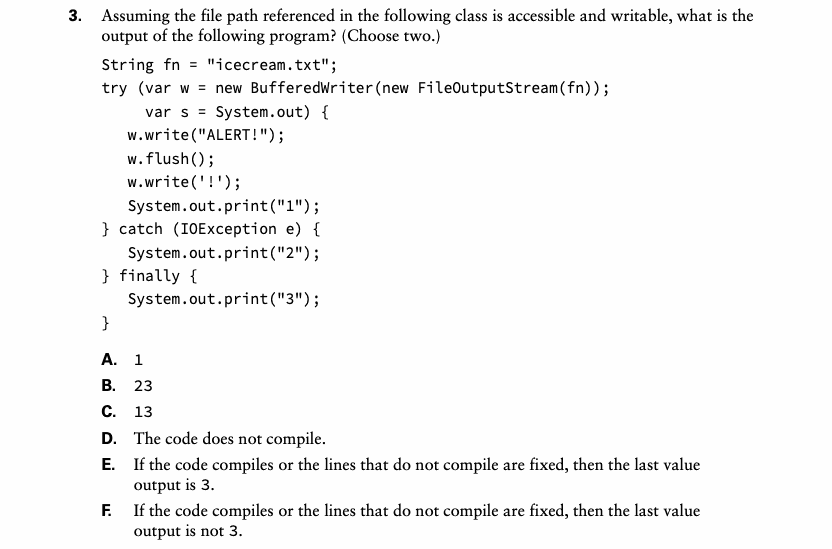
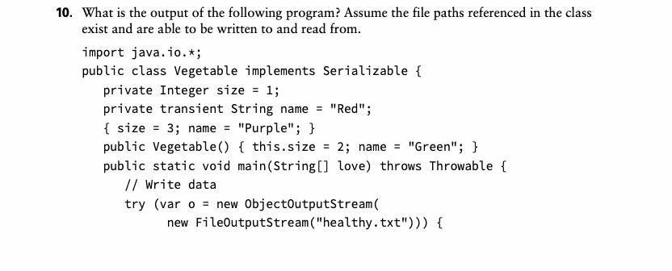
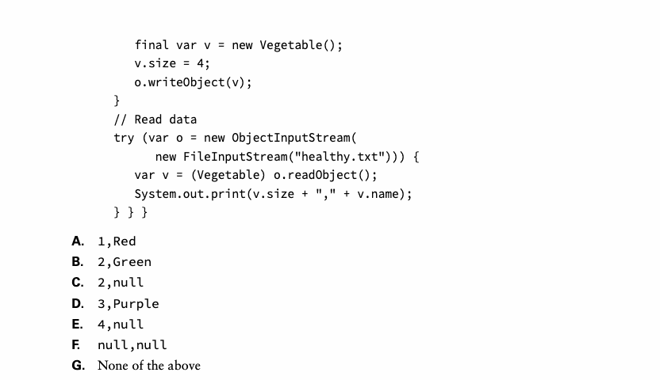
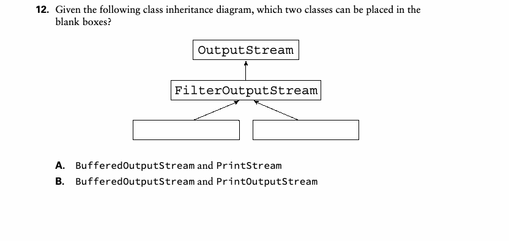
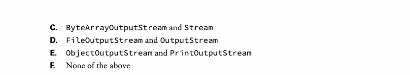
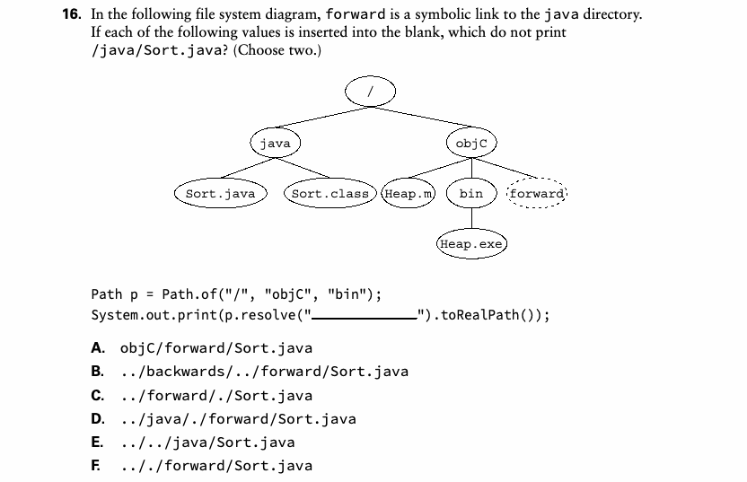

# Chapter 9: Using Java I/O API

> Source: *OCP Oracle Certified Professional Java SE 17 Developer Practice Tests (Exam 1Z0-829)*. Extracted from your PDF for personal study. Questions with figures/tables include a scan of the original page.

## 829-09-001

What exception is expected to be thrown by the following code snippet?

```java
var oldPath = Path.get("/rodent/mouse.txt");
var newPath = Path.get("/rodent/rat.txt");
Files.move(oldPath, newPath,
   StandardCopyOption.REPLACE_EXISTING);
```

- **A.** `AtomicMoveNotSupportedException`
- **B.** `DirectoryNotEmptyException`
- **C.** `FileAlreadyExistsException`
- **D.** The code does not compile.
- **E.** None of the above.

**Answer:** D

**Explanation:** The code does not compile because `Path.get()` is not a valid NIO.2 method, making option D correct. Either `Paths.get()` or `Path.of()` should be used instead.

## 829-09-002

What is the result of compiling and executing the following program?

```java
package vacation;
import java.io.*;
import java.util.*;
public class Itinerary {
   private List<String> activities = new ArrayList<>();
   private static Itinerary getItinerary(String name) {
     return null;
   }
   public static void printItinerary() throws Exception {
     Console c = new Console();
     final String name = c.readLine("What is your name?");
     final var stuff = getItinerary(name);
     stuff.activities.forEach(s -> c.printf(s));
   }
   public static void main(String[] h) throws Exception {
     printItinerary();
   } }
```

- **A.** The code does not compile.
- **B.** The code compiles and prints a `NullPointerException` at runtime.
- **C.** The code compiles but does not print anything at runtime.
- **D.** The code compiles and prints the value the user enters at runtime.
- **E.** The behavior cannot be determined until runtime.
- **F.** None of the above.

**Answer:** A

**Explanation:** The constructor for `Console` is `private`. Therefore, attempting to call `new` `Console()` outside the class results in a compilation error, making option A the correct answer. The correct way to obtain a `Console` instance is to call `System.console()`.

## 829-09-003

Assuming the file path referenced in the following class is accessible and writable, what is the output of the following program? (Choose two.)

```java
String fn = "icecream.txt";
try (var w = new BufferedWriter(new FileOutputStream(fn));
    var s = System.out) {
   w.write("ALERT!");
   w.flush();
   w.write('!');
   System.out.print("1");
} catch (IOException e) {
   System.out.print("2");
} finally {
   System.out.print("3");
}
```



- **A.** `1`
- **B.** `23`
- **C.** `13`
- **D.** The code does not compile.
- **E.** If the code compiles or the lines that do not compile are fixed, then the last value output is `3`.
- **F.** If the code compiles or the lines that do not compile are fixed, then the last value output is not `3`.

**Answer:** D, F

**Explanation:** `BufferedWriter` is a wrapper class that requires an instance of `Writer` to operate on. Since `FileOutputStream` does not inherit `Writer`, the code does not compile, and option D is correct. If `FileWriter` was used instead of `FileOutputStream`, then the code would compile without issue and print `1`. The try-with-resources statement closes `System.out` before the `catch` and `finally` blocks are called. When the `finally` block is executed, the output has nowhere to go to, which means the last value of `3` is not printed, making option F correct.

## 829-09-004

What is the expected result when the `writeResume()` method is called? Assume the directories referenced in the class do not exist prior to the execution and that the file system is available and able to be written to.

```java
package job;
import java.nio.file.*;
public class Resume {
   public void writeResume() throws Exception {
     var f1 = Path.of("/templates/proofs");
     f1.createDirectories();
     var f2 = Path.of("/templates");
     f2.createDirectory(); // k1
     try(var w = Files.newBufferedWriter(
           Path.of(f2.toString(), "draft.txt"))) {
        w.append("My dream job");
       w.flush();
    }
    f1.delete(f1);
    f2.delete(f2);       // k2
  } }
```

- **A.** One line of this application does not compile.
- **B.** Two lines of this application do not compile.
- **C.** The code compiles, but line `k1` triggers an exception at runtime.
- **D.** The code compiles, but line `k2` triggers an exception at runtime.
- **E.** The code compiles and runs without printing an exception.
- **F.** None of the above.

**Answer:** F

**Explanation:** The code does not compile. There are no `createDirectory()`, `createDirectories()`, and `delete()` methods defined on the `Path` interface. Instead, the NIO.2 `Files` class should be used. Since four lines of code do not compile, option F is the correct answer. If the lines were corrected to use the `Files` class, then the application would print an exception at line `k1`, as the directory already exists.

## 829-09-005

Which classes are least likely to be marked `Serializable`? (Choose two.)

- **A.** A class that monitors the state of every thread in the application
- **B.** A class that holds data about the amount of rain that has fallen in a given year
- **C.** A class that manages the memory of running processes in an application
- **D.** A class that stores information about apples in an orchard
- **E.** A class that tracks the amount of candy in a gumball machine
- **F.** A class that tracks which users have logged in

**Answer:** A, C

**Explanation:** Generally speaking, classes should be marked with the `Serializable` interface if they contain data that we might want to save and retrieve later. Options B, D, E, and F describe the type of data that we would want to store over a long period of time. Options A and C, though, define classes that manage transient or short-lived data. Application processes change quite frequently, and trying to reconstruct a process is often considered a bad idea.

## 829-09-006

What is the output of the following code snippet? Assume that the current directory is the root path.

```java
Path p1 = Path.of("./found/../keys");
Path p2 = Paths.get("/lost/blue.txt");
System.out.println(p1.resolve(p2));
System.out.println(p2.resolve(p1));
```

- **A.** `/lost/blue.txt` and `/lost/blue.txt/keys`
- **B.** `/found/../keys/./lost/blue.txt` and `/lost/blue.txt/keys`
- **C.** `/found/../keys/./lost/blue.txt` and `keys`
- **D.** `/lost/blue.txt` and `/lost/blue.txt/./found/../keys`
- **E.** The code does not compile.
- **F.** None of the above.

**Answer:** D

**Explanation:** First, `p2` is an absolute path, which means that `p1.resolve(p2)` just returns `p2`. For this reason, options B and C are incorrect. Since `p1` is a relative path, it is appended onto `p2`, making option D correct and option A incorrect. Option A would be correct if `normalize()` were applied.

## 829-09-007

Fill in the blanks: `Writer` is a(n) that related stream classes .

- **A.** concrete class, extend
- **B.** abstract class, extend
- **C.** abstract class, implement
- **D.** interface, extend
- **E.** interface, implement
- **F.** None of the above

**Answer:** B

**Explanation:** `Writer` is an abstract class, so options A, D, and E are incorrect. Classes extend abstract classes; they do not implement them, making option B correct. Note that `InputStream`, `OutputStream`, and `Reader` are also abstract classes.

## 829-09-008

Assuming `/away/baseball.txt` exists and is accessible, what is the expected result of executing the following code snippet?

```java
var p1 = Path.of("baseball.txt");
var p2 = Path.of("/home");
var p3 = Path.of("/away");
Files.createDirectories(p2);
Files.copy(p3.resolve(p1),p2);
```

- **A.** A new file `/home/baseball.txt` is created.
- **B.** A new file `/home/away/baseball.txt` is created.
- **C.** The code does not compile.
- **D.** The code compiles, but an exception is printed at runtime.
- **E.** The output cannot be determined until runtime.
- **F.** None of the above.

**Answer:** D

**Explanation:** After calling `createDirectories()`, the directory `/home` is guaranteed to exist if it does not already. The second argument of the `copy()` method should be the location of the new file, not the folder the new file is placed in. Therefore, the program attempts to write the file to the path `/home`. Since there is already a directory at that location, a `FileAlreadyExistsException` is thrown at runtime, making option D correct.

## 829-09-009

Assuming the file referenced in the following snippet exists and contains five lines with the word `eggs` in them, what is the expected output?

```java
var p = Path.of("breakfast.menu");
Files.readAllLines(p)
   .filter(s -> s.contains("eggs"))
   .collect(Collectors.toList())
   .forEach(System.out::println);
```

- **A.** No lines will be printed.
- **B.** One line will be printed.
- **C.** Five lines will be printed.
- **D.** More than five lines will be printed.
- **E.** The code does not compile.
- **F.** None of the above.

**Answer:** E

**Explanation:** The code does not compile because `readAllLines()` returns a `List<String>`, not a stream, making option E the answer. If the correct method `lines()` was used instead, then five lines would be printed at runtime.

## 829-09-010

What is the output of the following program? Assume the file paths referenced in the class exist and are able to be written to and read from.

```java
import java.io.*;
public class Vegetable implements Serializable {
   private Integer size = 1;
   private transient String name = "Red";
   { size = 3; name = "Purple"; }
   public Vegetable() { this.size = 2; name = "Green"; }
   public static void main(String[] love) throws Throwable {
     // Write data
     try (var o = new ObjectOutputStream(
           new FileOutputStream("healthy.txt"))) {
       final var v = new Vegetable();
       v.size = 4;
       o.writeObject(v);
    }
    // Read data
    try (var o = new ObjectInputStream(
          new FileInputStream("healthy.txt"))) {
       var v = (Vegetable) o.readObject();
       System.out.print(v.size + "," + v.name);
    } } }
```





- **A.** `1,Red`
- **B.** `2,Green`
- **C.** `2,null`
- **D.** `3,Purple`
- **E.** `4,null`
- **F.** `null,null`
- **G.** None of the above

**Answer:** E

**Explanation:** The `size` variable is properly serialized with a value of `4`. Upon deserialization, none of the class elements that assign a value to an instance variable are run, leading to `size` being deserialized as `4`. Since the `name` variable is marked `transient`, this value is deserialized as `null`. For these reasons, option E is correct.

## 829-09-011

Why does `Console readPassword()` return a `char` array rather than a `String`?

- **A.** It improves performance.
- **B.** It improves security.
- **C.** Passwords must be stored as a `char` array.
- **D.** `String` cannot hold the individual password characters.
- **E.** It adds encryption.
- **F.** None of the above.

**Answer:** B

**Explanation:** The `readPassword()` returns a `char` array for security reasons. If the data was stored as a `String`, it would enter the shared JVM string pool, potentially allowing a malicious user to access it, especially if there is a memory dump. By using a `char` array, the data can be immediately cleared after it is written and removed from memory. For this reason, option B is the correct answer.

## 829-09-012

Given the following class inheritance diagram, which two classes can be placed in the blank boxes?

```java
    OutputStream
FilterOutputStream
```





- **A.** `BufferedOutputStream` and `PrintStream`
- **B.** `BufferedOutputStream` and `PrintOutputStream`
- **C.** `ByteArrayOutputStream` and `Stream`
- **D.** `FileOutputStream` and `OutputStream`
- **E.** `ObjectOutputStream` and `PrintOutputStream`
- **F.** None of the above

**Answer:** A

**Explanation:** While you might not be familiar with `FilterOutputStream`, the diagram shows that the two classes must inherit from `OutputStream`. Options B, C, and E can be eliminated as choices since `PrintOutputStream` and `Stream` are not the name of any `java.io` classes. Option D can also be eliminated because `OutputStream` is already in the diagram, and you cannot have a circular class dependency. That leaves us with the correct answer, option A, because `BufferedOutputStream` and `PrintStream` both extend

```java
FilterOutputStream.
```

## 829-09-013

How many lines of the following code contain compiler errors?

```java
12: var path = Paths.get(new URI("ice.cool"));
13: var view = Files.readAttributes(path,
14:    BasicFileAttributes.class);
15: Files.createDirectories(Path.relativize(".backup"));
16: if(view.length() > 0 && view.isDirectory())
17:    view.setTimes(null,null,null);
18: System.out.println(Files.deleteIfExists(path));
```

- **A.** All of the lines compile.
- **B.** One
- **C.** Two
- **D.** Three
- **E.** Four or more

**Answer:** D

**Explanation:** Line 15 is the first line to not compile, as `relativize()` is an instance method, not a `static` method. Line 16 also does not compile, as `size()`, not `length()`, should be used to retrieve a file size. Finally, line 17 does not compile because `view` is an attribute class, not an attribute view. The rest of the lines do not contain any compiler errors, making option D correct.

## 829-09-014

What is the output of the following application?

```java
import java.io.*;
public class TaffyFactory {
   public int getPrize(byte[] luck) throws Exception {
     try (InputStream is = new ByteArrayInputStream(luck)) {
        is.read(new byte[2]);
        if (!is.markSupported()) return -1;
        is.mark(5);
        is.read(); is.read();
        is.skip(3);
        is.reset();
        return is.read();
     }
   }
   public static void main(String[] sticky) throws Exception {
     final TaffyFactory p = new TaffyFactory();
     final var luck = new byte[] { 1, 2, 3, 4, 5, 6, 7 };
     System.out.print(p.getPrize(luck));
   } }
```

- **A.** `-2`
- **B.** `2`
- **C.** `3`
- **D.** `5`
- **E.** `7`
- **F.** An exception is thrown at runtime.

**Answer:** C

**Explanation:** The code compiles and runs without issue. The first two values of the `ByteArrayInputStream` are read. Next, the `markSupported()` value is tested. Since `-1` is not one of the possible options, we assume that `ByteArrayInputStream` does support marks. Two values are read and three are skipped, but then `reset()` is called, putting the stream back in the state before `mark()` was called. In other words, everything between `mark()` and `reset()` can be ignored. The last value read is `3`, making option C the correct answer.

## 829-09-015

What is the output of the following program? Assume the file paths referenced in the class exist and are able to be written to and read from.

```java
package heart;
import java.io.*;
public class Valve implements Serializable {
   private int chambers = -1;
   private transient Double size = null;
   private static String color;
   public Valve() { this.chambers = 3; color = "BLUE"; }
   public static void main(String[] love) throws Throwable {
     try (var o = new ObjectOutputStream(
           new FileOutputStream("scan.txt"))) {
        final Valve v = new Valve();
        v.chambers = 2;
        v.size = 10.0;
        v.color = "RED";
        o.writeObject(v);
     }
     new Valve();
     try (var i = new ObjectInputStream(
           new FileInputStream("scan.txt"))) {
        Valve v = (Valve)i.readObject();
        System.out.print(v.chambers+","+v.size+","+v.color);
     }
   }
   { chambers = 4; } }
```

- **A.** `2,null,RED`
- **B.** `2,null,BLUE`
- **C.** `3,10.0,RED`
- **D.** `3,10.0,BLUE`
- **E.** `0,null,null`
- **F.** None of the above

**Answer:** B

**Explanation:** The class compiles and runs without issue, so option F is incorrect. The class defines three variables, only one of which is serializable. The first variable, `chambers`, is serializable, with the value `2` being written to disk and then read from disk. Remember, the constructors and instance initializers are not executed when a class is deserialized. The next variable, `size`, is `transient`. It is discarded when it is written to disk, so it has the default object value of `null` when read from disk. Finally, the `color` variable is `static`, which means it is shared by all instances of the class. Even though the value was `RED` when the instance was serialized, this value was not written to disk, since it was not part of the instance. The constructor call `new Valve()` between the two try-with-resources blocks sets this value to `BLUE`, which is the value printed later in the application. For these reasons, the class prints `2,null,BLUE`, making option B the correct answer.

## 829-09-016

In the following file system diagram, `forward` is a symbolic link to the `java` directory. If each of the following values is inserted into the blank, which do not print `/java/Sort.java`? (Choose two.)

```java
                               /
                   java _________________ objC
           Sort.java ___ Sort.class Heap.m ___ bin ___ forward
                                        Heap.exe
Path p = Path.of("/", "objC", "bin");
System.out.print(p.resolve(" __________ ").toRealPath());
```



- **A.** `objC/forward/Sort.java`
- **B.** `../backwards/../forward/Sort.java`
- **C.** `../forward/./Sort.java`
- **D.** `../java/./forward/Sort.java`
- **E.** `../../java/Sort.java`
- **F.** `.././forward/Sort.java`

**Answer:** A, D

**Explanation:** Simplifying the path symbols, options B, C, and F become `/objC/forward/` `Sort.java`, which applying the symbol link becomes `/java/Sort.java`. Option E just becomes `/java/Sort.java`, without any path symbols involved. Option A is correct, as the `resolve()` method concatenates the path to be `/objC/bin/objC/forward/` `Sort.java`. Option D is also correct, as the simplified path is `/objC/java/forward/` `Sort.java`. In both of these cases, the symbolic link `/objC/forward` cannot be applied.

## 829-09-017

Which method defined in `Reader` can be used in place of calling `skip(1)`?

- **A.** `jump()`
- **B.** `mark()`
- **C.** `markSupported()`
- **D.** `read()`
- **E.** `reset()`
- **F.** None of the above

**Answer:** D

**Explanation:** The `skip(1)` method just reads a single byte and discards the value. The `read()` method can be used for a similar purpose, making option D the correct answer. Option A is incorrect because there is no `jump()` method defined in `Reader`. Options B, C, and E are incorrect because they cannot be used to skip data, only to mark a location and return to it later.

## 829-09-018

The `Rose` application is run with an input argument of `/flower`. The `/flower` directory contains five subdirectories, each of which contains five files. What is the result of executing the following program?

```java
import java.nio.file.*;
public class Rose {
   public void tendGarden(Path p) throws Exception {
     Files.walk(p,1)
        .map(q -> q.toRealPath())
        .forEach(System.out::println);
   }
  public static void main(String... thorns) throws Exception {
    new Rose().tendGarden(Paths.get(thorns[0]));
  } }
```

- **A.** The program completes without outputting anything.
- **B.** One `Path` value is printed.
- **C.** Six `Path` values are printed.
- **D.** Twenty-five `Path` values are printed.
- **E.** Twenty-six `Path` values are printed.
- **F.** None of the above.

**Answer:** F

**Explanation:** Trick question! The code does not compile; therefore, option F is correct. The `toRealPath()` interacts with the file system, and therefore throws a checked `IOException`. Since this checked exception is not handled inside the lambda expression, the class does not compile. If the lambda expression was fixed to handle the `IOException`, then the expected number of `Path` values printed would be six, and option C would be the correct answer. A `maxDepth` value of `1` causes the `walk()` method to visit two total levels— the original `/flower` and the files it contains.

## 829-09-019

What may be the result of executing the following program?

```java
package test;
import java.io.*;
public class Turing {
   public static void main(String... robots) {
     Console c = System.console();
     final String response = c.readLine("Are you human?");
     System.err.print(response);
   } }
```

- **A.** The program asks the user a question and prints the results to the error stream.
- **B.** The program throws a `NullPointerException` at runtime.
- **C.** The program does not terminate.
- **D.** All of the above.
- **E.** The class does not compile.

**Answer:** D

**Explanation:** The statements in options A, B, and C are each correct, making option D correct. If `System.console()` is available, then the program will ask the user a question and print the response to the error stream. On the other hand, if `System.console()` is not available, then the program will exit with a `NullPointerException`. It is strongly recommended to always check whether `System.console()` is `null` after requesting it. Finally, the user may choose not to respond to the program’s request for input, resulting in the program hanging indefinitely.

## 829-09-020

What is the output of the following method applied to an `InputStream` that contains the first four prime numbers, stored as bytes: `2`, `3`, `5`, `7`?

```java
private void jumpAround(InputStream is) throws IOException {
   try (is) {
     is.skip(1);
     is.read();
     is.skip(1);
     is.mark(4);
     is.skip(1);
     is.reset();
     System.out.print(is.read());
   }
}
```

- **A.** `5`
- **B.** `7`
- **C.** The code does not compile.
- **D.** The code compiles but throws an exception at runtime.
- **E.** The result cannot be determined until runtime.
- **F.** None of the above.

**Answer:** E

**Explanation:** The code compiles, so option C is incorrect. Not all `InputStream` classes support the `mark()` operation. If `mark()` is supported, then `7` is printed at runtime. Alternatively, if `mark()` is not supported, then an `IOException` will be printed at runtime. For this reason, option E is correct. Always remember to call `markSupported()` before using a `mark()` operation on an `InputStream`.

## 829-09-021

Assuming the directories and files referenced exist and are not symbolic links, what is the result of executing the following code?

```java
var p1 = Path.of("/tea/earlgrey/..",".").resolve(Path.of("hot.txt"));
var p2 = new File("/./tea/./earlgrey/./.././hot.txt").toPath();
System.out.print(Files.isSameFile(p1,p2));
System.out.print(" ");
System.out.print(p1.normalize().equals(p2.normalize()));
System.out.print(" ");
System.out.print(Files.mismatch(p1,p2));
```

- **A.** `true true -1`
- **B.** `true true 0`
- **C.** `true false -1`
- **D.** `true false 0`
- **E.** `false true -1`
- **F.** `false true 0`
- **G.** The code does not compile.
- **H.** The result cannot be determined.

**Answer:** A

**Explanation:** The code compiles and runs without issue, so option G is incorrect. If you simplify the redundant path symbols, then `p1` and `p2` represent the same path, `/tea/hot.txt`. Therefore, `isSameFile()` returns `true`. The second output is also `true` because the path values have been normalized. Finally, `mismatch()` sees the contents are the same, returning `-1`. For these reasons, option A is correct.

## 829-09-022

Which method are classes that implement the `java.io.Serializable` interface required to implement?

- **A.** `cereal()`
- **B.** `deserialize()`
- **C.** `serial()`
- **D.** `serialize()`
- **E.** `clone()`
- **F.** None of the above

**Answer:** F

**Explanation:** `Serializable` is a marker interface, which means it does not contain any abstract methods that require implementation, making option F correct. The interface is only meant to indicate the object is capable of serialization.

## 829-09-023

What is the result of compiling and executing the following program? Assume the current directory is `/stock` and the `/stock/sneakers` path does not exist prior to execution.

```java
 package shoe;
 import java.io.*;
 import java.nio.file.*;
public class Sneaker {
   public void setupInventory(Path d) throws Exception {
     Path suggestedPath = Paths.get("sneakers");
     if(Files.isSameFile(suggestedPath, d)          // j1
           && !Files.exists(suggestedPath))
        Files.createDirectories(d);                // j2
   }
   public static void main(String[] socks) throws Exception {
     Path w = new File("/stock/sneakers").toPath();     // j3
     new Sneaker().setupInventory(w);
   } }
```

- **A.** The `/stock/sneakers` directory is created.
- **B.** Line `j1` does not compile or produces an exception at runtime.
- **C.** Line `j2` does not compile or produces an exception at runtime.
- **D.** Line `j3` does not compile or produces an exception at runtime.
- **E.** None of the above.

**Answer:** B

**Explanation:** First, the class compiles without issue. The `Files.isSameFile()` method call on line `j1` first does a quick check to verify if the `Path` values are equivalent in terms of `equals()`. One is absolute, and the other is relative, so this initial test will fail. The `isSameFile()` method then moves on to verify that the two `Path` values reference the same file system object. Since we know the directory does not exist, the call to `isSameFile()` on line `j1` will produce a `NoSuchFileException` at runtime, making option B the correct answer.

## 829-09-024

Assuming the absolute path referenced in the code exists and its contents are accessible, which statement about the following code snippet is correct?

```java
Path p = Paths.get("/glasses/lens");
Files.walk(p)
   .map(z -> z.toAbsolutePath().toString())
   .filter(s -> s.endsWith(".java"))
   .collect(Collectors.toList()).forEach(System.out::println);
Files.find(p,Integer.MAX_VALUE,
     (w,a) -> w.toAbsolutePath().toString().endsWith(".java"))
   .collect(Collectors.toList()).forEach(System.out::println);
```

- **A.** The first stream statement does not compile.
- **B.** The second stream statement does not compile.
- **C.** Neither statement compiles.
- **D.** Both statements compile and produce the same result at runtime.
- **E.** None of the above.

**Answer:** D

**Explanation:** Both stream statements compile without issue, making options A, B, and C incorrect. The two statements are equivalent to one another and print the same values at runtime. For this reason, option D is correct. There are some subtle differences between the two methods calls. The `walk()` call does not include a depth limit, but since `Integer.MAX_VALUE` is the default value, the two calls are equivalent. Furthermore, the `walk()` statement prints a stream of absolute paths stored as `String` values, while the `find()` statement prints a stream of `Path` values. If the input `p` was a relative path, then these two calls would have very different results, but since we are told `p` is an absolute path, the application of `toAbsolutePath()` does not change the results.

## 829-09-025

When reading file information, what is an advantage of using an NIO.2 attribute interface rather than reading the values individually using `Files` methods? (Choose two.)

- **A.** Costs fewer round-trips to the file system
- **B.** Guarantees performance improvement
- **C.** Has support for symbolic links
- **D.** Reduces memory leaks
- **E.** Supports file system–dependent attributes
- **F.** Reduces resource leaks

**Answer:** A, E

**Explanation:** An attribute view has the advantage of reading all of the file information on a single trip, rather than multiple trips to the file system, making option A correct. Option B is incorrect because nothing guarantees it will perform faster, especially if the `Files` method is only being used to read a single attribute. Option C is also incorrect because both sets of methods have built-in support for symbolic links. Options D and F are incorrect because memory and resource leaks are not related to reading file attribute views. Finally, option E is correct, as NIO.2 supports file system–dependent attribute view classes.

## 829-09-026

Suppose that you need to read data that consists of serialized `int`, `double`, `boolean`, and `String` values from a file. You also want the program to be performant on large files. Which three `java.io` stream classes can be chained together to best achieve this result? (Choose three.)

- **A.** `BufferedReader`
- **B.** `FileReader`
- **C.** `ObjectInputStream`
- **D.** `BufferedStream`
- **E.** `FileInputStream`
- **F.** `BufferedInputStream`

**Answer:** C, E, F

**Explanation:** Since you need to read primitives and `String` values, the `InputStream` classes are appropriate. Therefore, you can eliminate options A and B since they use `Reader` classes. Option D is incorrect, as this is not a `java.io` class. The data should be read from the file using an `FileInputStream` class, buffered with an `BufferedInputStream` class for performance, and deserialized into Java-accessible data types with an `ObjectInputStream` class, making options C, E, and F correct.

## 829-09-027

Which statement about the following method is correct? Assume the `coffee` directory exists and is able to be read.

```java
void brew() throws Exception {
   final var m = Path.of("coffee");
   Files.walk(m)
     .filter(Files::isDirectory)
     .forEach(Files::isDirectory);
}
```

- **A.** It does not compile.
- **B.** It compiles but does not print anything at runtime.
- **C.** It compiles and prints `true` exactly once at runtime.
- **D.** It compiles and prints `true` at least once.
- **E.** The answer cannot be determined without knowing the contents of the directory.
- **F.** None of the above.

**Answer:** B

**Explanation:** The method compiles, so option A is incorrect. The method reads all of the elements of a directory tree, keeping only directories. The `forEach()` method does not print anything, though, making option B correct. If the lambda in the `forEach()` method was modified to print something, such as `s -> System.out.println(Files.isDirectory(s))`, then it would print `true` at least once for the coffee directory. It would then print `true` for each directory within the directory tree.

## 829-09-028

Assuming the file referenced in the `StudentManager` class exists and contains at least one record, which statements about the following class are correct? (Choose two.)

```java
package school;
import java.io.*;
record Student(String name) { static Integer score = -1; }
public class StudentManager {
   public static void main(String[] grades) {
     try(var ios = new ObjectInputStream(
           new FileInputStream(new File("s.data")))) {
       Student record;
       while((record = (Student)ios.readObject()) != null)     // p1
          System.out.print(record);
    } catch (EOFException e) {
    } catch (Exception e) {
       throw new RuntimeException(e);
    } } }
```

- **A.** The code does not compile.
- **B.** The code compiles but prints an exception at runtime.
- **C.** The program runs and prints all students in the file.
- **D.** The program runs but may only print some students in the files.
- **E.** Line `p1` demonstrates the proper way to check if all records have been read.
- **F.** Line `p1` does not demonstrate the proper way to check if all records have been read.

**Answer:** B, F

**Explanation:** The code compiles but the `Student` record does not implement `Serializable`. For this reason, an exception is thrown at runtime, and option B is correct. If the purpose is to verify all records have been read, then line `p1` contains an error. The problem with the implementation is that checking if `ios.readObject()` is `null` is not the recommended way of iterating over an entire file. For example, the file could have been written with `writeObject(null)` in between two non-`null` records. In this case, the reading of the file would stop on this `null` value, before the end of the file has been reached. For this reason, option F is also correct.

## 829-09-029

Given an instance of `Console c`, which of the following two method calls are invalid ways of retrieving input from the user? (Choose two.)

- **A.** `c.read()`
- **B.** `c.reader().read()`
- **C.** `c.reader().readLine()`
- **D.** `c.readLine()`
- **E.** `c.readPassword()`

**Answer:** A, C

**Explanation:** The `Console` class contains `readLine()` and `readPassword()` methods, but not a `read()` method, making option A one of the correct answers, and options D and E incorrect. It also contains a `reader()` method that returns a `Reader` object. The `Reader` class defines a `read()` method, but not a `readLine()` method. For this reason, option C is the other correct answer, and option B is incorrect. Recall that a `BufferedReader` is required to call the `readLine()` method.

## 829-09-030

What is the output of the following code snippet? Assume that the current directory is the root path `/`.

```java
Path p1 = Paths.get("./locks");
Path p2 = Paths.get("/found/red.zip");
System.out.println(p1.relativize(p2));
System.out.println(p2.relativize(p1));
```

- **A.** `../found/red.zip` and `../../locks`
- **B.** /`found/red.zip` and `/found/red.zip/./locks`
- **C.** `locks/../found/red.zip` and `../found/locks`
- **D.** `../../locks` and `../found/red.zip`
- **E.** /`found/red.zip` and `/found/red.zip/locks`
- **F.** None of the above

**Answer:** F

**Explanation:** The `relativize()` method requires that both path values be absolute or relative. Based on the details provided, `p1` is a relative path, while `p2` is an absolute path. For this reason, the code snippet produces an exception at runtime, making option F the correct answer. If the first path was modified to be absolute by dropping the leading dot (`.`) in the path expression, then the output would match the values in option A.

## 829-09-031

Assuming the current working directory is `/home`, then what is the output of the following program?

```java
1: package magic;
2: import java.nio.file.*;
3: public class Magician {
 4:     public String doTrick(Path path) {
 5:       return path.subpath(2,3)
 6:          .getName(1)
 7:          .toAbsolutePath()
 8:          .toString();
 9:     }
 10:    public static void main(String... cards) {
 11:      final Magician m = new Magician();
 12:      System.out.print(m.doTrick(
 13:         Paths.get("/bag/of/tricks/.././disappear.txt")));
 14:    } }
```

- **A.** `/home/tricks`
- **B.** `/home`
- **C.** `tricks`
- **D.** The code does not compile.
- **E.** The code compiles but prints an exception at runtime.
- **F.** None of the above.

**Answer:** E

**Explanation:** The code compiles without issue. Even though `tricks` would be dropped in the normalized path `/bag/of/disappear.txt`, there is no `normalize()` call, so `path.subpath(2,3)` returns `tricks` on line 5. On line 6, the call to `getName()` throws an `IllegalArgumentException` at runtime. Since `getName()` is zero-indexed and contains only one element, the call on line 6 throws an `IllegalArgumentException`, making option E the correct answer. If `getName(0)` had been used instead of `getName(1)`, then the program would run without issue and print `/home/tricks`.

## 829-09-032

Which statements about the `Files` methods `lines()` and `readAllLines()` are correct? (Choose two.)

- **A.** They have different return types.
- **B.** The `readAllLines()` method is always faster.
- **C.** The `lines()` method may require more memory.
- **D.** They have the same return type.
- **E.** The `lines()` method is always faster.
- **F.** The `readAllLines()` method may require more memory.

**Answer:** A, F

**Explanation:** The `lines()` method returns `Stream<String>`, while the `readAllLines()` method returns `List<String>`, making option A correct and option D incorrect. Neither method is guaranteed to be faster or slower than the other, making options B and E incorrect. The `lines()` method lazily reads the file as the stream is processed, while the `readAllLines()` method reads the entire file into memory at once. For this reason, the `readAllLines()` method may require more memory to hold a large file, making option F correct and option C incorrect.

## 829-09-033

Given the following application in which a user enters `bone` twice, what is the expected result?

```java
long start = System.currentTimeMillis();
var retriever = new BufferedReader(new InputStreamReader(System.in));
try(retriever; var husky = System.err) {
   var fetch = retriever.readLine();
   System.out.printf("%s fetched in %5.1f seconds",fetch, // v1
     (System.currentTimeMillis()-start)/1000.0);
}
var fetchAgain = retriever.readLine();
System.out.println(fetchAgain + " fetched again!");
```

- **A.** The program completes after printing a message once.
- **B.** The program completes after printing a message twice.
- **C.** An `IOException` is printed.
- **D.** The program prints an exception because the format of the `String` on line `v1` is invalid.
- **E.** A `NullPointerException` is thrown since `System.in` may be unavailable.
- **F.** None of the above, as the code does not compile.

**Answer:** A

**Explanation:** First, the code compiles. The format of the `String` on line `v1` is valid, making option D incorrect. While `System.console()` throws a `NullPointerException` if it is not available, `System.in` does not, making option E incorrect. The first part of the code runs without issue, printing a message such as `bone fetched in 1.8 seconds`. The I/O stream `System.in` is closed at the end of the try-with-resources block. That means calling `readLine()` again results in an operation on a closed stream, which would print an exception at runtime and make option C correct, except `System.err` is already closed due to the try-with-resources block! Therefore, only one message is printed, and option A is correct.

## 829-09-034

What is the expected result of calling `deleteTree()` on a directory? Assume the directory exists and is able to be modified.

```java
import java.nio.file.*;
public class Exterminate {
   public void deleteTree(Path q) {
     if (!Files.isDirectory(q))
        Files.delete(q);
     else {
        Files.list(q).forEach(this::deleteTree);
        Files.delete(q);
     } } }
```

- **A.** It will delete the directory itself only.
- **B.** It will delete the directory and its file contents only.
- **C.** It will delete the entire directory tree.
- **D.** The code does not compile.
- **E.** The code compiles but produces an exception at runtime.
- **F.** None of the above.

**Answer:** D

**Explanation:** The `Files.delete()` and `Files.list()` declare a checked `IOException` that must be handled or declared. For this reason, the code does not compile, and option D is correct.

## 829-09-035

Which code, if inserted into the method, will cause it to correctly copy any file passed to it that is accessible? (Choose two.)

```java
void copyFile(String source, String target) throws Exception {
   try (var is = new FileInputStream(source);
        OutputStream os = new FileOutputStream(target)) {
     byte[] data = new byte[123];
     int chirps;
     // INSERT CODE HERE
   } }
```

- **A.** 

  ```java
  while (is.read(data) > 0)
     os.write(data);
  ```
- **B.** 

  ```java
  while ((chirps = is.read(data)) > 0)
     os.write(data, 0, chirps);
  ```
- **C.** 

  ```java
  while ((chirps = is.read(data)) > 0)
     os.write(data);
  ```
- **D.** 

  ```java
  while ((chirps = is.read(data)) > 0)
     os.write(data, chirps, data.length);
  ```
- **E.** 

  ```java
  String line;
  while ((line = is.readLine()) != null)
     os.write(line + "\n");
  ```
- **F.** 

  ```java
  while ((chirps = is.read()) > 0)
     os.write(chirps);
  ```

**Answer:** B, F

**Explanation:** All of the options compile except option E, since `FileInputStream` does not have a `readLine()` method. A `BufferedReader` should be used instead. Options A and C suffer from the same problem. If the file is not exactly a multiple of `123` bytes, then extra information will be written to the file from the end of the `data` array. Option D is incorrect because the second argument should be an offset and the third argument should be the number of bytes to read from the `data` array. Option B is correct and uses an array to read a fixed number of bytes and then writes that exact number of bytes to the output file. Option F is also correct, although it does not use an array. Instead, a single byte is read and written on each iteration of the loop.

## 829-09-036

In this question, an instance of `Cereal` has been serialized to disk, with the source object having a `name` value of `CornLoops` and `sugar` value of `5`. What is the value of `name` and `sugar` after this object has been read from disk using the `ObjectInputStream`’s `readObject()` method?

```java
package breakfast;
import java.io.Serializable;
record Bowl(boolean spoon) {}
public class Cereal implements Serializable {
   private String name = "CocoaCookies";
   private transient int sugar = 10;
   private Bowl bowl;
   public Cereal() {
     super();
     this.name = "CaptainPebbles";
     this.bowl = new Bowl(true);
     sugar = 2;
   }
   { name = "SugarPops"; }
   // Getters/Setters Omitted
}
```

- **A.** `CaptainPebbles` and `10`
- **B.** `CornLoops` and `0`
- **C.** `SugarPops` and `10`
- **D.** `SugarPops` and `2`
- **E.** `CornLoops` and `-1`
- **F.** None of the above

**Answer:** F

**Explanation:** The `Bowl` record does not implement the `Serializable` interface; therefore, attempting to write the instance to disk, or calling `readObject()` using `ObjectInputStream`, will result in a `NotSerializableException` at runtime. Remember, all instance members of a class must be serializable or marked `transient` for the class to properly implement the `Serializable` interface and be used with Java serialization. For this reason, option F is the correct answer.

## 829-09-037

What is the output of the following code snippet?

```java
11: var halleysComet = Path.of("stars/./rocks/../m1.meteor")
12:    .subpath(1, 5).normalize();
13:
14: var lexellsComet = Paths.get("./stars/../solar/");
15: lexellsComet.subpath(1, 3)
16:    .resolve("m1.meteor").normalize();
17:
18: System.out.print(halleysComet.equals(lexellsComet) ?
19:    "Same!" : "Different!");
```

- **A.** `Same!`
- **B.** `Different!`
- **C.** The code does not compile.
- **D.** The class compiles but throws an exception at runtime.
- **E.** None of the above.

**Answer:** B

**Explanation:** The program compiles and runs without issue, making options C and D incorrect. The first variable, `halleysComet`, is created with `subpath(1,5)` and `normalize()` being applied right away, leading to `halleysComet` being assigned a value of `m1.meteor`. The second variable, `lexellsComet`, is assigned a value on line 14, but lines 15–16 do not include an assignment operation. Since `Path` instances are immutable, the changes are lost. For this reason, the two objects are not equivalent on lines 18–19, and option B is correct.

## 829-09-038

During deserialization from an I/O stream, which element of the class can be used to assign a value to the deserialized object?

- **A.** Variable initializer
- **B.** Instance initializer
- **C.** Static initializer
- **D.** Constructor
- **E.** The `restoreObject()` method
- **F.** None of the above

**Answer:** F

**Explanation:** When data is deserialized, none of variable initializers, instance initializers, or constructors is called. The class can have `static` initializers, but they are not called as part of deserialization. Finally, there is no `restoreObject()` method that is used in standard deserialization. For these reasons, option F is correct.

## 829-09-039

Assuming there are no symbolic links involved and file `/nursery/sapling.seed` exists, which statements about the following code snippet are correct? (Choose three.)

```java
Files.move(
   Paths.get("/nursery/sapling.seed"),
   Paths.get("/forest"),
   StandardCopyOption.ATOMIC_MOVE);
```

- **A.** The code may throw an exception at runtime.
- **B.** The code may complete without throwing an exception at runtime.
- **C.** After it runs, the new location of the file is `/nursery/sapling.seed`.
- **D.** After it runs, the new location of the file is `/forest/sapling.seed`.
- **E.** If a process is monitoring the move, it will not see an incomplete file.
- **F.** If a process is monitoring the move, it could see an incomplete file.

**Answer:** A, B, E

**Explanation:** The code moves a file from `/nursery/sapling.seed` to the new location of `/forest`. For this reason, options C and D are incorrect. If there is no file or directory at `/forest`, then the program completes successfully. If a file already exists at that location, then an exception is thrown since the `REPLACE_EXISTING` option is not set. For these reasons, options A and B are correct. Since the `ATOMIC_MOVE` flag is set, option E is correct, and option F is incorrect.

## 829-09-040

What is the output of the following application? Assume `/all-data` exists and is accessible within the file system.

```java
1: package sesame;
2: import java.nio.file.*;
3: import java.util.stream.*;
4: public class TheCount {
5:     public static Stream<String> readLines(Path p) {
6:       try { return Files.lines(p); } catch (Exception e) {
7:          throw new RuntimeException(e);
8:       }
9:     }
10:    public static long count(Path p) throws Exception {
11:      return Files.list(p)
12:            .filter(w -> Files.isRegularFile(w))
13:            .flatMap(s -> readLines(s))
14:            .count();
15:    }
16:    public static void main(String[] d) throws Exception {
17:      System.out.print(count(Paths.get("/all-data")));
18:    } }
```

- **A.** The code does not compile.
- **B.** The number of lines in all files in a directory tree.
- **C.** The number of lines in all files in a single directory.
- **D.** The code hangs indefinitely at runtime.
- **E.** An exception is printed at runtime.
- **F.** None of the above. Chapter Accessing Databases 10 Using JDBC THE OCP EXAM TOPICS COVERED IN THIS PRACTICE TEST INCLUDE THE FOLLOWING: ✓ Accessing databases using JDBC ■ Create connections, create and execute basic, prepared and callable statements, process query results and control transactions using JDBC API

**Answer:** C

**Explanation:** The program compiles and runs without issue, making options A, D, and E incorrect. The program uses `Files.list()` to iterate over all files within a single directory. For each file, it then iterates over the lines of the file and sums them. For this reason, option C is the correct answer. If the `count()` method had used `Files.walk()` instead of `Files.lines()`, then the class would still compile and run, and option B would be the correct answer. Using JDBC
