# Chapter 10: Accessing Databases Using JDBC

> Source: *OCP Oracle Certified Professional Java SE 17 Developer Practice Tests (Exam 1Z0-829)*. Extracted from your PDF for personal study. Questions with figures/tables include a scan of the original page.

## 829-10-001

How many of `Connection`, `Driver`, `DriverManager`, `PreparedStatement`, and `ResultSet` are JDBC interfaces included with the JDK?

- **A.** None
- **B.** One
- **C.** Two
- **D.** Three
- **E.** Four
- **F.** Five

**Answer:** E

**Explanation:** `Connection` is a JDK interface for communicating with the database. `PreparedStatement` and `ResultSet` are typically used to write queries and are also in the JDK. `Driver` is tricky because you don’t write code that references it directly. However, you are still required to know it is a JDBC interface. `DriverManager` is used in JDBC code to get a `Connection`. However, it is a concrete class rather than an interface. Since only four out of the five are JDBC interfaces, option E is correct.

## 829-10-002

Which of these can replace the following line of code without changing the behavior?

```java
void updateRecord(PreparedStatement stmt) throws SQLException {
   stmt.setString(2, null);
}
```

- **A.** `stmt.setNull(2);`
- **B.** `stmt.setNull(2, null);`
- **C.** `stmt.setNull(2, Types.VARCHAR);`
- **D.** None of the above

**Answer:** C

**Explanation:** The `setNull()` method requires you to pass the data type in the database. This makes option C the answer.

## 829-10-003

What must be the first characters of a database URL?

- **A.** `db,`
- **B.** `db:`
- **C.** `jdbc,`
- **D.** `jdbc:`
- **E.** None of the above

**Answer:** D

**Explanation:** All JDBC URLs begin with the protocol `jdbc` followed by a colon as a delimiter. Option D is the only one that does both of these, making it the correct answer.

## 829-10-004

Which is responsible for getting a connection to the database?

- **A.** `Driver`
- **B.** `Connection`
- **C.** `PreparedStatement`
- **D.** `Statement`
- **E.** `ResultSet`

**Answer:** A

**Explanation:** The `Driver` interface is responsible for getting a connection to the database, making option A the answer. The `Connection` interface is responsible for communication with the database but not making the initial connection. The `Statement` interface knows how to run the SQL query, and the `ResultSet` interface knows what was returned by a `SELECT` query.

## 829-10-005

Which of these obtains a `Connection`?

- **A.** `Connection.getConnection(url)`
- **B.** `Driver.getConnection(url)`
- **C.** `DriverManager.getConnection(url)`
- **D.** `new Connection(url)`
- **E.** None of the above

**Answer:** C

**Explanation:** `Connection` is an interface. Since interfaces do not have constructors, option D is incorrect. The `Connection` class doesn’t have a `static` method to get a `Connection` either, making option A incorrect. The `Driver` class is also an interface without `static` methods, making option B incorrect. Option C is the answer because `DriverManager` is the class used in JDBC to get a `Connection`.

## 829-10-006

Which method in `DriverManager` is overloaded to allow passing a username and password?

- **A.** `conn()`
- **B.** `connect()`
- **C.** `forName()`
- **D.** `getStatement()`
- **E.** `open()`
- **F.** None of the above

**Answer:** F

**Explanation:** The `DriverManager.getConnection()` method can be called with just a URL. It is also overloaded to take the URL, username, and password. Since this is not one of the options, the answer is option F.

## 829-10-007

What is the output if the `animals` database exists and contains an empty `names` table?

```java
var url = "jdbc:hsqldb:file:animals";
var sql = "SELECT count(*) FROM names";
try (var conn = DriverManager.getConnection(url);
   var stmt = conn.prepareStatement(sql,
     ResultSet.TYPE_SCROLL_INSENSITIVE,
     ResultSet.CONCUR_UPDATABLE);
   var rs = stmt.executeQuery()) {
   System.out.println(rs.getInt(1));
}
```

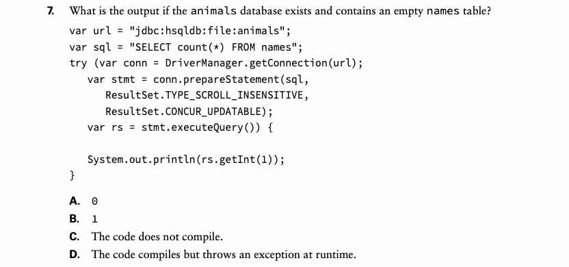

- **A.** `0`
- **B.** `1`
- **C.** The code does not compile.
- **D.** The code compiles but throws an exception at runtime.

**Answer:** D

**Explanation:** This code is missing a call to `rs.next()`. As a result, `rs.getInt(1)` throws a `SQLException` with the message i`nvalid cursor state`. Therefore, option D is the answer.

## 829-10-008

Consider the three methods `execute()`, `executeQuery()`, and `executeUpdate()`. Fill in the blanks: of these methods is/are allowed to run a `DELETE` SQL statement while of these methods is/are allowed to run an `UPDATE` SQL statement.

- **A.** None, one
- **B.** One, none
- **C.** One, one
- **D.** One, two
- **E.** Two, two
- **F.** Three, three

**Answer:** E

**Explanation:** The `execute()` method is allowed to run any type of SQL statements. The `executeUpdate()` method is allowed to run any type of the SQL statement that returns a row count rather than a `ResultSet`. Both `DELETE` and `UPDATE` SQL statements are allowed to be run with either `execute()` or `executeUpdate()`. They are not allowed to be run with `executeQuery()` because they do not return a `ResultSet`. Therefore, option E is the answer.

## 829-10-009

Suppose the `pandas` table has one row with the name `Mei Xiang` and the location `DC`. What does the following code output?

```java
 var url = "jdbc:hsqldb:file:mammals";
 var sql = "SELECT name FROM pandas WHERE location = 'DC'";
 try (var conn = DriverManager.getConnection(url);     // s1
   var stmt = conn.prepareStatement(sql);           // s2
   var rs = stmt.executeQuery()) {
   if (rs.next())
     System.out.println(rs.getString("name"));
   else
     System.out.println("No match");
}
```

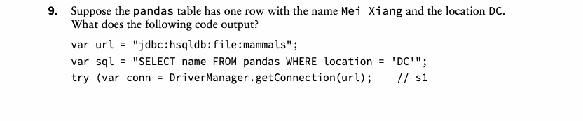

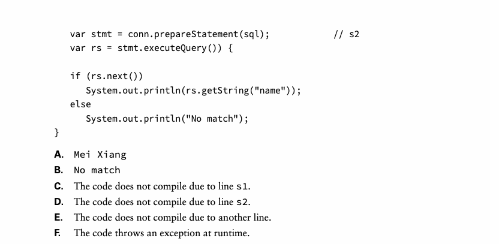

- **A.** `Mei Xiang`
- **B.** `No match`
- **C.** The code does not compile due to line `s1`.
- **D.** The code does not compile due to line `s2`.
- **E.** The code does not compile due to another line.
- **F.** The code throws an exception at runtime.

**Answer:** A

**Explanation:** This code uses a `PreparedStatement` without bind variables (`?`). While it would be better to use bind variables, this code does run. The `ResultSet` has one value and does print `Mei Xiang` successfully. Therefore, option A is the answer.

## 829-10-010

Suppose we have a `peacocks` table with two columns: `name` and `rating`. What does the following code output if the table is empty?

```java
var url = "jdbc:hsqldb:file:birds";
var sql = "SELECT name FROM peacocks WHERE name = ?";
try (var conn = DriverManager.getConnection(url);
   var stmt = conn.prepareStatement(sql)) {      // s1
   stmt.setString(1, "Feathers");
   stmt.setString(2, "Nice");
   boolean result = stmt.execute();              // s2
   System.out.println(result);
}
```

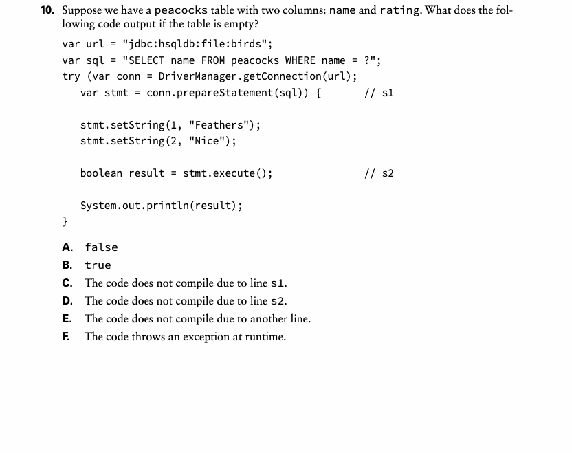


- **A.** `false`
- **B.** `true`
- **C.** The code does not compile due to line `s1`.
- **D.** The code does not compile due to line `s2`.
- **E.** The code does not compile due to another line.
- **F.** The code throws an exception at runtime.

**Answer:** F

**Explanation:** While the table has two columns, the SQL query has only one bind variable (`?`). Therefore, the code throws an exception when attempting to set the second bind variable, and option F is correct.

## 829-10-011

Suppose we have an empty `bunny` table with two columns: `name` and `color`.What is the state of the table after running this code?

```java
var url = "jdbc:hsqldb:file:rabbits";
var sql = "INSERT INTO bunny(name, color) VALUES (?, ?)";
try (var conn = DriverManager.getConnection(url);
   var stmt = conn.prepareStatement(sql)) {     // s1
   stmt.setString(1, "Daisy");
   stmt.setString(2, "Brown");
   stmt.executeUpdate();
   stmt.setString(1, "Cinna");
   stmt.setString(2, "Brown");
   stmt.executeUpdate();
}
```

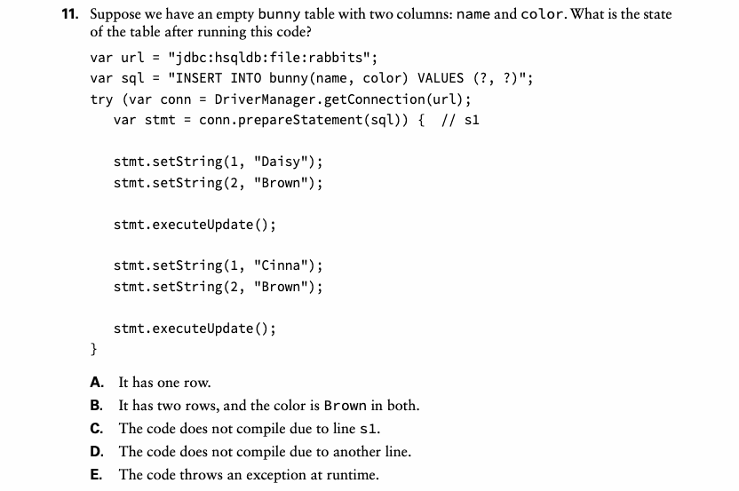

- **A.** It has one row.
- **B.** It has two rows, and the color is `Brown` in both.
- **C.** The code does not compile due to line `s1`.
- **D.** The code does not compile due to another line.
- **E.** The code throws an exception at runtime.

**Answer:** B

**Explanation:** This code is correct. It executes the first update to add the first row and then sets the parameters for the second. When it updates the second time, it adds the second row. Therefore, option B is the answer.

## 829-10-012

Suppose `cats` is an empty table. Where can `conn.rollback()` be inserted so that the table remains empty?

```java
try (var conn = DriverManager.getConnection(url)) {
   String insert = "INSERT INTO cats VALUES (? ,?)";
   try (var stmt = conn.prepareStatement(insert,
     ResultSet.TYPE_FORWARD_ONLY,
     ResultSet.CONCUR_READ_ONLY)) {
     stmt.setInt(1, 1);
     stmt.setString(2, "Kitty");
     stmt.executeUpdate();
     // line x
   }
   // line y
   conn.commit();
}
```

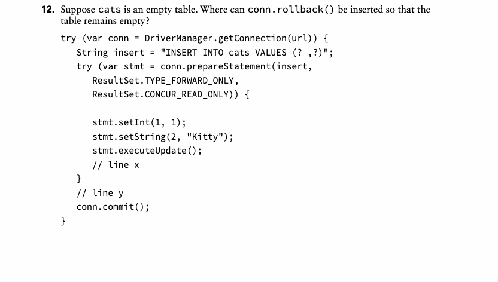

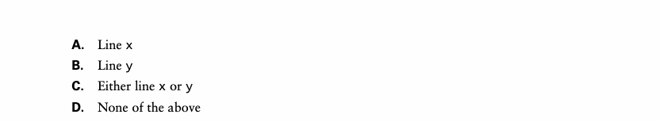

- **A.** Line `x`
- **B.** Line `y`
- **C.** Either line `x` or `y`
- **D.** None of the above

**Answer:** D

**Explanation:** Since `conn.setAutoCommit(false)` is not called, each update is automatically committed. Therefore, there is nothing to roll back and option D is the answer.

## 829-10-013

Given the `books` table in the figure and the following method, which option prints the value `379`? title num\_pages character vararg(255) integer Beginning Java 379 Advanced Java 669

```java
void printNumPages(Connection conn) throws SQLException {
   var sql = """
            SELECT *
            FROM books
            WHERE title = 'Beginning Java'""";
   var ps = conn.prepareStatement(sql);
   var rs = ps.executeQuery();
   if(rs.next())
     System.out.print( ________ );
}
```

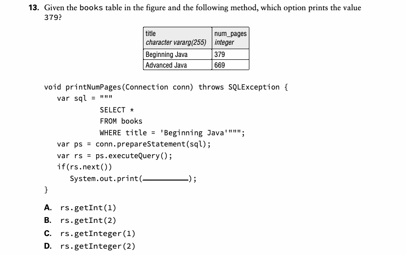

- **A.** `rs.getInt(1)`
- **B.** `rs.getInt(2)`
- **C.** `rs.getInteger(1)`
- **D.** `rs.getInteger(2)`

**Answer:** B

**Explanation:** Unlike arrays, JDBC uses one-based indexes. Since `num_pages` is in the second column, the parameter needs to be `2`, ruling out options A and C. Further, there is not a method named `getInteger()` on the `ResultSet` interface, ruling out option D. Because the proper method is `getInt()`, option B is the answer.

## 829-10-014

Given the `books` table in the previous question and the following code, which lines would you add to successfully insert a row? (Choose two.)

```java
var url = "jdbc:hsqldb:file:library";
var sql = "INSERT INTO books (title,num_pages) VALUES(?,?)";
try (var conn = DriverManager.getConnection(url);
    var stmt = conn.prepareStatement(sql,
       ResultSet.TYPE_SCROLL_INSENSITIVE,
       ResultSet.CONCUR_UPDATABLE)) {
  // INSERT CODE HERE
  stmt.executeUpdate();
}
```

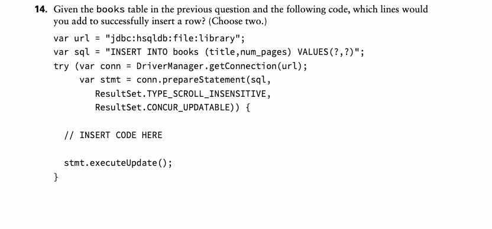


- **A.** `stmt.setObject(0, "Intermediate Java");`
- **B.** `stmt.setObject(1, "Intermediate Java");`
- **C.** `stmt.setObject(1, 500);`
- **D.** `stmt.setObject(2, 500);`

**Answer:** B, D

**Explanation:** Since JDBC does not begin indexes with 0, option A is incorrect and option B is correct. Similarly, the second parameter is at index 2, so option C is incorrect and option D is the other answer. Note that `setObject()` can be called instead of a more specific type.

## 829-10-015

Given the `books` table from the previous two questions and the following method, which option prints `Advanced Java`?

```java
void printTitle(Connection conn) throws SQLException {
   var sql = """
            SELECT title
            FROM books
            WHERE num_pages > 500""";
   var ps = conn.prepareStatement(sql);
   var rs = ps.executeQuery();
   if(rs.next())
     System.out.print( ________ );
}
```

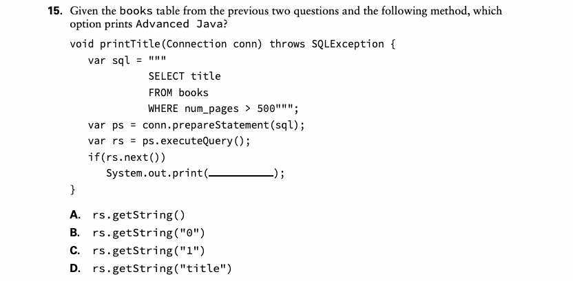

- **A.** `rs.getString()`
- **B.** `rs.getString("0")`
- **C.** `rs.getString("1")`
- **D.** `rs.getString("title")`

**Answer:** D

**Explanation:** Option A does not compile because you have to pass a column index or column name to the method. Options B and C compile. However, there are no columns named `0` or `1`. Since these column names don’t exist, the code would throw a `SQLException` at runtime. Option D is correct as it uses the proper column name.

## 829-10-016

Suppose we have a stored procedure named `summon` that has one `OUT` parameter named `superpower` that always returns the value `fly`. Fill in the blank so that the output is `fly`.

```java
var sql = "{call summon(?)}";
try (var conn = DriverManager.getConnection(url);
   var cs = conn.prepareCall(sql)) {
   cs. ___________ (1, Types.VARCHAR);
   var rs = cs. ____________ ();
   System.out.println(cs.getString("superpower"));
}
```

- **A.** `registerOutParameter` and `execute`
- **B.** `registerOutParameter` and `executeQuery`
- **C.** `setOutParameter` and `execute`
- **D.** `setOutParameter` and `executeQuery`
- **E.** None of the above

**Answer:** A

**Explanation:** Stored procedures use the `registerOutParameter()` method. Since this stored procedure returns a value, we need to call `execute()`, making option A the answer.

## 829-10-017

Suppose `cats` is an empty table. Where can `conn.rollback(sp)` be inserted so that exactly one row is in the table?

```java
try (var conn = DriverManager.getConnection(url)) {
   conn.setAutoCommit(false);
   String insert = "INSERT INTO cats VALUES (?,?)";
   Savepoint sp = null;
   try (var stmt = conn.prepareStatement(insert)) {
     stmt.setInt(1, 1);
     stmt.setString(2, "Kitty");
     stmt.executeUpdate();
     // line x
   }
   sp = conn.setSavepoint();
   try (var stmt = conn.prepareStatement(insert)) {
     stmt.setInt(1, 2);
     stmt.setString(2, "Beverly");
     stmt.executeUpdate();
     // line y
    }
    conn.commit();
}
```

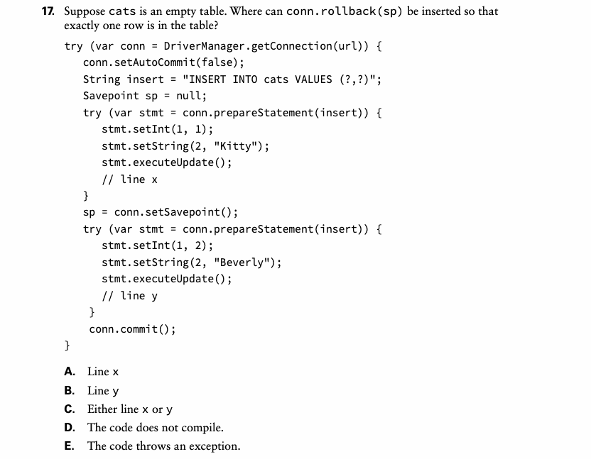

- **A.** Line `x`
- **B.** Line `y`
- **C.** Either line `x` or `y`
- **D.** The code does not compile.
- **E.** The code throws an exception.

**Answer:** B

**Explanation:** The `Kitty` insert is before the `SavePoint` so it is remembered. The `rollback()` method prevents the `Beverly` commit. When the code calls `commit()`, only `Kitty` is committed and option B is correct.

## 829-10-018

Assuming the `animals` database exists and contains one empty table named `names`, what is the output of the following?

```java
var url = "jdbc:hsqldb:file:animals";
var sql = "SELECT * FROM names";
try (var conn = new Connection(url);     // s1
   var stmt = conn.prepareStatement(sql); // s2
   var rs = stmt.executeQuery()) {       // s3
   if (rs.next())
     System.out.println(rs.getString(1));
   }
}
```

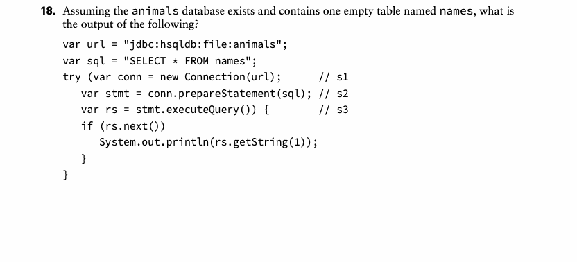

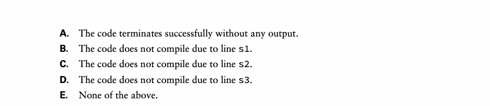

- **A.** The code terminates successfully without any output.
- **B.** The code does not compile due to line `s1`.
- **C.** The code does not compile due to line `s2`.
- **D.** The code does not compile due to line `s3`.
- **E.** None of the above.

**Answer:** B

**Explanation:** `Connection` is an interface rather than a concrete class. Therefore, it does not have a constructor and line `s1` does not compile. As a result, option B is the answer.

## 829-10-019

What is the correct order to close database resources?

- **A.** `Connection` then `PreparedStatement` then `ResultSet`
- **B.** `Connection` then `ResultSet` then `PreparedStatement`
- **C.** `PreparedStatement` then `Connection` then `ResultSet`
- **D.** `PreparedStatement` then `ResultSet` then `Connection`
- **E.** `ResultSet` then `PreparedStatement` then `Connection`
- **F.** None of the above

**Answer:** E

**Explanation:** Database resources should be manually closed in the reverse order from which they were opened. This means the `ResultSet` object is closed before the `Statement` object and the `Statement` object is closed before the `Connection` object. This makes option E the answer.

## 829-10-020

Assuming the `animals` database exists and contains one empty table named `names`, what is the output of the following?

```java
var url = "jdbc:hsqldb:file:animals";
var sql = "SELECT * FROM names";
try (var conn = DriverManager.getConnection(url);     // s1
   var stmt = conn.prepareStatement(sql);          // s2
   var rs = stmt.executeQuery()) {                // s3
   if (rs.next())
     System.out.println(rs.getString(1));
   }
}
```

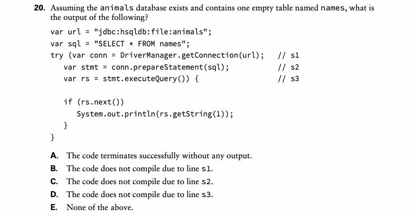

- **A.** The code terminates successfully without any output.
- **B.** The code does not compile due to line `s1`.
- **C.** The code does not compile due to line `s2`.
- **D.** The code does not compile due to line `s3`.
- **E.** None of the above.

**Answer:** A

**Explanation:** This code correctly obtains a `Connection` and `PreparedStatement`. It then runs a query, getting back a `ResultSet` without any rows. The `rs.next()` call returns `false`, so nothing is printed, making option A correct.

## 829-10-021

Suppose we have a `bunny` table with two columns: `name` and `color`.What does the following code output if the table is empty?

```java
 var url = "jdbc:hsqldb:file:rabbits";
 var sql = "SELECT count(*) FROM bunny WHERE color = ? and name = ?";
try (var conn = DriverManager.getConnection(url);
   var stmt = conn.prepareStatement(sql)) {     // s1
   stmt.setString(1, "White");
   try (var rs = stmt.executeQuery()) {     // s2
     if (rs.next())
        System.out.println(rs.getInt(1));
   }
}
```

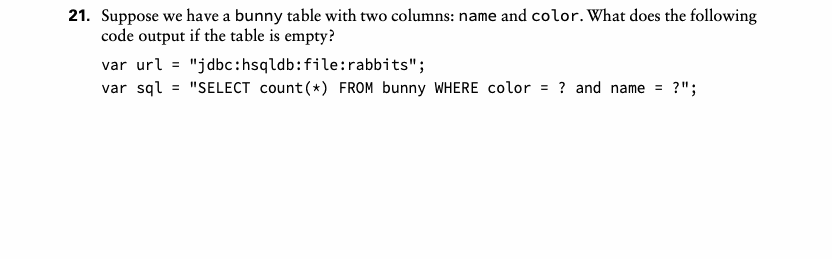

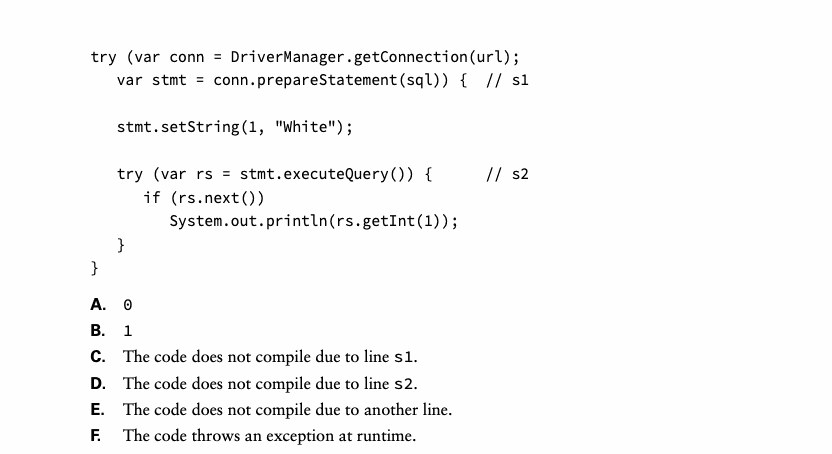

- **A.** `0`
- **B.** `1`
- **C.** The code does not compile due to line `s1`.
- **D.** The code does not compile due to line `s2`.
- **E.** The code does not compile due to another line.
- **F.** The code throws an exception at runtime.

**Answer:** F

**Explanation:** The SQL query has two bind variables, but the code sets only one. This causes a `SQLException` when `executeQuery()` is called, making option F the answer.

## 829-10-022

Suppose the `pandas` table has one row with the name `Mei Xiang` and the location `DC`. What does the following code output?

```java
var url = "jdbc:hsqldb:file:mammals";
var sql = "SELECT name FROM pandas WHERE location = ?";
try (var conn = DriverManager.getConnection(url);     // s1
   var stmt = conn.prepareStatement(sql)) {       // s2
   stmt.setString(1, "DC");
   try (var rs = stmt.executeQuery()) {
     if (rs.next())
        System.out.println(rs.getString("name"));
     else
        System.out.println("No match");
   } }
```

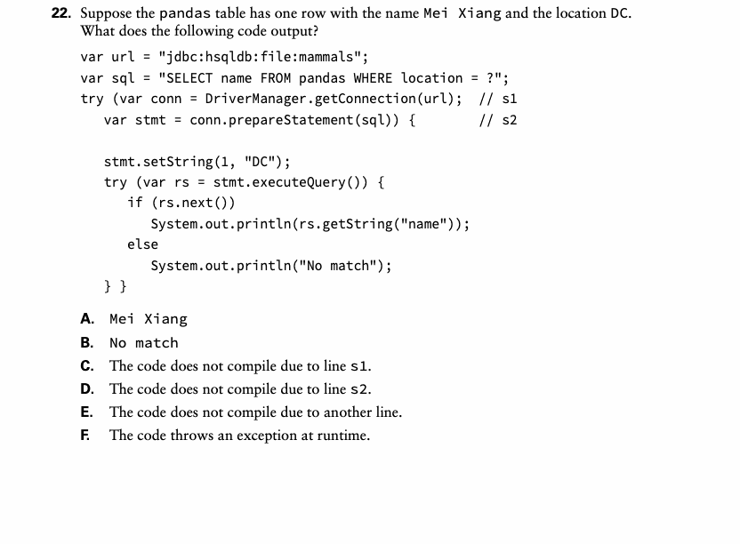


- **A.** `Mei Xiang`
- **B.** `No match`
- **C.** The code does not compile due to line `s1`.
- **D.** The code does not compile due to line `s2`.
- **E.** The code does not compile due to another line.
- **F.** The code throws an exception at runtime.

**Answer:** A

**Explanation:** This code uses a `PreparedStatement` and properly sets a bind variable (`?`). The `ResultSet` has one value and does print `Mei Xiang` successfully. Therefore, option A is the answer.

## 829-10-023

Suppose we have a stored procedure named `increment` that has one `INOUT` parameter named `num`. The `num` parameter always returns a number 1 larger than the one passed in. Which options fill in the blank so the output is `7`? (Choose two.)

```java
var sql = "{call increment(?)}";
try (var conn = DriverManager.getConnection(url);
   var cs = conn.prepareCall(sql)) {
   // Input parameter
   cs. ___________ (1, 6);
   // Output parameter
   cs. ________________ (1, Types.VARCHAR);
   var rs = cs.execute();
   System.out.println(cs.getString("num"));
}
```

- **A.** `registerInParameter`
- **B.** `registerInOutParameter`
- **C.** `registerOutParameter`
- **D.** `setInt`
- **E.** `setInOutParameter`
- **F.** `setOutParameter`

**Answer:** C, D

**Explanation:** Input parameters are set in the same way as in a `PreparedStatement`, making `setInt()` correct for the first blank and option D correct. For the second blank, stored procedures use `registerOutParameter()` for output, making option C the other correct answer.

## 829-10-024

Which is true if the `animals` database exists and contains an empty `names` table?

```java
var url = "jdbc:hsqldb:file:animals";
var sql = "SELECT COUNT(*) FROM names";
try (var conn = DriverManager.getConnection(url);
    var stmt = conn.prepareStatement(sql,
      ResultSet.TYPE_FORWARD_ONLY,
      ResultSet.CONCUR_READ_ONLY);
    var rs = stmt.executeQuery()) {
    rs.next();                       // r1
    System.out.println(rs.getInt(1));     // r2
}
```

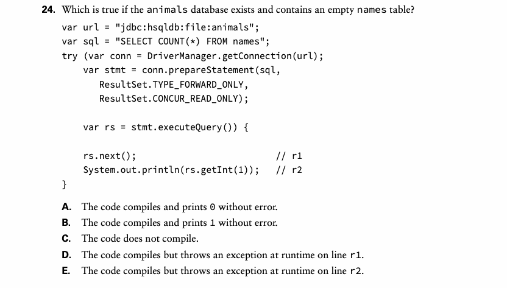


- **A.** The code compiles and prints `0` without error.
- **B.** The code compiles and prints `1` without error.
- **C.** The code does not compile.
- **D.** The code compiles but throws an exception at runtime on line `r1`.
- **E.** The code compiles but throws an exception at runtime on line `r2`.

**Answer:** A

**Explanation:** The `count(*)` function in SQL always returns a number. In this case, it is the number `0`. This means line `r1` executes successfully because it positions the cursor at that row. Line `r2` also executes successfully and prints `0`, which is the value in the row. Since the code runs successfully, option A is the answer.

## 829-10-025

Suppose we have an empty `bunny` table with two columns: `name` and `color`.What is the state of the table after running this code?

```java
var url = "jdbc:hsqldb:file:rabbits";
var sql = "INSERT INTO bunny(name, color) VALUES (?, ?)";
try (var conn = DriverManager.getConnection(url);
   var stmt = conn.prepareStatement(sql)) {     // s1
   stmt.setString(1, "Hoppy");
   stmt.setString(2, "Brown");
   stmt.executeUpdate();
   stmt.setString(1, "Daisy");
   stmt.executeUpdate();
}
```

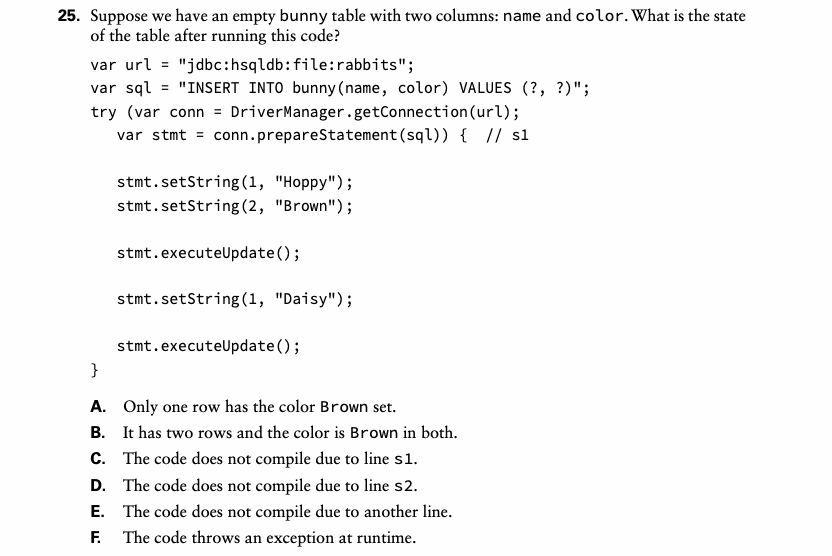

- **A.** Only one row has the color `Brown` set.
- **B.** It has two rows and the color is `Brown` in both.
- **C.** The code does not compile due to line `s1`.
- **D.** The code does not compile due to line `s2`.
- **E.** The code does not compile due to another line.
- **F.** The code throws an exception at runtime.

**Answer:** B

**Explanation:** This code is correct. It executes the first update to add the first row and then sets the parameters for the second. For the second update, only one parameter is set. The other is reused since it was set earlier. Therefore, option B is the answer.

## 829-10-026

Suppose `cats` is an empty table. How many rows are in this table when the code has completed?

```java
try (var conn = DriverManager.getConnection(url)) {
   conn.setAutoCommit(false);
   String insert = "INSERT INTO cats VALUES (? ,?)";
   try (var stmt = conn.prepareStatement(insert)) {
     stmt.setInt(1, 1);
     stmt.setString(2, "Kitty");
     stmt.executeUpdate();
   }
   var sp = conn.setSavepoint();
   conn.rollback();
   try (var stmt = conn.prepareStatement(insert)) {
     stmt.setInt(1, 2);
     stmt.setString(2, "Beverly");
     stmt.executeUpdate();
    }
    conn.commit();
}
```

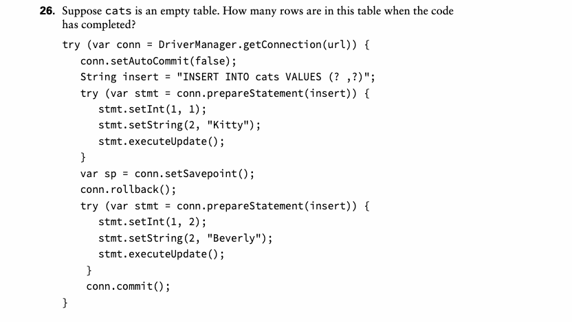

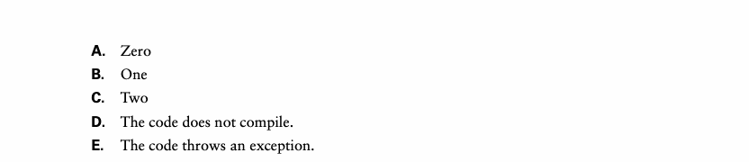

- **A.** Zero
- **B.** One
- **C.** Two
- **D.** The code does not compile.
- **E.** The code throws an exception.

**Answer:** B

**Explanation:** The `Kitty` insert is rolled back even though there is a savepoint since the savepoint is not referenced. The `Beverly` insert is retained, making option B correct.

## 829-10-027

Which is true of a `PreparedStatement`?

- **A.** It has a method to change the bind variable to a different character other than the `?` character.
- **B.** It can be used only for `SELECT` statements.
- **C.** It can be used only for `UPDATE` statements.
- **D.** All of these are true.
- **E.** None of these are true.

**Answer:** E

**Explanation:** In JDBC, the bind variable is always a question mark (`?`), making option A incorrect. A `PreparedStatatement` is not limited to specific types of SQL, making options B and C incorrect as well. This makes option E the correct answer.

## 829-10-028

Suppose we have a `peacocks` table with two columns: `name` and `rating`. What does the following code output if the table is empty?

```java
var url = "jdbc:hsqldb:file::birds";
var sql = "SELECT name FROM peacocks WHERE name = ?";
try (var conn = DriverManager.getConnection(url);
   var stmt = conn.prepareStatement(sql)) {     // s1
   stmt.setString(1, "Feathers");
   System.out.println(stmt.executeUpdate());     // s2
}
```

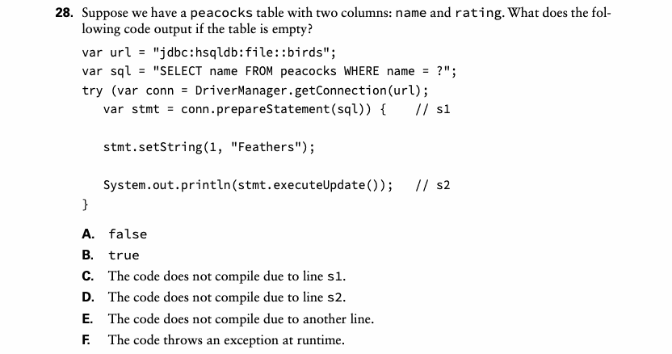

- **A.** `false`
- **B.** `true`
- **C.** The code does not compile due to line `s1`.
- **D.** The code does not compile due to line `s2`.
- **E.** The code does not compile due to another line.
- **F.** The code throws an exception at runtime.

**Answer:** F

**Explanation:** While this code compiles, it isn’t right. Since we have a `SELECT` statement, we should be calling `execute()` or `executeQuery()`. Option F is the answer because the code throws an exception when attempting to call `executeUpdate()`.

## 829-10-029

Which of the following statements about `Connection` methods are true? (Choose two.)

- **A.** `rollback()` is ignored while autocommit mode is set to `false`.
- **B.** `rollback()` is ignored while autocommit mode is set to `true`.
- **C.** When not in autocommit mode, calling `setAutoCommit(true)` causes the data to be immediately committed.
- **D.** When not in autocommit mode, calling `setAutoCommit(true)` creates a `SavePoint`.
- **E.** When not in autocommit mode, calling `setAutoCommit(true)` rolls back any outstanding changes.
- **F.** When not in autocommit mode, calling `setAutoCommit(true)` throws an exception.

**Answer:** B, C

**Explanation:** When in autocommit mode, statements are immediately committed. Since there is nothing to roll back, option B is one of the answers. Additionally, enabling autocommit mode triggers an immediate commit, giving us option C.

## 829-10-030

What is the most likely outcome of this code if the `bunny` table is empty?

```java
var url = "jdbc:hsqldb:file:rabbits";
var sql = "INSERT INTO bunny(name, color) VALUES (?, ?)";
try (var conn = DriverManager.getConnection(url);
   var stmt = conn.createStatement()) {
   stmt.setString(1, "Hoppy");
   stmt.setString(2, "Brown");
   stmt.executeUpdate(sql);
}
```

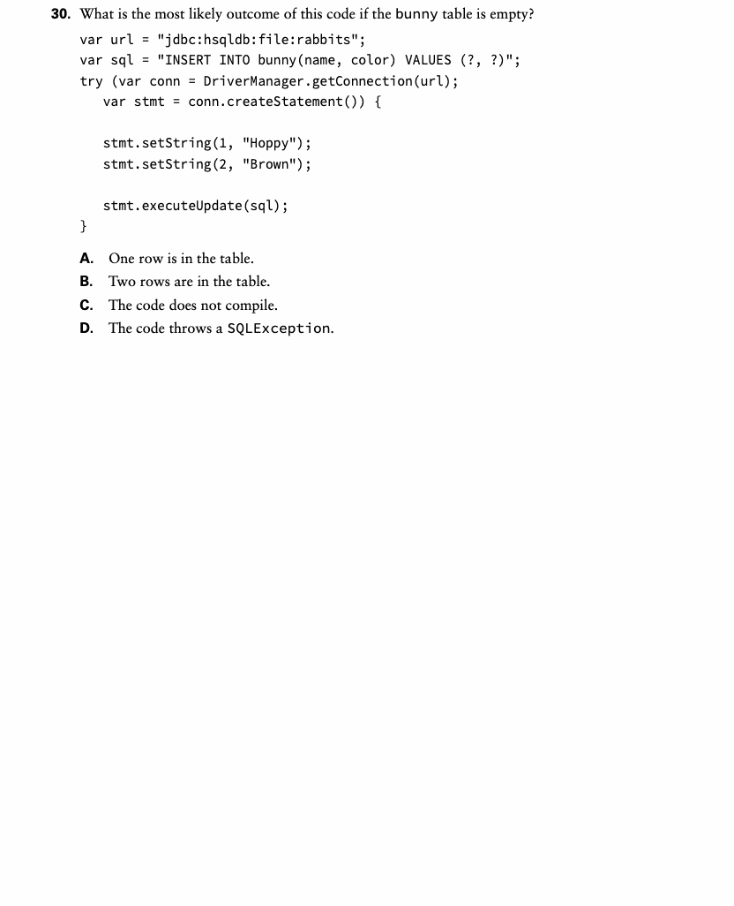

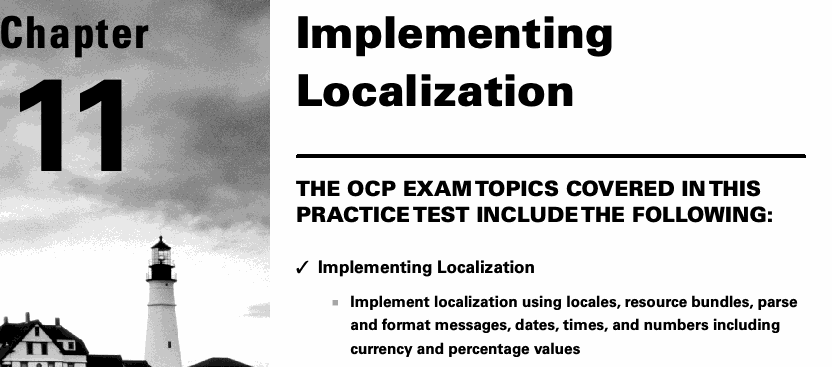

- **A.** One row is in the table.
- **B.** Two rows are in the table.
- **C.** The code does not compile.
- **D.** The code throws a `SQLException`. Chapter Implementing 11 Localization THE OCP EXAM TOPICS COVERED IN THIS PRACTICE TEST INCLUDE THE FOLLOWING: ✓ Implementing Localization ■ Implement localization using locales, resource bundles, parse and format messages, dates, times, and numbers including currency and percentage values

**Answer:** C

**Explanation:** This question is trickier if you know more JDBC than is on the exam. If you know only what is on the exam, you would assume the `createStatement()` method doesn’t exist. However, it does, and `stmt` is a `Statement` object. Since `setString()` does not exist on `Statement`, the code does not compile. This means the answer is option C regardless of your level of knowledge of JDBC.
