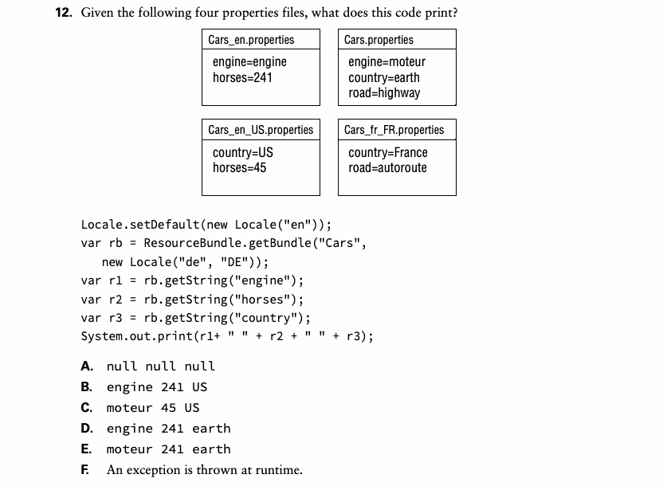

# Chapter 11: Implementing Localization

> Source: *OCP Oracle Certified Professional Java SE 17 Developer Practice Tests (Exam 1Z0-829)*. Extracted from your PDF for personal study. Questions with figures/tables include a scan of the original page.

## 829-11-001

Which of the following are considered locales? (Choose three.)

- **A.** Cultural region
- **B.** Local address
- **C.** City
- **D.** Time zone region
- **E.** Political region
- **F.** Geographical region

**Answer:** A, E, F

**Explanation:** Oracle defines a locale as a geographical, political, or cultural region, making options A, E, and F correct. A local address and city are too granular for a locale. Also, time zones often span multiple locales.

## 829-11-002

What is the result of the following?

```java
LocalDateTime pi = LocalDateTime.of(2022, 3, 14, 1, 59);
var formatter = DateTimeFormatter.ofPattern("M.ddhhmm");
System.out.println(formatter.format(pi));
```

- **A.** `2.140159`
- **B.** `3.140159`
- **C.** `59.140102`
- **D.** `59.140103`
- **E.** The code does not compile.
- **F.** The code compiles but throws an exception at runtime.

**Answer:** B

**Explanation:** While it is traditional to include the year when outputting a date, it is not required. This code correctly prints the month followed by a decimal point. After the decimal point, it prints the day of the month followed by the hours and minutes. Happy Pi Day! For these reasons, option B is correct.

## 829-11-003

Assuming the key `green` is in all five of the files referenced in the options, which file will the following code use for the resource bundle?

```java
Locale.setDefault(new Locale("en", "US"));
var rb = ResourceBundle.getBundle("Colors", new Locale("fr"));
System.out.print(rb.getString("green"));
```

- **A.** `Colors_default.properties`
- **B.** `Colors.properties`
- **C.** `Colors_en.properties`
- **D.** `Colors_US.properties`
- **E.** `Colors_en_US.properties`

**Answer:** E

**Explanation:** Java starts out by looking for a properties file with the requested locale, which in this case is the `fr` language. It doesn’t find it, so it moves on to the default locale, `en_US`, which it does find, making option E correct.

## 829-11-004

Assuming the following method is called with a `double` value of `1_900_000.0`, which values are printed? (Choose two.)

```java
public void payBill(double t) {
   var nf1 = NumberFormat.getCompactNumberInstance(
     Locale.getDefault(), Style.LONG);
   var nf2 = NumberFormat.getCompactNumberInstance();
   System.out.println(nf1.format(t));
   System.out.println(nf2.format(t));
}
```

- **A.** `1M`
- **B.** `1.9 million`
- **C.** `2M`
- **D.** `1.900M`
- **E.** `2 million`
- **F.** `1 million`

**Answer:** C, E

**Explanation:** A `CompactNumberFormat` rounds to the nearest whole number within the three-digit range, so the first line prints `2 million`, making option E correct. The second line prints `2M`, since `SHORT` is used as the `STYLE` by default, making option C correct.

## 829-11-005

What is the output of the following code snippet?

```java
var d = LocalDateTime.parse("2022-01-21T12:00:00",
   DateTimeFormatter.ISO_LOCAL_DATE);
System.out.print(d.format(DateTimeFormatter.ISO_LOCAL_TIME));
```

- **A.** `00:00:00`
- **B.** `12:00:00`
- **C.** `2022-01-21`
- **D.** `2022-01-22`
- **E.** The code does not compile.
- **F.** An exception is thrown at runtime.

**Answer:** F

**Explanation:** The code compiles but the first line throws an exception at runtime, making option F correct. The string sent to the `parse()` method contains a time component, but `ISO_LOCAL_DATE` is used as the formatter.

## 829-11-006

Fill in the blank with the option that allows the code snippet to compile and print a message without throwing an exception at runtime.

```java
var x = LocalDate.of(2022, 3, 1);
var y = LocalDateTime.of(2022, 3, 1, 5, 55);
var f = DateTimeFormatter.ofPattern("MMMM' at 'h' o'clock'");
System.out.print( _____________ );
```

- **A.** `f.formatDate(x)`
- **B.** `f.formatDate(y)`
- **C.** `f.format(x)`
- **D.** `f.format(y)`
- **E.** The code does not compile regardless of what is placed in the blank.
- **F.** None of the above.

**Answer:** F

**Explanation:** Options A and B are incorrect because `formatDate()` is not a valid method name in `DateTimeFormatter`. Option E is incorrect because the code compiles if either option C or D is used. Both options C and D will produce an exception at runtime, though, as the date pattern is invalid. In particular, the apostrophe in `o'clock` should be escaped. Option C is also incorrect because there is no hour value `h` for a `LocalDate`. If the pattern string was corrected with `o''clock`, then option D would be correct and print `March at 5` `o'clock` at runtime.

## 829-11-007

What does the following program print?

```java
import java.time.*;
import java.time.format.*;
public class PolarBear {
   public static void main(String[] args) {
     LocalDate polarBearDay = LocalDate.of(2022, 2, 27);
    var formatter = DateTimeFormatter.ofPattern("yyyy dd MMM");
    System.out.println(polarBearDay.format(formatter));
  } }
```

- **A.** `2022 27 Jan`
- **B.** `2022 27 Feb`
- **C.** `2022 Jan 27`
- **D.** `2022 Feb 27`
- **E.** None of the above

**Answer:** B

**Explanation:** `LocalDate` starts counting months from `1`, so month `2` is February. This rules out options A and C. The pattern specifies that the date should appear before the month, making option B correct.

## 829-11-008

Which of the following are valid locale formats? (Choose two.)

- **A.** `hi`
- **B.** `IN_hi`
- **C.** `hi_IN`
- **D.** `HI_IN`
- **E.** `in_hi`
- **F.** `IN`

**Answer:** A, C

**Explanation:** In Java, a locale can be represented by a language code in lowercase, or a language and country code, with language in lowercase and country in uppercase. For these reasons, options A and C are correct. Options B, D, and E are incorrect because the lowercase language must be before the uppercase country. Option F is incorrect because the language is missing.

## 829-11-009

Assuming the key `indigo` is in all five of the files referenced in the options, which file will the following code use for the resource bundle?

```java
Locale loc = new Locale("fr", "CH");
Locale.setDefault(new Locale("it", "CH"));
ResourceBundle rb = ResourceBundle.getBundle("Colors", loc);
rb.getString("Indigo");
```

- **A.** `Colors_default.properties`
- **B.** `Colors_en_US.properties`
- **C.** `Colors_CH.properties`
- **D.** `Colors_en.properties`
- **E.** `Colors_es.properties`
- **F.** None of the above

**Answer:** F

**Explanation:** Java starts out by looking for a properties file with the requested locale, which in this case is the `fr_CH` language and country. It doesn’t find `Colors_fr_CH.properties`, so it moves on to the locale with just a language code `fr`. It also does not find `Colors_fr.properties`. It then moves on to the default locale, `it_CH`, checking `Colors_it_CH.properties`, but there is still no match. It drops the country code and checks `it` for `Colors_it.properties`, but still doesn’t find a match. Finally, it checks for a `Colors.properties` file but since that’s not an option, it fails. The result is that a `MissingResourceException` is thrown at runtime, making option F correct.

## 829-11-010

For currency, the United States uses the `$` symbol, the UK uses the `£` symbol, and Germany uses the `€` symbol. Given this information, what is the expected output of the following code snippet?

```java
Locale.setDefault(Locale.US);
Locale.setDefault(Category.FORMAT, Locale.GERMANY);
System.out.print(NumberFormat.getCurrencyInstance(Locale.UK)
   .format(1.1));
```

- **A.** `$1.10`
- **B.** `1,10€`
- **C.** `£1.10`
- **D.** The code does not compile.
- **E.** An exception is thrown at runtime.
- **F.** The output cannot be determined without knowing the locale of the system where it will be run.

**Answer:** C

**Explanation:** The code compiles, so option D is incorrect. In this sample, the default locale is set to `US`, while the default locale format is set to `GERMANY`. Neither is used for formatting the value, as `getCurrencyInstance()` is called with `UK` as the locale. For this reason, the `£` symbol is used, making option C correct.

## 829-11-011

Which correctly fills in the blank to print `2022-01-15`?

```java
LocalDate hatDay = LocalDate.of(2022, Month.JANUARY, 15);
DateFormatter f = DateFormatter.ISO_DATE;
System.out.println( ______________________________ );
```

- **A.** `f.format(hatDate)`
- **B.** `hatDay.format(f)`
- **C.** Both of the above
- **D.** Neither of the above

**Answer:** D

**Explanation:** There is a `DateTimeFormatter` class, but not a `DateFormatter` class. The `DateTimeFormatter` class is used for formatting dates, times, or both. Since the provided code does not compile, nothing can fill in the blank to make the code print `2022-01-15`, and option D is the answer.

## 829-11-012

Given the following four properties files, what does this code print? Cars\_en.properties Cars.properties engine=engine engine=moteur horses=241 country=earth road=highway Cars\_en\_US.properties Cars\_fr\_FR.properties country=US country=France horses=45 road=autoroute

```java
Locale.setDefault(new Locale("en"));
var rb = ResourceBundle.getBundle("Cars",
   new Locale("de", "DE"));
var r1 = rb.getString("engine");
var r2 = rb.getString("horses");
var r3 = rb.getString("country");
System.out.print(r1+ " " + r2 + " " + r3);
```




- **A.** `null null null`
- **B.** `engine 241 US`
- **C.** `moteur 45 US`
- **D.** `engine 241 earth`
- **E.** `moteur 241 earth`
- **F.** An exception is thrown at runtime.

**Answer:** D

**Explanation:** The `getBundle()` does not find `Cars_de_DE.properties` or `Cars_de.properties`, so it moves on to the default locale. Since `Cars_en.properties` is available, it will use this file, falling back to `Cars.properties` if any values are not available. Therefore, it selects `engine` and `horses` from the first file, and `country` from the second file, printing `engine 241 earth` and making option D correct.

## 829-11-013

Given the four properties files in Question 12, what does this code print?

```java
Locale.setDefault(new Locale("en", "US"));
var rb = ResourceBundle.getBundle("Cars",
   new Locale("fr", "FR"));
var s1 = rb.getString("country");
var s2 = rb.getString("horses");
var s3 = rb.getString("engine");
System.out.print(s1+ " " + s2 + " " + s3);
```

- **A.** `France null engine`
- **B.** `France 241 moteur`
- **C.** `France 45 moteur`
- **D.** `France 241 engine`
- **E.** `France 45 engine`
- **F.** An exception is thrown at runtime.

**Answer:** F

**Explanation:** The `getBundle()` method matches `Cars_fr_FR.properties`. It will then fall back to `Cars_fr.properties` (which does not exist) and `Cars.properties` if the value is not available. For this reason, the first and third values would be `France` and `moteur`. While the second value `horses` is in the default locale, it is not available if the requested locale has been found. As a result, the code throws a `MissingResourceException`, making option F the answer.

## 829-11-014

Given the four properties files in Question 12, what does this code print?

```java
Locale.setDefault(new Locale("ja","JP"));
var rb = ResourceBundle.getBundle("Cars",
   new Locale("fr", "FR"));
var t1 = rb.getString("engine");
var t2 = rb.getString("road");
var t3 = rb.getString("country");
System.out.print(t1+ " " + t2 + " " + t3);
```

- **A.** `moteur autoroute France`
- **B.** `engine autoroute France`
- **C.** `engine highway France`
- **D.** `moteur highway France`
- **E.** `moteur highway US`
- **F.** An exception is thrown at runtime.

**Answer:** A

**Explanation:** The `getBundle()` method matches `Cars_fr_FR.properties`. It will then fall back to `Cars_fr.properties` (which does not exist) and `Cars.properties` if the value is not available. For this reason, the first value printed is `moteur` from `Cars.properties`, while the next two values printed are `autoroute` and `France` from `Cars_fr_FR.properties`, making option A correct.

## 829-11-015

Which of the following correctly define a `Locale` instance? (Choose three.)

- **A.** `Locale.get("it")`
- **B.** `new Locale("it")`
- **C.** `Locale.get(Locale.ITALIAN)`
- **D.** `new Locale.Builder().setLanguage("it").build()`
- **E.** `Locale.of("it")`
- **F.** `Locale.ITALIAN`

**Answer:** B, D, F

**Explanation:** There are no `get()` or `of()` methods in `Locale`. You can define a `Locale` using a constructor, making option B correct. You can also use a `Locale.Builder`, making option D correct. Finally, you can use a built-in constant, making option F correct.

## 829-11-016

Assuming the key `turquoise` is in all five of the files referenced in the options, which file will the following code use for the resource bundle?

```java
Locale loc = new Locale("zh", "CN");
Locale.setDefault(new Locale("en", "US"));
ResourceBundle rb = ResourceBundle.getBundle("Colors", loc);
rb.getString("turquoise");
```

- **A.** `Colors_en.properties`
- **B.** `Colors_CN.properties`
- **C.** `Colors.properties`
- **D.** `Colors_default.properties`
- **E.** `Colors_en_CN.properties`
- **F.** None of the above

**Answer:** A

**Explanation:** Java starts out by looking for a properties file with the requested locale, which in this case is the `zh_CN` language and country. It doesn’t find it, so it moves onto the locale with just a language code `zh`, which it also does not find. It then moves on to the default locale `en_US`, but there is still no match. It drops the country code and does find a match with `en`, making option A correct.

## 829-11-017

What format pattern would you pass to a `DateTimeFormatter` so it creates hour and minute output such as `02:33`?

- **A.** `HH:MM`
- **B.** `HH:mm`
- **C.** `hh:MM`
- **D.** `hh:mm`
- **E.** None of the above

**Answer:** D

**Explanation:** For dates, a lowercase `m` means minute while an uppercase `M` means month. This eliminates options A and C. A lowercase `h` means hour. Therefore, option B is incorrect, and option D is the answer.

## 829-11-018

Assuming the following method is called with a `double` value of `123_456.789`, which value is printed?

```java
public void printReceipt(double t) {
   var formatter = NumberFormat.getCompactNumberInstance(
     Locale.getDefault(), Style.SHORT);
   System.out.print(formatter.format(t));
}
```

- **A.** `123,456.789`
- **B.** `123.456 thousand`
- **C.** `123.456K`
- **D.** `124K`
- **E.** `123 thousand`
- **F.** `123K`

**Answer:** F

**Explanation:** A`CompactNumberFormat` rounds to the nearest whole number within the three-digit range, so the numeric value printed is `123`. Since the `SHORT` style is selected, the output is `123K`, making option F correct.

## 829-11-019

For what values of pattern will the following print `<02.1> <06.9> <10,00>`? (Choose two.)

```java
String pattern = " _____________ ";
var message = DoubleStream.of(2.1, 6.923, 1000)
   .mapToObj(v -> new DecimalFormat(pattern).format(v))
   .collect(Collectors.joining("> <"));
System.out.print("<" + message + ">");
```

- **A.** `##,00.##`
- **B.** `##,00.#`
- **C.** `0,00.#`
- **D.** `#,00.#`
- **E.** `0,00.0`
- **F.** `#,##.#`

**Answer:** B, D

**Explanation:** Options B and D correctly print the same string value in the specified format. Option A is incorrect because `<06.92>` is printed instead of `<06.9>`. Options C and E are incorrect, because (among other things) commas are printed as part of both of the first two values. Option F is incorrect because `<2.1> <6.9>` is printed instead of `<02.1> <06.9>`.

## 829-11-020

Which of the following are not valid `Locale` formats? (Choose two.)

- **A.** `nl_BE`
- **B.** `fr_CA`
- **C.** `uk_ua`
- **D.** `CR`
- **E.** `no`
- **F.** `ro_RO`

**Answer:** C, D

**Explanation:** In Java, a locale can be represented by a language code in lowercase, or a language and country code, with language in lowercase and country in uppercase. Option C is invalid because both values are lowercase. Option D is invalid because the value is in uppercase. The rest of the options are valid locale formats.

## 829-11-021

What is the result of running this code?

```java
12: LocalDate pieDay = LocalDate.of(2022, Month.JANUARY, 23);
13: LocalTime midnight = LocalTime.of(0, 0);
14: LocalDateTime pieTime = LocalDateTime.of(pieDay, midnight);
15:
16: DateTimeFormatter f = DateTimeFormatter
17:    .ofLocalizedDate(FormatStyle.SHORT);
18: f.format(pieDay);
19: f.format(pieTime);
20: f.format(midnight);
```

- **A.** The code runs successfully.
- **B.** The code throws an exception on line 18.
- **C.** The code throws an exception on line 19.
- **D.** The code throws an exception on line 20.
- **E.** The code does not compile.

**Answer:** D

**Explanation:** The `DateTimeFormatter` is created with `ofLocalizedDate()`. It knows how to format date fields but not time fields. Line 18 is fine because a `LocalDate` clearly has date fields. Line 19 is also fine. Since a `LocalDateTime` has both date and time fields, the formatter just looks at the date fields. Line 20 is a problem. A `LocalTime` object does not have any date fields so the formatter throws an `UnsupportedTemporalTypeException`, making option D the answer.

## 829-11-022

For currency, the United States uses the `$` symbol, the UK uses the `£` symbol, and Germany uses the `€` symbol. Given this information, what is the expected output of the following code snippet?

```java
Locale.setDefault(Locale.US);
Locale.setDefault(Category.FORMAT, Locale.GERMANY);
Locale.setDefault(Category.DISPLAY, Locale.UK);
System.out.print(NumberFormat.getCurrencyInstance()
   .format(6.95));
```

- **A.** `$6.95`
- **B.** `6,95 €`
- **C.** `£6.95`
- **D.** The code does not compile.
- **E.** An exception is thrown at runtime.
- **F.** The output cannot be determined without knowing the locale of the system where it will be run.

**Answer:** B

**Explanation:** The code compiles, so option D is incorrect. While three distinct locale values are set, the one that is used for formatting text is `Category.FORMAT`. For this reason, the `GERMANY` locale is used to format the data with the `€` symbol, making option B correct.

## 829-11-023

What is the output of the following code snippet?

```java
var x = LocalDate.of(2022, 3, 1);
var y = LocalDateTime.of(2022, 1, 1, 2, 55);
var f = DateTimeFormatter.ofPattern("'yyyy-MM'");
System.out.print(f.format(x) + " " + f.format(y));
```

- **A.** `2022-03 2022-01`
- **B.** `2022-01 2022-03`
- **C.** `2022-02 2022-00`
- **D.** `yyyy-MM yyyy-MM`
- **E.** The code does not compile.
- **F.** An exception is thrown at runtime.

**Answer:** D

**Explanation:** The date/time pattern uses single quotes to escape the date/time values, meaning the output is `yyyy-MM` for all valid inputs. For this reason, option D is correct. If the single quotes were removed, then `2022-03 2022-01` would be the correct output.

## 829-11-024

Given the following two properties files, what does the `loadPod()` method output?

```java
 container.properties
 name=generic
 number=2
 container_en.properties
 name=Ship
 type=container
 void loadPod() {
    new Locale.Builder()
     .setLanguage("en")
     .setRegion("US").build();
   var rb = ResourceBundle.getBundle("container");
   String name = rb.getString("name");
   String type = rb.getString("type");
   System.out.print(name + " " + type);
}
```

- **A.** `Ship container`
- **B.** `generic container`
- **C.** `generic null`
- **D.** The output cannot be determined without knowing the locale of the system where it will be run.
- **E.** An exception is thrown at runtime.
- **F.** None of the above.

**Answer:** D

**Explanation:** The method creates a resource bundle using a builder but never sets it. Since we don’t know the default locale of the code, the answer depends on where it is executed, making option D correct.

## 829-11-025

Given the two properties files from Question 24, what does the following method output?

```java
void loadContainer() {
   Locale.setDefault(new Locale("en"));
   var rb = ResourceBundle.getBundle("container");
   String name = rb.getString("name");
   String type = rb.getString("type");
   System.out.print(name + " " + type);
}
```

- **A.** `Ship container`
- **B.** `generic container`
- **C.** `generic null`
- **D.** The output cannot be determined without knowing the locale of the system where it will be run.
- **E.** An exception is thrown at runtime.
- **F.** None of the above.

**Answer:** A

**Explanation:** This code sets the default locale to English and then tries to get a resource bundle for `container`. It finds the resource bundle `container_en.properties` as the most specific match. Both keys are found in this file, so option A is the answer.

## 829-11-026

Given the two properties files from Question 24, what does the following method output?

```java
void loadControlPlane() {
   Locale.setDefault(new Locale("en_US"));
   var rb = ResourceBundle.getBundle("container");
   String name = rb.getString("name");
   String type = rb.getString("type");
   System.out.print(name + " " + type);
}
```

- **A.** `Ship container`
- **B.** `generic container`
- **C.** `generic null`
- **D.** The output cannot be determined without knowing the locale of the system where it will be run.
- **E.** An exception is thrown at runtime.
- **F.** None of the above.

**Answer:** E

**Explanation:** The `Locale` constructor that takes a single argument expects a language code, not a concatenation of language and region codes. Therefore, the language is set as `en_us`, not `en`, with no region code set. Since no properties files match the language `en_us`, the default `container.properties` is used. Since `type` is not found in this properties file, a `MissingResourceException` is thrown at runtime.

## 829-11-027

Which correctly fills in the blank to print `2022-01-15`?

```java
LocalDate hatDay = LocalDate.of(2022, Month.JANUARY, 15);
DateTimeFormatter f = DateTimeFormatter.ISO_DATE;
System.out.println( ______________________________ );
```

- **A.** `f.format(hatDay)`
- **B.** `hatDay.format(f)`
- **C.** `f.formatDate(hatDay)`
- **D.** `hatDay.formatDate(f)`
- **E.** `f.format(hatDay)` and `hatDay.format(f)`
- **F.** `f.formatDate(hatDay)` and `hatDay.formatDate(f)`

**Answer:** E

**Explanation:** Both `LocalDate` and `DateTimeFormatter` have a `format()` method. While it is tricky, you do need to know that the `format()` method can be called on either object. Therefore, option E is the answer.

## 829-11-028

Assuming the `Forest.properties` file is the only resource file available, what is the output of calling the `hike()` method?

```java
Forest.properties
trees=evergreen {0}
animals=squirrels
static void hike() {
   Locale.setDefault(new Locale.Builder()
     .setLanguage("en").build());
   var rb = ResourceBundle
     .getBundle("Forest", new Locale("fr"));
   System.out.print(MessageFormat.format("trees","pretty"));
}
```

- **A.** `trees`
- **B.** `trees pretty`
- **C.** `trees {0}`
- **D.** `trees null`
- **E.** The code does not compile.
- **F.** An exception is thrown at runtime.

**Answer:** A

**Explanation:** The code compiles, so option E is incorrect. Java starts out by looking for a properties file with the requested locale, which in this case is the `fr` language. It doesn’t find `Forest_fr.properties`, so it moves onto the default locale `en`. It also doesn’t find `Forest_en.properties`. It settles on `Forest.properties` without throwing an exception, so option F is incorrect. The first argument to `MessageFormat.format()` should be a pattern `String` value. Since `trees` is sent, the output of the formatting string is `trees`, making option A correct. If `rb.getString("trees")` was passed instead of just `trees`, then the output would be `evergreen pretty`.

## 829-11-029

What does the following print?

```java
import java.time.*;
import java.time.format.*;
public class Cat {
   public static void main(String[] args) {
     LocalDate catDay = LocalDate.of(2022, 10, 29);
     var formatter = DateTimeFormatter
        .ofPattern("Holiday: yyyy dd MMM");
     System.out.println(catDay.format(formatter));
   } }
```

- **A.** `Holiday: 2022 29 Sept`
- **B.** `Holiday: 2022 29 Oct`
- **C.** The code does not compile.
- **D.** The code compiles but throws an exception at runtime.

**Answer:** D

**Explanation:** The format of the pattern is incorrect. You can’t just put literal text in there without escaping it. Most of the characters of `Holiday:` are not defined formatting symbols. The code throws an `IllegalArgumentException`, so option D is correct.

## 829-11-030

Which of the following is not an expected output printed by the following code?

```java
double p = 1_909.2;
var nf1 = NumberFormat.getCompactNumberInstance(Locale.getDefault());
var nf2 = NumberFormat.getCompactNumberInstance(
   Locale.getDefault(), Style.SHORT);
var nf3 = NumberFormat.getCompactNumberInstance(
   Locale.getDefault(), Style.LONG);
System.out.println(nf1.format(p));
System.out.println(nf2.format(p));
System.out.println(nf3.format(p));
```

- **A.** `1909.2`
- **B.** `2K`
- **C.** `2 thousand`
- **D.** All of the above will be printed.
- **E.** None of the above, as the code does not compile. Chapter Practice Exam 1 12 This chapter contains 50 questions and is designed to simulate a real 1Z0-829 exam. While previous chapters were focused on a specifific set of objectives, this chapter covers all of the objectives on the exam. We recommend you take this exam only after you score well on the questions in the individual chapters. For this chapter, you should try to simulate the real exam experience as much as possible. This means setting aside 90 minutes of uninterrupted time to complete the test, as well as not looking at any reference material while taking the exam. If you don’t know an answer to a question, complete it as best you can and move on to the next question, just as you would on a real exam. Remember, the exam permits writing material, such as a whiteboard. If you do not have a whiteboard handy, you can just use blank sheets of paper and a pencil. If you do well on this test, then you are hopefully ready to take the real exam. With that said, good luck!

**Answer:** E

**Explanation:** The code does not compile because the first formatter requires both a `Locale` and a `Style`. You can omit both values, but not one.
