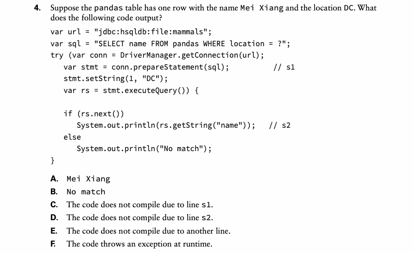
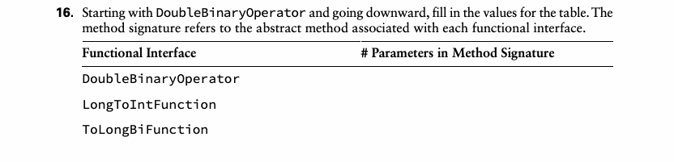
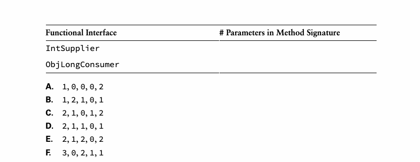
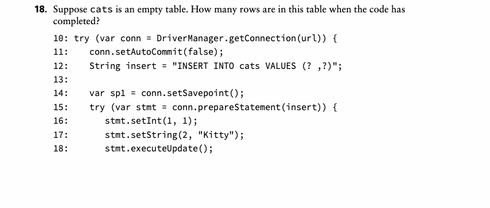
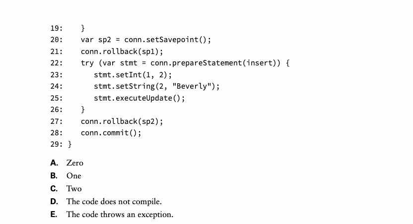
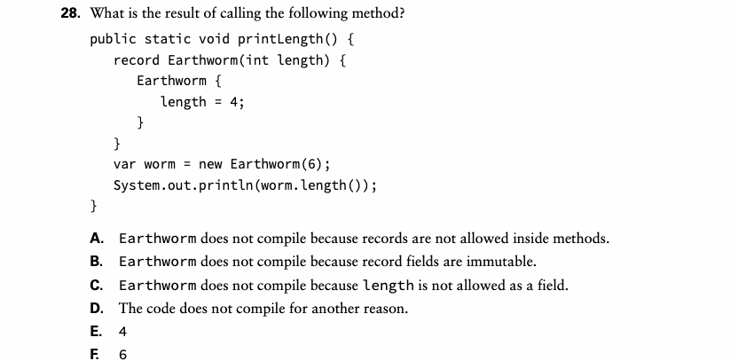

# Chapter 12: Practice Exam 1

> Source: *OCP Oracle Certified Professional Java SE 17 Developer Practice Tests (Exam 1Z0-829)*. Extracted from your PDF for personal study. Questions with figures/tables include a scan of the original page.

## 829-12-001

What is the result of the following?

```java
import java.util.stream.*;
public class StreamOfStreams {
   public static void main(String[] args) {
    var result =
       Stream.of(getNums(9, 8), getNums(22, 33))     // c1
          .flatMap(x -> x)                      // c2
          .map((a, b) -> a - b)                 // c3
          .filter(x -> !x.isEmpty())             // c4
          .get();
    System.out.println(result);
   }
   private static Stream<Integer> getNums(int num1, int num2) {
     return Stream.of(num1, num2);
   } }
```

- **A.** The code compiles and outputs `1`.
- **B.** The code compiles and outputs `8`.
- **C.** The first compiler error is on line `c1`.
- **D.** The first compiler error is on line `c2`.
- **E.** The first compiler error is on line `c3`.
- **F.** The first compiler error is on line `c4`.

**Answer:** E

**Explanation:** Line `c1` correctly creates a stream containing two streams. Line `c2` uses `flatMap()` to create a `Stream` of four `Integer` objects. The first problem is on line `c3`, which tries to use the numbers as if they are still pairs. Since we have a `Stream<Integer>` at that point, the code does not compile, and option E is the answer. Line `c4` does not compile either, as you can’t call a `List` method on an `Integer`.

## 829-12-002

Which statements about the following class are correct? (Choose two.)

```java
package knowledge;
class InformationException extends Exception {}
public class LackOfInformationException
     extends InformationException {
  public LackOfInformationException() {            // t1
     super("");
   }
   public LackOfInformationException(String s) {     // t2
     this(new Exception(s));
   }
   public LackOfInformationException(Exception c) {     // t3
     super();
   }
   public String getMessage() throws ArithmeticException {
     return "lackOf";
   } }
```

- **A.** `LackOfInformationException` compiles without issue.
- **B.** The constructor declared at line `t1` does not compile.
- **C.** The constructor declared at line `t2` does not compile.
- **D.** The constructor declared at line `t3` does not compile.
- **E.** The `getMessage()`method does not compile because it is an invalid override.
- **F.** `LackOfInformationException` is a checked exception.

**Answer:** B, F

**Explanation:** The `LackOfInformationException` class does not compile, making option A incorrect. The compiler inserts the default no-argument constructor into `InformationException`, since the class does not explicitly define any. Because `LackOfInformationException` extends `InformationException`, the only constructor available in the parent class is the no-argument call to `super()`. For this reason, the constructor defined at line `t1` does not compile because it calls a nonexistent parent constructor that takes a `String` value, and option B is one of the correct answers. The other two constructors at lines `t2` and `t3` compile without issue, making options C and D incorrect. Option E is also incorrect. The `getMessage()` method is inherited and the override is valid because new unchecked exceptions can be declared. Option F is the other correct answer. `LackOfInformationException` is a checked exception because it inherits `Exception`, but not `RuntimeException`.

## 829-12-003

Which of the following are valid code comments in Java? (Choose three.)

- **A.** `/** Insert */ in next method **/`
- **B.** `/****** Find the kitty cat */`
- **C.** `// Is this a bug?`
- **D.** `$ Begin method - performStart() $`
- **E.** `/*** TODO: Call grandma ***/`
- **F.** `# Updated code by Patti`

**Answer:** B, C, E

**Explanation:** Java supports three types of comments: single-line (`//`), multi-line (`/* */`), and Javadoc (`/** **/`), making options B, C, and E correct. Option A contains a `*/` in the middle of the expected comment, making the part after the comment `Insert */` invalid. Option D is incorrect because a dollar sign (`$`) is not a valid comment in Java. Finally, the hash (`#`) is not a comment character in Java, so option F is incorrect.

## 829-12-004

Suppose the `pandas` table has one row with the name `Mei Xiang` and the location `DC`. What does the following code output?

```java
var url = "jdbc:hsqldb:file:mammals";
var sql = "SELECT name FROM pandas WHERE location = ?";
try (var conn = DriverManager.getConnection(url);
   var stmt = conn.prepareStatement(sql);         // s1
   stmt.setString(1, "DC");
   var rs = stmt.executeQuery()) {
   if (rs.next())
     System.out.println(rs.getString("name"));     // s2
   else
     System.out.println("No match");
}
```



- **A.** `Mei Xiang`
- **B.** `No match`
- **C.** The code does not compile due to line `s1`.
- **D.** The code does not compile due to line `s2`.
- **E.** The code does not compile due to another line.
- **F.** The code throws an exception at runtime.

**Answer:** E

**Explanation:** All code in a try-with-resources declaration must implement `Closeable` or `AutoCloseable`. The call to `stmt.setString()` does not meet that criterion. Since it doesn’t compile, option E is the answer.

## 829-12-005

What does the following code print?

```java
 // Hare.java
 package com.animal;
public class Hare {
   void init() {
     System.out.print("init-");
   }
   protected void race() {
     System.out.print("hare-");
   } }
// Tortoise.java
package com.animal;
public class Tortoise {
   protected void race(Hare hare) {
     hare.init();     // x1
     hare.race();     // x2
     System.out.print("tortoise-");
    }
    public static void main(String[] args) {
      var tortoise = new Tortoise();
      var hare = new Hare();
      tortoise.race(hare);
   } }
```

- **A.** `init-hare-tortoise`
- **B.** `init-hare`
- **C.** The first line with a compiler error is line `x1`.
- **D.** The first line with a compiler error is line `x2`.
- **E.** The code does not compile due to a different line.
- **F.** The code throws an exception.

**Answer:** A

**Explanation:** The `init()` method is accessible from the same package. The `race()` method is available from the same package or subclasses. Since `Tortoise` is in the same package, both methods are available and option A is correct.

## 829-12-006

Which of the following lambda expressions can be passed to a method that takes `IntUnaryOperator` as an argument? (Choose three.)

- **A.** `v -> {System.out.print(“Hello!”); return 2%1;}`
- **B.** `(Integer w) -> w.intValue()`
- **C.** `(int j) -> (int) 30L`
- **D.** `(int q) -> q / 3.1`
- **E.** `(long x) -> (int) x`
- **F.** `z -> z`

**Answer:** A, C, F

**Explanation:** The `IntUnaryOperator` takes an `int` value and returns an `int` value. Options B and E are incorrect because the parameter types, `Integer` and `long`, respectively, are not `int`. Option B is incorrect because unboxing can be used for expressions, but it cannot be used for parameter matching. Option D is incorrect because dividing an `int` by a `double` value `3.1` results in `q/3.1` being a `double` value, which cannot be converted to `int` without an explicit cast. Option E is incorrect because the parameter type must match, and `long` is not the same as `int`. The rest of the lambda expressions are valid, since they correctly take an `int` value and return an `int` value. Therefore, options A, C, and F are the answer.

## 829-12-007

Which of the following is a valid method name in Java? (Choose two.)

- **A.** `_____`
- **B.** `%run`
- **C.** `check-Activity`
- **D.** `$Hum2`
- **E.** `sing\\3`
- **F.** `po#ut`

**Answer:** A, D

**Explanation:** Java methods must start with a letter, the dollar `$` symbol, or the underscore `_` character. For this reason, option B is incorrect, and options A and D are correct. Despite how option A looks, it is a valid method name in Java. Options C, E, and F do not compile because the symbols `-`, `\`, and `#` are not allowed in method names, respectively.

## 829-12-008

Which of the following is true of this module declaration?

```java
1: module com.mammal {
2:    exports com.mammal.cat;
3:    exports com.mammal.mouse to com.mice;
4:    uses com.animal;
5: }
```

- **A.** The first line that fails to compile is line 1.
- **B.** The first line that fails to compile is line 2.
- **C.** The first line that fails to compile is line 3.
- **D.** The first line that fails to compile is line 4.
- **E.** The code compiles.

**Answer:** E

**Explanation:** This is a correct `module-info` file. It exports the `com.mammal.cat` package to any modules that want to use it. By contrast, it exports the `com.mammal.mouse` package to only one other module. Finally, it demonstrates the `uses` directive. Since the code is correct, option E is the answer.

## 829-12-009

How many lines fail to compile?

```java
class Roller<E extends Wheel> {
   public void roll(E e) { }
}
class Wheel { }
class CartWheel extends Wheel { }
public class RollingContest {
   Roller<CartWheel> wheel1 = new Roller<CartWheel>();
   Roller<Wheel> wheel2 = new Roller<CartWheel>();
   Roller<? extends Wheel> wheel3 = new Roller<CartWheel>();
   Roller<? extends Wheel> wheel4 = new Roller<Wheel>();
   Roller<? super Wheel> wheel5 = new Roller<CartWheel>();
   Roller<? super Wheel> wheel6 = new Roller<Wheel>();
}
```

- **A.** One
- **B.** Two
- **C.** Three
- **D.** Four
- **E.** Five
- **F.** Six

**Answer:** B

**Explanation:** The `Roller` class uses a formal type parameter named `E` with a constraint. The key to this question is knowing that with generics, the `extends` keyword means any subclass or the class can be used as the type parameter. This means both `Wheel` and `CartWheel` are allowed. The `wheel1` declaration is fine because the same type is used on both sides of the declaration. The `wheel2` declaration does not compile because generics require the exact same type when not using wildcards. The `wheel3` and `wheel4` declarations are both fine because this time there is an upper bound to specify that the type can be a subclass. By contrast, the `super` keyword means it has to be that class or a superclass. The `wheel6` declaration is okay, but the `wheel5` one is a problem because it uses a subclass. Since `wheel2` and `wheel5` don’t compile, the answer is option B.

## 829-12-010

Given the following, what can we infer about subtypes of `First`, called `Chicken` and `Egg`? (Choose two.)

```java
public sealed interface First permits Chicken, Egg { }
```

- **A.** `Chicken` and `Egg` must be interfaces.
- **B.** `Chicken` and `Egg` can be classes or interfaces.
- **C.** `Chicken` and `Egg` must be located in a file other than `First`.
- **D.** `Chicken` and `Egg` must be located in the same file as `First`.
- **E.** `Chicken` and `Egg` must be located as nested classes of `First`.
- **F.** `Chicken` and `Egg` may be located in the same file or a different file as `First`.

**Answer:** B, F

**Explanation:** `Chicken` and `Egg` may either be sub-interfaces of `First` or implementers of it, making option B one of the answers. Since the `permits` clause is specified, `Chicken` and `Egg` may either be in the same file or a different file than `First`, making option F correct. They must not be nested since `First.Chicken` is not used in the `permits` clause.

## 829-12-011

What is the output of the following?

```java
var listing = new String[][] { { "Book", "34.99" },
   { "Game", "29.99" }, { "Pen", ".99" } };
System.out.println(listing.length + " " + listing[0].length);
```

- **A.** `2 2`
- **B.** `2 3`
- **C.** `3 2`
- **D.** `3 3`
- **E.** The code does not compile.
- **F.** The code compiles but throws an exception at runtime.

**Answer:** C

**Explanation:** This array has three elements, making `listing.length` output `3`. It so happens that each element references an array of the same size. But the code checks the first element and sees it is an array of size two, making the answer option C.

## 829-12-012

What does the following do?

```java
public class Player {
   interface Basket {
     boolean needToAim(double angle);
   }
   static void prepare(double angle, Basket t) {
     boolean ready = t.needToAim(angle);     // k1
     System.out.println(ready);
   }
   public static void main(String[] args) {
     prepare(45, d => d > 5 || d < -5);     // k2
   } }
```

- **A.** It prints `true`.
- **B.** It prints `false`.
- **C.** It doesn’t compile due to line `k1`.
- **D.** It doesn’t compile due to line `k2`.
- **E.** It doesn’t compile due to another line.

**Answer:** D

**Explanation:** The lambda syntax is incorrect. It should be `->`, not `=>`. Therefore, option D is correct.

## 829-12-013

What does `ServiceLocator.load(ChocolateLab.class)` return?

- **A.** `Collection`
- **B.** `List`
- **C.** `Stream`
- **D.** None of the above

**Answer:** D

**Explanation:** The `load()` method is on `ServiceLoader`, not `ServiceLocator`. Therefore, option D is the answer.

## 829-12-014

What is the output of the following when run as `java EchoFirst.java seed flower plant`?

```java
import java.util.*;
public class EchoFirst {
   public static void main(String[] args) {
     var result = Arrays.binarySearch(args, args[0]);
     System.out.println(result);
   } }
```

- **A.** `0`
- **B.** `1`
- **C.** `2`
- **D.** The code does not compile.
- **E.** The code compiles but throws an exception at runtime.
- **F.** The output is not guaranteed.

**Answer:** F

**Explanation:** The array is not sorted. It does not meet the pre-condition for a binary search. Therefore, the output is not guaranteed and the answer is option F.

## 829-12-015

Which is part of the module service and has a `requires` directive?

- **A.** Consumer
- **B.** Service locator
- **C.** Service provider
- **D.** Service provider interface
- **E.** None of the above

**Answer:** B

**Explanation:** Only the service locator and service provider interface are part of the service. The service locator has a `requires` directive, and the service provider interface has an `exports` directive, which matches option B.

## 829-12-016

Starting with `DoubleBinaryOperator` and going downward, fill in the values for the table.The method signature refers to the abstract method associated with each functional interface. Functional Interface # Parameters in Method Signature

```java
DoubleBinaryOperator
LongToIntFunction
ToLongBiFunction
```

Functional Interface # Parameters in Method Signature

```java
IntSupplier
ObjLongConsumer
```





- **A.** `1`, `0`, `0`, `0`, `2`
- **B.** `1`, `2`, `1`, `0`, `1`
- **C.** `2`, `1`, `0`, `1`, `2`
- **D.** `2`, `1`, `1`, `0`, `1`
- **E.** `2`, `1`, `2`, `0`, `2`
- **F.** `3`, `0`, `2`, `1`, `1`

**Answer:** E

**Explanation:** `DoubleBinaryOperator` takes two `double` values and returns a `double` value. `LongToIntFunction` takes one `long` value and returns an `int` value. `ToLongBiFunction` takes two generic arguments and returns a `long` value. `IntSupplier` does not take any values and returns an `int` value. `ObjLongConsumer` takes one generic and one `long` value and does not return a value. For these reasons, option E is the correct answer.

## 829-12-017

What is the result of the following?

```java
import java.time.*;
import java.time.format.*;
public class PiDay {
   public static void main(String[] args) {
     LocalDateTime pi = LocalDateTime.of(2022, 3, 14, 1, 59);
     DateTimeFormatter formatter = DateTimeFormatter
        .ofPattern("m.ddhh'MM'");
     System.out.print(formatter.format(pi));
   } }
```

- **A.** `3.140159`
- **B.** `3.1401MM`
- **C.** `59.140103`
- **D.** `59.1401MM`
- **E.** None of the above

**Answer:** D

**Explanation:** The code compiles and runs without issue. The `m` symbol represents minute, so `59` is the first value printed, followed by a period. The next symbols, `ddhh`, represent day and hour in two-digit formats, so `1401` is printed. Finally, `'MM'` represents an escaped string using single quotes, so it is printed just as `MM`. For these reasons, option D is correct.

## 829-12-018

Suppose `cats` is an empty table. How many rows are in this table when the code has completed?

```java
10: try (var conn = DriverManager.getConnection(url)) {
11:    conn.setAutoCommit(false);
12:    String insert = "INSERT INTO cats VALUES (? ,?)";
13:
14:    var sp1 = conn.setSavepoint();
15:    try (var stmt = conn.prepareStatement(insert)) {
16:      stmt.setInt(1, 1);
17:      stmt.setString(2, "Kitty");
18:      stmt.executeUpdate();
 19:    }
 20:    var sp2 = conn.setSavepoint();
 21:    conn.rollback(sp1);
 22:    try (var stmt = conn.prepareStatement(insert)) {
 23:      stmt.setInt(1, 2);
 24:      stmt.setString(2, "Beverly");
 25:      stmt.executeUpdate();
 26:    }
 27:    conn.rollback(sp2);
 28:    conn.commit();
 29: }
```





- **A.** Zero
- **B.** One
- **C.** Two
- **D.** The code does not compile.
- **E.** The code throws an exception.

**Answer:** E

**Explanation:** When the rollback to `sp1` happens on line 21, it invalidates all prior savepoints. This causes the rollback to `sp2` on line 27 to throw a `SQLException` and option E to be the answer.

## 829-12-019

Given the following class structure, what are valid ways to create a `Spinner` instance inside the `bake()` method? (Choose three.)

```java
public class Kitchen {
   class Mixer {
     class Spinner {}
   }
   public void bake() {
     // INSERT CODE HERE
   } }
```

- **A.** `var a = new Kitchen().new Mixer().new Spinner();`
- **B.** `Mixer.Spinner b = Mixer.new Spinner();`
- **C.** `var c = new Spinner();`
- **D.** `var d = new Mixer().new Spinner();`
- **E.** `Kitchen.Mixer.Spinner e = new Kitchen().new Mixer().new Spinner();`
- **F.** `Spinner f = new Kitchen().new Mixer().new Spinner();`

**Answer:** A, D, E

**Explanation:** `Mixer` and `Spinner` are member inner classes that require an instance of `Kitchen` and `Mixer`, respectively, to instantiate. Since `bake()` is defined as an instance method of `Kitchen`, the `Kitchen` instance can be implied. For this reason, option D is correct. Options A and E are also correct and rely on a new instance of `Kitchen` rather than the implied one. Options B and C are incorrect because there is no instance of `Mixer` used. Option F is incorrect because the reference type `Spinner` is undefined without the names of the enclosing classes.

## 829-12-020

Which sets of lines can be removed without stopping the code from compiling and while printing the same output? (Choose three.)

```java
 14: String race = "";
 15: outer:
 16: do {
 17: inner:
18:    do
19:    {
20:      race += "x";
21:    }
22:    while (race.length() <= 4);
23: } while (race.length() < 4);
24: System.out.println(race);
```

- **A.** Lines 15 and 17
- **B.** Lines 16 and 23
- **C.** Lines 17, 18, and 22
- **D.** Line 17
- **E.** Line 22
- **F.** Line 23

**Answer:** A, B, D

**Explanation:** The unmodified code prints `xxxxx`, so you’re looking for options that also print this value. Option A is correct because the labels are not referenced. Option B is correct because the outer `while` is broader than the inner `while`. If `race.length() <= 4` is `true`, then `race.length() < 4` must be `true`. The inner loop prints `xxxxx`, and the outer loop is not needed. Option C is incorrect because the outer loop only prints `xxxx` without the inner loop. Option D is also correct because a label is not used. Options E and F are incorrect because you cannot remove the `while` portion of a `do`/`while` loop.

## 829-12-021

How many of these module declarations are valid?

```java
module com.apple { exports com.apple; }
module com.4apple { requires com.apple;}
module com.apple4 { declares com.apple; }
module com.apple-four { }
module com.apple$ {}
```

- **A.** None
- **B.** One
- **C.** Two
- **D.** Three
- **E.** Four
- **F.** Five

**Answer:** C

**Explanation:** This question is tricky because it mixes testing valid identifier names with module concepts. The `com.apple` module is valid and demonstrates a simple module. Additionally, the `com.apple$` module is valid since `$` characters are permitted in identifier names. The `com.4apple` and `com.apple-four` modules are invalid because identifier or identifier segments may not start with a digit nor contain a dash. The `com.apple4` module is invalid because `declares` is not a valid module directive. Since only two are valid, option C is the answer.

## 829-12-022

Assuming `-g:vars` is used when the code is compiled to include debug information, what is the output of the following code snippet?

```java
51: Double tea = null;
52: Object coffee = (Integer)null;
53: String juice = "";
54: if(coffee instanceof Integer x) {
55:    System.out.println(x.intValue());
56: } else if (tea < juice.length()) {
57:    System.out.println(tea);
58: }
```

- **A.** A `NullPointerException` naming `tea` in the stack trace
- **B.** A `NullPointerException` naming `coffee` in the stack trace
- **C.** A `NullPointerException` naming `juice` in the stack trace
- **D.** A `NullPointerException` naming `tea` and `coffee` in the stack trace
- **E.** None of the above

**Answer:** A

**Explanation:** With a helpful `NullPointerException`, the program will print the variable that triggered the exception. In this case, the first exception is when `tea` is unboxed to a `double` on line 56, making option A correct. Lines 54–55 do not throw a `NullPointerException` because `instanceof` applied to a `null` value is always `false`, causing line 55 to be skipped.

## 829-12-023

What is the minimum number of `requires` directives that need to be removed to break the cyclic dependency?

```java
module com.animal {
   exports com.animal;
   requires com.plant;
}
module com.plant {
   exports com.plant;
   requires com.animal;
}
module com.worm {
   exports com.worm;
   requires com.animal;
   requires com.plant;
}
module com.hedgehog {
   exports com.hedgehog;
   requires com.animal;
   requires com.plant;
}
```

- **A.** None, as there is no cyclic dependency
- **B.** 1
- **C.** 2
- **D.** 3
- **E.** 4

**Answer:** B

**Explanation:** Modules have a cyclic dependency when they depend on each other. In this example, `com.animal` and `com.plant` depend on each other. The other two modules depend on `com.animal` and `com.plant` but do not participate in the cycle. If the `requires` directive in either `com.animal` or `com.plant` was removed, we would no longer have a cyclic dependency. Since only one directive needs to be removed, option B is correct.

## 829-12-024

Which of the following lambda expressions can be inserted into both blanks while still allowing the application to compile? (Choose three.)

```java
 package spooky;
 import java.util.function.*;
 abstract class Phantom {
    public void bustLater(DoubleConsumer buster, double value) {
     buster.accept(value);
   }
}
public class Ghost extends Phantom {
   public void bustNow(Consumer<Double> buster, double value) {
     buster.accept(value);
   }
   void call() {
     var value = 10.0;
     bustNow( ______________ , value);
     bustLater( ______________ , value);
   } }
```

- **A.** `System.out::print`
- **B.** `a -> {System.out.println(a.intValue());}`
- **C.** `g -> {System.out.println();}`
- **D.** `u -> System.out.println((long)u)`
- **E.** `v -> System.out.print(v)`
- **F.** `w -> System.out::println`

**Answer:** A, C, E

**Explanation:** To start with, `bustNow()` takes a `Double` value, while `bustLater()` takes a `double` value. To be compatible, the lambda expression has to be able to handle both data types. Option A is correct, since the method reference `System.out::print` matches overloaded methods that can take `double` or a `Double`. Option E is also correct, as it’s the equivalent rewrite of option A with a lambda expression. Option B is incorrect, since `intValue()` works for the `Consumer<Double>`, which takes `Double`, but not `DoubleConsumer`, which takes `double`. For a similar reason, option D is also incorrect because only the primitive `double` is compatible with this expression. Option C is correct and results in just a blank line being printed. Finally, option F is incorrect because of incompatible data types. The method reference code is inside of a lambda expression, which would be allowed only if the functional interface returned another functional interface reference.

## 829-12-025

Which statements best describe the result of executing this code? (Choose two.)

```java
package nyc;
public class TouristBus {
   public static void main(String... args) {
     var tour = new String[] {
        "Downtown", "Uptown", "Brooklyn" };
     var times = new String[] { "Day", "Night" };
     for (int i = 0, j = 0; i < tour.length; i++, j++)
        System.out.println(tour[i] + " " + times[j]);
   } }
```

- **A.** The `println()` causes one line of output.
- **B.** The `println()` causes two lines of output.
- **C.** The `println()` causes three lines of output.
- **D.** The code terminates successfully.
- **E.** The code throws an exception at runtime.

**Answer:** B, E

**Explanation:** The first two iterations through the loop complete successfully, making option B correct. However, the two arrays are not the same size, and the `for` loop only checks the size of the first one. The third iteration throws an `ArrayIndexOutOfBoundsException`, making option E correct.

## 829-12-026

What is the output of the following application?

```java
package rope;
import java.util.concurrent.*;
public class Jump {
   private static void await(CyclicBarrier b) {
       try { b.await(); } catch (Exception e) {}
    }
    public static void main(String[] chalk) {
       ExecutorService s = Executors.newFixedThreadPool(4);
       final var b = new CyclicBarrier(4,
         () -> System.out.print("Jump!"));
       for(int i=0; i<10; i++)
         s.execute(() -> await(b));
       s.shutdown();
    } }
```

- **A.** `Jump!` is printed once, and the program exits.
- **B.** `Jump!` is printed twice, and the program exits.
- **C.** The code does not compile.
- **D.** The output cannot be determined ahead of time.
- **E.** A deadlock is produced at runtime.
- **F.** None of the above.

**Answer:** E

**Explanation:** The code compiles without issue. The `main()` method creates a thread pool of four threads. It then submits 10 tasks to it. At any given time, the `ExecutorService` has up to four threads active, which is the same number of threads required to reach the `CyclicBarrier` limit. Therefore, the barrier limit is reached twice, printing `Jump!` twice. While eight of the tasks have been completed, two are left running. Since no more tasks will call the `await()` method, the `CyclicBarrier` limit is never reached, and a deadlock is encountered at runtime, with the program hanging indefinitely. For this reason, option E is correct.

## 829-12-027

Which statements about try-with-resources are true? (Choose two.)

- **A.** Any resource used must implement `Closeable`.
- **B.** If more than one resource is used, then the order in which they are closed is the reverse of the order in which they were created.
- **C.** If the `try` block and `close()` method both throw an exception, the one thrown by the `try` block is suppressed.
- **D.** Neither a `catch` nor a `finally` block is required.
- **E.** The `close()` method of the resources must throw a checked exception.

**Answer:** B, D

**Explanation:** The try-with-resources statement requires resources that implement `AutoCloseable`, making option A incorrect. Option B is correct and a valid statement about how resources are closed in try-with-resources statements. Option C is incorrect because the exception in the `try` block is reported to the caller, while the exception in the `close()` method is suppressed. Option D is the other correct answer because neither `catch` nor `finally` is required when try-with-resources is used. Finally, option E is incorrect. While the `AutoCloseable` interface does define a `close()` method that throws a checked exception, classes that implement this method are free to drop the checked exception, per the rules of overriding methods.

## 829-12-028

What is the result of calling the following method?

```java
public static void printLength() {
   record Earthworm(int length) {
     Earthworm {
        length = 4;
     }
   }
   var worm = new Earthworm(6);
   System.out.println(worm.length());
}
```




- **A.** `Earthworm` does not compile because records are not allowed inside methods.
- **B.** `Earthworm` does not compile because record fields are immutable.
- **C.** `Earthworm` does not compile because `length` is not allowed as a field.
- **D.** The code does not compile for another reason.
- **E.** `4`
- **F.** `6`

**Answer:** E

**Explanation:** The code does compile. Records and classes can be defined as local types within a method. Additionally, the compact constructor replaces the constructor parameter of `length`, making option E the answer.

## 829-12-029

What is the output of the following application?

```java
package homework;
import java.util.*;
import java.util.stream.*;
public class QuickSolution {
   public static int findFast(Stream<Integer> s) {
     return s.findAny().get();
   }
   public static int findSlow(Stream<Integer> s) {
     return s.parallel().findFirst().get();
   }
   public static void main(String[] pencil) {
     var s1 = List.of(1,2,3,4,5).stream();
     var s2 = List.of(1,2,3,4,5).stream();
     int val1 = findFast(s1);
     int val2 = findSlow(s2);
     System.out.print(val1 + " " + val2);
   } }
```

- **A.** `1 1`
- **B.** `3 1`
- **C.** The answer cannot be determined until runtime.
- **D.** The code does not compile.
- **E.** The code compiles but throws an exception at runtime.
- **F.** None of the above.

**Answer:** C

**Explanation:** The class compiles and runs without issue, so options D and E are incorrect. The result of `findSlow()` is deterministic and always `1`. The `findFirst()` method returns the first element in an ordered stream, whether it be serial or parallel. This makes it a costly operation for a parallel stream, since the stream has to be accessed in a serial manner. On the other hand, the result of `findFast()` is unknown until runtime. The `findAny()` method may return the first element or any element in the stream, even on serial streams. Since both `1 1` and `3 1` are possible outputs of this program, the answer cannot be determined until runtime, and option C is the correct answer.

## 829-12-030

Which statements are correct about the following text block? (Choose three.)

```java
var cute = """
   otter\
   pup \s
   play
   "toy"
   """;
```

- **A.** There are no whitespace characters between `otter` and `pup`.
- **B.** There are one or more whitespace characters between `otter` and `pup`.
- **C.** There is exactly one whitespace character between `pup` and `play`.
- **D.** There are exactly two whitespace characters between `pup` and `play`.
- **E.** There are exactly three whitespace characters between `pup` and `play`.
- **F.** Adding escape characters to the quotes around `toy` changes the value of the text block.
- **G.** Adding escape characters to the quotes around `toy` does not change the value of the text block.

**Answer:** A, E, G

**Explanation:** In a text block, a backslash (`\`) at the end of a line means to skip the line break. Since there is no whitespace or line break after `otter`, option A is correct. Following `pup` are three whitespace characters: the actual space character, the `\s`, and the new line, which matches option E. Remember that \\s means to preserve all whitespace at the end of the line in addition to adding a space. Finally, escaping quotes is allowed but not required, giving us option G.

## 829-12-031

What is the output of the following program?

```java
public class Ghost {
   private final String name;
   public Ghost() {
     this(null);
     this.name = "Casper";
   }
   public Ghost(String n) {
     name = "Boo";
   }
   public static void main(String[] sound) {
     var d = new Ghost("Space");
     System.out.println(d.name);
   } }
```

- **A.** `Casper`
- **B.** `Boo`
- **C.** `Space`
- **D.** The code does not compile.
- **E.** The answer cannot be determined with the information given.
- **F.** None of the above.

**Answer:** D

**Explanation:** The `name` instance variable is marked `final` and must be assigned a value exactly once when it is declared, by an instance initializer, or by a constructor. The no-argument constructor calls the `Ghost(String)` constructor, which assigns a value of `"Boo"` to `name`. The process returns and the constructor assigns a value of `"Casper"` to `name`. Since `name` is `final`, it cannot be assigned a value twice. The compiler detects this error, making option D the correct answer.

## 829-12-032

Which method can fill in the blank that would cause the program to consistently print `Tie!` 10 times?

```java
import java.util.concurrent.*;
import java.util.concurrent.locks.*;
public class TieShoes {
   private volatile Lock shoes = new ReentrantLock();
   public void tie() {
     try {
        if (shoes. ______________ ) {
           System.out.println("Tie!");
           shoes.unlock();
        }
     } catch (Exception e) {}
   }
   public static void main(String... unused) {
     var gate = new TieShoes();
     for (int i = 0; i < 10; i++) {
        var t = new Thread(() -> gate.tie());
        t.start();
        t.interrupt();
     } } }
```

- **A.** `lock()`
- **B.** `tryLock()`
- **C.** `tryLock(10)`
- **D.** The code does not compile regardless of what is placed in the blank.
- **E.** None of the above.

**Answer:** E

**Explanation:** Option A is incorrect because the `lock()` method does not return a `boolean` value. Option B allows the class to compile (making option D incorrect), but is not guaranteed to print `Tie!` 10 times. Depending on the thread ordering, it may print the value one to 10 times, as some threads may get a value of `false` on the call to `tryLock()`. Since the `tie()` method does not wait, the calls to `interrupt()` do not alter the program behavior. Option C is incorrect because `tryLock()` with a time value also requires a `TimeUnit` parameter. For these reasons, option E is the correct answer. Note that the `volatile` attribute has no impact in this program.

## 829-12-033

What is the output of the following program?

```java
var bed = List.of((short)2,(short)5);
var pillow = bed.parallelStream().reduce(0,
   (a,b) -> b.doubleValue() + a.doubleValue(),
   (c,d) -> d.doubleValue() + c.doubleValue());
System.out.println(pillow);
```

- **A.** `0`
- **B.** `0.0`
- **C.** `7`
- **D.** `7.0`
- **E.** The code does not compile.
- **F.** None of the above.

**Answer:** E

**Explanation:** Since it’s not a primitive stream, the underlying type is `Stream<Short>`, which means the data type of `b` is `Short`. On the other hand, the data type of `a`, `c`, and `d` is `Integer`. Because `Short` and `Integer` both define a `doubleValue()` method, these statements compile. The problem is with the return type of the two lambda expressions. The identity is set as `0`, not `0.0`, so the expected return type of each lambda expression is `Integer`, not `Double`. For this reason, neither lambda expression matches the parameters of the `reduce()` method, and option E is correct.

## 829-12-034

What is the output of the following application?

```java
package woods;
interface Plant {
   default String grow() { return "Grow!"; }
}
interface Living {
   public default String grow() { return "Super Growing!"; }
}
public class Tree implements Plant, Living {     // m1
   public String grow() { return super.Plant.grow(); }
   public static void main(String[] leaves) {
     Plant p = new Tree();                 // m2
     System.out.print(((Living)p).grow());     // m3
   } }
```

- **A.** `Grow!`
- **B.** `Super Growing!`
- **C.** It does not compile because of line `m1`.
- **D.** It does not compile because of line `m2`.
- **E.** It does not compile because of line `m3`.
- **F.** None of the above.

**Answer:** F

**Explanation:** A class can inherit two `default` interfaces with the same signature, so long as it correctly overrides them, which `Tree` does. It can also call an inherited version of the `default` method within an instance method, provided it uses the proper syntax. In this case, it does not. The correct syntax is `Plant.super.grow()`, not `super.Plant.grow()`. For this reason, this line does not compile. Since it is the only line that does not compile, option F is correct.

## 829-12-035

How many lines of the following interface do not compile?

```java
15: public interface Piano {
16:    String type = "Grand";
17:    void play();
18:    public static int getNumberOfKeys() {
19:      return type.equals("Grand") ? 88 : 61;
20:    }
21:    private static void printPianoInfo() {
22:      play();
23:      System.out.println("Key Count: "+getNumberOfKeys());
24:    }
25:    default void tune() {
26:      play();
27:      printPianoInfo();
28:    } }
```

- **A.** Zero
- **B.** One
- **C.** Two
- **D.** Three
- **E.** Four
- **F.** None of the above

**Answer:** B

**Explanation:** Line 22 does not compile because a `static` interface method cannot call an instancebased `abstract` method. Since this is the only line that does not compile, option B is correct.

## 829-12-036

Assume the file system is accessible, `/flower/rose.txt` exists, and the other two directories `/garden` and `/nursery` do not exist. What is the expected result after executing the following code snippet?

```java
Files.createDirectories(Path.of("/garden"));
Files.createDirectory(Path.of("/nursery"));
Files.move(Path.of("/flower/rose.txt"),
   Paths.get("/garden"), StandardCopyOption.REPLACE_EXISTING);
Files.move(new File("/garden/rose.txt").toPath(),
   Paths.get("/nursery"), StandardCopyOption.ATOMIC_MOVE);
```

- **A.** There is a file at `/nursery/rose.txt`.
- **B.** There is a file at `/flower/rose.txt`.
- **C.** The code does not compile.
- **D.** The first `move()` statement throws an exception.
- **E.** The second `move()` statement throws an exception.
- **F.** None of the above.

**Answer:** E

**Explanation:** The code compiles, so option C is incorrect. The first two lines successfully create directories. The first `move()` statement moves a file from `/flower/rose.txt` to `/garden`, not `/garden/rose.txt`. There is already an empty directory there, but since the `REPLACE_EXISTING` flag is provided, the `/garden` directory is replaced with a file. The next `move()` statement throws an exception because there is no source file at `/garden/rose.txt`. For this reason, option E is correct.

## 829-12-037

What is the output of the following?

```java
String chicken = "hen";
int numEggs = switch (chicken) {
   "hen" -> 3;
   default -> 0;
};
System.out.println(numEggs);
```

- **A.** `0`
- **B.** `3`
- **C.** `30`
- **D.** The code does not compile.

**Answer:** D

**Explanation:** The `switch` expression is close to correct. However, the `case` keyword is missing before `"hen"`, making option D the answer. If this were resolved, option B would be correct.

## 829-12-038

Given the following three class declarations, which sets of access modifiers can be inserted, in order, into the following blank lines that would allow all of the classes to compile? (Choose three.)

```java
// Alarm.java
package wake;
public class Alarm {
           static int clock;
           long getTime() {return clock;}
}
// Coffee.java
package wake;
public class Coffee {
   private boolean bringCoffee() {
     return new Alarm().clock<10;
   }
}
// Snooze.java
package sleep;
public class Snooze extends wake.Alarm {
   private boolean checkTime() { return getTime()>10;}
}
```

- **A.** package (blank) and package (blank)
- **B.** package (blank) and `protected`
- **C.** `protected` and package (blank)
- **D.** `protected` and `protected`
- **E.** `private` and `public`
- **F.** `public` and `public`

**Answer:** B, D, F

**Explanation:** The `clock` variable is accessed by a class in the same package; therefore, it requires package or less restrictive access (`protected` and `public`). The `getTime()` method is accessed by a subclass in a different package; therefore, it requires `protected` or less restrictive access (`public`). Options B, D, and F conform to these rules, making them the correct answer. Options A and C cause the `Snooze` class to fail to compile because the `getTime()` method is not accessible outside the package, even though `Snooze` is a subclass of `Alarm`. Option E causes the `Coffee` class to fail to compile because the `clock` variable is only visible within the `Alarm` class.

## 829-12-039

How many times does this code print `[2, 7, 8]`?

```java
1: import java.util.*;
2: import java.util.stream.*;
3:
4: public class RemoveMe<T> {
5:     private List<T> values;
6:     public RemoveMe(T... values) {
7:       this.values = Arrays.stream(values)
8:          .collect(Collectors.toList());
9:     }
10:    public void remove(T value) {
11:      values.remove(value);
12:    }
13:    public static void main(String[] args) {
14:      var integer = new RemoveMe<Integer>(2, 7, 1, 8);
15:      var longs = new RemoveMe<Long>(2L, 7L, 1L, 8L);
16:      integer.remove(1);
17:      longs.remove(1L);
18:
19:      System.out.println(integer.values);
20:      System.out.println(longs.values);
21:
22:      var values = new ArrayList<Integer>();
23:      values.add(2);
24:      values.add(7);
25:      values.add(1);
26:      values.add(8);
27:      values.remove(1);
28:      System.out.println(values);
29:    } }
```

- **A.** Zero
- **B.** One
- **C.** Two
- **D.** Three
- **E.** The code does not compile.
- **F.** The code compiles but throws an exception.

**Answer:** C

**Explanation:** Lines 14 and 15 create `RemoveMe<Integer>` and `RemoveMe<Long>` instances, respectively. Since we are using generics, the method calls on lines 16 and 17 autobox the primitive values (`1` and `1L`) to the `Integer` value `1` and `Long` value `1L`, respectively. Therefore, the method on line 11 removes the argument that matches this object value, and not the element at index `1`, from the two lists. These are the objects that result in `[2, 7, 8]`. Line 27 is trickier. Since we are passing a primitive `int`, the index is used (and not an object matching the value) in the call to `remove()`.This means line 28 prints `[2, 1, 8]`, which is not what we are looking for. Since only lines 19 and 20 give us the desired output, option C is the answer.

## 829-12-040

What is the result of executing the following code snippet?

```java
var name = "Desiree";
int _number = 694;
boolean profit$$$;
System.out.println(name + " won. "
   + _number + " profit? " + profit$$$);
```

- **A.** The declaration of `name` does not compile.
- **B.** The declaration of \_`number` does not compile.
- **C.** The declaration of `profit$$$` does not compile.
- **D.** The `println()` statement does not compile.
- **E.** The code compiles and runs successfully.
- **F.** The code compiles and throws an exception at runtime.

**Answer:** D

**Explanation:** Variables are allowed to start with an underscore and are allowed to contain a `$`. Therefore, all the variable declarations compile, making options A, B, and C incorrect. However, the `println()` method refers to the uninitialized local `boolean`. Since local variables are not automatically initialized, the code does not compile, and option D is correct.

## 829-12-041

Which are true of the following? (Choose two.)

```java
public class Hippo {
   private static void hippo(short num1, short num2) {
     System.out.println("shorts");
   }
   private static void hippo(int... nums) {
     System.out.println("varargs");
   }
   private static void hippo(Integer num1, Integer num2) {
     System.out.println("Integers");
   }
   private static void hippo(long num1, long num2) {
     System.out.println("longs");
   }
   public static void main(String... args) {
     hippo(1, 5);
   } }
```

- **A.** It outputs `Integers`.
- **B.** It outputs `longs`.
- **C.** It outputs `shorts`.
- **D.** It outputs `varargs`.
- **E.** If the method originally called by `hippo()` were commented out, the code would output `Integers`.
- **F.** If the method originally called by `hippo()` were commented out, the code would output `longs`.
- **G.** If the method originally called by `hippo()` were commented out, the code would output `shorts`.
- **H.** If the method originally called by `hippo()` were commented out, the code would output `varargs`.

**Answer:** B, E

**Explanation:** Java picks the most specific method signature it can find in an overloading situation. Since promotion is considered first, `longs` is output and option B is the answer. If that method were removed, Java would next go to autoboxing, printing `Integers` and making option E the other answer.

## 829-12-042

In most of the United States, daylight saving time ends on November 6, 2022 at 02:00 and we repeat that hour. What is the output of the following?

```java
var localDate = LocalDate.of(2022, 10, 6);
var localTime = LocalTime.of(1, 0);
var zone = ZoneId.of("America/New_York");
var z = ZonedDateTime.of(localDate, localTime, zone);
var offset = z.getOffset();
for (int i = 0; i < 6; i++)
   z = z.plusHours(1);
System.out.println(z.getHour() + " "
   + offset.equals(z.getOffset()));
```

- **A.** `5 false`
- **B.** `5 true`
- **C.** `6 false`
- **D.** `6 true`
- **E.** `7 false`
- **F.** `7 true`
- **G.** The code does not compile.
- **H.** The code compiles but throws an exception at runtime.

**Answer:** F

**Explanation:** The date/time APIs count months starting with one rather than zero. This means `localDate` is created as October 6, 2022. This is not the day that daylight saving time ends. The loop increments the hour six times, making the final time 07:00 with no change in time zone offset. Therefore, option F is the answer.

## 829-12-043

What is the result of executing the `Clownfish` program?

```java
 package ocean;
 class BubbleException extends Exception {}
 abstract class Fish {
   Fish getFish() {
     throw new RuntimeException("fish!");
   } }
public final class Clownfish extends Fish {
   public final Clownfish getFish() throws BubbleException {
     throw new RuntimeException("clown!");
   }
   public static void main(String[] bubbles) throws Exception {
     final var v = (Fish)new Clownfish();
     Clownfish f = v;
     f.getFish();
     System.out.println("swim!");
   } }
```

- **A.** The code compiles and prints `swim!`.
- **B.** The code compiles and prints `fish!`.
- **C.** The code compiles and prints a stack trace.
- **D.** One line of the program does not compile.
- **E.** Two lines of the program do not compile.
- **F.** None of the above.

**Answer:** E

**Explanation:** The `Clownfish` class contains an invalid override of the `getFish()` method. In particular, it cannot declare any new or broader checked exceptions. Next, there is an error in the `main()` method. Since `v` is a `var`, it is given a specific type based on the reference at compile time, in this case `Fish`. `Fish` is a supertype of `Clownfish`, so it cannot be assigned to a `Clownfish` reference without an explicit cast, resulting in a compiler error. Since the code contains two lines that do not compile, option E is correct.

## 829-12-044

What is the output of the following code?

```java
var sum = 0.0;
sum = sum + Math.round(11.2);
sum = sum + Math.ceil(8.1);
sum = sum + Math.abs(sum);
System.out.println(sum);
```

- **A.** `39`
- **B.** `39.0`
- **C.** `40`
- **D.** `40.0`
- **E.** `41`
- **F.** `41.0`
- **G.** None of the above

**Answer:** D

**Explanation:** Tracking the code, `round()` returns `11`. The `ceil()` method finds the next highest nonfractional number, which is `9.0`, and turns `sum` into `20.0`. Finally, the `abs()` method adds another `20.0` giving us `40.0`. Therefore, option D is correct.

## 829-12-045

Given the following classes, what is the output of the `Watch` program?

```java
1: class SmartWatch extends Watch {
2:     private String getType() { return "smart watch"; }
3:     public String getName() {
 4:       return getType() + ",";
 5:     }
 6: }
 7: public class Watch {
 8:     private String getType() { return "watch"; }
 9:     public String getName(String suffix) {
 10:      return getType() + suffix;
 11:    }
 12:    public static void main(String[] args) {
 13:      Watch watch = new Watch();
 14:      Watch smartWatch = new SmartWatch();
 15:      System.out.print(watch.getName(","));
 16:      System.out.print(smartWatch.getName(""));
 17:    } }
```

- **A.** `smart watch,smart watch`
- **B.** `smart watch,watch`
- **C.** `watch,smart watch`
- **D.** `watch,watch`
- **E.** The code does not compile.
- **F.** None of the above.

**Answer:** D

**Explanation:** Line 15 calls the method on line 9 since it is a `Watch` object, printing `watch`. Line 16 uses a `SmartWatch` object. However, the `getName()` method is not overridden in `SmartWatch`, since the method signature is different. Therefore, the method on line 9 gets called again. That method calls `getType()`. Since this is a `private` method, it is not overridden, and `watch` is printed again, making option D the correct answer.

## 829-12-046

Assuming the `heart.txt` and `romance.txt` files are accessible within the file system with the contents shown, what is the output of the code snippet?

```java
// heart.txt
happy
// romance.txt
Hapless
12: var x = Path.of("heart.txt");
13: var y = Paths.get("romance.txt");
14: var v = Files.mismatch(x, y);
15: System.out.println(v);
```

- **A.** `-1`
- **B.** `0`
- **C.** `2`
- **D.** `3`
- **E.** `4`
- **F.** The code does not compile.

**Answer:** B

**Explanation:** The code compiles, so option F is incorrect. The `Files.mismatch()` method returns the index of the first value that differs between the two files. Since this method is case sensitive, the first letters `h` and `H` differ, and `0` is printed, making option B correct.

## 829-12-047

What is the result of the following code?

```java
// Hopper.java
package com.animals;
public class Hopper {
   protected void hop() {
     System.out.println("hop");
   }
}
// Grasshopper.java
package com.insect;
import com.animals.Hopper;
public class Grasshopper extends Hopper {
   public void move() {
     hop(); // p1
   }
}
// HopCounter.java
package com.animals;
import com.insect.Grasshopper;
public class HopCounter {
   public static void main(String[] args) {
     var hopper = new Grasshopper();
     hopper.move(); // p2
     hopper.hop();     // p3
   } }
```

- **A.** The code prints `hop` once.
- **B.** The code prints `hop` twice.
- **C.** The first compiler error is on line `p1`.
- **D.** The first compiler error is on line `p2`.
- **E.** The first compiler error is on line `p3`.

**Answer:** B

**Explanation:** The `hop()` method has `protected` access, which allows subclasses to call it, making line `p1` compile. Additionally, code in the same package is allowed to access it, making lines `p2` and `p3` compile. The code compiles and runs without error, making option B the answer.

## 829-12-048

Given the following class, how many lines contain compilation errors?

```java
1: import java.io.*;
2: class StungException extends Exception {}
3: class Suit implements Closeable {
4:     public void close() throws IOException {}
5: }
 6: public class BeeCatcher {
 7:     public static void main(String[] b) throws IOException {
 8:       var s = new Suit();
 9:       var t = new Suit();
 10:      try (s; t) {
 11:         throw new StungException();
 12:      } catch (StungException | Exception e) {
 13:         s = null;
 14:      } finally {
 15:      } } }
```

- **A.** One
- **B.** Two
- **C.** Three
- **D.** Four
- **E.** None. The code compiles as is.

**Answer:** B

**Explanation:** The code does not compile, so option E is incorrect. A variable declared before the start of a try-with-resources statement may be used if it is `final` or effectively final. Since `s` is modified on line 13, it is neither; therefore, line 10 does not compile. Line 12 also does not compile. In a multi-catch expression, the two classes cannot be subtypes of each other. Other than lines 10 and 12, the rest of the code compiles, making option B correct.

## 829-12-049

Which of the following can fill in the blank to print out just the number `161`?

```java
import java.util.*;
import java.util.stream.*;
record Runner(int numberMinutes) { }
public class Marathon {
   public static void main(String[] args) {
     var match = Optional.ofNullable(161);     // line z
     var runners = Stream.of(new Runner(183),
        new Runner(161), new Runner(201));
     var opt = runners.map(Runner::numberMinutes)
                                ;
   } }
```

- **A.** 

  ```java
  .filter(m -> match.get().equals(m))
  .peek(System.out::println)
  .count()
  ```
- **B.** 

  ```java
  .filter(m -> match.get().equals(m))
  .peek(System.out::println)
  .max()
  ```
- **C.** 

  ```java
  .peek(System.out::println)
  .filter(m -> match.get().equals(m))
  .count()
  ```
- **D.** 

  ```java
  .peek(System.out::println)
  .filter(m -> match.get().equals(m))
  .max()
  ```
- **E.** The code does not compile due to line `z`.
- **F.** None of the above.

**Answer:** A

**Explanation:** Option E is incorrect since the `ofNullable()` method creates an `Optional` whether or not the parameter is `null`. Options B and D are incorrect and do not compile because `max()` takes a parameter to specify the logic for determining the order. Both options A and C compile. The order of the pipeline methods matters here. Option C prints all three numbers since the `filter()` operation happens after the `peek()`. Option A is correct as the methods are in the correct order.

## 829-12-050

How many lines of the following application contain compilation errors?

```java
1: package percussion;
2:
3: interface MakesNoise {}
4: abstract class Instrument implements MakesNoise {
5:     public Instrument(int beats) {}
6:     public void play() {}
7: }
8: public class Drum extends Instrument {
9:     public void play(int count) {}
10:    public void concert() {
11:      super.play(5);
12:    }
13:    public static void main(String[] beats) {
14:      MakesNoise mn = new Drum();
15:      mn.concert();
16:    } }
```

- **A.** The code compiles and runs without issue.
- **B.** One
- **C.** Two
- **D.** Three
- **E.** Four
- **F.** None of the above Chapter Practice Exam 2 13 Like Chapter 12, this chapter contains 50 questions and is designed to simulate a real 1Z0-829 exam. Ready with your scratch paper and 90 minutes? Good luck!

**Answer:** D

**Explanation:** The code definitely does not compile. The first problem with this code is that the `Drum` class is missing a constructor, causing the class declaration on line 8 to fail to compile. The default no-argument constructor cannot be inserted if the superclass, `Instrument`, defines only constructors that take arguments. The second problem with the code is that line 11 does not compile, since it calls `super.play(5)`, but the version of `play()` in the parent class does not take any arguments. Finally, line 15 does not compile. While `mn` may be a reference variable that points to a `Drum()` object, the `concert()` method cannot be called unless it is explicitly cast back to a `Drum` reference. For these three reasons, the code does not compile, and option D is the correct answer.
