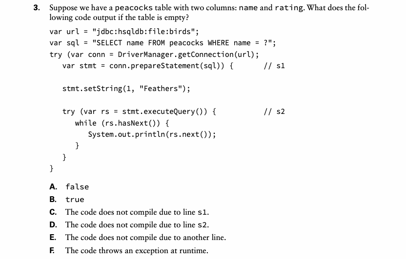
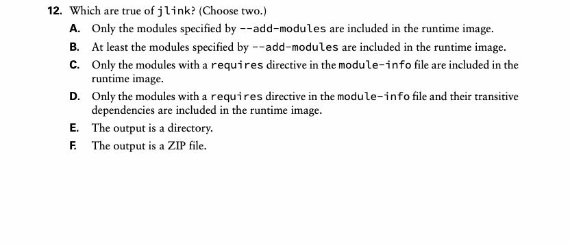
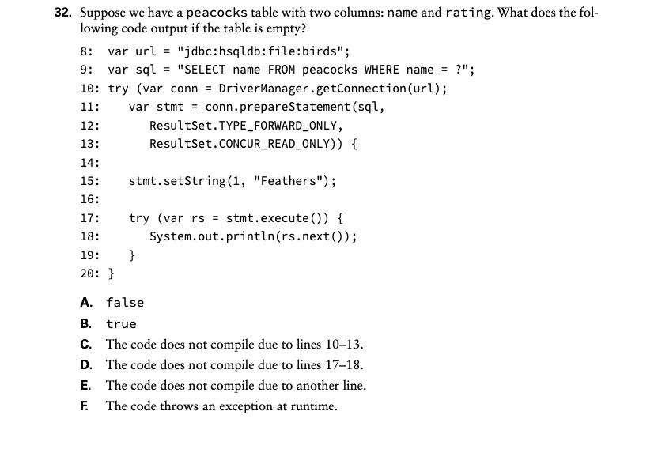

# Chapter 13: Practice Exam 2

> Source: *OCP Oracle Certified Professional Java SE 17 Developer Practice Tests (Exam 1Z0-829)*. Extracted from your PDF for personal study. Questions with figures/tables include a scan of the original page.

## 829-13-001

Which statements about the following application are true? (Choose two.)

```java
package party;
import java.util.concurrent.*;
public class Plan {
   ExecutorService s = Executors.newScheduledThreadPool(10);
   public void planEvents() {
     Runnable r1 = () -> System.out.print("Check food");
     Runnable r2 = () -> System.out.print("Check drinks");
     Runnable r3 = () -> System.out.print("Take out trash");
     s.scheduleWithFixedDelay(r1,1,TimeUnit.HOURS);     // g1
     s.scheduleAtFixedRate(r2,1,1000,TimeUnit.SECONDS);     // g2
     s.execute(r3);                                  // g3
     s.shutdownNow();
   } }
```

- **A.** Line `g1` does not compile.
- **B.** Line `g2` does not compile.
- **C.** Line `g3` does not compile.
- **D.** All of the lines of code compile.
- **E.** The code terminates properly at runtime.
- **F.** The code hangs indefinitely at runtime.
- **G.** The code throws an exception at runtime.

**Answer:** A, B

**Explanation:** Lines `g1` and `g2` do not compile because these methods are available only in the `ScheduledExecutorService` interface. Since `s` is of type `ExecutorService`, the lines referenced in options A and B do not compile. Even if the correct reference type for `s` was used, line `g1` would still fail to compile because `scheduleWithFixedDelay()` requires two `long` values, one for the initial delay and one for the period. Line `g3` compiles without issue because this method is available in the `ExecutorService` interface.

## 829-13-002

Assuming the current locale uses dollars (`$`) and the following method is called with a double value of `960_010`, which of the following values are printed? (Choose two.)

```java
public void print(double t) {
   System.out.print(NumberFormat.getCompactNumberInstance().format(t));
   System.out.print(
     NumberFormat.getCompactNumberInstance(
        Locale.getDefault(), Style.SHORT).format(t));
   System.out.print(NumberFormat.getCurrencyInstance().format(t));
}
```

- **A.** `960K`
- **B.** `9M`
- **C.** `9.6M`
- **D.** `$960,010.00`
- **E.** `$960,000.00`
- **F.** `900 thousand`
- **G.** `9 million`

**Answer:** A, D

**Explanation:** The code compiles and runs without issue. When a `CompactNumberFormat` instance is requested without a style, it uses the `SHORT` style by default. This results in both of the first two statements printing `960K`, making option A correct. Option D is also correct, as the full value is printed with a currency formatter without rounding.

## 829-13-003

Suppose we have a `peacocks` table with two columns: `name` and `rating`. What does the following code output if the table is empty?

```java
var url = "jdbc:hsqldb:file:birds";
var sql = "SELECT name FROM peacocks WHERE name = ?";
try (var conn = DriverManager.getConnection(url);
   var stmt = conn.prepareStatement(sql)) {      // s1
   stmt.setString(1, "Feathers");
   try (var rs = stmt.executeQuery()) {          // s2
     while (rs.hasNext()) {
        System.out.println(rs.next());
     }
   }
}
```



- **A.** `false`
- **B.** `true`
- **C.** The code does not compile due to line `s1`.
- **D.** The code does not compile due to line `s2`.
- **E.** The code does not compile due to another line.
- **F.** The code throws an exception at runtime.

**Answer:** E

**Explanation:** The `ResultSet` interface does not have a `hasNext()` method. Since the code does not compile due to a line without a comment, option E is the answer.

## 829-13-004

What is the output of the following?

```java
 1: import static java.util.stream.Collectors.*;
 2: import java.util.*;
 3: public record Goat(String food) {
 4:     public static void main(String[] args) {
 5:       var goats = List.of(
 6:          new Goat("can"),
 7:          new Goat("hay"),
 8:          new Goat("shorts"),
 9:          new Goat("hay"));
 10:
 11:      goats.stream()
 12:         .collect(groupingBy(Goat::food))
 13:         .entrySet()
 14:         .stream()
 15:         .filter(e -> e.getValue().size() == 2)
 16:         .map(e -> e.getKey())
 17:         .collect(partitioningBy(e -> e.isEmpty()))
18:         .get(false)
19:         .stream()
20:         .sorted()
21:         .forEach(System.out::print);
22:    } }
```

- **A.** `canshorts`
- **B.** `hay`
- **C.** `hayhay`
- **D.** `shortscan`
- **E.** The code does not compile.
- **F.** The code compiles but throws an exception at runtime.

**Answer:** B

**Explanation:** This code contains three stream pipelines for the price of one! Lines 11–13 are the first pipeline. They group the four `Goat` instances by the type of food they eat. This creates a `Map` logically similar to `{hay=[hay, hay], can=[can], shorts=[shorts]}`. Lines 14–17 are the second pipeline. This one starts by only including elements that have two matches, in our case `hay`. We then use the `String` key `hay`. Finally, this pipeline partitions the single key based on whether it has any characters, giving us `{false=[hay],` `true=[]}`. On line 18, we get just one of the lists leaving us with `[hay]`. The fifinal pipeline is lines 19–21. It sorts the single element in an attempt to confuse you and then prints it. Therefore, only one `hay` is printed, and option B is the answer.

## 829-13-005

What is the output of the following application?

```java
abstract class TShirt {
   abstract int insulate();
   public TShirt() {
     System.out.print("Starting...");
   }
}
public class Wardrobe {
   abstract class Sweater extends TShirt {
     int insulate() {return 5;}
   }
   private void dress() {
     final class Jacket extends Sweater {     // v1
        int insulate() {return 10;}
     };
     final TShirt outfit = new Jacket() {     // v2
        int insulate() {return 20;}
     };
     System.out.println("Insulation:"+outfit.insulate());
   }
   public static void main(String... snow) {
     new Wardrobe().dress();
   } }
```

- **A.** `Starting...Insulation:20`
- **B.** `Starting...Insulation:40`
- **C.** The code does not compile because of line `v1`.
- **D.** The code does not compile because of line `v2`.
- **E.** The code does not compile for a different reason.

**Answer:** D

**Explanation:** The code does not compile because the `Jacket` is marked `final` and cannot be extended by the anonymous class declared on line `v2`. Since this line doesn’t compile, option D is correct.

## 829-13-006

Which of the following use generics and compile without warnings? (Choose two.)

- **A.** `List<String> a = new ArrayList();`
- **B.** `List<> b = new ArrayList();`
- **C.** `List<String> c = new ArrayList<>();`
- **D.** `List<> d = new ArrayList<>();`
- **E.** `List<String> e = new ArrayList<String>();`
- **F.** `List<> f = new ArrayList<String>();`

**Answer:** C, E

**Explanation:** The diamond operator, `<>`, is only allowed to be used when instantiating rather than declaring. In other words, it can’t go on the left side of the assignment operator. Therefore, options B, D, and F are incorrect. The remaining three options compile. However, option A produces a warning because generics are not used on the right side of the assignment operator. Therefore, options C and E are correct. Option C is preferred over option E, since it uses the diamond operator rather than specifying a redundant type.

## 829-13-007

Which of the following statements about performing a concurrent reduction are correct? (Choose two.)

- **A.** If a collector is used, it must have the unordered characteristic.
- **B.** The stream must operate on thread-safe collections.
- **C.** If the `reduce()` method is used with a lambda expression, then it should be stateful.
- **D.** The stream must inherit `ParallelStream<T>`.
- **E.** The stream must be parallel.
- **F.** If a collector is used, it must have the concurrent characteristic.

**Answer:** E, F

**Explanation:** To perform a concurrent reduction, the stream or the collector must be unordered. Since it is possible to use an ordered collector with an unordered stream and achieve a parallel reduction, option A is incorrect. Option B is also incorrect. While having a thread-safe collection is preferred, it is not required. Stateful lambda expressions should be avoided, whether the stream is serial or parallel, making option C incorrect. Option D is incorrect as there is no class/interface within the JDK called `ParallelStream`. Options E and F are correct statements about performing parallel reductions.

## 829-13-008

What is the output of the following application?

```java
package tax;
public class Accountant {
   public void doTaxes() throws Throwable {
     try {
        throw new NumberFormatException();
     } catch (ClassCastException
           | ArithmeticException e) { // p1
        System.out.println("Math");
     } catch (IllegalArgumentException | Exception f) { // p2
        System.out.println("Unknown");
     } }
   public static void main(String[] numbers) throws Throwable {
     try {
        new Accountant().doTaxes();
     } finally {
        System.out.println("Done!");
     } } }
```

- **A.** `Math`
- **B.** `Unknown`
- **C.** `Unknown` followed by `Done!`
- **D.** The code does not compile due to line `p1`.
- **E.** The code does not compile due to line `p2`.
- **F.** None of the above.

**Answer:** E

**Explanation:** The second `catch` block on line `p2` does not compile. Since `IllegalArgumentException` is a subclass of `Exception`, they cannot be used in the same multi-catch block since it is redundant. For this reason, option E is correct. If the redundant exception class were removed from line `p2`, then the rest of the program would compile and print `Unknown` followed by `Done!` at runtime.

## 829-13-009

How many lines contain a compiler error?

```java
1: public record Bee(boolean gender, String species) {
2:     Bee {
3:       this.gender = gender;
4:       this.species = species;
5:     }
6:     Bee(boolean gender) {
7:       this(gender, "Honeybee");
8:     }
9:     @Override public String getSpecies() {
10:      return species;
11:    }
12:    @Override public String toString() {
13:      return species;
14:    } }
```

- **A.** Zero
- **B.** One
- **C.** Two
- **D.** Three
- **E.** Four
- **F.** Five

**Answer:** E

**Explanation:** Line 2 does not compile because a compact constructor must have the same `public` access as the record itself. Lines 3 and 4 do not compile because compact constructors cannot set field values with `this`. They can only modify constructor parameters. The constructor on line 6 compiles, as the access modifier does not need to match for non-compact constructors and chained constructors. Line 9 does not compile because `species()` is supplied by the record, which does not match `getSpecies()`. In this case, using the `@Override` annotation triggers a compiler error. Finally, the `toString()` override is correct. Since four lines do not compile, option E is the answer.

## 829-13-010

What is a possible output of the following?

```java
var trainDay = LocalDate.of(2022, 5, 14);
var time = LocalTime.of(10, 0);
var zone = ZoneId.of("America/Los_Angeles");
var zdt = ZonedDateTime.of(trainDay, time, zone);
var instant = zdt.toInstant();
instant = instant.plus(1, ChronoUnit.YEARS);
System.out.println(instant);
```

- **A.** `2022-05-14T10:00-07:00[America/Los_Angeles]`
- **B.** `2022-05-14T17:00:00Z`
- **C.** `2023-05-14T10:00-07:00[America/Los_Angeles]`
- **D.** `2023-05-14T17:00:00Z`
- **E.** The code does not compile.
- **F.** The code compiles but throws an exception at runtime.

**Answer:** F

**Explanation:** While an `Instant` represents a specific moment in time using GMT, Java only allows adding or removing units of `DAYS` or smaller. This code throws an `UnsupportedTemporalTypeException` because of the attempt to add `YEARS`. Therefore, option F is correct.

## 829-13-011

Which of the following are valid functional interfaces? (Choose two.)

- **A.** 

  ```java
  interface CanClimb {
     default void climb() {}
     static void climb(int x) {}
  }
  ```
- **B.** 

  ```java
  interface CanDance {
     int dance() { return 5; }
  }
  ```
- **C.** 

  ```java
  interface CanFly {
     abstract void fly();
  }
  ```
- **D.** 

  ```java
  interface CanRun {
     void run();
     static double runFaster() {return 2.0; }
  }
  ```
- **E.** 

  ```java
  interface CanSwim {
     abstract Long swim();
     boolean test();
  }
  ```

**Answer:** C, D

**Explanation:** To be a valid functional interface, an `interface` must declare exactly one `abstract` method. Option A is incorrect, because `CanClimb` does not contain any `abstract` methods. Next, all interface methods not marked `default` or `static` are assumed to be `abstract`, and `abstract` methods cannot have a body. For this reason, `CanDance` does not compile, making option B incorrect. Options C and D are correct answers because each contains exactly one `abstract` method. Option E is incorrect because it contains two `abstract` methods, since `test()` is implicitly `abstract`.

## 829-13-012

Which are true of `jlink`? (Choose two.)




- **A.** Only the modules specified by `--add-modules` are included in the runtime image.
- **B.** At least the modules specified by `--add-modules` are included in the runtime image.
- **C.** Only the modules with a `requires` directive in the `module-info` file are included in the runtime image.
- **D.** Only the modules with a `requires` directive in the `module-info` file and their transitive dependencies are included in the runtime image.
- **E.** The output is a directory.
- **F.** The output is a ZIP file.

**Answer:** B, E

**Explanation:** Options C and D are incorrect because the `jlink` command includes the module in `--add-modules` itself. Option A is incorrect because it also includes any dependencies and transitive dependencies. Therefore, option B is correct. Additionally, option E is correct, as `jlink` generates a directory with folders for the runtime image.

## 829-13-013

What is the output of the following?

```java
var builder = new StringBuilder("Leaves growing");
do {
   builder.delete(0, 5);
} while (builder.length() > 5);
System.out.println(builder);
```

- **A.** `Leaves growing`
- **B.** `ing`
- **C.** `wing`
- **D.** The code does not compile.
- **E.** The code compiles but throws an exception at runtime.

**Answer:** C

**Explanation:** On the first iteration through the loop, the first five characters are removed, and `builder` becomes `"s growing"`. Since there are more than five characters left, the loop iterates again. This time, five more characters are removed, and `builder` becomes `"wing"`. This matches option C.

## 829-13-014

What is the output of the following application?

```java
1: package fruit;
2: enum Season {
3:     SPRING(1), SUMMER(2), FALL(3), WINTER(4);
4:     public Season(int orderId) {}
5: }
6: public class PickApples {
7:     public static void main(String... orchard) {
8:       final Season s = Season.FALL;
9:       switch(s) {
10:         case Season.FALL:
11:            System.out.println("Time to pick!");
12:         default:
13:            System.out.println("Not yet!");
14:      } } }
```

- **A.** `Time to pick!`
- **B.** `Time to pick!` followed by `Not yet!`
- **C.** One line of code does not compile.
- **D.** Two lines of code do not compile.
- **E.** Three lines of code do not compile.
- **F.** The code compiles but prints an exception at runtime.

**Answer:** D

**Explanation:** Line 4 does not compile because enum constructors cannot be `public`. Line 10 also does not compile because a `case` statement must use an enum value without the type. In particular, `FALL` is permitted, but `Season.FALL` is not. For these two reasons, option D is correct.

## 829-13-015

Which are equivalent to this `switch` statement that takes an `int` value for `numEggs`? (Choose two.)

```java
boolean hasEggs;
switch (numEggs) {
   case 0 : hasEggs = true; break;
   default : hasEggs = false; break;
}
System.out.print(hasEggs);
```

- **A.** 

  ```java
  boolean hasEggs = switch (numEggs) {
     case 0 -> true
     default -> false
  };
  System.out.print(hasEggs);
  ```
- **B.** 

  ```java
  boolean hasEggs = switch (numEggs) {
     case 0 -> true;
     default -> false;
  };
  System.out.print(hasEggs);
  ```
- **C.** 

  ```java
  boolean hasEggs = switch (numEggs) {
     case 0 -> return true;
     default -> return false;
  };
  System.out.print(hasEggs);
  ```
- **D.** 

  ```java
  boolean hasEggs = switch (numEggs) {
     case 0 -> {yield true};
     default -> {yield false};
  };
  System.out.print(hasEggs);
  ```
- **E.** 

  ```java
  boolean hasEggs = switch (numEggs) {
     case 0 -> {yield true;}
     default -> {yield false;}
  };
  System.out.print(hasEggs);
  ```
- **F.** 

  ```java
  boolean hasEggs = switch (numEggs) {
     case 0 -> {return true;}
     default -> {return false;}
  };
  System.out.print(hasEggs);
  ```

**Answer:** B, E

**Explanation:** The `switch` statement is a complicated way of checking if `numEggs` is `0` and assigning the result to `hasEggs`. All the options attempt to convert it to a `switch` expression. Options C and F do not compile, as they use `return` statements. Option A does not compile because it is missing semicolons after each branch. Option D also does not compile since it has semicolons outside the `{}`’s, instead of inside them. This leaves us with the answers: options B and E.

## 829-13-016

Which of the following changes, when applied independently, will print the same result as the original implementation? (Choose two.)

```java
10: long sum = IntStream.of(4, 6, 8)
11:    .boxed()
12:    .parallel()
13:    .mapToInt(x -> x)
14:    .sum();
15: System.out.print(sum);
```

- **A.** Change the type on line 10 to `double`.
- **B.** Change the type on line 10 to `int`.
- **C.** Change line 11 to `unboxed()`.
- **D.** Remove line 11.
- **E.** Remove line 12.
- **F.** Remove line 13.

**Answer:** B, E

**Explanation:** The original implementation compiles and prints `18`. When using an `IntStream`, the `sum()` method returns an `int`. This makes option B correct, as both an `int` and a `long` will print `18`. By contrast, option A is incorrect because a `double` will print `18.0`. Option C is incorrect, as there is no `unboxed()` method available on a stream. Removing line 11 causes the code to not compile on line 13 since `mapToInt()` is not defined on `IntStream` (the stream is already made of `int` values), making option D incorrect. Removing line 13 causes the code to not compile on line 14, as `sum()` is only defined on primitive streams, not `Stream<Integer>`, making option F incorrect. Option E is the remaining correct answer. Running operations in parallel for such a tiny list is not helpful, but it does not change the result.

## 829-13-017

How many objects are eligible for garbage collection immediately before the end of the `main()` method?

```java
public class Tennis {
   public static void main(String[] game) {
     String[] balls = new String[1];
     int[] scores = new int[1];
     balls = null;
     scores = null;
   } }
```

- **A.** None
- **B.** One
- **C.** Two
- **D.** Three
- **E.** The code does not compile.
- **F.** None of the above.

**Answer:** C

**Explanation:** All arrays are objects regardless of whether they point to primitives or classes. That means both `balls` and `scores` are objects. Both are set to `null` so they are eligible for garbage collection. The `balls` array is initialized to contain all `null` references. There are no objects inside. The `scores` array is initialized to all `0` values. Therefore, only two objects exist to be eligible for garbage collection, and option C is correct.

## 829-13-018

What is true about the following?

```java
import java.util.*;
public class Yellow {
   public static void main(String[] args) {
     List list = Arrays.asList("Sunny");
     method(list);                             // c1
   }
    private static void method(Collection<?> x) {     // c2
       x.forEach(a -> {});                       // c3
   } }
```

- **A.** The code doesn’t compile due to line `c1`.
- **B.** The code doesn’t compile due to line `c2`.
- **C.** The code doesn’t compile due to line `c3`.
- **D.** The code compiles and runs without output.
- **E.** The code compiles but throws an exception at runtime.

**Answer:** D

**Explanation:** This code actually does compile. Line `c1` is fine because the method uses the `?` wildcard, which allows any collection. Line `c2` is a standard method declaration. Line `c3` looks odd, but it does work. The lambda takes one parameter and does nothing with it. Since there is no output, option D is correct.

## 829-13-019

What is true of the `equals()` method in this record?

```java
public record Coin(boolean heads) {
   public boolean equals(Object obj) {
     if (! (obj instanceof Coin coin)) {
        return false;
    }
    return heads == coin.heads;
   } }
```

- **A.** It returns `true` when passed in a `null`.
- **B.** It throws an exception when passed a `Boolean` instead of a `Coin`.
- **C.** It does not compile due to the `instanceof`.
- **D.** It does not compile because `equals()` is not allowed to be implemented in a `record`.
- **E.** None of the above.

**Answer:** E

**Explanation:** This code is correct, making option E the answer. While a record provides an implementation of `equals()`, you are free to write your own. Due to flow scoping, `coin` is available after the `if` statement. The `instanceof` handles `null` and incorrect classes.

## 829-13-020

Which message does the following application print?

```java
package ranch;
public class Cowboy {
   private int space = 5;
   private double ship = space < 2 ? 3L : 10.0f;     // g1
   public void printMessage() {
     if(ship>1) {
        System.out.print("Goodbye!");
     } if(ship<10 && space>=2)                 // g2
        System.out.print("Hello!");
     else System.out.print("See you again!");
   }
   public static final void main(String... stars) {
     new Cowboy().printMessage();
   } }
```

- **A.** `Hello!`
- **B.** `Goodbye!`
- **C.** `See you again!`
- **D.** It does not compile because of line `g1`.
- **E.** It does not compile because of line `g2`.
- **F.** None of the above.

**Answer:** F

**Explanation:** The code compiles without issue, making options D and E incorrect. Applying the ternary `? :` operator, the variable `ship` is assigned a value of `10.0`. Both values are implicitly cast to `double`. The expression in the first `if` statement evaluates to `true`, so `Goodbye` is printed. Notice that there is no `else` statement on line `g2`; therefore, the second `if` statement is also executed, causing `See you again` to also be printed. Since two statements are printed, option F is correct.

## 829-13-021

What is the result of compiling and running the following application?

```java
package names;
import java.util.*;
import java.util.function.*;
interface ApplyFilter {
   void filter(List<String> input);
}
public class FilterBobs {
   static Function<String,String> first = s ->
     {System.out.println(s); return s;};
   static Predicate second = t -> "bob".equalsIgnoreCase(t);
   public void process(ApplyFilter a, List<String> list) {
     a.filter(list);
   }
   public static void main(String[] contestants) {
     final List<String> people = new ArrayList<>();
     people.add("Bob");
     people.add("bob");
     people.add("Tina");
     people.add("Louise");
     final FilterBobs f = new FilterBobs();
     f.process(q -> {
        q.removeIf(second);
        q.forEach(first);
     }, people);
   } }
```

- **A.** It prints two lines.
- **B.** It prints three lines.
- **C.** One line of code does not compile.
- **D.** Two lines of code do not compile.
- **E.** Three lines of code do not compile.
- **F.** The code compiles but prints an exception at runtime.

**Answer:** D

**Explanation:** The code does not compile, so options A, B, and F are incorrect. The first compilation error is in the declaration of the lambda expression for `second`. It does not use a generic type, which means `t` is of type `Object`. Since `equalsIgnoreCase()` expects a `String` as a parameter, the lambda expression does not compile. The second compilation issue is in the lambda expression in the `main()` method. Notice that `process()` takes an `ApplyFilter` instance, and `ApplyFilter` is a functional interface that takes a `List<String>` object. For this reason, `q` in this lambda expression is treated as an instance of `List<String>`. The `forEach()` method defined in `Collections` requires a `Consumer` instance, not a `Function`, so the `q.forEach(first)` call does not compile. For these two reasons, option D is the correct answer, since the rest of the code compiles without issue.

## 829-13-022

How many of the following variable declarations compile?

```java
1: import java.util.*;
2: public class ListOfList {
3:     public void create() {
4:       List<?> n = new ArrayList<>();
5:
6:       List<? extends RuntimeException> o
7:          = new ArrayList<Exception>();
8:
9:       List<? super RuntimeException> p
10:         = new ArrayList<Exception>();
11:
12:      List<T> q = new ArrayList<?>();
13:
14:      List<T extends RuntimeException> r
15:         = new ArrayList<Exception>();
16:
17:      List<T super RuntimeException> s
18:         = new ArrayList<Exception>();
19:    } }
```

- **A.** None
- **B.** One
- **C.** Two
- **D.** Three
- **E.** Four
- **F.** Five

**Answer:** C

**Explanation:** Lines 12–18 do not compile because neither the class nor method defines a generic type `T`. The declaration on lines 6–7 does not compile because `? extends` `RuntimeException` cannot be assigned a broader type. This leaves us with two declarations that do compile, making option C the correct answer. Line 4 compiles, since any type of generic list can go in `List<?>`. The declaration on lines 9–10 also compiles because `?` `super RuntimeException` does allow a broader exception type.

## 829-13-023

What is the result of running the following program?

```java
1: package fun;
2: public class Sudoku {
3:    static int[][] game;
4:    public static void main(String args[]) {
5:      game[3][3] = 6;
6:      Object[] obj = game;
7:      obj[3] = 'X';
8:      System.out.println(game[3][3]);
9:    } }
```

- **A.** `6`
- **B.** `X`
- **C.** The code does not compile.
- **D.** The code compiles but throws a `NullPointerException` at runtime.
- **E.** The code compiles but throws a different exception at runtime.
- **F.** The output is not guaranteed.

**Answer:** D

**Explanation:** This question appears to ask you about involved array logic. Instead, it is checking to see if you remember that instance and class variables are initialized to `null`. Line 5 throws a `NullPointerException`, making option D correct.

## 829-13-024

Which commands can include the following output? (Choose two.)

```java
JDK Internal API ___ Suggested Replacement
sun.misc.Unsafe ___ See http://openjdk.java.net/jeps/260
```

- **A.** `jdeps sneaky.jar`
- **B.** `jdeps –j sneaky.jar`
- **C.** `jdeps –s sneaky.jar`
- **D.** `jdeps --internals sneaky.jar`
- **E.** `jdeps -jdkinternals sneaky.jar`
- **F.** `jdeps --jdk-internals sneaky.jar`

**Answer:** E, F

**Explanation:** Options B and D are incorrect because those flags do not exist on the `jdeps` command. Options A and C do exist, but do not include suggested replacements. Options E and F are correct, as they will include a table of suggestions if any internal APIs are used in the JAR.

## 829-13-025

Assuming the following class is concurrently accessed by numerous threads, which statement about the `CountSheep` class is correct?

```java
package fence;
import java.util.concurrent.atomic.*;
public class CountSheep {
   private static AtomicInteger counter = new AtomicInteger();
   private Object lock = new Object();
   public synchronized int increment1() {
     return counter.incrementAndGet();
   }
   public static synchronized int increment2() {
     return counter.getAndIncrement();
   }
   public int increment3() {
     synchronized(lock) {
        return counter.getAndIncrement();
     } } }
```

- **A.** The class is thread-safe only if `increment1()` is removed.
- **B.** The class is thread-safe only if `increment2()` is removed.
- **C.** The class is thread-safe only if `increment3()` is removed.
- **D.** The class is already thread-safe.
- **E.** The class does not compile.
- **F.** The class compiles but may throw an exception at runtime.

**Answer:** D

**Explanation:** The code compiles, making option E incorrect. The key here is that the `AtomicInteger` variable is thread-safe regardless of the synchronization methods used to access it. Therefore, synchronizing on an instance object, as in `increment1()`, or on the class object, as in `increment2()`, is unnecessary because the `AtomicInteger` class is already thread-safe. For this reason, option D is the correct answer.

## 829-13-026

How many lines of the main method fail to compile?

```java
10: public class Transport {
11:    static interface Vehicle {}
12:    static class Bus implements Vehicle {}
13:
14:    public static void main(String[] args) {
15:      Bus bus = new Bus();
16:
17:      System.out.println(null instanceof Bus);
18:      System.out.println(bus instanceof Vehicle);
19:      System.out.println(bus instanceof Bus);
20:      System.out.println(bus instanceof ArrayList);
21:      System.out.println(bus instanceof Collection);
22: } }
```

- **A.** None
- **B.** One
- **C.** Two
- **D.** Three
- **E.** Four
- **F.** Five

**Answer:** B

**Explanation:** You are allowed to use `null` with `instanceof`; it just prints `false`. The `bus` variable is both a `Vehicle` and a `Bus`, so lines 18 and 19 print `true`. Then it gets interesting. We know that `bus` is not an `ArrayList` or `Collection`. However, the compiler only knows that `bus` is not an `ArrayList` because `ArrayList` is a concrete class. Line 20 does not compile. The compiler can’t definitively state that `bus` is not a `Collection`. Some future program could create a subclass of `Bus` that does implement `Collection`, so this line compiles. Therefore, only line 20 fails to compile, and option B is correct.

## 829-13-027

What is the output of the following application?

```java
package fly;
public class Helicopter {
   public int adjustPropellers(int length, String[] type) {
     length++;
     type[0] = "LONG";
     return length;
   }
   public static void main(String[] climb) {
     final var h = new Helicopter();
     var length = 5;
     var type = new String[1];
     length = h.adjustPropellers(length, type);
     System.out.print(length + "," + type[0]);
   } }
```

- **A.** `5,LONG`
- **B.** `6,LONG`
- **C.** `5,null`
- **D.** `6,null`
- **E.** The code does not compile.
- **F.** The code compiles but throws an exception at runtime.

**Answer:** B

**Explanation:** The application compiles and runs without issue, so options E and F are incorrect. Java uses pass-by-value, so even though the change to `length` in the first line of the `adjustPropellers()` method does not change the value in the `main()` method, the value is later returned by the method and used to reassign the `length` value. The result is that `length` is assigned a value of `6`, due to it being returned by the method. For the second parameter, while the `String[]` reference cannot be modified to impact the reference in the calling method, the data in it can be. Therefore, the value of the first element is set to `LONG`, resulting in an output of `6,LONG`, making option B the correct answer.

## 829-13-028

What does the following output?

```java
var dice = new LinkedList<Integer>();
dice.offer(3);
dice.offer(2);
dice.offer(4);
System.out.print(dice.stream().filter(n -> n != 4));
```

- **A.** `2`
- **B.** `3`
- **C.** `[3 2]`
- **D.** The code does not compile.
- **E.** None of the above.

**Answer:** E

**Explanation:** The code correctly creates a `LinkedList` with three elements. The stream pipeline does compile. However, there is no terminal operation, which means the stream is never evaluated, and the output is something like `java.util.stream.ReferencePipeline$2@404b9385`. This is definitely not one of the listed choices, so option E is correct.

## 829-13-029

How many of these classes cause a compiler error?

```java
final class Chimp extends Primate { }
non-sealed class Bonabo extends Primate { }
final class Gorilla { }
public abstract sealed class Primate permits Chimp, Bonabo {
   abstract String getName();
}
```

- **A.** Zero
- **B.** One
- **C.** Two
- **D.** Three
- **E.** Four

**Answer:** C

**Explanation:** The `Chimp` and `Bonabo` classes do not compile because they do not implement the abstract `getName()` method. This gives us two compiler errors and the answer of option C.

## 829-13-030

Which statements are true about the `requires` directive? (Choose two.)

- **A.** Changing it to a `requires direct` directive is always allowed.
- **B.** Changing it to a `requires direct` directive is never allowed.
- **C.** Changing it to a `requires direct` directive is sometimes allowed.
- **D.** Including `requires java.base` is allowed, but redundant.
- **E.** Including `requires java.base` is never allowed.
- **F.** Including `requires java.base` is sometimes needed to change the meaning of a file.

**Answer:** B, D

**Explanation:** There is no `requires direct` directive, making option B correct. If the `requires transitive` directive were used in the answer options instead, option A would be the answer, since it represents a superset of the functionality. Additionally, option D is correct because `java.base` is implied whether you specify it or not.

## 829-13-031

Which of the following are true right before the `transformation()` method ends? (Choose two.)

```java
public static void transformation() {
   String state1 = new String("ice");
   String state2 = new String("water");
   String state3 = new String("mist");
   state1 = state2;
   state2 = state3;
   state3 = state1;
}
```

- **A.** No objects are eligible for garbage collection.
- **B.** One object is eligible for garbage collection.
- **C.** Two objects are eligible for garbage collection.
- **D.** No objects are guaranteed to be garbage collected.
- **E.** One object is guaranteed to be garbage collected.
- **F.** Two objects are guaranteed to be garbage collected.

**Answer:** B, D

**Explanation:** At the end of the method, `state1` and `state3` both point to `"water"`, while `state2` points to `"mist"`. Since there are no references to `"ice"`, it is eligible for garbage collection, making option B correct. However, garbage collection is not guaranteed to run, so option D is also correct.

## 829-13-032

Suppose we have a `peacocks` table with two columns: `name` and `rating`. What does the following code output if the table is empty?

```java
8: var url = "jdbc:hsqldb:file:birds";
9: var sql = "SELECT name FROM peacocks WHERE name = ?";
10: try (var conn = DriverManager.getConnection(url);
11:    var stmt = conn.prepareStatement(sql,
12:      ResultSet.TYPE_FORWARD_ONLY,
13:      ResultSet.CONCUR_READ_ONLY)) {
14:
15:    stmt.setString(1, "Feathers");
16:
17:    try (var rs = stmt.execute()) {
18:      System.out.println(rs.next());
19:    }
20: }
```




- **A.** `false`
- **B.** `true`
- **C.** The code does not compile due to lines 10–13.
- **D.** The code does not compile due to lines 17–18.
- **E.** The code does not compile due to another line.
- **F.** The code throws an exception at runtime.

**Answer:** D

**Explanation:** The `execute()` method returns a `boolean`, not a `ResultSet`. This causes a compiler error on line 18, which makes option D correct.

## 829-13-033

Which two numbers does the following code print? (Choose two.)

```java
10: int numWorms = 0;
11: ++numWorms;
12: System.out.println(numWorms++);
13: int mask = ~numWorms;
14: System.out.println(mask);
```

- **A.** `1`
- **B.** `2`
- **C.** `3`
- **D.** `-1`
- **E.** `-2`
- **F.** `-3`

**Answer:** A, F

**Explanation:** On line 11, `numWorms` is incremented to `1`. Line 12 increments the value again to `2`. However, post-increment happens at the end and `1` is printed, giving us option A. On line 13, we take the bitwise complement by negating the value and subtracting one. This results in `-3`, which is option F.

## 829-13-034

Bill wants to create a program that reads all of the lines of all of his books using NIO.2. Unfortunately, Bill may have made a few mistakes writing his program. How many lines of the following class contain compilation errors?

```java
1: package bookworm;
2: import java.io.*;
3: import java.nio.file.*;
4: public class ReadEverything {
5:     public void readFile(Path p) {
6:       try {
7:          Files.readAllLines(p)
8:          .parallel()
9:          .forEach(System.out::println);
10:      } catch (Exception e) {}
11:    }
12:    public void read(Path directory) throws Exception {
13:      Files.walk(directory)
14:         .filter(p -> File.isRegularFile(p))
15:         .forEach(x -> readFile(x));
16:    }
17:    public static void main(String[] b) throws IOException {
18:      Path p = Path.get("collection");
19:      new ReadEverything().read(p);
20:    } }
```

- **A.** None. Bill’s implementation is correct.
- **B.** One
- **C.** Two
- **D.** Three
- **E.** Four
- **F.** Five

**Answer:** E

**Explanation:** The code does contain compilation errors, so option A is incorrect. The first is on line 8. The `readAllLines()` method returns a `List<String>`, not a `Stream<String>`. While `parallelStream()` is allowed on a `Collection`, `parallel()` is not. Next, line 14 does not compile because of an invalid method call. The correct NIO.2 method call is `Files.isRegularFile()`, not `File.isRegularFile()`, since the legacy `File` class does not have such a method. Line 18 contains a similar error. `Path` is an interface, not a class, with the correct call being `Paths.get()`. Finally, line 19 does not compile because the `read()` method throws `Exception`, which is not caught or handled by the `main()` method. For these four reasons, option E is the correct answer.

## 829-13-035

Fill in the blank with the pair that compiles and runs without throwing any exceptions. (Choose three.)

```java
var x = new ArrayDeque<>();
x.offer(18);
x. _______ ();
x. _______ ();
```

- **A.** `peek`, `peek`
- **B.** `peekFirst`, `peekLast`
- **C.** `poll`, `poll`
- **D.** `pop`, `pop`
- **E.** `remove`, `remove`
- **F.** `removeFirst`, `removeLast`

**Answer:** A, B, C

**Explanation:** All of the options compile, but three throw an exception at runtime. Options A and B are correct because peeking returns the next value or `null` if there isn’t one without changing the state of the queue. Option C is correct because polling removes and returns the next value, returning `null` if there isn’t one. Options D, E and F are incorrect because both popping and removing throw a `NoSuchElementException` when the queue is empty. This means these return `18` for the first call and throw an exception for the second.

## 829-13-036

What is the output of the following?

```java
public class InitOrder {
   { System.out.print("1"); }
   static { System.out.print("2"); }
   public InitOrder() {
     System.out.print("3");
   }
   public static void callMe() {
     System.out.print("4");
   }
   public static void main(String[] args) {
     callMe();
     callMe();
     System.out.print("5");
   } }
```

- **A.** `1223445`
- **B.** `2445`
- **C.** `22445`
- **D.** `223445`
- **E.** `2233445`
- **F.** None of the above

**Answer:** B

**Explanation:** This class is never instantiated, so the instance initializer never outputs `1`, and the constructor never outputs `3`. This rules out options A, D, and E. A `static` initializer runs only once for the class, which rules out option C. Option B is correct because the `static` initializer runs once printing `2`, followed by the `static` method `callMe()` printing `4` twice, and ending with the `main()` method printing `5`.

## 829-13-037

Which of the following exceptions need to be handled or declared by the method in which they are thrown? (Choose two.)

- **A.** `FileNotFoundException`
- **B.** `ArithmeticException`
- **C.** `IOException`
- **D.** `BigProblem`
- **E.** `IllegalArgumentException`
- **F.** `RuntimeException`

**Answer:** A, C

**Explanation:** Checked exceptions that inherit `Exception` but not `RuntimeException` are required to be handled or declared. `FileNotFoundException` and `IOException` are checked exceptions, which must be handled or declared, making options A and C correct. `ArithmeticException` and `IllegalArgumentException` extend `RuntimeException`, making them unchecked exceptions. Option D is also incorrect, as it is not the name of a standard exception class in Java.

## 829-13-038

Given that `FileNotFoundException` is a subclass of `IOException` and `Long` is a subclass of `Number`, what is the output of the following application?

```java
package materials;
import java.io.*;
class CarbonStructure {
    protected long count;
    public abstract Number getCount() throws IOException; // q1
    public CarbonStructure(int count) { this.count = count; }
}
public class Diamond extends CarbonStructure {
   public Diamond() { super(15); }
   public Long getCount() throws FileNotFoundException { // q2
     return count;
   }
   public static void main(String[] cost) {
     try {
        final CarbonStructure ring = new Diamond(); // q3
        System.out.print(ring.getCount()); // q4
     } catch (IOException e) {
        e.printStackTrace();
     } } }
```

- **A.** `null`
- **B.** `15`
- **C.** It does not compile because of line `q1`.
- **D.** It does not compile because of line `q2`.
- **E.** It does not compile because of line `q3`.
- **F.** It does not compile because of line `q4`.
- **G.** The class compiles but produces an exception at runtime.

**Answer:** C

**Explanation:** This problem appears to be about overriding a method, but in fact, it is much simpler. The class `CarbonStructure` is not declared `abstract`. Since it contains an abstract method, line `q1` does not compile and option C is correct. If the class were declared `abstract`, then it would compile and print `15` at runtime.

## 829-13-039

Which of the following are valid `Locale` formats? (Choose two.)

- **A.** `iw`
- **B.** `UA`
- **C.** `it_ch`
- **D.** `JA_JP`
- **E.** `th_TH`
- **F.** `ES_hn`

**Answer:** A, E

**Explanation:** In Java, a locale can be represented by a language code in lowercase, or a language and country code, with language in lowercase and country in uppercase. For these reasons, options A and E are correct. Options C, D, and F are incorrect because the lowercase language must be before the uppercase country. Option B is incorrect because the language is missing.

## 829-13-040

Which are true statements about the majority of steps in migrating to a modular application? (Choose two.)

- **A.** In a bottom-up migration, automatic modules turn into named modules.
- **B.** In a bottom-up migration, named modules turn into automatic modules.
- **C.** In a bottom-up migration, unnamed modules turn into named modules.
- **D.** In a top-down migration, automatic modules turn into named modules.
- **E.** In a top-down migration, named modules turn into automatic modules.
- **F.** In a top-down migration, unnamed modules turn into named modules.

**Answer:** C, D

**Explanation:** A fully modular application has all named modules, making options B and E incorrect. A bottom-up migration starts out with unnamed modules, making option C correct. By contrast, a top-down migration starts by making all modules automatic modules, making option D correct.

## 829-13-041

What is the result of the following?

```java
import java.util.*;
public class Museums {
   public static void main(String[] args) {
     String[] array = {"Natural History", "Science", "Art"};
     List<String> museums = Arrays.asList(array);
     museums.remove(2);
     System.out.println(museums);
   } }
```

- **A.** `[Natural History, Science]`
- **B.** `[Natural History, Science, Art]`
- **C.** The code does not compile.
- **D.** The code compiles but throws an exception at runtime.

**Answer:** D

**Explanation:** When converting an array to a `List`, Java uses a fixed-length backed list. This means that the list uses an array in the implementation. While changing elements to new values is allowed, adding and removing elements is not, making option D the answer.

## 829-13-042

Which of the following statements about nested classes are correct? (Choose three.)

- **A.** An anonymous class can declare that it implements multiple interfaces.
- **B.** All nested classes can contain constant variables.
- **C.** A local class can declare that it implements multiple interfaces.
- **D.** A member inner class cannot contain `static` methods.
- **E.** A `static` nested class can contain `static` methods.
- **F.** A local class can access all local variables prior to its declaration within a method.

**Answer:** B, C, E

**Explanation:** Options B, C, and E are valid statements about nested classes. An anonymous class can declare only one supertype, either a class or an interface, making option A incorrect. A member inner class can contain `static` methods, making option D incorrect. A local class can access only `final` and effectively final local variables, making option F incorrect.

## 829-13-043

What is the output of the following?

```java
var list = Arrays.asList("flower", "seed", "plant");
Collections.sort(list);
Collections.reverse(list);
var result = Collections.binarySearch(list,
   list.get(0), Comparator.reverseOrder());
System.out.println(result);
```

- **A.** `0`
- **B.** `1`
- **C.** `2`
- **D.** The code does not compile.
- **E.** The code compiles but throws an exception at runtime.
- **F.** The output is not guaranteed.

**Answer:** A

**Explanation:** First, the list is sorted ascendingly. Then it is reversed so it is in descending order. Since our binary search also uses descending order, we meet the pre-condition for binary search. At this point, the list contains `[seed, plant, flower]`. The key is to notice that the first element is now `seed` rather than `flower`. Calling a binary search to find the position of `seed` returns `0`, which is the index matching that value. Therefore, the answer is option A.

## 829-13-044

Which two options when inserted independently can fill in the blank to compile the code? (Choose two.)

```java
javac _________ mods -d birds com-bird/*.java *.java
```

- **A.** `-cp`
- **B.** `-m`
- **C.** `-p`
- **D.** `-classpath`
- **E.** `--classpath`
- **F.** `--module-path`

**Answer:** C, F

**Explanation:** The `javac` command takes a `--module-path` parameter. You need to memorize that the short form of this option is `-p`. This makes options C and F the answer.

## 829-13-045

What is the result of calling this method?

```java
16: void play() {
17:    record Toy(String name){ }
18:
19:    var toys = Stream.of(
20:      new Toy("Jack in the Box"),
21:      new Toy("Slinky"),
22:      new Toy("Yo-Yo"),
23:      new Toy("Rubik's Cube"));
 24:
 25:    var spliterator = toys.spliterator();
 26:    var batch1 = spliterator.trySplit();
 27:    var batch2 = spliterator.trySplit();
 28:    var batch3 = spliterator.trySplit();
 29:
 30:    batch1.forEachRemaining(System.out::print);
 31: }
```

- **A.** `Toy[name=Jack in the Box]`
- **B.** `Toy[name=Slinky]`
- **C.** `Toy[name=Yo-Yo]`
- **D.** `Toy[name= Rubik's Cube]`
- **E.** `Toy[name=Jack in the Box]Toy[name=Slinky]`
- **F.** `Toy[name=Yo-Yo]Toy[name=Rubik's Cube]`
- **G.** No output is printed.
- **H.** An exception is thrown.

**Answer:** E

**Explanation:** Line 25 creates a `Spliterator` containing four toys. Line 26 splits them into two equal groups by removing the first half of the elements and making them available to `batch1`. These get printed on line 30, making option E the answer. Note that the splits on lines 27 and 28 are meaningless since `batch1` has already been split off.

## 829-13-046

How many lines of the following application need to be changed to make the code compile?

```java
1: package castles;
2: import java.io.*;
3: public class Palace {
4:     public void openDrawbridge() throws Exception {
5:       try {
6:          throw new Exception("Problem");
7:       } catch (IOException e) {
8:          throw new IOException();
9:       } catch (FileNotFoundException e) {
10:         try {
11:            throw new IOException();
12:         } catch (Exception e) {
13:         } finally {
14:            System.out.println("Almost done");
15:         }
16:      } finally {
17:         throw new RuntimeException("Unending problem");
18:      } }
19:    public static void main(String[] moat)
20:         throws IllegalArgumentException {
21:      new Palace().openDrawbridge();
22:    } }
```

- **A.** None. The code compiles and produces a stack trace at runtime.
- **B.** One
- **C.** Two
- **D.** Three
- **E.** Four
- **F.** Five

**Answer:** D

**Explanation:** Line 9 is not reachable and does not compile, since `FileNotFoundException` is a subclass of `IOException`, which has already been caught. Next, the local variable `e` is declared twice within the same scope, with the declaration on line 12 failing to compile. Finally, the `openDrawbridge()` method declares the checked `Exception` class, but it is not handled or declared in the `main()` method on line 21. Since lines 9, 12, and 21 need to be changed for the code to compile, option D is correct.

## 829-13-047

How many lines need to be changed to make this code compile?

```java
1: public class Massage {
2:    var name = "Sherrin";
3:    public void massage(var num) {
4:      var zip = 10017;
5:      var underscores = 1_001_7;
6:      var _ = "";
7:    } }
```

- **A.** Zero
- **B.** One
- **C.** Two
- **D.** Three
- **E.** Four

**Answer:** D

**Explanation:** Lines 2 and 3 do not compile because `var` can only be used for local variables. Line 6 does not compile because a single underscore is not permitted as a variable name. These three compiler errors cause option D to be the answer. Lines 4 and 5 use `var` correctly.

## 829-13-048

How many of these variables are `true`?

```java
var lol = "lol";
var moreLols = """
   lol
""";
var smiley = lol.toUpperCase() == lol;
var smirk = lol.toUpperCase() == lol.toUpperCase();
var blush = lol.toUpperCase().equals(lol);
var cool = lol.toUpperCase().equals(lol.toUpperCase());
var wink = lol.toUpperCase().equalsIgnoreCase(lol);
var yawn = lol.toUpperCase().equalsIgnoreCase(
   lol.toUpperCase());
var sigh = lol.equals(moreLols);
```

- **A.** One
- **B.** Two
- **C.** Three
- **D.** Four
- **E.** Five
- **F.** Six
- **G.** None. The code does not compile.

**Answer:** C

**Explanation:** The variables `smiley` and `smirk` are both `false` since a `String` should be compared with a method rather than `==`, especially when not comparing two values from the string pool. The variable `blush` is also `false` because one value is uppercase and the other is lowercase. The variable `cool` is `true` because both values are uppercase. The variables `wink` and `yawn` print are `true` because they don’t look at the case. Finally, `sigh` is `false` because the text block has a trailing new line. This makes option C the answer.

## 829-13-049

Which of the following are valid lambda expressions? (Choose three.)

- **A.** `() -> {}`
- **B.** `(Double adder) -> {int y; System.out.print(adder);`

  ```java
  return adder;}
  ```
- **C.** `(Long w) -> {Long w=5; return 5;}`
- **D.** `(int count, vote) -> count*vote`
- **E.** `dog -> dog`
- **F.** `name -> {name.toUpperCase()}`

**Answer:** A, B, E

**Explanation:** First, option A is a valid functional interface that matches the `Runnable` functional interface. Option B is also a valid lambda expression that matches `Function<Double,Double>`, among other functional interfaces. Option C is incorrect because the local variable `w` cannot be declared again in the lambda expression body, since it is already declared as a lambda parameter. Option D is also incorrect. If the data type is specified for one variable in a lambda expression, it must be specified for all variables within the expression. Next, option E is correct because this lambda expression matches the `UnaryOperator` functional interface. Finally, option F is incorrect. The statement `name.toUpperCase()` is missing a semicolon (`;`), which is required to terminate the statement.

## 829-13-050

What can fill in the blank so the `play()` method can be called from all classes in the `com.mammal.eland` package, but not the `com.mammal.gopher` package?

```java
package com.mammal;
public class Enrichment {
             void play() {}
}
```

- **A.** Leave it blank
- **B.** `private`
- **C.** `protected`
- **D.** `public`
- **E.** None of the above Chapter Practice Exam 3 14 Chapter 14 is the third and fifinal practice exam chapter in the book. Make sure you have 90 minutes and scratch paper before you start. Good luck on both this chapter and the real exam!

**Answer:** E

**Explanation:** Leaving it blank gives package access. This would be the correct answer if the code we wanted to receive access were in the same package as `com.mammal`. Since it is not, we would need modules in order to restrict the access and option E is correct.
